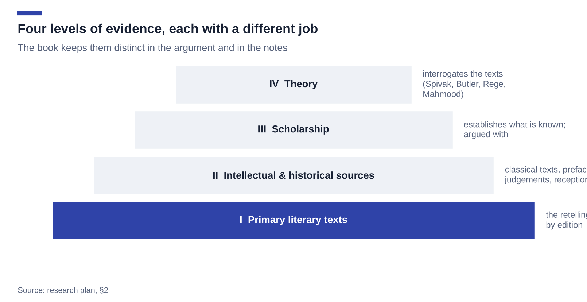

## The corpus

A book about how "novelists across languages and generations" have reconstructed Sita must first decide what it will read, and the decision is already an argument. A corpus that begins in 1990 will find a story of feminist awakening; a corpus that begins with Vālmīki will find that the awakening was preceded by several earlier awakenings and a good deal of sleep. A corpus confined to English will find a cosmopolitan conversation among diaspora novelists and Delhi publishers; a corpus that includes Telugu, Malayalam, Bengali, Odia, Marathi and Assamese will find that the most daring work was often done far from that conversation, and earlier. A corpus confined to novels will miss the poems, plays, songs, films and paintings in which much of the argument about Sita has actually taken place.

The research for this book was therefore built on a deliberately wide corpus, assembled over several years and recorded in a workbook that now holds 243 works.^[The workbook is titled *Sitayans: Feminist Retellings of the Ramayana. Research Corpus* (last updated 10 November 2026). Its Master Corpus tab holds one row per work, identified W001 to W243; views by period, theme, character, form and language are drawn from it.] Of these, 131 are primary works (retellings in any form), 19 are source texts that the retellings answer (Vālmīki, the *Dasaratha Jātaka*, the Jain *Paumacariya*, Kālidāsa, Bhavabhūti, Kamban, the *Adhyātma* and *Adbhuta Rāmāyaṇas*, Tulsīdās and others), 80 are works of scholarship and 13 are works of theory. The primary works span twenty-two languages, from Sanskrit, Pali and Prakrit through Tamil, Telugu, Kannada, Malayalam, Bengali, Odia, Assamese, Marathi, Gujarati, Hindi, Awadhi, Braj Bhasha, Urdu and Persian to Malay, Thai and English, and include visual and silent-film works. Within the corpus, a subset of sixty-eight book-length retellings has been sorted into five kinds: feminist retellings, which openly question how the epic treats women or are widely read as doing so (twenty-two books); woman-centred retellings, which tell the story from a woman's side with sympathy but keep its plot and values (twenty-seven); devotional and conservative tellings, which keep Sita as an ideal or answer feminist readings (eight); novels in which Sita is a modern metaphor rather than a character (six); and collections, essays and critiques (five).^[Corpus workbook, Retelling Books tab and Dashboard. The classification is explicitly provisional: "A woman narrator alone does not make a book feminist. Move a book if your reading disagrees."]

The distribution of the corpus across time is itself evidence. Ninety-nine works date from 2010 onward and sixty-four from the liberalisation era (1991–2009); only nineteen date from the colonial period and thirty-seven from the first four decades after independence. Part of this skew reflects the explosion of publishing in English since the 1990s, and part of it reflects the scholarly turn to Sita that followed the televised *Ramayan* of 1987–88 and the events of December 1992. But part of it reflects the selective memory of the field. The colonial-period texts in the corpus include Michael Madhusudan Dutt's *Meghnadbadh Kavya* (1861), Kumaran Asan's *Chintavishtayaya Sita* (1919), Gudipati Venkata Chalam's *Sita Agnipravesam* (1924) and Pudumaippittan's "Saapa Vimochanam" (1943), each of which is more radical in its handling of Sita than most of what was published in English in the 2010s. The thinness of the early periods is a finding about what has been remembered, not about what was written.

The distribution by language tells a parallel story. English accounts for the largest single share of primary works, followed by Hindi, Telugu, Bengali and Malayalam. Telugu's prominence is not an accident of my sampling; it reflects a genuine regional tradition of rationalist and feminist rewriting that runs from Chalam through Kodavatiganti Kutumba Rao and Ranganayakamma to Volga, and behind them, the women's songs studied by Velcheru Narayana Rao.^[Velcheru Narayana Rao, "A Rāmāyaṇa of Their Own: Women's Oral Tradition in Telugu," in *Many Rāmāyaṇas: The Diversity of a Narrative Tradition in South Asia*, ed. Paula Richman (Berkeley: University of California Press, 1991), 114–36 [W072].] Malayalam's prominence reflects a comparable lineage from Kumaran Asan through C. N. Sreekantan Nair and Lalithambika Antharjanam to Sarah Joseph. The thinness of Gujarati, Punjabi, Kashmiri and Sindhi women's retellings, by contrast, is a gap the workbook records honestly and that this book does not pretend to fill.^[Corpus workbook, Sources and Method tab, "Gaps to search next".]

The distribution by character makes the point that will occupy Chapter 10. Sita is named as a central character in well over a hundred primary and source texts; Surpanakha, Ahalya and Urmila follow at a great distance; Kaikeyi and Mandodari at a greater distance still; and Shabari, the forest woman whose tasted berries Rama accepts, appears in barely half a dozen. The feminist canon, like the devotional canon before it, has been overwhelmingly a canon about a queen.

Finally, if the book-length and major retellings are laid out on a single time-line, as the Chronology at the end of this book does, two features deserve notice. The first is that "feminist" retellings, in the workbook's sense, appear in the 1860s (Madhusudan Dutt's *Birangana Kabya*), the 1910s and 1920s (Asan, Chalam), the 1940s and 1950s (Pudumaippittan, Warerkar) and the 1990s (Mallika Sengupta), long before the English-language boom. The second is that devotional and conservative tellings do not disappear as feminist tellings multiply; they multiply alongside them, and in the 2010s and 2020s they increasingly speak the language of empowerment. That second feature is the subject of Chapter 12.

## Four levels of evidence

The research plan for this book distinguished four levels of evidence, and I have tried to keep them distinct in the argument and in the notes.^[Research plan, §2.]

**Level I** consists of the primary literary texts: the retellings themselves, read in their original language where I am able and in translation where I am not, with the edition and the translator identified. For texts I could read only in translation (Telugu, Malayalam, Tamil, Kannada, Odia and Assamese texts among them) I have said so, and I have been careful not to build arguments on features of style that a translation cannot be trusted to preserve.

**Level II** consists of the primary intellectual and historical sources that surround the retellings: the classical texts they answer, the commentaries, the authors' prefaces and interviews, the reformers' tracts, the court judgements and the reception history. A preface in which an author says what she meant is evidence about what she meant; it is not evidence about what her book does.

**Level III** is peer-reviewed scholarship: feminist literary criticism, South Asian historiography, religious studies, comparative mythology, narratology, intellectual history. I cite it to establish what is known and to argue with it where I disagree.

**Level IV** is theory: thinkers whose arguments help to interrogate the texts. The plan was emphatic that theory must earn its place. "We will not cite a scholar simply because the name is impressive. Every theoretical intervention must answer a specific textual or historical problem."^[Research plan, §2.] I have tried to honour that rule. Spivak appears when the question is whether a novelist restores Sita's voice or speaks through her; Butler, when the question is how repeated performances of ideal wifehood produce the appearance of natural virtue; Rege, when the question is whose Sita is being universalised; Mahmood, when the question is whether a pious woman's refusal can be agency; Kandiyoti, when the question is why older women enforce the rules that once bound them.

## The interlocutors, and how I use them

It may be useful to set out, at the start, the principal scholars with whom this book argues, and the specific problem for which each is called.

**A. K. Ramanujan** is the book's first interlocutor because he made it impossible to speak of *the* Rāmāyaṇa. His essay "Three Hundred Rāmāyaṇas" argued that there is no single original but a pool of signifiers from which each telling draws, and that in India "no one ever reads the Rāmāyaṇa or the Mahābhārata for the first time".^[A. K. Ramanujan, "Three Hundred Rāmāyaṇas: Five Examples and Three Thoughts on Translation," in Richman, *Many Rāmāyaṇas*, 22–49, at 46† [W062].] The essay's removal from the Delhi University history syllabus in October 2011 is itself part of the history this book traces.^[Corpus workbook, W062.] I accept Ramanujan's plurality, but I shall argue that plurality has limits, and that Velcheru Narayana Rao's question, "When does Sita cease to be Sita?", is the necessary complement to Ramanujan's celebration of variety.^[Velcheru Narayana Rao, "When Does Sita Cease to Be Sita? Notes toward a Cultural Grammar of Indian Narratives," in *The Rāmāyaṇa Revisited*, ed. Mandakranta Bose (New York: Oxford University Press, 2004), 219–41 [W110]. The corpus workbook corrects an attribution of this essay to Bose.]

**Paula Richman** is present throughout, as the editor of the three volumes (*Many Rāmāyaṇas*, *Questioning Ramayanas* and *Ramayana Stories in Modern South India*) without which a study of this kind could not be attempted, and as a scholar of the Periyar and Śambūka traditions.

**Uma Chakravarti** is the historian whose 1983 essay on "The Development of the Sita Myth" laid the foundation for feminist work on Sita in India, and whose account of Brahmanical patriarchy supplies the strongest version of the case that I partly resist.^[Uma Chakravarti, "The Development of the Sita Myth: A Case Study of Women in Myth and Literature," *Samya Shakti* 1, no. 1 (1983): 68–75 [W058].] I resist it not by denying the patriarchy but by questioning its continuity.

**Kumkum Sangari and Sudesh Vaid**, in *Recasting Women*, and **Partha Chatterjee** within that volume, showed how the nineteenth century reconstructed Indian womanhood under colonial pressure.^[Kumkum Sangari and Sudesh Vaid, eds., *Recasting Women: Essays in Colonial History* (New Delhi: Kali for Women, 1989); Partha Chatterjee, "The Nationalist Resolution of the Women's Question," in the same volume, 233–53 [W066].] Their work is the foundation of my second proposition.

**Susie Tharu and K. Lalita** recovered women's writing as literary history and taught a generation to look for it in the vernaculars; my seventh proposition is in their debt.^[Susie Tharu and K. Lalita, eds., *Women Writing in India: 600 B.C. to the Present*, 2 vols. (New York: Feminist Press, 1991–93).]

**Gayatri Chakravorty Spivak** supplies the question "can the subaltern speak?", and with it the warning that the speaker who claims to give a voice may only be using a mouth.^[Gayatri Chakravorty Spivak, "Can the Subaltern Speak?," in *Marxism and the Interpretation of Culture*, ed. Cary Nelson and Lawrence Grossberg (Urbana: University of Illinois Press, 1988), 271–313 [W064].] Her phrase about "white men saving brown women from brown men" has an Indian echo that she would recognise: upper-caste writers saving a queen from a king, while the forest woman watches.^[Spivak, "Can the Subaltern Speak?," 296†.]

**Judith Butler** is used sparingly, for one purpose: to show that the "naturalness" of Sita's virtue is an effect of repetition, of the calendar print and the wedding blessing and the Sunday serial, rather than its cause.^[Judith Butler, *Gender Trouble: Feminism and the Subversion of Identity* (New York: Routledge, 1990), 33†.]

**Simone de Beauvoir** supplies the thesis that one becomes, rather than is born, a woman, and therefore the question of how one becomes Sita.^[Simone de Beauvoir, *The Second Sex*, trans. Constance Borde and Sheila Malovany-Chevallier (New York: Alfred A. Knopf, 2010), 283†.]

**Veena Das** is called when the question is violence that is not spectacular but ordinary: the violence of suspicion, of rumour, of the neighbour's remark, which is precisely the violence of the washerman in the *Uttarakāṇḍa*.^[Veena Das, *Life and Words: Violence and the Descent into the Ordinary* (Berkeley: University of California Press, 2007).]

**Nivedita Menon** supplies the feminist insistence that supposedly natural gender norms are unstable and politically maintained.^[Nivedita Menon, *Seeing Like a Feminist* (New Delhi: Zubaan and Penguin, 2012).]

**Chandra Talpade Mohanty** supplies the critique of the singular, monolithic "Third World Woman" constructed by Western feminist scholarship, which I extend to the singular, monolithic "traditional Sita" constructed by a good deal of Indian feminist scholarship.^[Chandra Talpade Mohanty, "Under Western Eyes: Feminist Scholarship and Colonial Discourses," *boundary 2* 12, no. 3 / 13, no. 1 (1984): 333–58.]

**Sharmila Rege** supplies the Dalit feminist standpoint and its question: when an upper-caste feminist speaks of "the Indian woman", which women does she mean?^[Sharmila Rege, "Dalit Women Talk Differently: A Critique of 'Difference' and Towards a Dalit Feminist Standpoint Position," *Economic and Political Weekly* 33, no. 44 (31 October 1998): WS39–WS46.]

**Saba Mahmood** and **Deniz Kandiyoti** supply, between them, the two most useful accounts of agency within constraint: Mahmood's account of the pious subject who inhabits norms rather than resisting them, and Kandiyoti's account of the "patriarchal bargain" by which women strategise within a given system.^[Mahmood, *Politics of Piety*; Deniz Kandiyoti, "Bargaining with Patriarchy," *Gender & Society* 2, no. 3 (1988): 274–90 [W063].]

**Adrienne Rich** and **Alicia Ostriker** supply the theory of revisionist mythmaking: Rich's definition of re-vision as "the act of looking back, of seeing with fresh eyes, of entering an old text from a new critical direction", and Ostriker's account of women poets as "thieves of language".^[Adrienne Rich, "When We Dead Awaken: Writing as Re-Vision," *College English* 34, no. 1 (1972): 18–30, at 18† [W050]; Alicia Ostriker, "The Thieves of Language: Women Poets and Revisionist Mythmaking," *Signs* 8, no. 1 (1982): 68–90 [W057].] I shall argue that Indian women had been entering old texts from new critical directions for several centuries before Rich gave the practice a name.

## The debates

The research plan insisted that every chapter contain genuine disagreements, and that the book should not "construct a feminist argument by assuming that every traditional interpretation is patriarchal and every modern interpretation emancipatory".^[Research plan, §3.] The eight debates it identified recur throughout the chapters, and it is worth stating them together.

| Debate | Position A | Position B |
|---|---|---|
| Agency | agency through resistance | agency through negotiation within constraint |
| Chastity | a personal ethical commitment | patriarchal regulation of female sexuality |
| Marriage | sacred companionship | institutional control |
| Exile | punishment and dispossession | the possibility of autonomy |
| Motherhood | a source of authority | an instrument of confinement |
| Silence | powerlessness | strategic refusal |
| Feminism | the recovery of an oppressed woman | a critique of the very category of the ideal woman |
| Tradition | patriarchal continuity | plurality and contestation within tradition |

Each chapter's box titled **The Debate** takes one or more of these pairs and states where the evidence of that chapter leaves the argument. I do not always come down on the same side. On chastity, I shall argue that Vālmīki's Sita treats her fidelity as her own ethical commitment rather than as Rama's property, and that this distinction matters; but I shall also argue that the *Uttarakāṇḍa* turns that commitment into a matter of public regulation, and that the turning is precisely what the poem asks us to notice. On exile, I shall argue that the forest is both punishment and possibility, and that the women's songs knew this long before the novelists did. On tradition, I shall argue for plurality and contestation, but I shall not pretend that the plurality was evenly distributed, or that the contestation always reached the women who most needed it.

::: {custom-style="Box Title"}
Reading Against the Text
:::

::: {custom-style="Box"}
At the end of Vālmīki's poem, Sita leaves, and Rama stays to rule. In almost every modern retelling that ends with her return to the earth, the narrative goes with her: the book closes when she disappears. What would a retelling look like that stayed in Ayodhya after the earth closed, and asked what kind of kingdom Rama ruled for the remaining years of his reign, in a city whose citizens had got what they asked for?
:::

## What this book does not do

Three limitations should be stated at the outset.

First, this is not a study of reception in the ethnographic sense. I discuss the reception of the televised *Ramayan*, of *Sita Sings the Blues*, of *Adipurush* and of the 2026 film, but I rely for this on published scholarship and journalism rather than on fieldwork of my own. The one exception, flagged in the corpus as an open item, is the Braj women's songs I recorded in Dholpur, which I have not yet transcribed fully enough to use as evidence and which I therefore mention only as a direction for further work.^[Corpus workbook, W203.]

Second, this is not a comprehensive survey. A book that tried to discuss all 243 works in the corpus would discuss none of them properly. I have chosen texts that do argumentative work: texts that change the plot, or refuse to; texts that were contested, banned or celebrated; texts that represent a language, a region, a caste position or a political moment that the argument needs. Many fine works are mentioned only in passing, and the Appendix lists the full corpus so that the reader can see what has been left out.

Third, and most importantly, this book does not resolve the question it asks. I have stated my answer, and I shall defend it, but I do not think the tension between Sita as a history of speech and Sita as a history of political need can be dissolved. It can only be held, honestly, in view. The best of the texts discussed here hold it in view; the worst resolve it in favour of whichever side the author was on before she began to write.

## The plan of the book

**Part I** examines the inheritance. **Chapter 1** reads the Vālmīki *Rāmāyaṇa* closely, verse by verse at the points that matter, to establish what the poem actually says Sita says, and to show that the trial before the fire and the banishment on the riverbank are framed, within the poem, as matters of public reputation and royal precedent rather than private suspicion. **Chapter 2** surveys the regional, devotional and women's traditions, from Kamban and Krittibas to Candrābatī and Mollā, from the shadow Sita of the *Adhyātma Rāmāyaṇa* to the warrior Sita of the *Adbhuta*, and from the Telugu women's songs to the Marathi grindmill songs, and argues that the women's songs constitute an intellectual tradition. **Chapter 3** examines the colonial period, in which reformers, nationalists, painters and the first film-makers assembled the ideal wife, and in which, simultaneously, the first modern counter-Sitas appeared.

**Part II** follows the rebels and reformers. **Chapter 4** reads the "interior turn" inaugurated by Kumaran Asan's *Chintavishtayaya Sita* (1919), alongside Gangadhar Meher's Odia *Tapaswini* and Kuvempu's Kannada epic. **Chapter 5** examines the anti-epic: Chalam's rebel Sita, Periyar's reversal of heroes, Ambedkar's indictment of Rama, Ranganayakamma's Marxist footnotes, and the Śambūka plays, and asks whether turning the epic against itself frees Sita or merely conscripts her. **Chapter 6** moves to the women at the edges: Ahalya returned to stone by Pudumaippittan, Urmila's long sleep and longer neglect, and the Sita who becomes soil in Warerkar's *Bhoomikanya Sita* and nature itself in Aravindan's *Kanchana Sita*.

**Part III** takes up feminist reconstruction. **Chapter 7** begins with Candrābatī and Nabaneeta Dev Sen's recovery of her, Mallika Sengupta's Bengali *Sitayan*, and Madhu Kishwar's evidence that ordinary Indian women say yes to Sita and no to Rama. **Chapter 8** is devoted to Volga's *The Liberation of Sita* and her later Shabari novel. **Chapter 9** reads Sarah Joseph, Ambai and the southern women's retellings as counter-memory. **Chapter 10** asks whose Sita is being universalised, through Meena Kandasamy, Hira Bansode, Du. Saraswathi and the Surpanakha tradition.

**Part IV** examines the market, the screen and the nation. **Chapter 11** reads the "Sitayan moment" of the late 2010s, when the first-person Sita became a bestseller genre, through Chitra Banerjee Divakaruni, Vayu Naidu, S. L. Bhyrappa, Amit Majmudar and Aditya Iyengar. **Chapter 12** reads the warrior Sita of Amish's *Sita: Warrior of Mithila* and the women-in-public-life Kaikeyi of Vaishnavi Patel, and asks what the language of empowerment is doing in a nationalist key. **Chapter 13** reads the disappearing Sita of Samhita Arni's *The Missing Queen*, the scroll-painted Sita of Arni and Moyna Chitrakar's *Sita's Ramayana*, and the jazz-age Sita of Nina Paley's *Sita Sings the Blues*. **Chapter 14** reads Anamika's Hindi novel *Trin Dhari Ot*, translated as *Sita's Veil*, and its claim to a *deśaj* or soil-rooted feminism. **Chapter 15** surveys Sita on screen from Phalke's *Lanka Dahan* (1917) to the Ramayana film of 2026.

The **Conclusion** returns to the earth that opens at the end of Vālmīki's poem.
