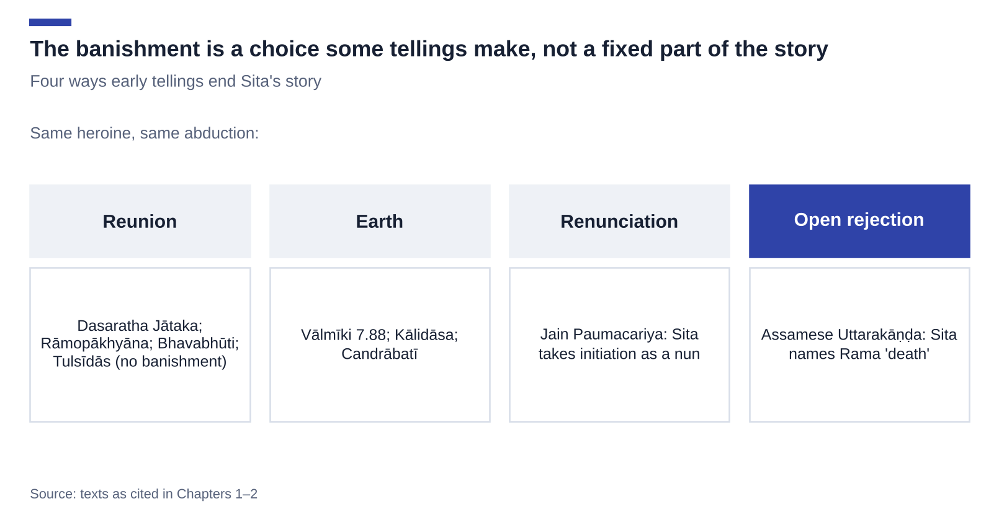
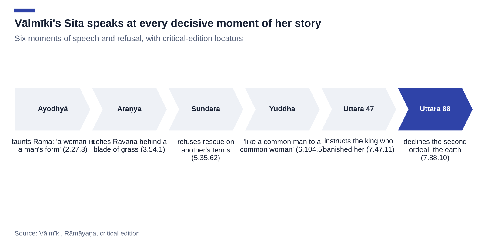

# Part I. The Inheritance: Sita Before the Novel {.unnumbered}

# Chapter 1. The Sita of Vālmīki: Voice, Refusal and the Myth of the Silent Wife

::: {custom-style="Epigraph"}
*kiṃ mām asadṛśaṃ vākyam īdṛśaṃ śrotradāruṇam*\
*rūkṣaṃ śrāvayase vīra prākṛtaḥ prākṛtām iva*

"Why, hero, do you make me hear such unfitting words, harsh and cruel to the ear, like a common man speaking to a common woman?"

— Sītā to Rāma before the fire, Vālmīki *Rāmāyaṇa* 6.104.5 (CE)
:::

## The argument of this chapter

Every modern retelling of Sita is, whether it admits it or not, an argument with Vālmīki. Some writers argue with him directly, quoting his verses back at him; most argue with a Vālmīki they have never read, the Vālmīki of the calendar print, the school textbook and the Sunday serial, whose Sita is a model of patient silence. It is therefore necessary, before any modern text is examined, to establish what the poem attributed to Vālmīki actually says, and in particular what it says Sita says.

This chapter makes five claims.

1. There is no single "original" Rāmāyaṇa against which later tellings can be measured as faithful or deviant; but there is a text, the Sanskrit poem attributed to Vālmīki, which is the most influential of the tellings and the one most modern writers believe themselves to be answering. To read it closely is not to privilege it as an origin, but to test the claims made about it.

2. The Sita of that poem is not silent. She speaks at every decisive moment of her story, and she speaks with a range that runs from tenderness through sarcasm, accusation and political advice to formal oath.

3. The trial before the fire is framed, within the poem itself, as a matter of Rama's *pauruṣa* (manhood) and *yaśas* (reputation) rather than of Sita's guilt; and Sita's reply turns the trial into an indictment of the judge.

4. The banishment in the seventh book is framed as a decision about public precedent: the citizens fear that if the king tolerates a wife who has lived in another man's house, they will have to tolerate the same in their own wives. The poem gives Sita no hearing before sentence; it gives her, afterwards, the last word on kingship.

5. Sita's final act is a refusal. She does not undergo the second ordeal, does not return, does not resume her place. Whatever else it is, her descent into the earth is an exercise of will that the poem honours.

The chapter proceeds by close reading. I quote the Sanskrit of the Baroda critical edition at each point where an argument depends on wording, and I give my own deliberately literal translation, because the published translations, excellent as some of them are, make choices that a reader should be able to check.

## The problem of the original

Let me deal first with an objection that will be raised at once. Why begin with Vālmīki at all, when the best scholarship of the last forty years has taught us that there are many Rāmāyaṇas and that none of them is the original?

The objection has force, and I accept its premise. A. K. Ramanujan's essay "Three Hundred Rāmāyaṇas" demonstrated, with the economy of a master, that the tellings of the Rama story in Sanskrit, Tamil, Kannada, Jain Prakrit, Thai and the folk traditions are not versions of a single text but independent crystallisations from a common "pool of signifiers".^[A. K. Ramanujan, "Three Hundred Rāmāyaṇas: Five Examples and Three Thoughts on Translation," in *Many Rāmāyaṇas: The Diversity of a Narrative Tradition in South Asia*, ed. Paula Richman (Berkeley: University of California Press, 1991), 22–49 [W062].] Camille Bulcke, the Belgian Jesuit who spent a lifetime in Ranchi and wrote his monumental survey in Hindi, had demonstrated the same plurality two generations earlier, tracing episode by episode how Sita's birth, her abduction, her trial and her exile changed across languages and sects.^[Camille Bulcke, *Rāmkathā: Utpatti aur Vikās* (Prayag: Hindi Parishad, Prayag Vishvavidyalaya, 1950) [W043].] The early tellings outside the Vālmīki tradition are, for our purposes, especially instructive, because they show that the episodes on which modern feminist critique has concentrated were not present in every early version of the story.

In the Pali *Dasaratha Jātaka* (no. 461 in the Jātaka collection), Rama, Lakkhaṇa and Sītā are siblings, the children of King Dasaratha. They withdraw to the Himalaya to escape the intrigues of a second queen, return after the exile, and Sita becomes Rama's queen. There is no abduction, no war, no fire and no banishment.^[*Dasaratha Jātaka*, Jātaka no. 461 [W002]. B. R. Ambedkar cites it in "The Riddle of Rama and Krishna"; see Chapter 5.] In the *Rāmopākhyāna*, the Rama story told within the third book of the *Mahābhārata*, Sita is abducted and recovered, and her purity is affirmed by the testimony of the gods rather than by her entry into the fire; the story ends with the return and the coronation, and there is no banishment.^[*Mahābhārata* 3.257–76 (critical edition) [W003].] In the Jain *Paumacariya* of Vimalasūri, a work whose dates are disputed but which belongs to the first half of the first millennium, Sita passes through an ordeal and then takes initiation as a Jain nun, and other women follow her into renunciation; she chooses her own exit.^[Vimalasūri, *Paumacariya* [W004]; the Sanskrit *Padmacarita* of Raviṣeṇa (678 CE) keeps the same ending [W006].]

The comparison establishes a point that is indispensable to the rest of this book: the banishment of Sita is not a fixed element of the Rama story. It is a choice, made by certain tellings and not by others. And within the Vālmīki tradition itself, the scholarly consensus holds that the first and last books, the *Bālakāṇḍa* and the *Uttarakāṇḍa*, are later than the central five; the critical edition retains them, but the philologists who prepared it and the translators who followed it treat them as a distinct stratum.^[Robert P. Goldman, introduction to *The Rāmāyaṇa of Vālmīki: An Epic of Ancient India*, vol. 1, *Bālakāṇḍa* (Princeton, NJ: Princeton University Press, 1984) (pinpoint to be verified) [W001].]

Here I must enter a caution, because this philological fact has been put to a use that deserves to be named. There is a line of devotional apologetics, widely encountered in popular commentary and on the internet, which disposes of the banishment of Sita by declaring the *Uttarakāṇḍa* an interpolation. Rama, on this account, never banished Sita; some later hand added the episode; the "real" Rāmāyaṇa ends with the coronation. Let me call this the *interpolation defence*. It is attractive because it allows the defender to keep an unblemished Rama without engaging with what the poem says. But it proves too much. The *Uttarakāṇḍa* has been read, recited, performed, painted, sung and argued over as part of the Rāmāyaṇa for well over a thousand years; Kālidāsa built two cantos of the *Raghuvaṃśa* on it; Bhavabhūti built a whole drama on it; and, decisively for this book, the women of India have preferred it. Nabaneeta Dev Sen observed that the favourite episodes of women singers in Bengali, Marathi, Maithili and Telugu "seem to come mostly from the Balakanda and the Uttarkanda, the two so-called spurious books, excluded by strictly classical Ramayan scholars".^[Nabaneeta Dev Sen, "When Women Retell the Ramayan," *Manushi* 108 (1998): 19.] The interpolation defence, in other words, would save Rama by deleting precisely the part of the story that women have made their own. It is, in its effect if not its intention, an act of silencing.

I shall therefore read the poem as the tradition has received it, with the critical edition as my text and with the *Uttarakāṇḍa* included, while remaining alert to the fact that the poem is layered. The question I put to it is simple. What does Sita say?

## Book 2: the argument for the forest

The first long speech that Vālmīki gives Sita is an argument, and she wins it.

Rama has been exiled. He comes to tell her, and he tells her to stay behind: to serve his parents, to be gentle with Bharata, to fast and pray. The poem's description of her response is precise:

> *evam uktā tu vaidehī priyārhā priyavādinī*\
> *praṇayād eva saṃkruddhā bhartāram idam abravīt*
>
> Spoken to in this way, Vaidehī, who deserved kindness and spoke kindly, became angry, from love itself, and said this to her husband.^[CE 2.24.1.]

*Praṇayād eva saṃkruddhā*: angry precisely because she loves. The phrase should be pinned above the desk of every writer who believes that the traditional Sita lacked passion. What follows is a speech that deploys the full vocabulary of wifely devotion, and deploys it as a weapon. A father, a mother, a brother, a son and a daughter-in-law each enjoy the fruits of their own merit, she says; only a wife shares her husband's lot, "and therefore I too have been ordered to live in the forest".^[CE 2.24.2–3.] For women, "neither father nor son nor self nor mother nor friends, but the husband alone is the refuge, here and hereafter".^[CE 2.24.4: *na pitā nātmajo nātmā na mātā na sakhījanaḥ / iha pretya ca nārīṇāṃ patir eko gatiḥ sadā*.] If he leaves for the forest today, she will walk ahead of him, trampling the thorns.^[CE 2.24.5.] And then a line that is easily passed over:

> *anuśiṣṭāsmi mātrā ca pitrā ca vividhāśrayam*\
> *nāsmi saṃprati vaktavyā vartitavyaṃ yathā mayā*
>
> I have been taught by my mother and my father about every kind of situation. I need not be told now how I am to behave.^[CE 2.24.8.]

The doctrine of the husband as the wife's only refuge, which a modern reader is likely to hear as the very voice of patriarchy, is here the premise of a woman's refusal to obey her husband. Rama has told her what to do. She tells him that she does not need to be told. The argument from *strīdharma*, the duty of women, is turned against the man who would assign her a duty she does not want.

Rama does not yield. He describes the hardships of the forest at length. Sita's second speech, after he has finished, is sharper:

> *kiṃ tvāmanyata vaidehaḥ pitā me mithilādhipaḥ*\
> *rāma jāmātaraṃ prāpya striyaṃ puruṣavigraham*
>
> What did my father, the lord of Mithila, of the Videhas, think he was getting, Rama, when he took as his son-in-law a woman in a man's form?^[CE 2.27.3.]

The verse is introduced by the poet with a word that leaves no doubt about its tone: she "reviled" or "taunted" him (*paricikṣepa*), "out of love and out of pride" (*praṇayāc cābhimānāc ca*).^[CE 2.27.2.] What follows escalates. People who say that there is no greater energy than Rama's, she continues, speak from ignorance.^[CE 2.27.4.] What has he done that makes him so dejected, what is he afraid of, that he wishes to abandon her, who has no other refuge?^[CE 2.27.5.] She compares herself to Sāvitrī, who followed Satyavān into death.^[CE 2.27.6.] And then she accuses him, in a simile whose force is muted by most translations, of being willing to hand her over to others "like a *śailūṣa*", a player or actor, a figure associated in the śāstric literature with men who live by the display of their wives.^[CE 2.27.8: *svayaṃ tu bhāryāṃ kaumārīṃ ciram adhyuṣitāṃ satīm / śailūṣa iva māṃ rāma parebhyo dātum icchasi*. The Princeton translation renders *śailūṣa* as "actor"; the social sense of the term is discussed in the commentarial tradition.] With him, she says, the forest will be heaven; without him, the palace will be hell.^[CE 2.27.17: *yas tvayā saha sa svargo nirayo yas tvayā vinā*.] And if he will not take her, she will drink poison that very day rather than fall into the power of his enemies.^[CE 2.27.18.]

Rama yields. The first time that Vālmīki's Sita opposes her husband's will, she prevails, and she prevails by a combination of devotional argument, personal insult, appeal to precedent (Sāvitrī) and threat of suicide. This is not the speech of a silent woman. It is the speech of a woman who knows exactly which levers move the man she is speaking to, and who pulls all of them.

Two observations are in order before we move on. The first is that the speech is constructed from the materials of *pativratā* ideology, the ideology of the devoted wife. It does not reject that ideology; it inhabits it, and from inside it, finds the leverage to override the husband's command. Saba Mahmood's description of agency as a capacity that "specific relations of subordination create and enable" could not find a better illustration.^[Saba Mahmood, *Politics of Piety: The Islamic Revival and the Feminist Subject* (Princeton, NJ: Princeton University Press, 2005), 18† [W113].] The second observation is that the later tradition found this speech embarrassing. Tulsīdās, who admired Sita above all women, did not give her the taunt about "a woman in a man's form". Madhu Kishwar's remark that the *Rāmcaritmānas* "marks the transition from Ram and Sita being presented as an ideal couple to projecting each of them as an ideal man and woman respectively" describes, among other things, the softening of this exchange.^[Madhu Kishwar, "Yes to Sita, No to Ram! The Continuing Popularity of Sita in India," *Manushi* 98 (January–February 1997): 20.] The silent Sita began, in part, as an editorial decision about what an ideal woman should not say.

## Book 3: the accusation and the blade of grass

The third book contains the two speeches of Sita that modern readers find most uncomfortable, for opposite reasons.

The first is her accusation of Lakshmana. Mārīca, disguised as the golden deer, has cried out in Rama's voice. Lakshmana, who knows that Rama cannot be harmed, refuses to leave her. Sita's response is brutal. She calls him "ignoble, cruel in the guise of compassion, a disgrace to your family", and says she thinks he wants Rama's death because he wants her.^[CE 3.43.20: *anārya karuṇārambha nṛśaṃsa kulapāṃsana / ahaṃ tava priyaṃ manye tenaitāni prabhāṣase*.] Lakshmana goes. It is worth noticing what is *not* in this scene: there is no line drawn on the ground, no Lakshmaṇa-rekhā. Nabaneeta Dev Sen remarked on the absence: the protective circle that Sita crosses in so many women's songs is "not to be found in Valmiki".^[Dev Sen, "When Women Retell," 24.] The Lakshmaṇa-rekhā, which has passed into Indian English as the very image of the limit a woman must not cross, is a later addition, and an instructive one. In Vālmīki, Sita is not abducted because she crossed a line that a man had drawn for her protection. She is abducted because she was alone, and she was alone because she had compelled both men to leave.

The second is her defiance of Ravana. He has revealed himself, described his wealth and power, and offered to make her the chief of his queens. The poet sets the scene of her reply with two words that ought to be better known: she is *nirbhayā*, "without fear", and *śokakarṣitā*, "worn down by grief".

> *sā tathoktā tu vaidehī nirbhayā śokakarṣitā*\
> *tṛṇam antarataḥ kṛtvā rāvaṇaṃ pratyabhāṣata*
>
> Spoken to in this way, Vaidehī, fearless though worn down by grief, placed a blade of grass between them and answered Ravana.^[CE 3.54.1.]

The blade of grass is one of the great images of the poem, and it recurs, in the same words, in her speeches to Ravana in captivity.^[CE 5.19.3.] Its meaning has been debated: is it a barrier, a sign of contempt, a refusal to address him directly, a ritual device? Anamika's Hindi novel of 2023, discussed in Chapter 14, takes its title from Tulsīdās's version of the image, *tṛn dhari oṭ*, "holding a blade of grass as a screen".^[Anamika, *Trin Dhari Ot* (New Delhi: Vani Prakashan, 2023); English translation, *Sita's Veil* (New Delhi: Yatra Books with Vani Prakashan, 2025) [W201].] What is not in doubt is what she says from behind it. Her husband is Rama, renowned in the three worlds, "my husband and my god" (*daivataṃ sa patir mama*); he will take Ravana's life.^[CE 3.54.3–4.] "If you had assaulted me by force in his presence, you would now lie slain in battle, as Khara lies in Janasthāna."^[CE 3.54.5.] Ravana is like a sacrificial animal already tied to the post; his life is as good as over.^[CE 3.54.9.]

Here again the vocabulary is the vocabulary of wifely devotion (*daivataṃ sa patir mama*, "my husband is my god"), and here again it is put to work as an instrument of defiance. A modern reader who hears only the devotion misses the speech. A woman alone, in the power of a man who has just abducted her, tells him to his face how he will die.

## Book 5: the counsellor and the refusal of rescue

In the *Sundarakāṇḍa*, Hanumān finds Sita in the Aśoka grove, emaciated, surrounded by *rākṣasī* guards, under sentence of death if she does not yield to Ravana within two months. It is the book in which Sally Sutherland Goldman located "the voice of Sita", and with good reason; it gives her more speech than any other.^[Sally J. Sutherland Goldman, "The Voice of Sita in Vālmīki's *Sundarakāṇḍa*," in *Questioning Ramayanas: A South Asian Tradition*, ed. Paula Richman (Berkeley: University of California Press, 2001) (pinpoint to be verified) [W103].] I draw attention to three moments.

The first is her reply to Ravana's renewed proposal. She places the blade of grass between them again and tells him to "turn his mind away from me and set it on his own people".^[CE 5.19.3: *nivartaya mano mattaḥ svajane kriyatāṃ manaḥ*.] Then she does something that the liberation narrative has no category for. She gives Ravana political advice. If he wishes to keep his kingdom, he should make Rama his friend; Rama is the kind of ally a prudent king cultivates, and he does not desire Ravana's death.^[CE 5.19.18: *mitram aupayikaṃ kartuṃ rāmaḥ sthānaṃ parīpsatā / vadhaṃ cānicchatā ghoraṃ tvayāsau puruṣarṣabhaḥ*.] The captive counsels her captor on statecraft. She speaks, in this moment, not as a wife but as a princess of Mithila who knows how kingdoms survive.

The second is her refusal of rescue. Hanumān, having found her, offers to carry her back to Rama on his back, there and then. She declines, and her reasons are layered. She fears she will fall into the sea; she fears the *rākṣasas* will pursue them; she wants Rama to win her back by his own valour, because that is what his honour requires. And then the decisive reason:

> *bhartur bhaktiṃ puraskṛtya rāmād anyasya vānara*\
> *nāhaṃ spraṣṭuṃ padā gātram iccheyaṃ vānarottama*
>
> Putting my devotion to my husband first, O best of monkeys, I would not wish to touch, even with my foot, the body of anyone other than Rama.^[CE 5.35.62.]

This is the verse that modern readers find hardest to forgive, and I understand why. It seems to sacrifice the woman's freedom to an abstraction of purity. But observe its grammar. The verb is a desiderative of choice: *iccheyam*, "I would wish". Sita is not saying that she is forbidden; she is saying what she will and will not do. Her fidelity is something she exercises, not something exercised upon her. And she knows the cost. She is choosing to remain in captivity, under a death sentence, rather than escape on terms that are not hers. Whatever one thinks of the choice, it is a choice, and the poem marks it as such. Sally Sutherland's earlier comparison of Sita and Draupadī, which contrasts Sita's aggression "turned inward" with Draupadī's open anger, captures part of this: Sita's power is exercised as self-restraint, and self-restraint is not passivity.^[Sally J. Sutherland, "Sita and Draupadi: Aggressive Behavior and Female Role-Models in the Sanskrit Epics," *Journal of the American Oriental Society* 109, no. 1 (1989): 63–79 [W067].]

The third moment is less a speech than a refusal of speech. When Hanumān returns to Rama, he carries a token, a jewel from her hair, and a message. The message includes a reminder of an incident, the crow that attacked her and against which Rama once loosed a blade of grass charged as a divine weapon. Sita's question, as she gives it to Hanumān to carry, is pointed:

> *matkṛte kākamātre 'pi brahmāstraṃ samudīritam*\
> *kasmād yo māṃ harat tvattaḥ kṣamase taṃ mahīpate*
>
> For my sake you loosed the weapon of Brahmā at a mere crow. Why then, lord of the earth, do you tolerate the one who carried me away from you?^[CE 5.36.33.]

The form of address deserves notice. She does not call him husband here. She calls him *mahīpati*, lord of the earth: the king who owes protection, not the lover who owes tenderness. The rebuke, as so often with Vālmīki's Sita, is delivered as a reminder of what is owed, and to whom it is owed in his public capacity. We shall meet the same choice of address in Kālidāsa's version of her message from the forest.

By the end of the fifth book, then, Vālmīki's Sita has argued her husband into submission, accused her brother-in-law of treachery, defied her abductor twice to his face, given him political advice, refused rescue on terms that were not her own, and sent her husband a reproach. The silent Sita of the calendar print is not to be found. She was never here.
