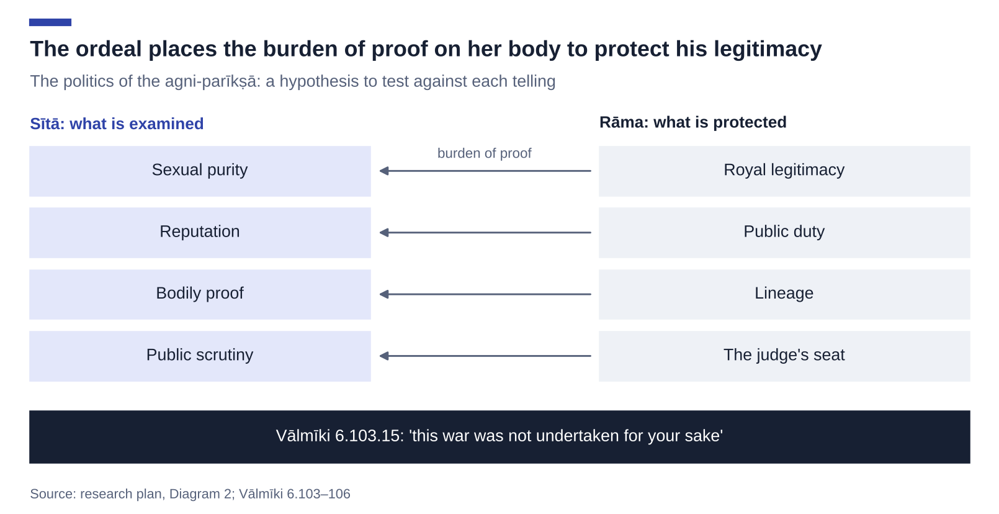
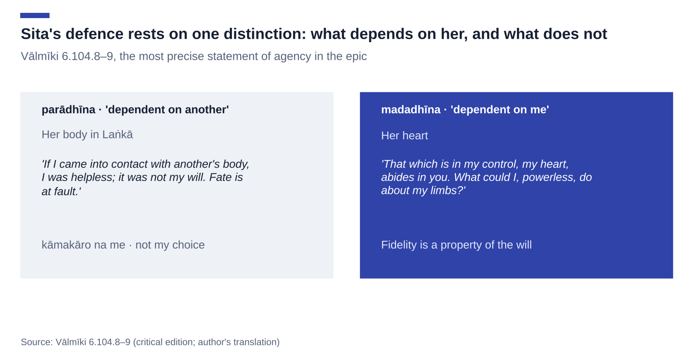
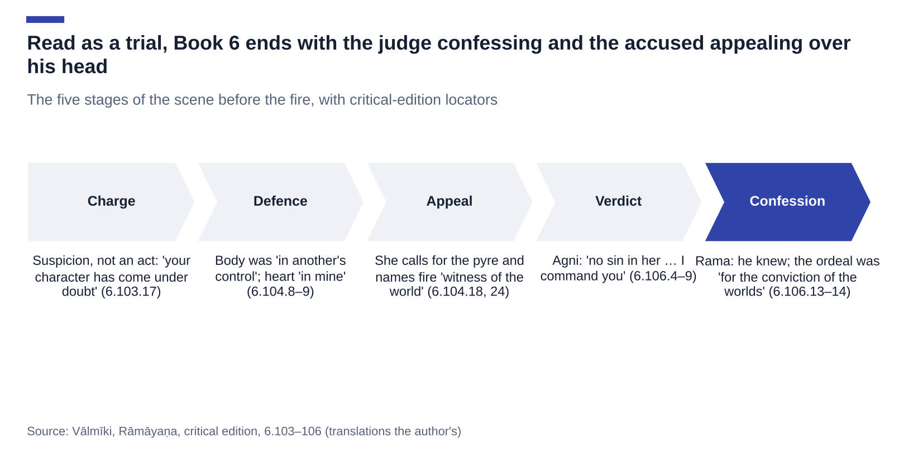
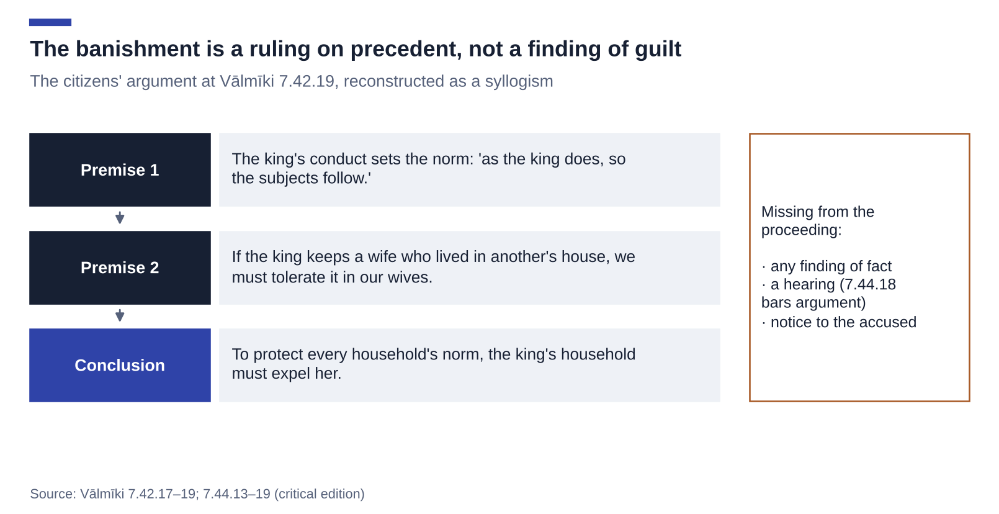

## Book 6: the trial before the fire

The scene after the war is the crux of every modern argument about Sita, and it repays the closest attention. I shall read it as a lawyer reads the record of a trial: who speaks, in what order, on what charge, with what evidence, before what audience, and with what verdict.

### The charge

Ravana is dead. Vibhīṣaṇa has been crowned. Sita has been bathed, adorned and brought, at Rama's command, before the assembled armies of monkeys, bears and *rākṣasas*. The poem tells us that Rama looked at her as she stood bowed at his side, and that "anger was lodged in his heart" (*hṛdayāntargatakrodhaḥ*).^[CE 6.103.1.] His first words are not addressed to her as a wife. They are a proclamation of victory, and the grammar of the victory is the grammar of honour.

> *eṣāsi nirjitā bhadre śatruṃ jitvā mayā raṇe*\
> *pauruṣād yad anuṣṭheyaṃ tad etad upapāditam*
>
> Here you are, good lady, won back by me after conquering the enemy in battle. What had to be done by manliness, that I have accomplished.^[CE 6.103.2.]

He has reached the end of his anger; the insult (*dharṣaṇā*) has been wiped out; insult and enemy have been rooted out together.^[CE 6.103.3.] Today his manliness (*pauruṣa*) has been seen.^[CE 6.103.4.] The man who does not wipe out an insult by his own energy, he says, has no manhood worth the name.^[CE 6.103.6.] He thanks Hanumān, Sugrīva and Vibhīṣaṇa by name.^[CE 6.103.7–9.] Sita, hearing this, stands with her eyes "wide open like a doe's" and full of tears.^[CE 6.103.10.] And Rama's anger, seeing her, flares up again "like a fire into which much ghee has been poured".^[CE 6.103.11.] He frowns, looks at her sideways, and speaks "harshly, in the midst of the monkeys and the *rākṣasas*" (*abravīt paruṣaṃ sītāṃ madhye vānararakṣasām*).^[CE 6.103.12.]

The charge follows, and it is worth reading in full, because the modern retellings that soften it and the modern critiques that denounce it have often not attended to its structure.

> *viditaś cāstu bhadraṃ te yo 'yaṃ raṇapariśramaḥ*\
> *sa tīrṇaḥ suhṛdāṃ vīryān na tvadarthaṃ mayā kṛtaḥ*
>
> Let it be known to you, lady (good fortune to you!), that this toil of battle, which has been brought through by the valour of my friends, was not undertaken by me for your sake.^[CE 6.103.15.]

It was undertaken, he continues, to protect his conduct (*vṛtta*), to avert disgrace (*apavāda*) on every side, and to wipe away the stain on his illustrious lineage.^[CE 6.103.16.] And then comes the charge itself, couched in an image:

> *prāptacāritrasaṃdehā mama pratimukhe sthitā*\
> *dīpo netrāturasyeva pratikūlāsi me dṛḍham*
>
> Your character having come under suspicion, you stand before me as hateful to me as a lamp to a man with diseased eyes.^[CE 6.103.17.]

He tells her to go where she pleases: "these are the ten directions, lady; I have no use for you".^[CE 6.103.18.] What man of good family, he asks, would take back a woman who has lived in another man's house?^[CE 6.103.19.] How could he take her back, she who has fallen from Ravana's lap and been looked at with his evil eye?^[CE 6.103.20.] She may set her heart on Lakshmana, or Bharata, or Sugrīva, or Vibhīṣaṇa, as she pleases, for Ravana could not have kept his hands off a woman so beautiful living in his house.^[CE 6.103.22–24.]

Three features of the charge must be noticed, because they will govern everything that follows.

First, the charge is not an accusation of an act. Rama does not say that Sita was unfaithful. He says that her character "has come under suspicion" (*prāptacāritrasaṃdehā*). The offence is the suspicion, not the deed. This is, in the strictest sense, a reputational offence, and the injured party is not Rama the husband but Rama the representative of a lineage.

Second, the trial is public. Rama chooses to speak "in the midst of" the armies. The audience is not incidental to the charge; it is its occasion. The "disgrace on every side" that he is concerned to avert is precisely the disgrace that would attach to a king who was seen to take back such a woman.

Third, the war is retrospectively reinterpreted. What had been, in every earlier book of the poem, a war to recover Sita is declared not to have been for her at all. Its object was *pauruṣa*, manhood, and *yaśas*, fame. Sita has been, it now appears, the occasion of a contest between men about honour.

### The defence

Sita's reply is, in my judgement, one of the great speeches of world literature, and it has been remarkably little read as what it is: a defence, constructed point by point, that turns into a counter-indictment.

The poet first records its cost. She was "deeply pained"; she had never heard such words before, and to hear them "in a great crowd" made her shrink with shame, "as though entering into her own limbs"; she wept as though pierced by arrows of speech.^[CE 6.104.1–3.] Then, wiping her face, she speaks "slowly, in a voice choked with tears".^[CE 6.104.4.] The slowness is part of the point. This is not a cry. It is a measured reply.

She opens with the charge of vulgarity quoted as the epigraph to this chapter: he speaks to her "like a common man to a common woman".^[CE 6.104.5.] The register of the reproach is social. Rama has claimed to be acting to protect an illustrious lineage; Sita replies that the manner of his speech betrays the lineage he claims to protect.

She then denies the charge and offers her character as her oath: "I am not as you take me to be; trust me; I swear to you by my own conduct."^[CE 6.104.6.] And she identifies the logical fallacy on which his suspicion rests:

> *pṛthak strīṇāṃ pracāreṇa jātiṃ tvaṃ pariśaṅkase*\
> *parityajemāṃ śaṅkāṃ tu yadi te 'haṃ parīkṣitā*
>
> Because of the conduct of some women, you suspect the whole sex. Give up this suspicion, if you have ever tested me.^[CE 6.104.7.]

This is an argument against generalisation from a class to an individual, and it is made in the language of evidence: *parīkṣitā*, "tested", "examined", the very root from which *parīkṣā*, ordeal, is formed. You have had a lifetime to examine me, she says; examine me, not my sex.

Next comes the distinction on which the entire defence turns, and which a lawyer will recognise at once as the distinction between an act of the will and an event suffered under compulsion:

> *yady ahaṃ gātrasaṃsparśaṃ gatāsmi vivaśā prabho*\
> *kāmakāro na me tatra daivaṃ tatrāparādhyati*
>
> *madadhīnaṃ tu yat tan me hṛdayaṃ tvayi vartate*\
> *parādhīneṣu gātreṣu kiṃ kariṣyāmy anīśvarā*
>
> If I came into contact with another's body, my lord, I was helpless; it was not my will. Fate is at fault there. That which is in my control, my heart, abides in you. What could I, powerless, do about my limbs, which were in another's control?^[CE 6.104.8–9.]

*Kāmakāro na me*: "it was not my doing by choice". *Madadhīnam*: "that which depends on me". *Parādhīna*: "that which depends on another". *Anīśvarā*: "without sovereignty", "not the mistress". The vocabulary is the vocabulary of agency and its limits, and Sita deploys it with complete precision. She concedes nothing about her body that she need not concede; she claims everything about her will that she is entitled to claim. Fidelity, in this argument, is a property of the will, and the will was never in Ravana's power. If one wishes to know where Vālmīki's Sita locates her own agency, it is here: in the domain of what depends on her.

She then asks the question that destroys Rama's case on its own terms:

> *preṣitas te yadā vīro hanūmān avalokakaḥ*\
> *laṅkāsthāhaṃ tvayā vīra kiṃ tadā na visarjitā*
>
> When you sent the hero Hanumān as a scout, while I was in Laṅkā, why, hero, did you not repudiate me then?^[CE 6.104.11.]

Had he done so, she says, she would have given up her life at once, before the monkey's eyes, and he would have been spared a war, his friends spared their suffering.^[CE 6.104.12–13.] The question exposes the inconsistency at the heart of the charge. If Rama believed that her residence in Ravana's house had made her unacceptable, he believed it before the war, and he should have said so. If he did not believe it before the war, he cannot claim to believe it now. The war, which he has just declared was not for her, was in fact conducted in a manner that implied that it was.

Then the counter-indictment:

> *tvayā tu naraśārdūla krodham evānuvartatā*\
> *laghuneva manuṣyeṇa strītvam eva puraskṛtam*
>
> But you, tiger among men, following only your anger, like a petty man, have put my being a woman, and nothing else, in front.^[CE 6.104.14.]

*Strītvam eva puraskṛtam*: "you have placed womanhood alone in front". It is the sharpest sentence in the speech, and it names the operation that Rama has performed. He has reduced her to her sex. Her birth from the earth, which made her no ordinary woman, he has ignored.^[CE 6.104.15.] The hand he took in marriage when they were both children, he has not honoured; her devotion and her character he has "put behind his back".^[CE 6.104.16: *na pramāṇīkṛtaḥ pāṇir bālye bālena pīḍitaḥ / mama bhaktiś ca śīlaṃ ca sarvaṃ te pṛṣṭhataḥ kṛtam*.] The word *pramāṇīkṛtaḥ* is again juridical: the hand he took was not "made authoritative", not admitted as evidence.

### The appeal

Then she turns to Lakshmana and asks him to build a pyre: "make me a pyre, son of Sumitrā, the remedy for this calamity; struck down by a false accusation, I cannot bear to live".^[CE 6.104.18: *citāṃ me kuru saumitre vyasanasyāsya bheṣajam / mithyāpavādopahatā nāhaṃ jīvitum utsahe*.] Lakshmana looks at Rama; Rama's face gives assent; the pyre is built.^[CE 6.104.20–21.] Sita circumambulates Rama, who stands with his face turned down (*adhomukham*), bows to the gods and the Brahmins, and speaks to the fire:

> *yathā me hṛdayaṃ nityaṃ nāpasarpati rāghavāt*\
> *tathā lokasya sākṣī māṃ sarvataḥ pātu pāvakaḥ*
>
> As my heart has never strayed from Rāghava, so may the purifier, the witness of the world, protect me on every side.^[CE 6.104.24.]

It is customary to describe what follows as a test imposed on Sita. On the evidence of the text, that description is incomplete. Rama did not order the fire. He charged her and told her to go. It was Sita who called for the pyre, Sita who chose the fire, and Sita who named the fire as "the witness of the world" (*lokasya sākṣī*). In the language of procedure, she appealed. She refused the jurisdiction of a judge who had prejudged her case, and she took it to a higher court whose witness could not be impeached.

The higher court finds for her. Agni rises from the flames holding her in his lap, unharmed, her garland unwithered, and gives her back to Rama with a verdict that is also a command: "Here is your Vaidehī, Rama; there is no sin in her. Neither by word nor mind nor thought nor glance has she, who is of good conduct, transgressed against you."^[CE 6.106.4–5.] She was abducted helpless; she was guarded by hideous *rākṣasīs*; she was tempted and threatened; she did not think of Ravana, "her inner self having gone to you".^[CE 6.106.6–8.] "Take her back, Rāghava, she is pure in heart and without sin. *You are to say nothing against her. I command you.*"^[CE 6.106.9: *viśuddhabhāvāṃ niṣpāpāṃ pratigṛhṇīṣva rāghava / na kiṃ cid abhidhātavyam aham ājñāpayāmi te*.] The god of fire gives the king an order.

### The judge's confession

And then Rama explains himself, and his explanation is more damning than his charge.

> *avaśyaṃ triṣu lokeṣu sītā pāvanam arhati*\
> *dīrghakāloṣitā ceyaṃ rāvaṇāntaḥpure śubhā*
>
> *bāliśaḥ khalu kāmātmā rāmo daśarathātmajaḥ*\
> *iti vakṣyanti māṃ santo jānakīm aviśodhya hi*
>
> Necessarily, in the three worlds, Sita required purification, this good woman who had lived a long time in Ravana's inner apartments. "Rama, son of Daśaratha, is a fool ruled by desire": so good people would have said of me, had I not purified Jānakī.^[CE 6.106.11–12.]

He knew, he says, that she was devoted to him alone, that her heart was his.^[CE 6.106.13.] But "for the sake of the conviction (*pratyaya*) of the three worlds", he "ignored Vaidehī as she entered the fire".^[CE 6.106.14: *pratyayārthaṃ tu lokānāṃ trayāṇāṃ satyasaṃśrayaḥ / upekṣe cāpi vaidehīṃ praviśantīṃ hutāśanam*.] Ravana could no more have violated her, he adds, than the ocean could cross its shore, for she was "protected by her own radiance" (*rakṣitāṃ svena tejasā*).^[CE 6.106.15.]

Let us take Rama at his word. He did not doubt Sita. He knew she was faithful. He staged the charge, before the assembled armies, in the harshest terms available to him, and let her walk into a fire, in order to secure public conviction. The trial was not a search for the truth, which the judge already possessed. It was a performance of truth for an audience, and the person who paid for the performance was the one person whose truth was not in question.

This is the point on which modern readers divide most sharply, and it is worth stating the division fairly. One reading, devotional and also, in its way, political, holds that Rama's explanation vindicates him: he knew her purity, he sacrificed his private feelings to his public duty, and he arranged for that purity to be proved beyond all doubt so that no one could ever question it again. Madhu Kishwar records this line of apologetics in its classic modern form, from Pandurang Shastri Athavale: "it was not Ram who abandoned Sita; in reality it was the king who abandoned the queen, in the performance of his duty".^[Kishwar, "Yes to Sita," 25.] The other reading holds that the explanation is an aggravation: a man who believes his wife innocent and nonetheless humiliates her publicly and allows her to risk death, for the sake of what others might say, has subordinated a person to an appearance. Kishwar's own interviews suggest that the second reading is the one that ordinary Indians, women and men, overwhelmingly hold: Sita's offer of the ordeal is seen "as an act of defiance that challenges her husband's aspersions, as a means of showing him to be so flawed in his judgement that the gods have to come and pull up Ram for his foolishness".^[Kishwar, "Yes to Sita," 23.]

My own reading should by now be clear. Vālmīki has written a trial in which the judge confesses that the trial was a performance, the accused converts the proceedings into an appeal to a higher court, and the higher court issues an order to the judge. The poem does not need a modern feminist to point out that something is wrong here. It has pointed it out itself, in the god's command and in the king's confession. What it has not done is to say what follows. That is left to the seventh book.

## Book 7: the precedent

The *Uttarakāṇḍa* returns Rama and Sita to Ayodhya and gives them, for a while, happiness. Sita becomes pregnant. Rama asks her what she desires, and she says she would like to visit the hermitages on the banks of the Ganga. Rama agrees. That evening, he asks his companion Bhadra what the people are saying about him.

What they are saying is recorded with a precision that deserves more attention than it receives:

> *kīdṛśaṃ hṛdaye tasya sītāsaṃbhogajaṃ sukham*\
> *aṅkam āropya hi purā rāvaṇena balād dhṛtām*
>
> *laṅkām api punar nītām aśokavanikāṃ gatām*\
> *rakṣasāṃ vaśam āpannāṃ kathaṃ rāmo na kutsate*
>
> *asmākam api dāreṣu sahanīyaṃ bhaviṣyati*\
> *yathā hi kurute rājā prajā tam anuvartate*
>
> What sort of pleasure can he take in his heart from enjoying Sita, who was once carried off by force by Ravana on his lap, taken to Laṅkā, kept in the Aśoka grove, fallen into the power of *rākṣasas*? How is it that Rama feels no disgust? Now we too shall have to put up with this in our wives. For as the king does, so the subjects follow.^[CE 7.42.17–19.]

The final verse is the key to the whole episode, and to my mind it has been misread by both the apologists and the critics. The citizens are not, or not only, expressing a prurient disgust. They are making an argument about precedent. The king's conduct is normative. If the king tolerates a wife who has lived in another man's house, the subjects will be bound to tolerate it in their own wives. *Yathā hi kurute rājā prajā tam anuvartate*: as the king acts, the people follow. The king is not merely a husband; he is a source of law.

Seen in this light, Rama's decision is not, in the first instance, a decision about Sita at all. It is a decision about the precedent that his household sets for every household in his kingdom. He states his reasoning to his brothers: disgrace (*akīrti*) sends a man to the lowest worlds for as long as it is spoken of; "for fear of disgrace I would give up my own life, or you, bulls among men, let alone the daughter of Janaka".^[CE 7.44.11–13.] He orders Lakshmana to take Sita across the Ganga the next morning, to the neighbourhood of Vālmīki's hermitage, and to abandon her there.^[CE 7.44.15–17.] And he adds two instructions that complete the picture:

> *na cāsmi prativaktavyaḥ sītāṃ prati kathaṃ cana*
>
> I am not to be answered back concerning Sita in any way.^[CE 7.44.18.]

Anyone who tries to dissuade him, he says, is bound by an oath sworn on his arms and his life.^[CE 7.44.19.]

A lawyer reading this passage cannot help noticing what is absent. The principle that no one shall be condemned unheard, *audi alteram partem*, which Indian courts treat as a principle of natural justice and which the śāstric tradition knew in its own terms, is violated twice over. Sita is not heard: she is not told of the decision, and Lakshmana deceives her about the purpose of the journey until they reach the far bank. And no one may speak for her: the king has forbidden argument on pain of a curse. The sentence is passed in the absence of the accused, without a hearing, on the basis of public rumour, and with a bar on advocacy. It is, by any standard the epic itself recognises elsewhere, a denial of justice.

## Sita's reply from the riverbank

When Lakshmana finally tells her, on the far bank of the Ganga, Sita falls to the ground. When she recovers, she speaks, and her speech moves through three stages.

The first is grief and bewilderment. "Surely this body of mine was created for sorrow."^[CE 7.47.3.] What sin did she commit in a former life, whom did she separate from his wife, that she, "pure in conduct and faithful", should be abandoned by the king?^[CE 7.47.4: *kiṃ nu pāpaṃ kṛtaṃ pūrvaṃ ko vā dārair viyojitaḥ / yāhaṃ śuddhasamācārā tyaktā nṛpatinā satī*.] Notice the noun: not her husband, but *nṛpati*, the king. Even in grief, she names the office that has acted against her. What will she say to the sages when they ask what crime she committed?^[CE 7.47.7.]

The second is a refusal of the easiest exit. She would drown herself in the Ganga today, she says, but she will not, because the royal line of her husband would be mocked.^[CE 7.47.8.] It is a striking reversal: the woman who has just been sacrificed to the reputation of the lineage declines to damage that reputation by her death. She is, in the strict sense, more careful of Rama's *yaśas* than Rama has been of her life.

The third is her message to the king, and it is extraordinary.

> *yathā bhrātṛṣu vartethās tathā paureṣu nityadā*\
> *paramo hy eṣa dharmaḥ syād eṣā kīrtir anuttamā*
>
> *yat tvaṃ paurajanaṃ rājan dharmeṇa samavāpnuyāḥ*\
> *ahaṃ tu nānuśocāmi svaśarīraṃ nararṣabha*\
> *yathāpavādaṃ paurāṇāṃ tathaiva raghunandana*
>
> Treat the citizens always as you treat your brothers. That would be the highest dharma; that would be unsurpassed fame. That you should win the citizens to you through dharma, O king: that is my concern. I do not grieve for my own body, bull among men, so much as for the disgrace among the citizens, delight of the Raghus.^[CE 7.47.11–12.]

The message has been read as the supreme expression of wifely self-abnegation, and it can be read that way. But it can also be read, and I think must be read, as a lesson in kingship delivered by the person the king has just wronged, using the king's own vocabulary. Rama acted for *kīrti*; she tells him what *kīrti* actually consists in. Rama acted to avoid the people's *apavāda*; she tells him that she too grieves for the *apavāda*, which is to say, for the fact that his people speak ill. Rama acted to set a precedent for his subjects' households; she tells him that the highest *dharma* is to treat his subjects as brothers. And she says that she does not grieve for her body: the body that was the object of the citizens' talk, the body that was "in another's control" in Laṅkā, the body that was the whole of what Rama put in front when he put her womanhood in front. In abandoning her body to the forest, she claims the domain that depends on her, the domain of judgement, and exercises it on the king.

Kālidāsa understood this. In the fourteenth canto of the *Raghuvaṃśa*, his version of her message begins *vācyas tvayā madvacanāt sa rājā*, "you must tell the king, from me", and asks whether it befits his illustrious family to abandon on hearing public talk a woman he saw purified by fire before his own eyes.^[Kālidāsa, *Raghuvaṃśa* 14.61; Kishwar cites the verse in "Yes to Sita," 24, 31 n. 3.] Madhu Kishwar notices that in this verse Sita "does not address Ram as Aryaputra ... but refers to him as 'King' instead".^[Kishwar, "Yes to Sita," 24.] The observation is just, and it applies already to Vālmīki. The woman who addresses Rama as *nṛpati* and *rājan* in her grief has already begun to unmarry him.

Vālmīki, receiving her into his hermitage, says that he knows her to be sinless by the eye of his austerity, and entrusts her to the female ascetics who live nearby, who will care for her "as for a child".^[CE 7.48.10–11.] In the poem's final economy, the woman expelled from the city by the judgement of the citizens is received in the forest by the judgement of a sage and the care of a community of women. It is a pattern we shall meet again, many times, in the modern tellings, from the Telugu songs in which the women of the household support Sita to Volga's Sita, who finds her liberation through a sequence of women whom Rama's world has wronged.

## Book 7 again: the refusal

I return, then, to the scene with which the Introduction began. Years have passed. The twins have grown and have sung the poem at Rama's sacrifice. Rama sends for Sita and asks that she prove her purity in the assembly. Vālmīki vouches for her. Rama replies that he accepts the sage's word, that she proved her purity once before in the presence of the gods, that he abandoned her out of fear of the people though he knew her to be sinless, and asks forgiveness of the sage, not of her; and he says he would be pleased if she proved her purity "in the midst of the world".^[CE 7.88.2–4.]

She appears, in ochre. She makes her oath. The earth takes her.

Two readings of this act have dominated the modern argument. The first holds that it is the ultimate submission: a woman who, faced with a second ordeal, chooses death rather than further suspicion, and whose last words declare that her husband was her whole inner life. The second holds that it is the ultimate refusal: a woman who, summoned a second time to prove what she has already proved, declines to do so, and leaves.

Madhu Kishwar's interviews leave no doubt which reading the Indian public has chosen. "The refusal of Sita to go through a second agnipariksha", she writes, "has left a far deeper impact on the popular imagination. It is interpreted not as an act of self annihilation but as a momentous but dignified rejection of Ram as a husband."^[Kishwar, "Yes to Sita," 23.] And she adds a sentence that might serve as the epigraph to this whole book: "Ram may not have rejected her as a wife but only as a queen in deference to social opinion, but Sita rejects him as a husband."^[Kishwar, "Yes to Sita," 24.] The women's song from Avadh that she quotes goes further than Vālmīki: when Rama comes to take Sita back, "Sita looked at him one moment, her eyes filled with anger, / Sita descended into the earth, she spoke not a word."^[Kishwar, "Yes to Sita," 24, quoting a song published by Vidya Bindu Singh.]

The text of the critical edition will support both readings, and I do not think it can be made to choose. But it supports the second reading on three points that the first reading must explain away. First, Sita is dressed as an ascetic: she has already left the household, and she comes to the assembly as one who has renounced. Second, her oath is not a request to be believed. It is a conditional invocation addressed to the Earth, and its condition is one that only she can know to be satisfied: "as I have not thought of anyone but Rāghava, *even in my mind*". The fire, the first time, was "the witness of the world"; this time, she calls no witness except her own mind, and asks the Earth, her mother, to act on her word. Third, the Earth does act. She rises on a throne, takes her daughter in her arms, and welcomes her. The poem gives the last word not to the king, nor to the citizens, nor even to the sage, but to a mother receiving a daughter who has been sent home.

I do not want to overstate the point. Sita's oath is an oath of fidelity to Rama, and its content is devotion; a reading that ignores this is as partial as a reading that ignores the refusal. The genius of the scene lies precisely in its refusal to separate the two. Her devotion and her refusal are one act. She has been faithful to him "even in her mind", and it is because she has been faithful that she will not submit to being tried again. Fidelity, in Vālmīki's last scene, is the ground of refusal, not its opposite.

::: {custom-style="Box Title"}
Reading Against the Text
:::

::: {custom-style="Box"}
At the fire, Sita names Agni "the witness of the world" (6.104.24). At the end, she calls no witness but her own mind and asks the Earth to act on it (7.88.10). Is the movement from the first oath to the second a movement from submission to the world's judgement to a declaration of independence from it? If so, what does it mean that the world is "bewildered" (7.88.20) by an act it cannot judge?
:::

::: {custom-style="Box Title"}
The Debate: Chastity
:::

::: {custom-style="Box"}
**Position A:** Sita's chastity is a personal ethical commitment, a vow she keeps and exercises as her own.\
**Position B:** Sita's chastity is the patriarchal regulation of female sexuality, enforced through ordeal and exile.\
**Where the evidence of Vālmīki leaves the argument.** Both positions are in the text, and the text knows the difference between them. Sita speaks of her fidelity as *madadhīnam*, that which depends on her (6.104.9); she refuses Hanumān's rescue with the grammar of desire, "I would not wish" (5.35.62). That is Position A. Rama speaks of her chastity as a matter of lineage, reputation and public conviction (6.103.16; 6.106.14), and the citizens speak of it as a precedent for their own wives (7.42.19). That is Position B. The poem stages the conflict between the two and lets Sita have the last word. The modern retellings that discard her fidelity in order to free her from Rama's regulation lose the very ground on which Vālmīki's Sita stood to refuse him.
:::

## Coda: the other victim

This chapter cannot close without the episode that the *Uttarakāṇḍa* places, in the critical edition, some twenty cantos after Sita's abandonment and twenty before her return to the earth. A Brahmin's son has died young. The death is attributed to a disorder in the kingdom: someone is performing austerities who has no right to. Rama searches, and finds a man hanging head down, performing fierce *tapas*. He asks who he is. The man answers:

> *śūdrayonyāṃ prasūto 'smi tapa ugraṃ samāsthitaḥ*\
> *devatvaṃ prārthaye rāma saśarīro mahāyaśaḥ*
>
> I was born from a Śūdra womb, and I have undertaken fierce austerity. I seek divinity in this very body, illustrious Rama.^[CE 7.67.2.]

His name is Śambūka. "While the Śūdra was still speaking", the poem says, Rama drew his sword and cut off his head; and at that moment the Brahmin boy came back to life.^[CE 7.67.4–5.]

I place Śambūka here, at the end of a chapter about Sita, because the *Uttarakāṇḍa* places him beside her, and because no reading of Sita that claims to take the tradition seriously can leave him out. The book that banishes a woman on the strength of rumour, without a hearing, beheads a Śūdra on the strength of his birth, in the middle of his answer. Both judgements are delivered by the same king in the name of the same order. Both are presented by the poem without comment. And both have been the subject of argument, inside the tradition, for centuries: Bhavabhūti gave Rama an anguished soliloquy before the stroke, Kuvempu in the twentieth century wrote a play in which the injustice is made visible to Rama himself, and Dalit writers from Periyar's circle to Omprakash Valmiki have made the episode the centre of their critique.^[Bhavabhūti, *Uttararāmacarita*, act 2 [W007]; Kuvempu, *Shudra Tapasvi* (1944) [W040]; Omprakash Valmiki, *Shambuk's Severed Head*, in *Performing the Ramayana Tradition*, ed. Paula Richman and Rustom Bharucha (New York: Oxford University Press, 2021) [W176]; Paula Richman, "Why Can't a Śūdra Perform Asceticism? Śambūka in Three Modern South Indian Plays," in Bose, *Rāmāyaṇa Revisited* [W111].] Chapter 5 takes up this argument. For now it is enough to note that the same seventh book that gives Sita her last and greatest refusal also gives Śambūka no chance to finish a sentence. A tradition can be plural without being just, and a reading that is faithful to it must say so.

## Conclusion

The Sita of Vālmīki is not silent. She argues, taunts, accuses, defies, counsels, refuses, rebukes, appeals and, at the end, withdraws. She inhabits the ideology of wifely devotion and uses it as an instrument of her own will. When she is put on trial, she exposes the trial as a performance, appeals over the judge's head, and wins. When she is condemned without a hearing, she sends the king a lesson in kingship. When she is summoned to be tried again, she refuses, and the earth takes her side.

Whatever the modern retellings are doing, then, they are not giving a voice to a voiceless woman. They are choosing among the voices Vālmīki already gave her, amplifying some, silencing others, and adding new ones of their own. Every modern Sita is, in this sense, an edition of Vālmīki's, and the editorial choices are the evidence. The next two chapters trace how the tradition between Vālmīki and the moderns, first in the regions and the women's songs and then in the colonial century, made its own choices, and how the silent Sita whom modern feminists set out to liberate was made.
