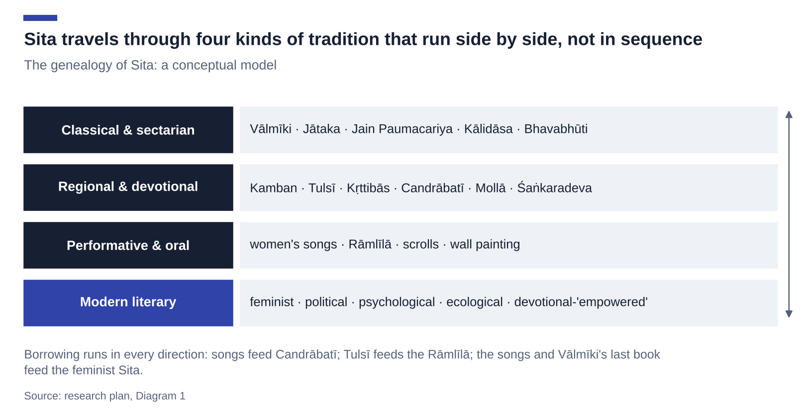
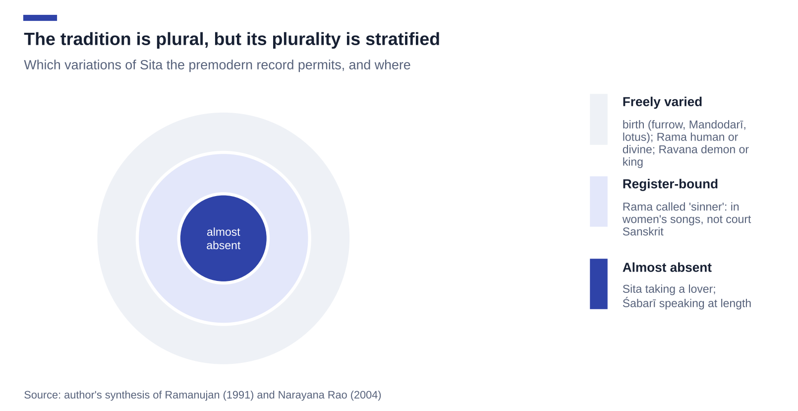
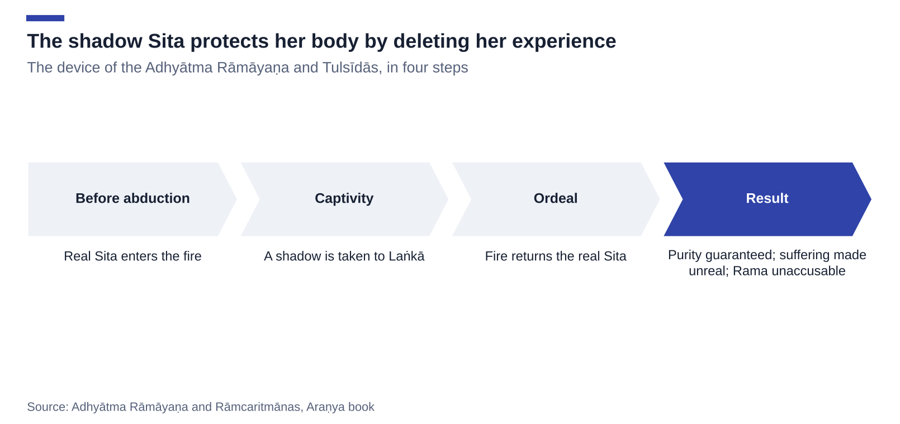

# Chapter 2. Many Rāmāyaṇas, Many Sitas: Regional, Devotional and Women's Traditions

::: {custom-style="Epigraph"}
"The professional bard sings of Ram. The village woman sings of Sita."

— Nabaneeta Dev Sen, *Manushi* 108 (1998), p. 20
:::

## The argument of this chapter

Between Vālmīki and the first modern retellings lie some fifteen centuries of Rāmāyaṇa-making in every major language of the subcontinent and of Southeast Asia, in court poetry and temple recitation, in Jain and Buddhist narrative, in Persian *masnavī* and Malay *hikayat*, in painting, sculpture, theatre and song. No single chapter can survey this inheritance, and this one does not try. It asks a narrower question: what did the tellings between Vālmīki and the nineteenth century do to Sita's voice, and in particular to the voice of refusal that Chapter 1 traced?

The chapter makes five claims.

1. The plurality of the Rāmāyaṇa tradition is real, but plurality is not the same as equality of voice. Tellings vary within a grammar, and the question is which variations the grammar permits.

2. The great devotional tellings, above all the *Adhyātma Rāmāyaṇa* and Tulsīdās's *Rāmcaritmānas*, protected Sita by spiritualising her. The device of the shadow Sita guaranteed her purity in advance, at the cost of making her suffering unreal. Devotion, in this sense, was a more effective silencer than suspicion.

3. Alongside and against this current ran a series of counter-currents within the "classical" and regional traditions: the fierce Sita of the *Adbhuta Rāmāyaṇa* and the Odia *Bilaṅkā Rāmāyaṇa*, the Assamese Sita who calls Rama death incarnate, the Bengali Sita of Candrābatī, the Persian Sita whose fire becomes a rose garden. The critique of Rama is not a modern import.

4. Women's songs in Telugu, Bengali, Marathi, Maithili, Awadhi and Bhojpuri constitute a distinct Rāmāyaṇa, organised around the life-cycle of a woman rather than the career of a hero. These songs are not "folklore" to be quarried for colour. They are a body of reflection on marriage, labour, motherhood, abandonment and justice, and they constitute intellectual history.

5. In the women's songs, the critique of Rama is often voiced not by Sita herself but by the singer, by Lakshmana, by the trees and the birds, by the women of the household. This distributed or *choral* agency is easily mistaken for Sita's passivity. It is better understood as a different theory of how a wronged woman's case is to be made.

## Plurality and its grammar

Ramanujan's "Three Hundred Rāmāyaṇas" is rightly celebrated for its demonstration that the tellings of the Rama story are not copies of an original but independent works drawing on a common pool. Less often noticed is the essay's closing image, which describes the tradition not as a text but as a language: the Rāmāyaṇa, he suggests, is something one is always already inside, something one hears before one reads.^[A. K. Ramanujan, "Three Hundred Rāmāyaṇas: Five Examples and Three Thoughts on Translation," in *Many Rāmāyaṇas: The Diversity of a Narrative Tradition in South Asia*, ed. Paula Richman (Berkeley: University of California Press, 1991), 22–49 [W062].] A language permits infinite sentences, but not every string of words is a sentence. Velcheru Narayana Rao put the necessary question with characteristic directness: "When does Sita cease to be Sita?"^[Velcheru Narayana Rao, "When Does Sita Cease to Be Sita? Notes toward a Cultural Grammar of Indian Narratives," in *The Rāmāyaṇa Revisited*, ed. Mandakranta Bose (New York: Oxford University Press, 2004), 219–41 [W110].] There are, his essay argues, limits to how far a telling can transform a figure before audiences cease to recognise her; the tradition is plural within a cultural grammar, not without one.

I accept both halves of this position, and I add a third observation that neither Ramanujan nor Rao makes explicit. The grammar is not neutral with respect to gender or caste. Some variations are freely permitted: Sita may be born of the earth, of Mandodarī, of a lotus; Rama may be human or divine; Ravana may be a demon or a tragic king. Other variations are permitted only in certain registers, certain languages, certain communities of performance: Sita may call Rama a sinner in a Bengali women's song but not, for the most part, in a Sanskrit court poem. And some variations have been permitted almost nowhere until very recently: Sita may not, in the premodern record, take a lover; Śabarī may not speak at length. The plurality of the tradition is therefore a stratified plurality. To celebrate it without asking who had access to which variations is to repeat, in a liberal key, the very exclusions it claims to transcend.

## Kamban: love before the bow, feeling before the fire

The twelfth-century Tamil *Irāmāvatāram* of Kamban is the first great regional reworking of Vālmīki, and its handling of Sita announces two tendencies that will recur throughout the devotional tradition.

The first is the intensification of love. In Vālmīki, Rama and Sita meet as bride and groom after he has broken the bow; the marriage is arranged by the bow-test. Kamban has them see each other first, from a palace window and a street, before the contest, and fall in love at once; the line in which "he looked, and she looked" (*aṇṇalum nōkkiṉāṉ avaḷum nōkkiṉāḷ*) is among the most quoted in Tamil literature.^[Kamban, *Irāmāvatāram*, Bālakāṇṭam, Mitilaik kāṭcip paṭalam [W008] (verse number to be verified).] The consequence for Sita is ambiguous. On one hand she becomes a lover with desires of her own, who suffers anxiety until she learns that the youth she saw is the one who broke the bow; on the other, her desire is entirely directed to the man her father's contest will in any case deliver. Kamban gives Sita an inner life, and the inner life is wholly Rama's.

The second is the intensification of feeling around the fire. David Shulman's reading of the ordeal in Kamban shows a poet who stages the scene with an emotional and cosmological amplitude Vālmīki does not attempt: the fire itself is afraid to burn her, and the ordeal becomes an occasion for the cosmos to testify to a purity that is never seriously in doubt.^[David Shulman, "Fire and Flood: The Testing of Sītā in Kampaṉ's *Irāmāvatāram*," in Richman, *Many Rāmāyaṇas*, 89–113 [W073].] The result, again, is double. The scene is more terrible and more beautiful, and Sita's suffering is given cosmic witness. But the more cosmic the witness, the less the scene is a confrontation between a wife and a husband. Kamban's Sita does speak before the fire, but the speech that matters is the universe's.

Kamban's Ahalya, too, is altered: she is less culpable than in Vālmīki, where she knowingly accepts Indra "out of curiosity about the king of the gods".^[CE 1.47.19: *muniveṣaṃ sahasrākṣaṃ vijñāya raghunandana / matiṃ cakāra durmedhā devarājakutūhalāt*.] We shall return to Ahalya's long transformation in Chapter 6. The point to note here is the direction of travel. The regional devotional poets made the women of the epic more sympathetic and less responsible, more pure and less wilful. They protected them, and the protection cost them their agency.

## The shadow and the substitute

The device that carried this tendency to its limit is the shadow Sita. In the *Adhyātma Rāmāyaṇa*, a Vaiṣṇava text of the fourteenth or fifteenth century embedded in the *Brahmāṇḍa Purāṇa*, Rama, knowing that Ravana will come, instructs Sita to enter the fire and to leave in her place an illusory double (*māyā-sītā*) who will be abducted, imprisoned and rescued. At the ordeal, the fire returns the real Sita and the shadow vanishes.^[*Adhyātma Rāmāyaṇa*, Araṇyakāṇḍa [W010].] Tulsīdās, writing in Awadhi at the end of the sixteenth century, takes up the device: in the *Rāmcaritmānas*, before the abduction, Rama tells Sita that he is about to perform a human play (*naralīlā*) and asks her to dwell in the fire until he has destroyed the demons; she enters it, leaving her shadow.^[Tulsīdās, *Rāmcaritmānas*, Araṇyakāṇḍa [W016].] When the ordeal comes in the Lanka book, Tulsī softens Rama's speech almost to nothing; the fire is a formality by which the real Sita is restored.

Wendy Doniger, comparing the shadow Sita with the phantom Helen of Stesichorus and Euripides, saw in both a characteristic move of patriarchal mythology: the creation of a double who absorbs the sexual danger so that the original may remain untouched.^[Wendy Doniger, *Splitting the Difference: Gender and Myth in Ancient Greece and India* (Chicago: University of Chicago Press, 1999) (pinpoint to be verified) [W096].] I accept the comparison, but I want to draw out a consequence that is specific to the Indian case and to the argument of this book. The shadow device does not merely protect Sita's body. It protects Rama. In Vālmīki, Rama's charge before the fire is a scandal that the poem itself acknowledges, by having the fire god command the king. In the *Adhyātma* and the *Mānas*, there is no scandal, because there is no real suspicion: the king knows, the reader knows, the gods know, and the ordeal is a ritual exchange of the shadow for the substance. The device that makes Sita untouchable also makes Rama unaccusable.

And it makes Sita's experience disappear. The woman who stood in the Aśoka grove for ten months, under sentence of death, defying Ravana behind a blade of grass, was not Sita; she was a shadow. The suffering that Vālmīki's Sita invoked as evidence of her fidelity ("what could I, powerless, do about my limbs?") is not hers to invoke, because it did not happen to her. The devotional Sita is protected from history by being removed from it. The Rāmāyaṇa that most Hindi speakers know best is, for this reason, the Rāmāyaṇa in which Sita has least to say about what was done to her.

Tulsī made one other editorial decision whose importance for the modern afterlife of Sita cannot be overstated. The *Uttarakāṇḍa* of the *Mānas* does not narrate the banishment. It describes, instead, the reign of Rama, the *Rāmrājya*, as a golden age of righteousness and contentment, with Sita at Rama's side. The single most painful episode of Vālmīki's seventh book is simply absent from the text that became the scripture of North Indian Vaiṣṇavism. When Madhu Kishwar observes that "the medieval Ramayan of Tulsi marks the transition from Ram and Sita being presented as an ideal couple to projecting each of them as an ideal man and woman respectively", she identifies the cost of the transition: an ideal man cannot be shown banishing his pregnant wife on the strength of rumour.^[Madhu Kishwar, "Yes to Sita, No to Ram! The Continuing Popularity of Sita in India," *Manushi* 98 (January–February 1997): 20.] The banishment survived in the North Indian imagination nonetheless, through Vālmīki, through Bhavabhūti, through the women's songs and through the Rāmlīlā; but it survived outside the scripture. The ideal wife of the *Mānas* is the wife of an ideal husband, and the ideal husband never abandons her. That is one reason why the nineteenth-century reformers and nationalists, who drew so much of their Sita from Tulsī, found her so serviceable.

Tulsī's text also contains, in the *Sundarakāṇḍa*, the line in which the ocean, rebuked by Rama, declares that "the drum, the rustic, the Śūdra, the animal and the woman" are fit to be beaten or disciplined (*ḍhol gaṃvār sūdra pasu nārī*). The line has been a flashpoint for more than a century, contested in its meaning, its speaker and its grammar, defended by some commentators as the ocean's self-abasing speech rather than the poet's doctrine.^[Tulsīdās, *Rāmcaritmānas*, Sundarakāṇḍa [W016]; the corpus workbook records the line as "a flashpoint".] I raise it not to adjudicate the exegetical dispute but to note its structure: woman and Śūdra in a single list. The devotional tradition that spiritualised Sita did not thereby spiritualise women; and it bound the question of women to the question of caste in the same breath, as the *Uttarakāṇḍa* had bound Sita to Śambūka.

## Counter-currents in the classical and regional traditions

It would be a serious error to conclude from Tulsī that the regional and devotional traditions moved uniformly towards a silent and protected Sita. They did not. Some of the most violent and the most defiant Sitas in the whole tradition belong to this period, and several belong to its Sanskrit and court registers, not to the folk.

### The fierce Sita

The *Adbhuta Rāmāyaṇa*, a Sanskrit Śākta text probably of the fourteenth or fifteenth century and attributed, as such texts often are, to Vālmīki himself, adds a sequel to the familiar story. After the defeat of the ten-headed Ravana, Sita reveals that he had an elder brother with a thousand heads. Rama goes to fight him and falls. Sita, seeing her husband struck down, takes the form of Kālī and destroys the thousand-headed Ravana herself.^[*Adbhuta Rāmāyaṇa* [W009]. The text also makes Sita the daughter of Mandodarī and includes a *Sītā Sahasranāma*.] The Odia *Bilaṅkā Rāmāyaṇa* attributed to Sāralā Dāsa tells a parallel story of Sita as Kālī destroying the thousand-headed Ravana of Pātāla.^[*Bilanka Ramayana*, attributed to Sarala Das [W012].]

These texts were not marginal curiosities. The *Adbhuta* was cited, before the release of the 2026 Ramayana film, as the classical warrant for a "warrior Sita".^[Corpus workbook, W009 and W206.] Ruth Vanita's reading of it is a valuable corrective to easy appropriation: she argues that even in her Kālī form Sita remains recognisably a wife, that her ferocity is exercised on her husband's behalf, and that the text's goddess is a smiling consort rather than an autonomous destroyer.^[Ruth Vanita, "The Sita Who Smiles: Wife as Goddess in the *Adbhut Ramayana*," *Manushi* 148 (2005) (pinpoint to be verified) [W115].] I think Vanita is right about the frame and wrong to let the frame neutralise the image. A tradition in which Sita can kill what Rama cannot is a tradition that has imagined the inversion of the hero's role, whatever domestic justification it supplies. The fierce Sita does not need to be a modern feminist to be a problem for the ideal of the dependent wife.

### The Assamese Sita who calls Rama death

Further east, the Assamese tradition produced what may be the most explicit premodern rejection of Rama in any language. The *Saptakāṇḍa Rāmāyaṇa* of Mādhava Kandalī, composed in the fourteenth century under a Barāhī king, is among the earliest translations of Vālmīki into a modern Indian language; its *Uttarakāṇḍa*, ascribed to the great Vaiṣṇava teacher Śaṅkaradeva in the fifteenth or sixteenth century, gives Sita, at the end, a refusal that is not veiled by devotion at all. In Tilottoma Misra's translation of the passages in which Sita speaks, she finally rejects Rama and names him *Yamkāl*, death incarnate.^[Tilottoma Misra, trans. and ed., *Sita's Voice in the Assamese Ramayana: Selected Verses from the Ramayana of Madhava Kandali and the Uttarakanda of Sankaradeva* (New Delhi: Zubaan, 2024) [W237] (pinpoint to be verified).]

The significance of this for the argument of this book can hardly be overstated. Here is a Sita who refuses Rama outright, by name, with an epithet of mortal hostility, in a text composed not by a radical or a rationalist, nor by a woman, but by the founding figure of Assamese Vaiṣṇavism. The poet is male, upper-caste, devout; the Sita he writes is the most openly defiant in the premodern record. Hypothesis C of this research, that the feminist canon has its own exclusions, is nowhere better illustrated: the canon of "feminist retellings" has had almost nothing to say about Śaṅkaradeva's Sita, because she does not fit the story in which defiance is modern and devotion is patriarchal.

### Candrābatī and the portrait

In Bengal, the fifteenth-century Kṛttibāsī *Rāmāyaṇ* became the regional mainstream, devotional and full of local colour; Tony Stewart and Edward Dimock have read in it an indirect critique of Rama's kingship, conducted by negation.^[Tony K. Stewart and Edward C. Dimock Jr., "Kṛttibāsa's Apophatic Critique of Rāma's Kingship," in *Questioning Ramayanas: A South Asian Tradition*, ed. Paula Richman (Berkeley: University of California Press, 2001) [W011].] But it is a sixteenth-century woman from Mymensingh, Candrābatī, who gives Bengal its most radical Sita. Chapter 7 discusses her poem at length; here I note only its structure and one motif. Candrābatī opens not with Rama's birth but with Mandodarī and Sita's birth; she compresses the war almost to nothing; she makes Sita's twelve-month lament, a *bāromāsī*, carry the narrative; and she attributes the banishment to a scheme by Rama's sister Kukuā, who tricks Sita into drawing a portrait of Ravana and then shows it to Rama as evidence of her lingering attachment.^[Candrābatī, *Chandrabati's Ramayan*, trans. Nabaneeta Dev Sen (New Delhi: Zubaan, 2020); Mandakranta Bose and Sarika Priyadarshini Bose, trans., *A Woman's Ramayana: Candrāvatī's Bengali Epic* (London: Routledge, 2013) [W015; W143].]

The portrait motif travels. It appears in the Thai *Ramakien* of the court of Rama I, where a demoness persuades Sita to draw Ravana's likeness, which is placed under Rama's bed and leads to her banishment.^[*Ramakien* [W023].] It appears in Telugu women's songs, and in a modern Kannada poem by H. S. Venkatesha Murthy built on the image of Sita as the one who creates Ravana's image.^[H. S. Venkatesha Murthy, "Portrait Ramayana," in *Ramayana Stories in Modern South India: An Anthology*, ed. Paula Richman (Bloomington: Indiana University Press, 2008) [W123].] What is striking about it is the transfer it effects. In Vālmīki, the banishment is caused by the citizens' talk. In the portrait tellings, it is caused by a woman's act of representation, solicited by another woman's malice. The cause of Sita's suffering moves inside the household, and specifically into the women's quarters. This is, as we shall see, characteristic of the women's tradition: the epic's public catastrophe is retold as a domestic one.

### The Persian and Malay Sitas

The Rāmāyaṇa was also told, for centuries, in the languages and courts of Islam, and the Sitas of those tellings belong in this inheritance. A Persian translation commissioned at the Mughal court and owned by Akbar's mother, Hamida Banu Begum, survives with fifty-six paintings; it is evidence, at the very least, of a woman reader and patron of the Rāmāyaṇa at the centre of a Muslim court.^[John Seyller, Marika Sardar and Audrey Truschke, *The Ramayana of Hamida Banu Begum, Queen Mother of Mughal India* (Doha: Museum of Islamic Art; Milan: Silvana Editoriale, 2020) [W017].] Masīḥ Pānīpatī's *Dāstān-i Rām u Sītā*, a Persian *masnavī* of about five thousand verses dedicated to Jahāngīr, recasts the epic as a love story and gives Kaikeyī and Ravana's sister more narrative space.^[Masih Panipati, *Dastan-i Ram u Sita* (1623–24) [W020].] In a nineteenth-century Persian Rāmāyaṇa from the Punjab attributed to Mohar Singh, Sita prays, at the ordeal, that the fire become a rose garden for her as it did for Ibrāhīm, and Trijaṭā compares Rama to ʿĪsā.^[Persian Ramayana of Mohar Singh [W025]; the corpus workbook flags its exact date as unconfirmed.] In the Malay *Hikayat Seri Rama*, whose oldest manuscript reached the Bodleian Library in 1635, Ravana is a more sympathetic figure and Rama a more arrogant one, and the story lives inside an Islamic court culture.^[*Hikayat Seri Rama* [W018].] Harry Aveling has shown how the Indonesian, Malay and Thai tellings stage, soften or reverse the testing of Sita.^[Harry Aveling, "'Sita Puts Out the Fire': Some Depictions of the Testing of Sita's Virtue in Indonesian, Malay, and Thai Literature," *Kritika Kultura* 18 (2012) [W141].]

These Sitas complicate the argument in a way I want to welcome rather than avoid. A decolonial reading that equated the Indic with the Hindu would have no place for Mohar Singh's Sita praying in the idiom of Ibrāhīm's fire. But the Rāmāyaṇa's own plurality has always exceeded the boundaries of any one religion; that is part of what Ramanujan meant by a pool. What these tellings share with the regional Hindu tellings is the freedom to rework the ordeal in the image of their own sacred histories. What they do not share, and what none of them supplies, is a Sita who stands outside the frame of wifely fidelity. The rose garden protects her as the shadow does. The ordeal is transformed, not refused.

### Women poets of the court and the temple

The premodern record also includes women who composed Rāmāyaṇas in the courtly and devotional registers. Nabaneeta Dev Sen paired Candrābatī with the sixteenth-century Telugu poet Ātukuri Mollā, and drew from the pairing the typology that structures Chapter 7: Mollā, she wrote, retold the epic "by borrowing the traditional eyes of the male epic poet", while Candrābatī retold it "with your own women's eyes".^[Nabaneeta Dev Sen, "When Women Retell the Ramayan," *Manushi* 108 (1998): 18.] But Dev Sen also saw what was radical in Mollā's choice: "Molla, a woman and Shudra, threw a challenge to the Brahmin court poets by writing a perfect classical Ramayan. ... The Brahmins did not allow Molla's work to be read in the royal court."^[Dev Sen, "When Women Retell," 18.] Mollā, from a potter family, wrote a devout telling in plain Telugu that follows Vālmīki closely and does not criticise Rama;^[Atukuri Molla, *Molla Ramayanam* [W014].] her intervention lay in her authorship, not in her Sita. In seventeenth-century Tanjore, Madhuravāṇī, a poet at the court of Raghunātha Nāyaka, rendered the king's Telugu Rāmāyaṇa into Sanskrit;^[Madhuravani, *Ramayanasara* [W021].] in eighteenth-century Andhra, Tarigoṇḍa Veṅgamāmba, who refused the marks of widowhood, composed a devotional Telugu Rāmāyaṇa.^[Tarigonda Vengamamba, *Vashista Ramayanam* [W022].]

The lesson of these women is the lesson of Hypothesis C from the other side. If the feminist canon has excluded devout and upper-caste male poets who wrote defiant Sitas, it has also struggled to know what to do with women poets who wrote devout Sitas. Mollā's Shudra womanhood, exercised through the mastery of a classical form from which Brahmins excluded her, is a form of agency that the liberation narrative cannot see, because it is not exercised on behalf of Sita. It is exercised on behalf of Mollā.

### The Jain Sita: the ordeal, and then the nun's robe

The most thorough revision of the Rama story in premodern India was made not by a Hindu poet but by the Jains, and its Sita deserves a fuller account than the brief references elsewhere in this book have given her. The Jain tellings begin with the Prakrit *Paumacariya* of Vimalasūri, whose date is disputed (the work itself claims a date some five centuries after Mahāvīra, and scholars have placed it anywhere from the first to the fifth century of the common era), and continue through Raviṣeṇa's Sanskrit *Padmacarita* of 678, Svayambhūdeva's Apabhraṃśa *Paumacariu*, Guṇabhadra's *Uttarapurāṇa* and Hemacandra's twelfth-century universal history of the Jain heroes.^[Vimalasūri, *Paumacariya* [W004]; Raviṣeṇa, *Padmacarita* [W006]; on the Jain Rāmāyaṇas generally, see V. M. Kulkarni, *The Story of Rāma in Jain Literature* (Ahmedabad: Saraswati Pustak Bhandar, 1990)† (pinpoints to be verified).]

The Jain revision begins from a rationalist objection. Vimalasūri's narrator, in the work's opening frame, asks how the Rāmāyaṇa of the Brahmins can be true: how can *rākṣasas* be man-eating demons, how can monkeys build a bridge, how can a Ravana be killed who had defeated the gods?^[Vimalasūri, *Paumacariya*, opening frame† (pinpoint to be verified).] The Jain telling answers by naturalising the story. Ravana and his kin are *vidyādharas*, a race of learned and powerful humans with magical knowledge, not demons; the "monkeys" are *vidyādharas* whose banners bear a monkey emblem. Ravana is a noble and devout king, a future Jina, whose single fault is his desire for Sita. And Rama, whom the Jains call Padma, is a soul destined for liberation, who must not kill: it is his brother Lakshmaṇa who kills Ravana, and who, for that killing, goes to hell.^[Kulkarni, *The Story of Rāma in Jain Literature*† (pinpoints to be verified).]

Within this frame, the Jain Sita's story keeps the outline of Vālmīki's and changes its ending. She is abducted, faithful in captivity and recovered. She is banished, pregnant, because of the citizens' talk, and gives birth in the forest to twin sons, whom the Jain tellings call Lavaṇa and Aṅkuśa. The sons grow up, fight their father and uncle without knowing who they are, and are reconciled. Then Sita is called back to Ayodhya and submits to an ordeal by fire, in the presence of the city. The fire becomes a lake, and Sita appears seated on a lotus throne, vindicated.^[On the ordeal in the Jain tellings, see Kulkarni, *The Story of Rāma in Jain Literature*† (pinpoints to be verified).]

And then she leaves. Vindicated before the city, offered her place again by Rama, Sita declines it. She pulls out her hair in the Jain rite of renunciation, takes initiation as a nun and enters the ascetic life; and other women follow her into it.^[Vimalasūri, *Paumacariya* [W004]; corpus workbook, W004.] The corpus workbook summarises the ending as "renunciation as Sita's own exit: a non-Hindu telling where she chooses her ending".^[Corpus workbook, W004.] In the Jain cosmology that frames the story, her renunciation is rewarded with rebirth among the gods, and her path continues towards liberation.^[Kulkarni, *The Story of Rāma in Jain Literature*† (pinpoints to be verified).]

Three features of the Jain Sita bear on the argument of this book.

The first is that the Jain telling separates the ordeal from the refusal. Vālmīki's Sita refuses the second ordeal; the Jain Sita undergoes it, passes it and then refuses the marriage. Her vindication is complete, public and miraculous, and it does not change her decision. The Jain telling thus makes explicit what Vālmīki's ending implies: that the question at the end is not whether Sita is pure, which has been settled, but whether she will return to the man who doubted her. The Jain answer is no. She has been proved innocent, and she chooses to leave.

The second is that the Jain Sita's exit is not into the earth but into a community. She becomes a nun, and other women follow her. Her refusal is not a solitary withdrawal but the founding of a way of life shared with other women, in an institution, the Jain order of nuns, that existed in history and that offered women, then and now, an honoured alternative to marriage. Chapter 8 argued that Volga's Sita, in *The Liberation of Sita*, achieves a liberation that has the shape of renunciation, and noted the Jain precedent.^[See Chapter 8.] The precedent is closer than the comparison suggests. The modern Telugu feminist and the ancient Jain monk arrived at the same ending: Sita, vindicated, chooses the renunciant's life over the queen's, in the company of women.

The third is that the Jain telling, alone among the major premodern traditions, made Ravana sympathetic without making Sita love him. The Jain Ravana is noble, learned, devout and doomed by a single desire. He is in many ways the most admirable figure in the story. And Sita refuses him as absolutely as Vālmīki's Sita does. The Jain tradition thus anticipated by more than a millennium the modern rehabilitation of Ravana that Chapters 5 and 19 examined, and it observed the limit that Chapter 29 identifies as the boundary of the grammar: Ravana may be redeemed; Sita may not be made to desire him.

The Jain tellings also preserve a motif that the women's tellings and the Southeast Asian tellings share, and that Chapters 19 and 20 discussed: in Guṇabhadra's *Uttarapurāṇa* and the related tradition of the *Vasudevahiṇḍī*, Sita is born to Ravana and Mandodarī, and abandoned because of a prophecy that she will destroy her father's line.^[On Sita as Ravana's daughter in the Jain tellings, see Kulkarni, *The Story of Rāma in Jain Literature*†; and Chapter 19 on Manini Anandani's *Mandodari* [W163], which draws on this tradition.] The Jain Rāmāyaṇa is, in short, a vast reservoir of alternatives to Vālmīki, composed by a tradition that rejected the Brahmanical telling on rational and ethical grounds. Its Sita undergoes the ordeal, passes it, and walks away. Few modern retellings have been as radical.

### The Mahābhārata's Sita: a story told to a husband

The earliest retelling of the Rama story outside Vālmīki's poem is inside the other great Sanskrit epic. In the forest book of the *Mahābhārata*, after Draupadī has been seized by King Jayadratha and rescued by the Pāṇḍavas, Yudhiṣṭhira asks the sage Mārkaṇḍeya whether any man has ever been more unfortunate than he; and Mārkaṇḍeya, to console him, tells him the story of Rama, whose wife was also carried off and recovered. The episode is known as the *Rāmopākhyāna*, "the story of Rama".^[*Rāmopākhyāna* [W003], *Mahābhārata*, *Āraṇyakaparvan*† (critical edition locators to be verified).]

The frame matters. The *Rāmopākhyāna* is told to a husband whose wife has been abducted, as a consolation for him. Its subject, in that frame, is the husband's suffering and the husband's recovery of what he lost. Sita appears, as Draupadī has just appeared, as the wife whose seizure is the husband's misfortune. The story is a precedent offered to a king: others have suffered this, and recovered their wives, and so will you.

The *Rāmopākhyāna*'s Sita is spared much of what Vālmīki's endures. The corpus workbook records the decisive difference: it is "a short telling that ends with the return and coronation: there is no banishment of Sita".^[Corpus workbook, W003.] And its scene of reunion resolves the question of her purity, as scholars have generally read it, by the testimony of the gods, who appear and declare her innocent, rather than by her entry into the fire.^[*Rāmopākhyāna*† (pinpoint to be verified).] The earliest retelling of the Rāmāyaṇa thus has no ordeal by fire in Vālmīki's form and no banishment at all.

Two conclusions follow for the argument of this book. The first was drawn in Chapter 1: the ordeal and the banishment are not fixed elements of the Rama story but choices, made by some tellings and not by others, and the earliest witness outside Vālmīki did not make them. The second is subtler. The *Rāmopākhyāna* spares Sita the fire and the forest, and it does so in a story told to console a husband. It is the husband's Rāmāyaṇa: a story in which the wife is recovered and the marriage restored, because that is what the listener needs to hear. The gentler telling is not, for that reason, a telling more attentive to Sita. Nabaneeta Dev Sen observed that "no one blesses a bride by saying, 'Be like Draupadi'".^[Nabaneeta Dev Sen, "When Women Retell the Ramayan," *Manushi* 108 (1998): 19.] The *Mahābhārata* offered Draupadī's husband the story of Sita as a comfort. It did not ask Draupadī what she thought of it.
