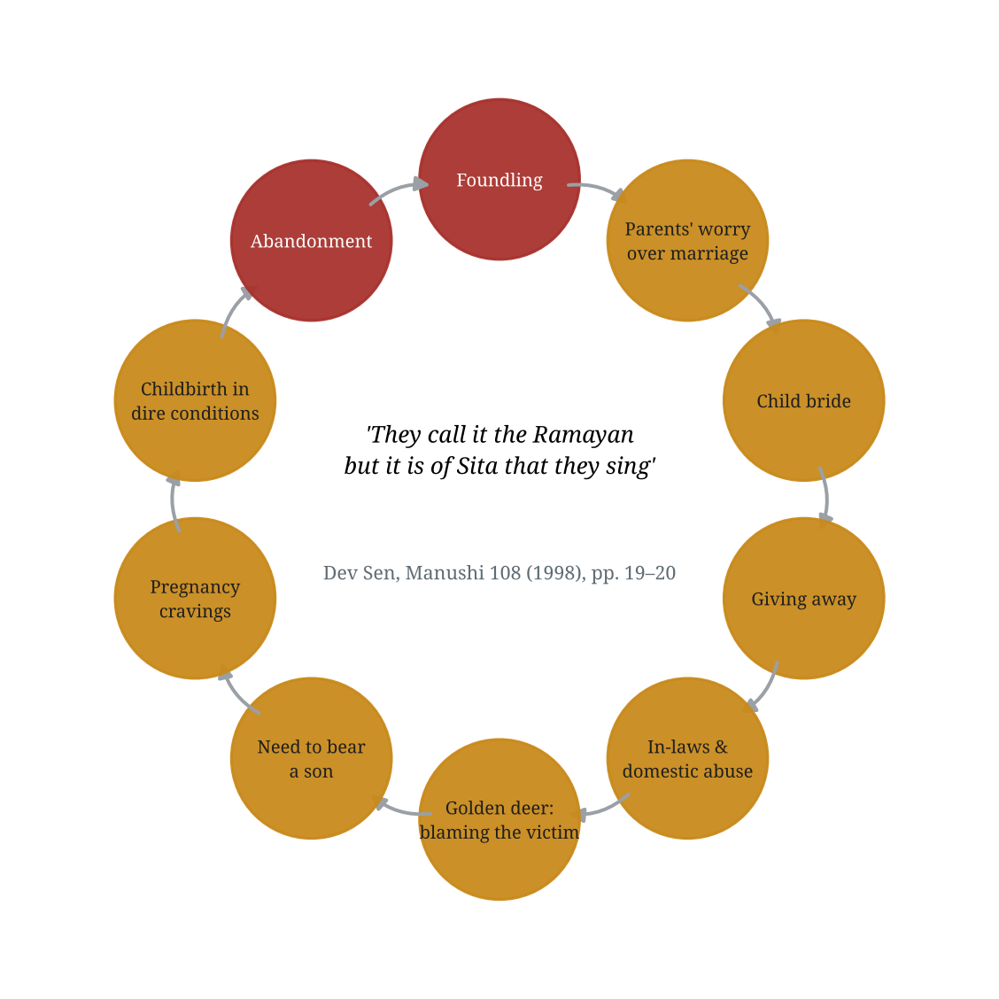
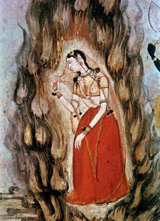

## The women's Rāmāyaṇa

I come now to the part of the inheritance that matters most for this book's argument and that has been most consistently undervalued: the songs in which women across the subcontinent have sung the story of Sita for themselves.

The modern scholarship on these songs is not large, but it is distinguished. Velcheru Narayana Rao's essay on Telugu women's songs, published in *Many Rāmāyaṇas* in 1991, demonstrated that there existed in Telugu a separate women's Rāmāyaṇa, sung by Brahmin and non-Brahmin women at domestic rituals and during work, in which the war barely figures and the concerns are pregnancy, birth, marriage, the relations between women of a household, and the quarrels of daily life.^[Velcheru Narayana Rao, "A Rāmāyaṇa of Their Own: Women's Oral Tradition in Telugu," in *Many Rāmāyaṇas: The Diversity of a Narrative Tradition in South Asia*, ed. Paula Richman (Berkeley: University of California Press, 1991), 114–36 [W072].] Usha Nilsson studied Awadhi and Bhojpuri women's songs in which Sita becomes the language for speaking about power inside the household.^[Usha Nilsson, "'Grinding Millet But Singing of Sita': Power and Domination in Awadhi and Bhojpuri Women's Songs," in *Questioning Ramayanas: A South Asian Tradition*, ed. Paula Richman (Berkeley: University of California Press, 2001) [W099].] Smita Tewari Jassal, working with songs sung by lower-caste women in eastern Uttar Pradesh, showed how Sita's trials became a vocabulary for women's own labour, marriage and caste position.^[Smita Tewari Jassal, *Unearthing Gender: Folksongs of North India* (Durham, NC: Duke University Press, 2012), chap. 4, "Sita's Trials" [W142].] The People's Archive of Rural India has published translations of Marathi grindmill songs (*ovī*) in which trees console Sita in the forest.^[People's Archive of Rural India, Grindmill Songs Project, "Sita's songs of love, exile and sorrow" (published 25 January 2022) [W086].] And Nabaneeta Dev Sen, in the paper she presented at the Sita Symposium at Columbia University and published in *Manushi* in 1998, gathered songs in Bengali, Marathi, Maithili and Telugu into a single argument whose terms still frame the field.^[Nabaneeta Dev Sen, "When Women Retell the Ramayan," *Manushi* 108 (1998): 18–27 [W093].]

Dev Sen's essay deserves close reading, both for what it establishes and for where I think it stops short.

### What the songs choose

Dev Sen's first observation concerns selection. "They call it the Ramayan but it is of Sita that they sing."^[Dev Sen, "When Women Retell," 19.] The women "are not interested in the heroic epic cycle, which has no relevance to their lives. If what they create is fragmentary, it is because their lives are fragmentary. For them, it is the whole story."^[Dev Sen, "When Women Retell," 19.] Their favourite episodes come from the first and last books, the two that classical scholarship regards as later additions; the war, the heart of the male epic, is compressed or omitted.

From the songs she derives ten recurrent sub-themes, which together trace the life of a woman: Sita the foundling, "the girl child as the essential orphan"; the parents' worry over her marriage; child marriage; the giving-away; the in-laws and "the nature of domestic abuse"; the golden deer and the mentality of "blaming the victim"; the need to bear a son; the cravings of pregnancy; childbirth under dire conditions; and abandonment, "facing rejection and dispossession of one's social identity".^[Dev Sen, "When Women Retell," 20.] I have drawn these as a cycle (Figure 2.4), because that is how the songs arrange them. The male epic is a line, from birth through exile and war to coronation. The women's Rāmāyaṇa is a round, the round of a woman's life from her father's house to her husband's and out again, repeated in every generation.

The selection is itself an argument. It says that what matters in the story of Sita is not the war that was fought over her but what happened to her before and after it: that she was found in a furrow and did not know her parents; that she was married young; that she was badly treated in her husband's house; that she was blamed for her own abduction; that she gave birth alone. The heroic epic treats these as background. The women's epic treats the war as background. Neither is "the" Rāmāyaṇa; but only one of them has been called the Rāmāyaṇa in the textbooks.

### What the songs say

The songs, as Dev Sen presents them, are remarkable for their concreteness. In a Marathi work song Sita in exile talks to the trees because there is no one else: "Dear Plum tree, dear Babul tree, Sita is telling you the story of her life. Please listen ... I was found at the tip of a plough / How can I have parents?"^[Dev Sen, "When Women Retell," 20.] In Bengali and Maithili her commonest epithet is *janam-dukhinī*, "born to suffer".^[Dev Sen, "When Women Retell," 21.] In a Maithili song, young Sita, sweeping the courtyard, lifts Śiva's bow with her left hand while sweeping with her right, and her father faints, because a girl that strong will never find a husband; in another, Sita herself goes to her father and says, "How much longer do you plan to keep me unmarried? This is not right behaviour!"^[Dev Sen, "When Women Retell," 21.] In a Telugu wedding song, the bride is "only as tall as seven jasmine flowers", and her father, showing the small child asleep in the huge wedding bed to the groom's father, pleads that she is "still an innocent child", a plea in which Dev Sen hears "a clear hint of the possibility of marital rape".^[Dev Sen, "When Women Retell," 22.] In the Marathi songs of the in-laws' house (*sāsurvās*), Sita is fed bitter neem leaves for twelve years, forbidden to wear *kuṅkum*, forbidden to wash her hair, and denied her husband's bed: "Sita has been in exile right inside her bedroom."^[Dev Sen, "When Women Retell," 22.]

In the exile songs, the concreteness becomes almost unbearable. In Maithili, Sita walks into the forest, and in the third mile her labour begins; she asks a tree to be her friend, offers it her golden bangle, and asks it to cut the cord: "Alas! if only Ram would understand!"^[Dev Sen, "When Women Retell," 25.] In Marathi, smoke rises in the dense forest because water is being boiled; Sita has given birth; she has no bed but a rock, no one to cook for her, no cradle, and for five days she has had nothing to eat.^[Dev Sen, "When Women Retell," 25.] Dev Sen sets these songs beside the statistics of maternal mortality and unattended births in India in the 1990s, and the juxtaposition is not rhetorical; the songs are evidence about the conditions in which the singers gave birth.^[Dev Sen, "When Women Retell," 25.] "This is how women sing themselves into their Ramayan."^[Dev Sen, "When Women Retell," 25.]

And in these songs Rama is judged. The Bengali women, Dev Sen reports, call him *pāṣaṇḍa*, "heartless", and *pāpiṣṭha*, "sinner": "Five months pregnant, Sita was in the royal palace, a heartless Ram sent her off to the forest!"; "Sita takes a few steps and looks back a few times / But oh! the palace of that sinner Ram still rises high."^[Dev Sen, "When Women Retell," 26.] A Marathi song says simply: "Because Sita is a woman ... Ram, just because some wild people talked / You have sent virtuous Sita into the forest!"^[Dev Sen, "When Women Retell," 26.] Another Marathi song gives Rama's lament after the banishment, and it is a lament for a housekeeper: "Who can sprinkle the floor with water as well as she can? Who will give me my dhotis?"^[Dev Sen, "When Women Retell," 23.] And one Marathi song contains an image that I think is among the most profound in the entire Rāmāyaṇa tradition, ancient or modern:

> How did they do it?? It melts our blood into tears ...\
> Who is fighting so bravely in the forest? Who is all alone?\
> Ram is reading about Sita's exile\
> In a book ...^[Dev Sen, "When Women Retell," 25.]

Rama reads about Sita's exile in a book. He is outside the story of her suffering, a reader of it, while she lives it. The singer has grasped, in four lines, what this book is attempting to argue at length: that the history of Sita has been, for most of its course, written and read by those who did not have to live it.

### "Sita is no rebel"?

Having assembled this evidence, Dev Sen draws a conclusion that I think it does not entirely support. "In the women's retelling", she writes, "Sita is no rebel; she is still the yielding, suffering wife, but she speaks of her sufferings, of injustice, of loneliness and sorrow."^[Dev Sen, "When Women Retell," 19.] And at the end of the essay: "She laments but does not challenge Ram in the songs. Other women speak for her just as they expect others to speak up for them. So even in Chandrabati's poem, where Ram is severely criticised, Sita remains a docile wife while Chandrabati, the narrator, lashes her whip under her name."^[Dev Sen, "When Women Retell," 27.] Sita, she concludes, is "a victim who suffers in grandeur, without being vengeful. She is a prey who never turns into a predator."^[Dev Sen, "When Women Retell," 27.]

There is much truth in this, and the observation that "other women speak for her" is acute. But I want to resist the conclusion that the songs therefore do not challenge Rama, and I want to resist it on the basis of Dev Sen's own evidence.

The challenge is there. It is in the epithets "heartless" and "sinner"; in the line "Ram has no compassion I am five months pregnant", which Sita speaks, in the Marathi song, to the women she is leaving;^[Dev Sen, "When Women Retell," 23.] in the Maithili daughter's demand to be married; in the Telugu father's plea against the wedding night. What the songs do not do is place the challenge in the form that a modern reader expects, which is the form of a single woman confronting a single man in a speech of self-assertion. They distribute it. The challenge is voiced by the singer, by the trees, by the women of the household, by Lakshmana, who in a song quoted by Kishwar refuses at first to abandon "a bhabhi such as Sita who is like food for the hungry and clothes for the naked".^[Madhu Kishwar, "Yes to Sita, No to Ram! The Continuing Popularity of Sita in India," *Manushi* 98 (January–February 1997): 23, quoting Vidya Bindu Singh.] It is voiced, above all, by the community of women who sing.

I propose to call this *choral agency*: the agency of a wronged woman whose case is made not by herself alone but by a chorus that includes her. It is not a lesser form of agency than the agency of the solitary speaker. It is a different theory of how justice is to be sought. The solitary speaker addresses the judge and demands a verdict; the chorus addresses itself and builds a common judgement that the judge cannot touch. Consider the Marathi song that Dev Sen quotes near the end of her essay:

> Sita's exile,\
> Let us share it among ourselves.\
> Sita's exile,\
> How many times will it happen?\
> Sita's exile,\
> Is happening every moment, everywhere\
> When leaving for the forest\
> Sita distributed it amongst us all\
> Bit by bit.^[Dev Sen, "When Women Retell," 26.]

This is not the voice of a docile wife. It is not the voice of Sita at all; it is the voice of the women among whom Sita, leaving, "distributed" her exile. It describes a transfer of grievance from one woman to a community, and the formation, through that transfer, of a collective that knows what has been done and how often it is done. Hypothesis A of this research, that the domestic is a counter-epic, finds here its clearest confirmation. The epic of the male bard ends in coronation. The epic of the grindstone ends in a distribution of exile, which is to say, in solidarity.

The Avadh song that Kishwar reproduces goes further still, and gives Sita herself the refusal that Dev Sen did not find. When the sage Vasiṣṭha asks her how she, so wise, can have forgotten Rama, she replies:

> Guru, you who know what I went through but ask me this question\
> As though you know nothing,\
> The Ram who put me in the fire, who threw me out of the house\
> Guru, how shall I see his face? ...\
> But I will never in my life see the face of that heartless Ram again\
> And may fate never cause us to meet again.^[Kishwar, "Yes to Sita," 24.]

Her sons, asked whose sons they are, reply that they are the grandsons of Janaka and the sons of Sita, "and we know not the name of our father": a matrilineal declaration that, as Kishwar notes, disowns the father altogether.^[Kishwar, "Yes to Sita," 24.] And when Rama comes in person, "Sita looked at him one moment, her eyes filled with anger, / Sita descended into the earth, she spoke not a word."^[Kishwar, "Yes to Sita," 24.] The refusal that Vālmīki's last scene stages ambiguously, the women's song stages without ambiguity at all.

### Mithila: the bride's country

One region deserves separate notice, because it claims Sita as its own daughter. In Mithila, the region of north Bihar and southern Nepal where Janaka ruled, Kishwar found that "Sita is treated as a daughter of every household", because, as the songs have it, had Janaka not happened to plough that field that day, someone of any other caste might have found her.^[Kishwar, "Yes to Sita," 28.] The people of Mithila, she reports from a 1986 Hindi travelogue, avoid marrying their daughters in the month in which Sita was married, and avoid marrying them to families in Avadh, or anywhere west of Mithila; they name Sita in their wedding songs and omit Rama.^[Kishwar, "Yes to Sita," 28.] A daughter in one song instructs her father to find her a groom from the north, the south or the east, but "don't go westward, O father".^[Kishwar, "Yes to Sita," 28.] P. Karn's recent work on Kāyastha women's wedding songs in Maithili shows "Sita" functioning almost as a common noun for "daughter", and reads the songs as a Maithil feminism of their own.^[P. Karn, "Poetics of Maithili Folk Songs: Re-defining 'Sita' as a Maithil Feminist," *SCHOLARS* 8, no. 1 (2026): 62–72 [W205].]

The case of Mithila adds a dimension that the liberation narrative cannot accommodate. Here is a region whose entire marriage culture is organised around a judgement on Rama as a son-in-law, and a judgement in Sita's favour. It is not a modern judgement. It is not a feminist judgement in any sense the word would have in a seminar. And yet it is a judgement, enacted generation after generation, in the most consequential decisions families make. It is an intellectual tradition in the strict sense: a body of reasoning about marriage and its dangers, transmitted and applied.

## The painted Sita

The visual traditions require a book of their own, and I can do no more here than indicate their bearing on the argument.

The great manuscript Rāmāyaṇas of the seventeenth century, above all the Mewar Rāmāyaṇa commissioned by Mahārāṇā Jagat Singh I of Udaipur and painted between 1649 and 1653 by Sahibdin, Manohar and their workshops, tell the story as continuous narrative in hundreds of folios, with Sita present in scene after scene: in the forest, in the Aśoka grove, before the fire. The Pahari ateliers of the late eighteenth century, in Guler and Kangra, gave the forest exile a lyrical intimacy in which Sita, Rama and Lakshmana share meals, gather flowers and sleep under the trees. These are court paintings, made for kings; their Sita is beautiful, devoted and, as befits the patrons, largely without complaint.

The women's visual traditions are another matter. In Bengal, the Paṭuā scroll painters, many of them Muslim by name and many of them women, sing the story as they unroll the scroll; Mandakranta Bose has shown that their Rāmāyaṇa scrolls dwell on Sita's abduction and invite sympathy for her.^[Mandakranta Bose, *Ramayana in Bengali Folk Paintings* (New Delhi: Niyogi Books) [W157] (year to be confirmed); on the women painters of Naya, corpus W112.] Moyna Chitrakar's scrolls became, in 2011, the basis of the graphic novel *Sita's Ramayana*, discussed in Chapter 13. In Mithila, women's wall and floor painting, made for weddings and domestic rituals and transferred to paper from the 1960s, made Sita's wedding one of its central subjects; Sita Devi of Jitwarpur (c. 1912–2005), honoured with the Padma Shri in 1981, painted the Rāmāyaṇa in this tradition, and in April 2024 an exhibition of one hundred Madhubani paintings by thirty-seven women artists presented a whole Mithila Rāmāyaṇa in Delhi, framed by the saying that "every bride is Sita and every groom is Ram".^[Corpus workbook, W051 and W195.] A review of another exhibition records a Sita painted with her lips erased, a silence that the viewer may read as agency.^[Corpus workbook, W198; the reviewer found the show "more devotional than feminist".]

The relation between these visual traditions and the women's songs is the relation of the court to the courtyard. The court paintings show Sita; the women's paintings and scrolls are made by women who have, as the Mithila saying has it, been Sita. Hypothesis D, that vernacular women's narratives constitute intellectual history, extends to images as well as words. A Paṭuā woman singing the abduction as she unrolls her scroll is reasoning, in paint and song, about what it means for a woman to be carried off and then blamed for it.

::: {custom-style="Box Title"}
Reading Against the Text
:::

::: {custom-style="Box"}
In the *Adhyātma Rāmāyaṇa* and the *Rāmcaritmānas*, a shadow Sita is abducted while the real Sita waits safely in the fire. If the shadow suffered the captivity, who walked into the fire at Laṅkā, and who came out? And if the devotional tradition could imagine a woman whose suffering was not real, what does that tell us about the kind of woman it was able to imagine as real?
:::

::: {custom-style="Box Title"}
The Debate: Tradition
:::

::: {custom-style="Box"}
**Position A:** Tradition is patriarchal continuity: the Rāmāyaṇa, in all its forms, transmits and sanctifies the subordination of women.\
**Position B:** Tradition is plurality and contestation: the Rāmāyaṇa has always contained its own critique, in regional poets, sectarian tellings and above all women's songs.\
**Where the evidence of this chapter leaves the argument.** Position B is better supported, but only if plurality is understood as stratified. The critique of Rama is indigenous and old: the Assamese *Uttarakāṇḍa*, the *Adbhuta*, Candrābatī, the Mithila marriage customs and the songs of the grindstone all attest it. But the critique was distributed unevenly by register, language and caste. It was loudest where it was least likely to be written down, and quietest in the text that became North India's scripture. A defender of tradition who cites the songs must also admit that the tradition did not let the songs into the court. A critic of tradition who cites Tulsī must also admit that the women who sang against Rama were singing the Rāmāyaṇa.
:::

## Conclusion

The inheritance that the modern writers received was neither the silent Sita of the liberation narrative nor a uniformly radical Sita waiting to be rediscovered. It was a field of tellings, in which the devotional mainstream had spiritualised Sita, protected her by a shadow and removed the banishment from scripture, while the margins of the field, in Assam, in Bengal, in Mithila, in the songs of the grindstone and the scroll, had preserved and sharpened her refusal, and had turned the epic of a hero's war into the epic of a woman's life.

What happened next is the subject of Chapter 3. The nineteenth century did not invent the ideal Sita; the materials for her lay ready in the *Mānas*. But it selected those materials, printed them, painted them in oil, put them on stage and on screen, and made them the emblem of a nation. In doing so it made the margins of the field invisible to the new reading public, and it is that public, educated in English and Hindi and taught to think of Tulsī's Sita as "the traditional Sita", that the modern feminist retellings would set out to liberate.
