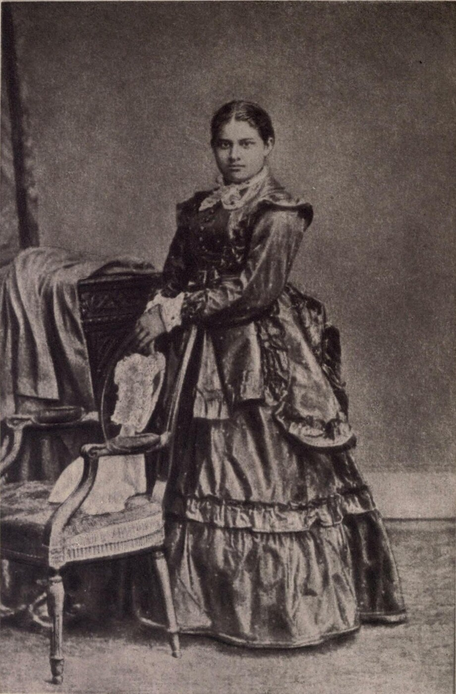

# Chapter 3. The Colonial Sita: Reform, Nation and the Manufacture of the Ideal Wife

::: {custom-style="Epigraph"}
"This linear view of human society makes the past something to be studied and kept in museums but is not expected to encroach upon the supposedly superior wisdom of the present generation."

— Madhu Kishwar, *Manushi* 98 (1997), p. 22
:::

## The argument of this chapter

If Chapter 1 established that Vālmīki's Sita is not silent, and Chapter 2 that the devotional mainstream spiritualised her while the margins preserved her refusal, this chapter asks where the silent and submissive Sita of modern common sense came from. My answer is that she was manufactured, in the precise sense of the word: made by hand, from existing materials, in identifiable workshops, for identifiable markets, during the century and a half of colonial rule. The materials lay ready in Tulsī and in the Sanskrit *strīdharma* literature. The workshops were the reformer's study, the nationalist's lecture hall, the painter's press and the film studio. The markets were a new reading public, a new nation-in-the-making, and a colonial interlocutor whose contempt for Indian womanhood demanded an answer.

The chapter makes five claims.

1. The colonial encounter placed Indian womanhood on trial, and made the condition of women the index by which a civilisation was to be judged. Indian reformers and nationalists accepted the jurisdiction of that tribunal even as they contested its verdict.

2. The reformers' Sita, exemplified by Īśvaracandra Vidyāsāgar's *Sītār Banabās* (1860), was a Sita of sentiment: her suffering was made into an instrument for educating the feelings of a new middle-class reader, and for arguing, by implication, for the companionate marriage.

3. The nationalists' Sita was the emblem of an inner domain that the coloniser could not touch. Partha Chatterjee's account of the "nationalist resolution of the women's question" explains why that Sita had to be chaste, self-sacrificing and silent: she was the guarantee that the nation, whatever it borrowed from the West in the outer world, remained itself at home.

4. Print, oleograph, theatre and cinema fixed the image. Raja Ravi Varma's presses, Phalke's *Lanka Dahan* (1917) and Vijay Bhatt's *Ram Rajya* (1943) gave the ideal Sita a face, a costume and a posture that the twentieth century would treat as "traditional".

5. The same century produced the first modern counter-Sitas: Michael Madhusudan Dutt's Lanka-centred epic and his heroines' letters, Toru Dutt's domestic Sita, and Tagore's rediscovery of Urmila. The colonial period was not only the period of the ideal wife; it was also the period in which the ideal began to be argued with in modern forms.

## The tribunal

Let me begin with the trial, since this book has been concerned from its first page with trials.

In the first decades of the nineteenth century, the East India Company's servants, the evangelical missionaries who arrived after the Charter Act of 1813 opened India to them, and the utilitarian philosophers who wrote about India without visiting it, came to share a conviction: that the condition of a society's women was the surest index of its place on the scale of civilisation, and that the condition of Hindu women placed Hindu society very low indeed. James Mill's *History of British India* (1817) gave the conviction its most influential formulation, treating the degradation of women as a characteristic of rude peoples and their elevation as a mark of the civilised, and finding the Hindus firmly among the former.^[James Mill, *The History of British India*, 3 vols. (London: Baldwin, Cradock and Joy, 1817), vol. 1 (pinpoint to be verified).] The debates over *satī*, culminating in Bentinck's regulation of 1829, over female infanticide, over widow remarriage, over child marriage and the age of consent, were conducted within this frame. The question in each was not only what should be done, but what the practice revealed about Hindu civilisation.

Lata Mani's study of the *satī* debate made the decisive observation about the structure of these arguments. In them, she showed, women were neither the subjects nor, finally, the objects of the discourse; they were its ground. Officials, missionaries and Indian reformers argued with one another about what scripture required, what custom permitted, what tradition really was, and the burning woman was the occasion of the argument rather than its participant. "Women in fact became the site on which tradition was debated and reformulated."^[Lata Mani, "Contentious Traditions: The Debate on Sati in Colonial India," *Cultural Critique* 7 (1987): 119–56, at 153†. See also Lata Mani, *Contentious Traditions: The Debate on Sati in Colonial India* (Berkeley: University of California Press, 1998).]

Sita entered this debate as evidence. For the missionary, she was evidence of the degradation of the Hindu woman: a wife commanded to walk into fire, banished on rumour, taught that her husband was her god. For the reformer, she was evidence that Hindu tradition contained, in its purest sources, an ideal of womanhood higher than anything Europe could show, and that the abuses of the present were corruptions of that ideal. For the orthodox defender of custom, she was evidence that Hindu women had always been, and should remain, devoted and self-effacing. All three parties agreed on what Sita was. They disagreed about whether to deplore or to venerate her.

That agreement is the root of the modern liberation narrative's first error. The missionary and the reformer between them settled the description of Sita as the silent, suffering, self-sacrificing wife, and the description outlived both of them. When, a century later, a feminist retelling set out to free Sita from silence and self-sacrifice, it accepted the description and reversed the valuation. It took its Sita from the tribunal of the nineteenth century, not from Vālmīki.

This is what I mean by coloniality in the reading of Sita. It is not that the critics of Rama are colonial agents; I have argued in Chapter 2 that the critique of Rama is indigenous and old. It is that the object of modern critique, the "traditional Sita", is a figure whose features were fixed in a debate conducted under colonial conditions and on colonial terms, in which Indian participants accepted the coloniser's premise that the status of women was a verdict on the civilisation and set out to win the case. Kishwar's observation that the "popular western view" treats the past as something "to be studied and kept in museums" is apposite here.^[Madhu Kishwar, "Yes to Sita, No to Ram! The Continuing Popularity of Sita in India," *Manushi* 98 (January–February 1997): 22.] The nineteenth century turned Sita into a museum piece, a display of ideal womanhood behind glass, and the twentieth century's critics, breaking the glass, assumed that the display was the thing itself.

## The reformer's Sita: sentiment as pedagogy

The first great modern prose retelling of Sita in an Indian language was written by a man whom Bengal still remembers above all as a reformer of women's condition. Īśvaracandra Vidyāsāgar (1820–1891), the Sanskrit scholar whose campaign led to the Hindu Widows' Remarriage Act of 1856 and who spent much of his later life arguing against polygamy and for women's education, published *Sītār Banabās* (The Exile of Sita) in 1860.^[Ishwar Chandra Vidyasagar, *Sitar Banabas* (Calcutta, 1860) [W026]. The corpus workbook records it as a prose narrative listed under "Novel", and notes that the edition must be checked.] It is a prose narrative of the seventh book, drawn principally from Bhavabhūti's *Uttararāmacarita*, and it dwells, at length and with deliberate pathos, on Sita's grief in exile.

The choice of subject is itself significant. Vidyāsāgar did not retell the war or the coronation. He retold the banishment, the episode that Tulsī had left out of scripture and that the women's songs had made their own. And he retold it through Bhavabhūti, whose drama is built around Rama's remorse and the possibility of reconciliation, rather than through Vālmīki, whose seventh book ends in the earth. The consequence is a Sita whose suffering is the occasion for an education in feeling. The reader of *Sītār Banabās*, a member of the new Bengali middle class formed by English education and the colonial bureaucracy, was invited to weep for Sita, and through weeping to learn that a wife was a being with feelings that a husband could wound.

This pedagogy of sentiment was the reformers' characteristic method, and its ambivalence should be stated clearly. On one hand, it made Sita's suffering visible and morally significant at a time when the suffering of real widows and child-wives was a matter of public argument; to weep for Sita was, implicitly, to concede that women's pain mattered. On the other hand, it made her suffering the very substance of her virtue. A Sita who is admirable because she suffers well is a Sita whose suffering must continue for her to remain admirable. The reformers wanted husbands to be kinder; they did not, on the whole, want wives to be less patient. The Sita of sentiment taught men compassion and women endurance.

Tanika Sarkar's work on the conjugality debates of late-nineteenth-century Bengal, and especially on the controversy around the Age of Consent Bill of 1891, shows how quickly this pedagogy of sentiment could be turned to the opposite purpose. The orthodox opponents of reform, she argues, constructed a "Hindu wife" whose voluntary submission, whose love expressed as self-surrender, was the proof that Hindu marriage needed no reform; the very suffering that the reformers had used to argue for change became, in their hands, the evidence of a superior spiritual conjugality.^[Tanika Sarkar, *Hindu Wife, Hindu Nation: Community, Religion, and Cultural Nationalism* (New Delhi: Permanent Black, 2001) (pinpoint to be verified).] Sita served both sides. That is the mark of an emblem rather than a person.

## The poet who preferred Lanka

The year after Vidyāsāgar's book, and in the same city, Michael Madhusudan Dutt (1824–1873) published the first volume of the *Meghnādbadh Kābya* (The Slaying of Meghanāda), and nothing in Bengali literature was the same afterwards.^[Michael Madhusudan Dutt, *Meghnadbadh Kavya* (1861); English translation, *The Slaying of Meghanada: A Ramayana from Colonial Bengal*, trans. Clinton B. Seely (New York: Oxford University Press, 2004) [W027].] A convert to Christianity, a lover of Milton and Homer and Tasso, a man who had tried and failed to become an English poet before he became the founder of modern Bengali poetry, Madhusudan wrote his epic in blank verse (*amitrākṣar chanda*), a form he imported into Bengali for the purpose, and he wrote it from Lanka's side. Its hero is Ravana's son Meghanāda, killed treacherously by Lakshmana while at prayer; its sympathies lie with the besieged city, its grieving king and its doomed prince. In a letter to his friend Rajnarayan Basu, Madhusudan put his position with a candour that still shocks: "I despise Ram and his rabble, but the idea of Ravan elevates and kindles my imagination; he was a grand fellow."^[Michael Madhusudan Dutt to Rajnarayan Basu, 1860, as quoted in Seely's introduction to *The Slaying of Meghanada* (pinpoint to be verified)†.]

For the history of Sita, Madhusudan's epic matters in two ways. First, it contains a striking scene in which Sita, captive in the Aśoka grove, tells her story to the *rākṣasī* Saramā, Vibhīṣaṇa's wife, who befriends her. The two women talk, and through their talk the poem allows Sita a retrospective account of her own life that is neither the devotional narrator's nor Rama's. It is one of the first modern scenes in which Sita narrates, and it is significant that she narrates to another woman, and to a woman of the enemy. Second, the epic's most memorable woman is not Sita at all but Pramīlā, Meghanāda's wife, who leads a band of armed women through Rama's lines to reach her husband in the besieged city, and who, when he is killed, mounts his funeral pyre.

Pramīlā has been claimed for feminism, and she deserves the claim; a woman who leads an army of women through enemy lines to join her husband has exercised a martial agency few heroines in Indian literature can match. But she also dies as a *satī*, thirty years after Bentinck's regulation, in a poem by a Christian convert who idolised Milton. The tension is not a confusion in Madhusudan's thought. It is the tension of the colonial moment itself, which could imagine an Indian woman's heroism only within a narrative that ended by consuming her. Hypothesis B, that Sita is not liberated simply by acquiring a voice, has a corollary here: Pramīlā is not liberated simply by acquiring a sword.

In 1862 Madhusudan published *Bīrāṅganā Kābya* (The Heroines), a collection of eleven verse letters in which women of myth write to the husbands and lovers who failed them, modelled on Ovid's *Heroides*.^[Michael Madhusudan Dutt, *Birangana Kabya* (1862) [W238]. The corpus workbook notes that it must be checked which of the eleven letters come from the Rāmāyaṇa; Kaikeyi's letter to Dasharatha is one.] Among the writers is Kaikeyī, who writes to Daśaratha; among them, too, is Śūrpaṇakhā, who writes to Lakshmana. The heroines show anger, desire and grief rather than a goddess's composure. It is among the first modern works in any Indian language to let the women of the epics address the men who wronged them in their own voices, and it is telling that its form came from Rome by way of English education. The colonial century's first experiment in giving epic women a voice borrowed the voice from Ovid.

I do not say this to diminish Madhusudan's achievement, which was immense, but to make a point that will recur. The first modern counter-Sitas were made with imported tools: blank verse, the epistolary heroine, the Romantic cult of the defeated rebel, the sympathy for Satan that Blake and Shelley had found in Milton. The modern critique of Rama, in its first literary form, owed as much to *Paradise Lost* as to Candrābatī. That does not make it inauthentic; Bengali literature absorbed these forms and made them its own. But it does mean that the modern Sita who talks back was, from her first appearance, a bilingual creature, and that the question of whose idiom she speaks in has been with her from the beginning.

## Toru Dutt: Sita in the darkened room

In 1882, five years after her death at the age of twenty-one, the Bengali poet Toru Dutt's *Ancient Ballads and Legends of Hindustan* was published in London with an introduction by Edmund Gosse. Among its poems is a short lyric titled "Sita".^[Toru Dutt, "Sita," in *Ancient Ballads and Legends of Hindustan* (London: Kegan Paul, Trench, 1882) [W028] (pinpoint to be verified).] It begins, "Three happy children in a darkened room!"† The children are listening to their mother tell the story of Sita's second exile: of the forest, of the hermitage, of the sage, of Sita weeping. They weep with her. The poem ends in the room, not in the forest.

The poem is slight, and it has often been read as a pretty exercise in Orientalist picturesque by a young woman educated in France and England. I think it is more than that, and that its significance lies precisely in its frame. Toru Dutt does not retell Sita's story. She retells the telling of it: a mother, in a Bengali house, narrating Sita's exile to her children, who weep. The poem locates the Rāmāyaṇa where the women's songs located it, in the home, in the voice of a woman speaking to those she raises. It is the domestic counter-epic of Hypothesis A, written in English by a Christian woman who would die before she was twenty-two. And it shows the exile, the episode Tulsī excised and Vidyāsāgar made sentimental, being transmitted within the household as the part of the story that matters. A reader looking for the colonial Sita's rebellion will not find it here. A reader looking for evidence of how the story actually lived among women in the colonial century will find it in the darkened room.

