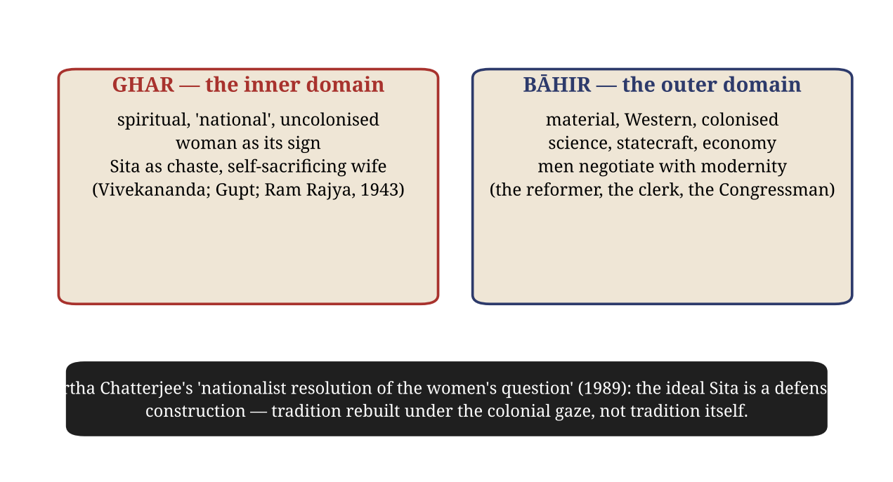
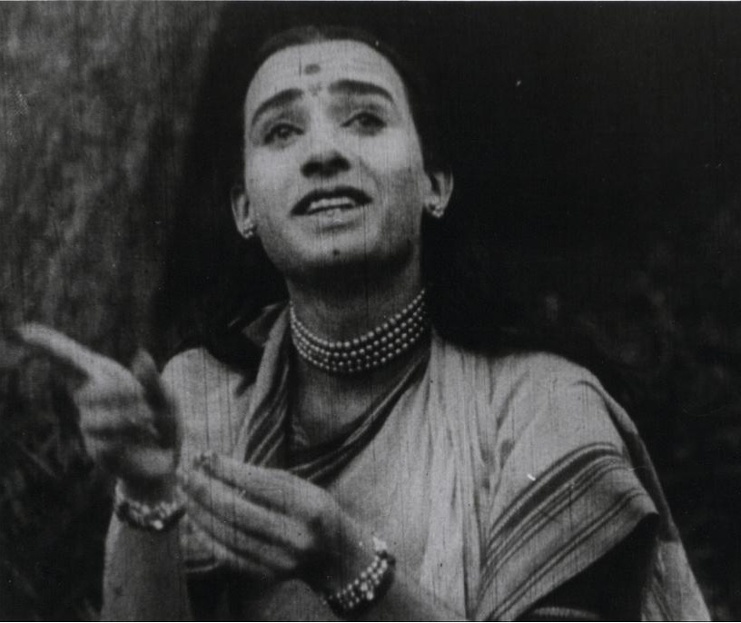

## The nationalist's Sita: the inner domain

If the reformers made Sita an instrument of sentiment, the nationalists made her an emblem of the nation itself. The shift can be dated roughly to the last two decades of the nineteenth century, and its logic was set out a century later by Partha Chatterjee in an essay that has become indispensable to any account of gender in colonial India.

Chatterjee's argument is that Indian nationalism, from the late nineteenth century, resolved the "women's question" by dividing the world into two domains.^[Partha Chatterjee, "The Nationalist Resolution of the Women's Question," in *Recasting Women: Essays in Colonial History*, ed. Kumkum Sangari and Sudesh Vaid (New Delhi: Kali for Women, 1989), 233–53 [W066]; expanded in Partha Chatterjee, *The Nation and Its Fragments: Colonial and Postcolonial Histories* (Princeton, NJ: Princeton University Press, 1993), chaps. 6–7.] In the outer, material domain (*bāhir*), the domain of science, technology, economy and statecraft, the West was acknowledged to be superior, and Indians had to learn from it. In the inner, spiritual domain (*ghar*), the domain of religion, family and culture, India was superior and must remain untouched. Woman was the guardian and the sign of the inner domain. "The home in its essence must remain unaffected by the profane activities of the material world—and woman is its representation."^[Chatterjee, *Nation and Its Fragments*, 120†.] The nationalist could wear trousers in the office and speak English in court, provided his wife at home remained, in some essential way, Sita.

This resolution required a particular Sita. She had to be chaste, because her chastity was the nation's integrity. She had to be self-sacrificing, because her sacrifice was the moral capital against which the outer world's compromises were drawn. And she had to be silent, or at least to speak only in the register of devotion, because a Sita who argued with her husband, who taunted him with being "a woman in a man's form", who called him a common man before the armies, would have introduced into the inner domain precisely the conflict that the inner domain existed to exclude. The nationalist Sita was Vālmīki's Sita with the arguments removed.

The most eloquent architect of this Sita was Swami Vivekananda (1863–1902), and it is worth being precise about what he said, since he is often cited and rarely read. In lectures delivered in India and in America at the turn of the century, Vivekananda held up Sita as the unique and unsurpassable ideal of Indian womanhood: pure, patient, all-suffering, never uttering a harsh word against Rama even after her banishment, the very embodiment of what Indian women should be and what Western women could not understand.^[Swami Vivekananda, "The Ramayana" (lecture delivered at Pasadena, California, 31 January 1900) and "Women of India," in *The Complete Works of Swami Vivekananda*, Mayavati Memorial Edition (Calcutta: Advaita Ashrama), vols. 4 and 9 respectively (pinpoints to be verified). I paraphrase rather than quote.] Two things are striking about this portrait. The first is that it is, in significant respects, untrue to Vālmīki: Vālmīki's Sita speaks harshly to Rama more than once, and her last act is a refusal. The second is that it was constructed, in large part, for a foreign audience. Vivekananda's Sita was an argument addressed to the West about the superiority of Indian spiritual womanhood. She was, in the most literal sense, Sita for export, and she came home bearing the authority of having impressed the world.

I want to be careful here, because Vivekananda is a figure of the first importance in the recovery of Indian self-respect under colonialism, and nothing I say should be taken to diminish that. His insistence that India had something to teach the world, and not merely to learn, was a necessary act of epistemic courage. But the Sita he taught was shaped by the very tribunal he was defying. The missionary had said that Indian women were degraded; Vivekananda answered that they were exalted, and offered as proof a Sita who embodied the virtues the missionary would recognise as feminine: purity, patience, self-sacrifice, gentleness. He won the argument on the missionary's terms. The Sita who was the price of the victory was a Sita whom the missionary could admire, which is to say, a Sita who did not argue.

Mohandas Gandhi (1869–1948) inherited this Sita and transformed her into a political instrument of extraordinary power. For Gandhi, Sita was the model of the satyagrahi: a woman who resisted the overwhelming force of Ravana by the strength of her purity and her refusal, without violence, and who could therefore stand for the resistance of a subject people to an empire. He invoked her in his campaigns for *swadeshi* and in his appeals to women to join the national movement, and his vision of a just polity took the name of *Rāmrājya*.^[See, among many statements, Gandhi's writings on women and on Rāmrājya in *The Collected Works of Mahatma Gandhi* (New Delhi: Publications Division) (pinpoints to be verified).] Gandhi's Sita is, in one respect, closer to Vālmīki's than Vivekananda's: she resists. She refuses Ravana; she does not merely suffer. But it is the resistance of the Aśoka grove, not the resistance of the riverbank or the assembly. Gandhi needed a Sita who refused the coloniser; he had no use for a Sita who refused her husband, and he did not dwell on her.

Here, then, is the decisive move. The nationalist Sita refused only outward, at Ravana, at the foreign abductor, at Laṅkā, which could be read as the empire. Inward, towards Rama and Ayodhya, she was silent. The refusal that Vālmīki gave her, the refusal of the king's second trial, was redirected outward and turned into an emblem of national resistance. Her capacity for defiance was preserved, but it was assigned a new target. That redirection is one of the most consequential editorial acts in the history of the Rāmāyaṇa, and it was performed not by Brahmanical patriarchy in some timeless sense but by the national movement in the first half of the twentieth century.

## Urmila remembered: Tagore and the poets' neglect

The same decades produced a rediscovery whose consequences are traced in Chapter 6. Around 1900, Rabindranath Tagore wrote a short essay, "Kābye Upekṣitā" (The Women Neglected in Poetry), in which he named Ūrmilā, Lakshmana's wife, left behind in Ayodhya for fourteen years, as the heroine the poets had forgotten.^[Rabindranath Tagore, "Kabye Upekshita," collected in *Prachin Sahitya* (1907) [W029]. The corpus workbook records the date as c. 1900–1907.] In 1908, Mahāvīr Prasād Dvivedī, the editor of the Hindi journal *Sarasvatī*, published an essay urging Hindi poets to repair their neglect of her.^[Mahavir Prasad Dwivedi, essay on the poets' neglect of Urmila, *Saraswati* (1908) [W030]; title wording and year to be checked.] The challenge was taken up by Maithilīśaraṇ Gupt, whose *Pañcavaṭī* (1925) had already treated the Śūrpaṇakhā episode, and whose *Sāket* (1931), a long Hindi epic centred on Urmila's separation, became one of the canonical works of modern Hindi poetry.^[Maithili Sharan Gupt, *Panchavati* (1925) [W035]; *Saket* (Jhansi: Sahitya Sadan, 1931) [W036].]

*Sāket* is a nationalist and devotional poem, and its Urmila is a figure of patriotic self-sacrifice: she waits because her husband serves a cause, and her waiting is itself a form of service. In its eighth canto, Kaikeyī repents in public at Citrakūṭ, an addition that redeems the epic's villainess for the national family. Shanta Gokhale has argued that the poem, for all its devotion to Urmila, gave her "no real substance or voice", and the corpus records her judgement as a test of Hypothesis B.^[Corpus workbook, W036, recording Shanta Gokhale's criticism.] I agree. The rediscovery of Urmila was real, and it began a line that runs through Warerkar, the Telugu songs, Kavita Kane and the Adishakti theatre company. But in its nationalist moment, the rediscovered woman was given a place in the national pantheon rather than a voice of her own. Tagore noticed her absence; Gupt filled it with a monument.

## The face of the ideal: oleograph, stage and screen

Ideals become common sense when they acquire a face. The decisive faces of the modern Sita were made between 1890 and 1945, by a painter, a stage, and two film studios.

### The painter's press

Raja Ravi Varma (1848–1906), the Travancore aristocrat who taught himself European oil technique and became the most celebrated Indian painter of his time, painted the Rāmāyaṇa repeatedly: Sita in the Aśoka grove, Ravana carrying Sita off as Jaṭāyu attacks, Rama's coronation, Sita's descent into the earth. In 1894 he founded a lithographic press in Bombay, later moved to Malavli near Lonavala, which reproduced his mythological paintings as cheap oleographs and distributed them across the subcontinent. Within a generation, the Ravi Varma Sita, a fair-skinned, full-figured woman in a draped sari, her eyes lowered, her posture modest, hung in hundreds of thousands of Indian homes. Kajri Jain's study of Indian calendar art traces how this image passed, through the bazaar print and the calendar, into the visual common sense of the twentieth century.^[Kajri Jain, *Gods in the Bazaar: The Economies of Indian Calendar Art* (Durham, NC: Duke University Press, 2007) (pinpoint to be verified).]

Two features of the Ravi Varma Sita bear on the argument. First, she is an academic nude's modest cousin: her body is rendered in the idiom of European salon painting, with its conventions of feminine beauty, and then draped. The "traditional" Sita of the calendar is, in this precise sense, a colonial-modern creation, the product of an Indian painter's mastery of a European technique. Second, the press standardised her. The Sita of the Paṭuā scroll, the Mithila wall, the Pahari miniature and the temple mural had been many; the Sita of the oleograph was one, reproduced identically in every bazaar. Judith Butler's account of gender as "the repeated stylization of the body, a set of repeated acts within a highly rigid regulatory frame that congeal over time to produce the appearance of substance, of a natural sort of being" describes, with uncanny exactness, what the oleograph did to Sita.^[Judith Butler, *Gender Trouble: Feminism and the Subversion of Identity* (New York: Routledge, 1990), 33†.] Repetition produced the appearance of nature. The Sita on the kitchen wall looked traditional because she was everywhere, and she was everywhere because she was mass-produced.

### The stage and the screen

The theatre had come first. Viṣṇudās Bhāve's *Sītā Svayaṃvar*, staged in 1843, is usually counted as the first modern Marathi play, and it put a Rāmāyaṇa wedding on the stage for a new urban audience.^[Vishnudas Bhave, *Sita Swayamvar* (1843) [W024].] The Parsi theatre and the Marathi *saṅgīt nāṭak* made the mythological play a staple of the late-nineteenth-century stage. And in 1917 Dadasaheb Phalke, who had made India's first feature film four years earlier, made *Lanka Dahan* (The Burning of Lanka).^[Dadasaheb Phalke, dir., *Lanka Dahan* (1917) [W032].]

In *Lanka Dahan*, Sita and Rama were both played by the same actor, Anna Salunke, a man. Women did not then act in Indian films, and Salunke, who had played the queen Taramati in Phalke's *Raja Harishchandra*, was the studio's specialist in women's roles. The fact is usually mentioned as a curiosity of early cinema. It is more than that. The first screen Sita was a performance of femininity by a male body, and a performance so successful that audiences reportedly prostrated themselves before the screen. If one wanted a demonstration of Butler's thesis that gender is performative, one could not ask for a better one: the ideal wife of the nation was, in her first cinematic incarnation, a man performing her. The modesty, the lowered eyes, the gestures of devotion were a repertoire of repeated acts, learned and executed, and the body that executed them was irrelevant to their effect.

The talkies made the ideal speak, and what it said was devotion. Debaki Bose's *Seeta* (1934), with Durga Khote as Sita and Prithviraj Kapoor as Rama, filmed the seventh book and the exile, and was the first Indian sound film shown at an international festival, at Venice in 1934.^[Debaki Bose, dir., *Seeta* (1934) [W037].] Vijay Bhatt's *Ram Rajya* (1943), with Shobhana Samarth as Sita, became the most influential of all: Samarth's Sita, gentle, luminous and composed, passed directly into the calendar art of the following decades, and the film is often said to have been the only one Gandhi ever watched.^[Vijay Bhatt, dir., *Ram Rajya* (1943) [W038]. The claim about Gandhi is widely repeated and should be treated as reported tradition.] The title is the argument. *Rāmrājya* was the name of the nationalist utopia, and the film set its Sita at the heart of it, banished and yet serene, an emblem of the sacrifice on which the ideal kingdom rests. The year was 1943; the Quit India movement had been crushed the year before; Bengal was starving. The nation needed a Sita who could suffer without bitterness, and the studio supplied her.

## The other colonial Sitas

It would be a grave distortion to leave the impression that the colonial century produced only the ideal wife. It also produced, in its last three decades, the first modern counter-Sitas in the Indian languages, and they are the subject of Part II. Here I simply name them, in order that the reader may hold them in mind as the background of what has been argued.

Around 1912–15, the Odia poet Gangadhar Meher wrote *Tapasvinī*, an eleven-canto poem on Sita's life after the banishment, in which her grief, in Vālmīki's hermitage, becomes ascetic strength.^[Gangadhar Meher, *Tapaswini* (c. 1912–15) [W239]; the year of composition is to be checked.] In 1919, the Malayalam poet Kumaran Asan published *Cintāviṣṭayāya Sīta* (Sita Lost in Thought), in which Sita, alone after her sons have gone to Rama's court, looks back on her life and judges Rama's choices.^[Kumaran Asan, *Chintavishtayaya Sita* (1919) [W033].] In 1924, the Telugu writer Gudipati Venkata Chalam wrote a play, *Sita Agnipravesam*, in which Sita declares Ravana nobler than Rama because he asked for her love, and walks into Ravana's pyre.^[Chalam, *Sita Agnipravesam* (1924) [W034]; the date is given by Volga.] In 1943, the Tamil writer Pudumaippittan published "Sāpa Vimocanam", in which Ahalya, freed from stone, hears of Sita's ordeal and chooses to become stone again.^[Pudumaippittan, "Saapa Vimochanam" (1943) [W039].] And in 1944, Kuvempu wrote the Kannada play *Śūdra Tapasvi*, in which Rama is brought to see the injustice of killing Śambūka.^[Kuvempu, *Shudra Tapasvi* (1944) [W040].]

The list makes a point that the liberation narrative cannot absorb. The first sustained modern critiques of Rama's treatment of Sita were written in Odia, Malayalam, Telugu, Tamil and Kannada, by men, between 1912 and 1944, while the nationalist ideal was at its height. They were contemporaneous with the manufacture of the ideal wife, not subsequent to it. The ideal and its critique were born together, in the same colonial century, as two answers to the same tribunal. One answered: our women are exalted, and here is Sita to prove it. The other answered: our tradition contains its own judgement on Rama, and here is Sita to pronounce it.

::: {custom-style="Box Title"}
Reading Against the Text
:::

::: {custom-style="Box"}
In *Lanka Dahan* (1917), a man played both Rama and Sita. Suppose that the most influential image of the "traditional" Sita, the modest, devoted figure of the calendar and the screen, was from its first appearance a performance of femininity that any trained body could give. What, then, is a feminist retelling liberating when it liberates "the traditional Sita": a woman, or a repertoire?
:::

::: {custom-style="Box Title"}
The Debate: Feminism
:::

::: {custom-style="Box"}
**Position A:** Feminism's task is the recovery of an oppressed woman: to restore to Sita the voice and agency that patriarchy took from her.\
**Position B:** Feminism's task is the critique of the very category of the ideal woman: to show how "Sita" was constructed and to whose benefit.\
**Where the evidence of this chapter leaves the argument.** The colonial evidence strongly favours Position B as a starting point. The ideal Sita was made, in identifiable places and for identifiable purposes: by reformers educating sentiment, by nationalists guarding an inner domain, by a painter's press, by film studios. To "recover" her is to accept her as given. But Position B, pressed alone, risks treating every Sita as a construction and none as a person, and so reproduces the structure Lata Mani identified, in which women are the ground of the argument rather than its subjects. The way through is to read the colonial Sita as a construction and to read Vālmīki's, Candrābatī's and the songs' Sitas as evidence that the construction suppressed.
:::

## Conclusion

The silent and submissive Sita of modern common sense was not handed down unchanged from antiquity. She was assembled in the nineteenth and early twentieth centuries from materials that the devotional tradition supplied, by people answering a colonial tribunal that had made the condition of women the measure of a civilisation. The reformer made her suffering an education in sentiment. The nationalist made her chastity the sign of an inviolable inner domain and redirected her refusal outward, at Laṅkā, away from Ayodhya. The painter's press gave her a single face and repeated it until it looked like nature. The studio gave her a voice, and the voice said devotion.

At the same time, in the regional languages, the first modern writers were already arguing with her. Part II of this book follows them. It begins with the poet who first gave Sita a modern interior life, in Malayalam, in 1919, and who let her think about Rama, for the first time in a long poem, as a woman who had been wronged.
