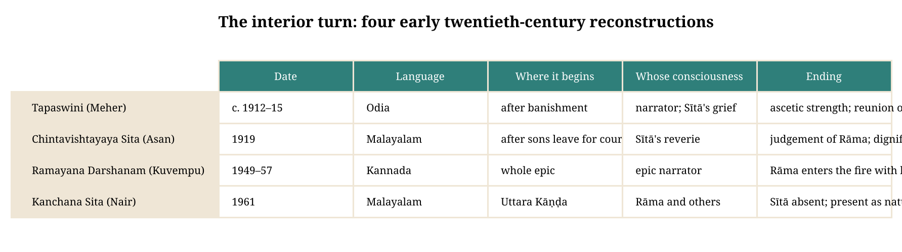

# Part II. Rebels and Reformers: The Twentieth-Century Sita {.unnumbered}

# Chapter 4. The Interior Turn: Kumaran Asan, Gangadhar Meher, Kuvempu and the Thinking Sita

::: {custom-style="Epigraph"}
*madadhīnaṃ tu yat tan me hṛdayaṃ tvayi vartate*

"That which is in my control, my heart, abides in you."

— Sītā before the fire, Vālmīki *Rāmāyaṇa* 6.104.9 (CE)
:::

## The argument of this chapter

In Vālmīki, Sita draws a line between what depends on her and what does not. Her body, in Laṅkā, was in another's power; her heart was in her own. The modern literature of Sita begins, in a sense, with the exploration of that second domain: the domain of what goes on inside her. Before the twentieth century, the inner life of Sita was largely inferred from her speech; she was given words, and the reader deduced from the words what she felt. In the first decades of the twentieth century, a group of poets in three southern and eastern languages did something different. They placed the reader inside Sita's mind, and let her think, at length, about what had been done to her.

This chapter calls their achievement the *interior turn*, and makes four claims about it.

1. The interior turn began not in English, nor among the urban, upper-caste intelligentsia of the presidency towns, but in Odia, Malayalam and Kannada, and its three principal poets came from communities that the caste order of their time placed outside or at the bottom of its hierarchy: Gangadhar Meher from a family of weavers in western Odisha, Kumaran Asan from the Ezhava community of Kerala, Kuvempu from the Vokkaliga peasantry of Karnataka. The first modern Sitas who think were written by men whom Brahmanical society did not regard as entitled to the higher learning.

2. The interior turn chose the "after": the time after the war, after the banishment, when Sita is alone in the forest with her sons. The women's songs and Candrābatī had already made this time their own. The interior poets inherited it.

3. Interiority is not voice. Kumaran Asan's Sita thinks, judges and resolves, but she does so alone, without an interlocutor. The interior turn gave Sita a mind; it did not give her an audience. This distinction is the key to Hypothesis B.

4. The interior turn produced, in Kuvempu's epic, a different solution to the problem of the fire: not Sita's vindication, but Rama's participation in her ordeal. That solution, I shall argue, is the first modern attempt to make the ordeal a shared rather than a gendered burden, and its limits are as instructive as its ambition.

## Before the turn: Kālidāsa and Bhavabhūti

The interior turn had classical precedents, and it is worth recalling them, because the moderns knew them well and were answering them.

Kālidāsa's *Raghuvaṃśa* gives Sita, in its fourteenth canto, the message from the forest discussed in Chapter 1: restrained, dignified, and pointed, addressed to "the king" and asking whether his act befits his line.^[Kālidāsa, *Raghuvaṃśa* 14.61 [W005].] It is an early classical model of what the corpus workbook calls the "restrained rebuke: voice without revolt".^[Corpus workbook, W005.] But it is a message, not a meditation; Kālidāsa shows us what Sita says, not what she thinks.

Bhavabhūti's *Uttararāmacarita* (eighth century) is the first great work of the tradition to centre the emotional aftermath of the banishment, and it is Rama's aftermath, not Sita's. The drama opens with a picture gallery in which Rama and the pregnant Sita look at paintings of their earlier life; it moves through Rama's anguish after the banishment, including the soliloquy in which he steels his own right hand to strike Śambūka; and its celebrated third act places Sita, invisible by divine grace, beside Rama in the forest of Pañcavaṭī, watching him mourn her while the forest goddess Vāsantī reproaches him for his cruelty.^[Bhavabhūti, *Uttararāmacarita* [W007]. David Shulman has read the play as a study in "cruelty and compassion"; see the corpus record.] The play ends not in the earth but in reunion.

Bhavabhūti's third act is one of the most remarkable scenes in Sanskrit drama, and its structure deserves attention. Sita is present but unseen. She watches the man who abandoned her grieve for her; she hears another woman, Vāsantī, reproach him on her behalf; she is moved, and her resentment softens. The interiority on display is principally Rama's, and Sita's is shown as response to his. The corpus workbook's note is exact: "compassion for Sita without giving her the last word."^[Corpus workbook, W007.] Vidyāsāgar, as Chapter 3 noted, built his *Sītār Banabās* largely on Bhavabhūti, and so the nineteenth-century Bengali reader met the exile through a lens that focused on the husband's remorse.

The interior turn reversed the lens. In Asan, Meher and Kuvempu, it is Sita who remembers, Sita who grieves, Sita who judges, and Rama who is the object of her thought.

## Gangadhar Meher's *Tapasvinī*

Gangadhar Meher (1862–1924) was born in Barpali, in the Sambalpur region of western Odisha, into a family of weavers. He left school early, worked as a clerk, and taught himself the Sanskrit and Odia classics. His long poem *Tapasvinī*, in eleven cantos, was composed in the second decade of the twentieth century (the exact year is disputed between 1912 and 1915) and has become one of the canonical works of modern Odia poetry; one bookseller's description calls it a "Sitayana".^[Gangadhar Meher, *Tapaswini* [W239]. English translations: Jayanta Mahapatra (Bhubaneswar: Orissa Sahitya Akademi, 1998); Harekrishna Meher (Kolkata, 2009). The corpus workbook flags the year of composition.]

The poem's frame is chosen with care. It begins after the banishment, in Vālmīki's hermitage, and ends when Lava and Kuśa meet Rama. Everything that the heroic epic regards as the story (the bow, the exile, the abduction, the war, the coronation) has already happened. What remains is a woman in a forest, pregnant and then a mother, coming to terms with what has been done to her.

The title is the argument. *Tapasvinī* means a female ascetic, a woman who practises *tapas*, the austerity that generates spiritual power. Meher's Sita does not merely endure the forest; she transforms her exile into a discipline. The grief that Vidyāsāgar dwelt on as pathos becomes, in Meher, the raw material of ascetic strength. Her sorrow is not cured; it is converted.

This conversion can be read in two ways, and the debate between them maps directly onto the debate about exile that the research plan identified: is the forest "punishment and dispossession" or "the possibility of autonomy"?^[Research plan, §3.] On the first reading, *Tapasvinī* sanctifies Sita's dispossession by renaming it as spiritual achievement: the woman who has been thrown out of her home is praised for making the best of it, and the praise confirms the injustice. On the second reading, the poem discovers in the forest a domain of self-making that the palace denied her. In Ayodhya, Sita was a queen, a wife, a reputation; in the hermitage, she becomes a practitioner, someone who does something with her own will, and what she does generates a power that is hers.

I incline to the second reading, and I incline to it partly because of who wrote the poem. The word *tapasvinī* carries, in the Indian context, a charge that is easily missed: *tapas* was, in Brahmanical theory, a prerogative of the twice-born, and its exercise by those outside that order was precisely the transgression for which Śambūka was beheaded. A weaver poet writing, in the second decade of the twentieth century, a poem in which Sita becomes an ascetic in the forest is not merely sanctifying her exile. He is claiming for her, and implicitly for himself, a form of spiritual agency that the orthodox order reserved for others. The forest, in *Tapasvinī*, is the place where those whom the order has expelled can practise the disciplines the order denied them.

Meher's other great gift to the interior turn is his nature poetry. His forest is not a backdrop but a community: deer, birds, creepers and rivers respond to Sita's grief and share it. The Marathi women's songs, in which Sita addresses the plum and the babul tree because there is no one else, are close kin.^[Nabaneeta Dev Sen, "When Women Retell the Ramayan," *Manushi* 108 (1998): 20.] So, in its way, is Vālmīki's own final scene, in which the Earth receives her daughter. The interior turn and the ecological Sita, which Chapter 6 traces through Warerkar and Aravindan, are born together in Meher's forest.

## Kumaran Asan's *Cintāviṣṭayāya Sīta*

### The poet

N. Kumaran Asan (1873–1924) was one of the three great poets of modern Malayalam, and a disciple of Śrī Nārāyaṇa Guru, the Ezhava saint and reformer whose movement challenged the caste order of Kerala in the name of "one caste, one religion, one god for humankind". Asan served for years as general secretary of the Śrī Nārāyaṇa Dharma Paripālana Yogam, the movement's principal organisation; he was a member of the Travancore legislature; and his poetry, from the romantic *Vīṇapūvu* (The Fallen Flower, 1907) to the openly anti-caste *Duravastha* (The Tragic Plight, 1922), in which a Nambūtiri woman takes refuge in the hut of a Pulaya man during the Malabar rebellion, and *Caṇḍālabhikṣuki* (The Untouchable Nun), was bound up with the reform of a society in which his own community was denied entry to temples, schools and public roads.^[On Asan's life and work, see the corpus record [W033] and the introduction to Paula Richman, ed., *Ramayana Stories in Modern South India: An Anthology* (Bloomington: Indiana University Press, 2008) [W128] (pinpoint to be verified).]

It matters, for the argument of this book, that the poem which the corpus workbook calls "a landmark of Sita's inner voice in 1919, long before 'feminist retellings'" was written by a poet from a community that Brahmanical Kerala classed as polluting.^[Corpus workbook, W033.] When the liberation narrative traces the modern Sita's emancipation to the English-educated feminist of the late twentieth century, it overlooks not only the women's songs but also this earlier, anti-caste lineage, in which the right to an inner life was claimed for Sita by men who were claiming it, at the same time, for themselves.

### The poem

*Cintāviṣṭayāya Sīta* (usually translated "Sita Lost in Thought" or "Sita Immersed in Thought") was published in 1919. Its situation is precisely chosen. Sita is in Vālmīki's hermitage. Her sons, Lava and Kuśa, have gone to Ayodhya with the sage, to sing the poem at Rama's horse sacrifice. She is alone, for the first time in years, on a riverbank at evening. And she thinks.^[Kumaran Asan, *Chintavishtayaya Sita* (1919) [W033]; English translation (excerpts) in Richman, *Ramayana Stories in Modern South India*; a full English version appears as *Sita: Her Untold Story* (New Delhi: Authorspress, 2017). Quotations are avoided here; the summary follows the poem's sequence (pinpoints to be verified).]

The poem is almost entirely a meditation, rendered from inside Sita's consciousness. She recalls her childhood in Mithila, her marriage, the years in the forest with Rama, the abduction, the captivity, the war, the ordeal, the brief happiness in Ayodhya, the banishment. As she remembers, she evaluates. And the evaluation, which is the heart of the poem, is a judgement on Rama.

The judgement is not a denunciation. Asan's Sita does not call Rama a sinner, as the Bengali women do, nor death incarnate, as the Assamese *Uttarakāṇḍa* does. Her judgement is more searching, because it is more sympathetic. She understands why Rama acted as he did. She understands the pressures of kingship, the weight of public opinion, the demands of a role that requires its holder to place the subjects above the self. And having understood, she concludes that he was wrong: that he chose the king over the husband, the reputation over the person, the role over the truth he knew. The corpus record summarises it exactly: she "looks back on her life, judges Rama's choices and moves towards her end with self-respect".^[Corpus workbook, W033.]

The final movement of the poem brings the summons. Sita is to come to Ayodhya and prove her purity before the assembly. In Asan, as in Vālmīki, she goes, and she does not stay; she returns to the earth. But the earth, in Asan, has been prepared for by the poem's long meditation. The reader has followed her thought to its conclusion, and her final act appears not as a sudden miracle but as the outcome of a reasoned judgement. She has thought her way to refusal.

### Interiority is not voice

The achievement of Asan's poem is so considerable that it is easy to miss what it does not do, and what it does not do is crucial to the argument of this book.

Asan's Sita thinks. She does not speak to Rama. The entire meditation takes place in solitude, on a riverbank, with no interlocutor but the evening. Her judgement on Rama is rendered for the reader, not for him. When she finally faces him in the assembly, she does not deliver the judgement she has reached; she enacts it, by leaving.

This is not a weakness in the poem. It is its insight. Asan understood something that many later retellings did not: that a woman in Sita's position, in the society Asan knew, could form a judgement but could not deliver it to its object without the judgement being converted into something else, into insubordination, or hysteria, or a plea. The only form of delivery that preserved the judgement intact was the act of refusal. Asan's Sita thinks her way to a verdict and executes it in silence.

But it does mean that the interior turn gave Sita a mind, not an audience. The reader overhears her. Rama never does. Hypothesis B of this research holds that Sita is not liberated simply by acquiring a voice; Asan's poem suggests a refinement. Sita is not liberated simply by acquiring an interior either. What the interior turn established is that Sita's judgement of Rama could be imagined at length, in the most intimate literary form available, and could be represented as reasoned rather than emotional. What it did not establish, because it could not, is a world in which that judgement would be heard.

Spivak's question becomes pressing here. "Can the subaltern speak?" was never a question about whether subaltern people have thoughts, or even whether they utter them; it was a question about whether their utterances can be heard as speech within the structures that receive them.^[Gayatri Chakravorty Spivak, "Can the Subaltern Speak?," in *Marxism and the Interpretation of Culture*, ed. Cary Nelson and Lawrence Grossberg (Urbana: University of Illinois Press, 1988), 271–313 [W064].] Asan's Sita is not a subaltern; she is a queen. But in the economy of the poem, she occupies exactly the position Spivak describes: she has a judgement that cannot be uttered in a form its addressee could receive. Asan's solution, which is Vālmīki's solution, is to make the refusal itself the utterance. The earth opening is the only sentence that Rama cannot reinterpret.
