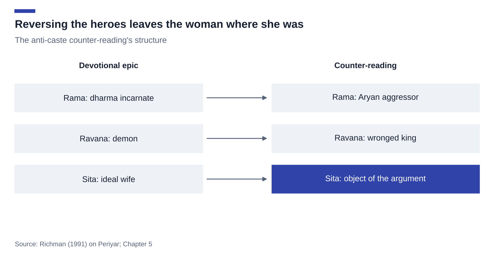
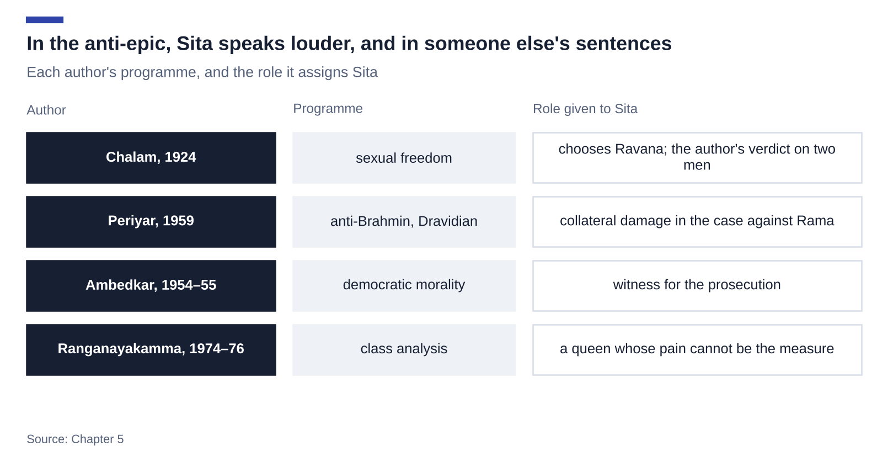

# Chapter 5. The Anti-Epic: Chalam, Periyar, Ambedkar, Ranganayakamma and the Problem of the Borrowed Sita

::: {custom-style="Epigraph"}
"You could tell it like it is by borrowing an ideological viewpoint as Ranganayakamma does in Ramayan Vishabriksham, rewriting the Ram tale from the Marxist point of view."

— Nabaneeta Dev Sen, *Manushi* 108 (1998), p. 18
:::

## The argument of this chapter

The interior turn let Sita judge Rama in the privacy of her own mind. The writers of this chapter put Rama on trial in public. Between the 1920s and the 1970s, a series of rationalists, anti-caste thinkers, Marxists and satirists, writing in Telugu, Tamil, Kannada, Hindi, Marathi and English, turned the Rāmāyaṇa against itself. They read it as an indictment of its hero, of the caste order he defended, of the kingdom he ruled and of the religion that worshipped him. Their books were banned, burned, litigated and, in one case, removed from public circulation for more than three decades. Their Sitas speak louder than any in the tradition before them.

This chapter asks whose words those Sitas speak. It makes five claims.

1. The anti-epic converted Rama from judge into defendant. This was a genuine intellectual achievement, and its consequences for Indian public life were profound: it made the Rāmāyaṇa arguable in the language of rights, reason and justice.

2. In doing so, the anti-epic borrowed Sita. In Chalam, she is the mouthpiece of the author's sexual radicalism; in Periyar, she is collateral damage in an assault on Rama; in Ambedkar, she is a witness for the prosecution; in Ranganayakamma, she is a case study in class and gender power. In each, her voice is louder, and in each, it is less her own.

3. The reversal of heroes that several of these texts perform (Ravana for Rama, Lanka for Ayodhya, Dravidian for Aryan) changes who is admired but not where the woman stands. Sita's place in the plot is unaltered; only the valuation of the men around her changes.

4. The anti-caste critique is the anti-epic's most enduring contribution, and it forces the question that Chapter 1 raised at its close: that the *Uttarakāṇḍa*'s two victims, Sita and Śambūka, belong together, and that a reading of one without the other is incomplete.

5. Some of the anti-epic's frames were themselves borrowed from colonial knowledge, notably the racial reading of the Rāmāyaṇa as an Aryan conquest of the Dravidian south. A decolonial reading must hold together two facts: that the grievance the anti-epic expressed was real and indigenous, and that some of the categories in which it expressed that grievance came from the colonial archive.

## Chalam: the Sita who walks into the wrong pyre

Gudipati Venkata Chalam (1894–1979), who wrote simply as Chalam, was the most scandalous Telugu writer of the twentieth century. His novels of the 1920s and 1930s, *Maidānam* above all, imagined women leaving loveless marriages for lovers, choosing their sexual partners, refusing the institution of marriage altogether, and they were denounced as obscene and read in secret by a generation. In 1924, according to Volga, who has traced her own lineage through him, he wrote a play called *Sītā Agnipraveśam* (Sita Enters the Fire).^[Gudipati Venkata Chalam, *Sita Agnipravesam* (1924) [W034]; English translation in Paula Richman, ed., *Ramayana Stories in Modern South India: An Anthology* (Bloomington: Indiana University Press, 2008). The date is the one given by Volga in a 2017 interview in *Scroll*, as recorded in the corpus workbook.]

Chalam's Sita is a rebel and a logician. Brought before Rama after the war, she does not defend her purity; she attacks his premises. Ravana, she argues, was nobler than Rama, because Ravana asked for her love and waited for it, while Rama treated her as a machine for producing heirs.^[Corpus workbook, W034. Paraphrase; pinpoint to be verified.] And when the pyre is built, she does not enter the fire that Rama has had prepared for her ordeal. She walks into Ravana's funeral pyre. The title of the play, *Sita Enters the Fire*, is a pun on the expected scene: she enters a fire, but not the one Rama intended, and not to prove what he wanted proved.

The audacity of this is difficult to recover for a reader in the twenty-first century, when Sita novels in which she desires Ravana have become, if not common, then at least publishable. In 1924, Chalam made Sita prefer the demon to the god, made her choice a matter of erotic and emotional respect rather than of purity, and made her final act a *satī* for the wrong husband. It is the most complete inversion of the ideal wife that the corpus records before the 1970s, and the corpus workbook is right to call it "a radical, male-authored 'feminist' Sita".^[Corpus workbook, W034.]

The scare quotes around "feminist" are deserved, and the reasons are worth stating. Chalam's Sita is defined, in her rebellion, entirely by her relation to men. She chooses one man over another; she judges them by how they desired her; she dies for the one she chooses. The ideal wife's devotion is not abolished but transferred. Her body, which in Vālmīki she claimed as "that which depends on another" only by compulsion, is in Chalam given freely to the man who asked rather than took; but it is still given. And the voice in which she delivers her judgement is recognisably Chalam's own, the voice of the polemicist against the hypocrisies of Telugu marriage, arguing for sexual freedom as the essence of a woman's liberty. When Hypothesis C asks whether voice can come from male reformers too, Chalam's play answers: it can, but it comes with the reformer's accent.

This is not to diminish Chalam. His Sita broke open a question that the tradition had kept shut: whether a woman's fidelity, if it is truly her own ethical commitment, must not include the freedom to commit it elsewhere. Vālmīki's Sita claimed fidelity as *madadhīnam*, that which depends on her. Chalam took her at her word and asked what she would do if she were free to choose. His answer, that she would choose the man who respected her desire, is one answer. It is not the only one, and it is not hers alone. But it was the first time the question had been asked, in a modern Indian language, about Sita.

## Periyar: the Rāmāyaṇa as a charge sheet

Erode Venkatappa Ramasami (1879–1973), Periyar, "the great one", was the founder of the Self-Respect Movement and the most consequential anti-caste thinker of twentieth-century South India. Over several decades of speeches, pamphlets and articles in Tamil, consolidated in a book translated into English as *The Ramayana: A True Reading* (1959) and into Hindi as *Saccī Rāmāyaṇ* (1968), he read the epic as a political document: a record of the Aryan conquest of the Dravidian south, in which Rama was the aggressor, Ravana the wronged Dravidian king, the *rākṣasas* the indigenous peoples demonised by their conquerors, and the epic itself an instrument of Brahmanical domination.^[E. V. Ramasami (Periyar), *The Ramayana: A True Reading* (Madras, 1959; 2nd ed., 1972) [W046]; Paula Richman, "E. V. Ramasami's Reading of the Rāmāyaṇa," in *Many Rāmāyaṇas: The Diversity of a Narrative Tradition in South Asia*, ed. Paula Richman (Berkeley: University of California Press, 1991), 175–201.] Periyar's movement staged public burnings of the Rāmāyaṇa and of images of Rama.

Paula Richman's study of Periyar's reading shows its method with great clarity: a systematic inversion of the epic's moral valuations, conducted episode by episode, with every act of Rama's reinterpreted as cowardice, cruelty or caste privilege and every act of Ravana's as dignity or justified response.^[Richman, "E. V. Ramasami's Reading," in *Many Rāmāyaṇas*, 175–201 (pinpoint to be verified).] The mutilation of Śūrpaṇakhā, in this reading, is an unprovoked assault by Aryan princes on a Dravidian woman; the abduction of Sita is Ravana's legitimate retaliation; his restraint in captivity, his refusal to violate her, is evidence of his nobility.

What happens to Sita in this reading? The corpus record is blunt: "Sita is treated harshly as part of the attack on Rama."^[Corpus workbook, W046.] Periyar's purpose required that the Aryan heroine be no more admirable than the Aryan hero, and his treatment of her, in pamphlets addressed to a popular audience, could be crude: she is portrayed as vain, as complicit, as having invited her own abduction. The great reversal of heroes left the woman exactly where she was: an object over which men contend, now seen from the other side. The corpus workbook's judgement is exact: "the anti-caste reversal of heroes, which does not by itself free Sita".^[Corpus workbook, W046.]

There is a further complication, and it is one that a decolonial reading must face honestly. Periyar's frame, the Rāmāyaṇa as the epic of an Aryan invasion of the Dravidian south, was not an indigenous discovery. Its elements came, in large part, from nineteenth-century colonial scholarship: from the racial philology that divided the peoples of India into Aryan and non-Aryan on linguistic grounds, from Bishop Robert Caldwell's *Comparative Grammar of the Dravidian or South-Indian Family of Languages* (1856) and the political uses to which the category "Dravidian" was put, and from the Orientalist reading of the *rākṣasas* as the aboriginal inhabitants of India.^[Robert Caldwell, *A Comparative Grammar of the Dravidian or South-Indian Family of Languages* (London: Harrison, 1856). On the colonial genealogy of the Aryan–Dravidian frame, see Thomas R. Trautmann, *Aryans and British India* (Berkeley: University of California Press, 1997) (pinpoint to be verified).] Periyar's grievance against Brahmanical domination was real, rooted in the lived humiliations of caste in the Madras Presidency, and owed nothing to the coloniser. But the narrative frame in which he expressed it, the racial history of an ancient conquest, was assembled in the colonial archive.

I state this not to discredit Periyar's critique of caste, which stands independently of any theory of ancient migrations, but to complete the account of coloniality offered in Chapter 3. The nationalist answer to the colonial tribunal produced the ideal Sita; one strand of the anti-caste answer produced the Aryan Rama. Both took colonial categories and turned them to Indian purposes. In the nationalist case, the category was the status of women as an index of civilisation; in the Dravidian case, it was race as the key to history. A reader who rejects the first borrowing as coloniality must, in consistency, examine the second with the same rigour. That examination does not acquit Rama; it relocates the charge from race to caste, where Periyar's own lived evidence, and the *Uttarakāṇḍa*'s treatment of Śambūka, place it far more securely.

### The court and the Hindi edition

The Hindi translation of Periyar's book, published as *Saccī Rāmāyaṇ* by Lalai Singh Yadav, an anti-caste activist in Uttar Pradesh, was forfeited by order of the state government in 1969 on the ground that it was offensive to Hindu religious feeling. Yadav challenged the order; the Allahabad High Court set it aside; and the state's appeal reached the Supreme Court, which in 1976 dismissed it.^[*State of Uttar Pradesh v. Lalai Singh Yadav* (Supreme Court of India, 1976) [W046] (report citation to be verified).] The judgement, as I understand it, turned not on the merits of Periyar's reading but on the defect of the forfeiture order, which had failed to state the grounds on which the government had formed its opinion. The court defended due process, not the book.

The episode belongs in this chapter for a reason that a lawyer will appreciate. The *Uttarakāṇḍa*, as Chapter 1 argued, records a king who condemned without a hearing, on the basis of public feeling, and forbade argument. Two thousand years later, a state government forfeited a book about that king, on the basis of public feeling, without stating its grounds. The court that set the order aside did for Periyar's translator what no one in Ayodhya did for Sita: it insisted that a decision adverse to a citizen must give reasons. The modern constitutional order, in this small case, corrected the precedent that Rama set. Whether it has corrected it in larger cases is a question this book returns to in Chapter 15.

