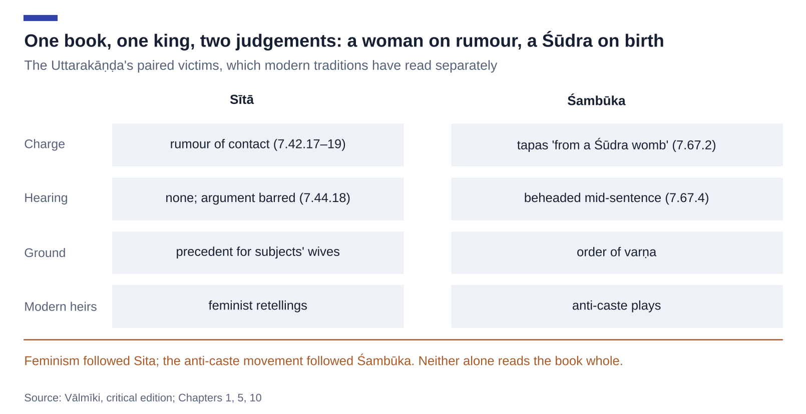

## Ambedkar: a jurist reads the Uttarakāṇḍa

Bhimrao Ramji Ambedkar (1891–1956), economist, jurist, chairman of the Drafting Committee of the Constitution and the foremost intellectual of the anti-caste movement, wrote *Riddles in Hinduism* in 1954–55, in the last years of his life. It was published only in 1987, as part of the fourth volume of the Maharashtra government's edition of his *Writings and Speeches*, and its first appendix, "The Riddle of Rama and Krishna", provoked an agitation in Maharashtra that led, for a time, to demands for its withdrawal, and to counter-mobilisation by Dalit organisations in its defence.^[B. R. Ambedkar, "The Riddle of Rama and Krishna," Appendix I of *Riddles in Hinduism*, in *Dr. Babasaheb Ambedkar: Writings and Speeches*, vol. 4, ed. Vasant Moon (Bombay: Education Department, Government of Maharashtra, 1987), 323ff. (pinpoints to be verified) [W045]. The official PDF of this volume could not be retrieved while this chapter was written; the account below paraphrases and does not quote.]

Ambedkar's treatment of Rama is an indictment, and it is conducted in the manner of the lawyer he was. He assembles the record from Vālmīki, episode by episode, and asks whether the conduct it describes is consistent with the claim that Rama is the ideal man. On the evidence of the corpus record and of the appendix's well-known structure, his case against Rama as a husband rests on three counts. First, the ordeal after the war: Rama humiliated Sita in public and demanded proof of a purity he had no reason to doubt. Second, the banishment: Rama abandoned a pregnant wife on the strength of gossip, without inquiry, without telling her, and without any process by which she might answer. Third, the final summons: Rama asked Sita to undergo a second ordeal, and she preferred to leave the world rather than live with him again.^[Corpus workbook, W045: "Attacks Rama's treatment of Sita (the fire test, the banishment, her refusal of a second test) and of Vali; cites the Buddhist Jataka where Sita is Rama's sister."] Ambedkar also cites the Buddhist *Dasaratha Jātaka*, in which Sita is Rama's sister, as evidence that the story was told differently in other traditions, an argument for plurality that anticipates Ramanujan's by three decades.

What I want to draw attention to is the structure of Ambedkar's second count, because it is the structure of the argument this book made in Chapter 1. Ambedkar's objection to the banishment is not, in the first instance, that it was cruel, though it was. It is that it was arbitrary: that a decision of the gravest consequence to a person was taken without inquiry and without a hearing. This is the objection of a jurist trained in the principles of natural justice, the man who would, a few years earlier, have guided into the Constitution of India the guarantee that no person shall be deprived of life or personal liberty except according to procedure established by law. The *Uttarakāṇḍa*'s silence about due process, which I read in Chapter 1 against the epic's own standards, Ambedkar read against the standards he had helped write into the founding law of the republic.

And here the question of the borrowed Sita becomes acute. Ambedkar's Sita is a witness for the prosecution. Her suffering is evidence; her final refusal is evidence; her very existence as a wronged wife is evidence against Rama's claim to be the ideal man. She is treated with sympathy, and the sympathy is genuine. But she is not the subject of the appendix. Rama is. And Rama is indicted not only as a husband but as a king who killed Vālin from ambush and a Śūdra ascetic for his austerities. Sita is one exhibit among several.

This is not a criticism of Ambedkar, whose purpose was to demolish the claim that Hindu tradition supplied a moral exemplar worthy of a democratic society, and who chose his exhibits accordingly. It is an observation about the structure of the anti-epic. When the prosecutor calls Sita, he calls her to testify against Rama. He does not ask her what she thinks of the court.

## Ranganayakamma: the footnote as weapon

Muppala Ranganayakamma (born 1939), a Telugu novelist and Marxist, published *Rāmāyaṇa Viṣavṛkṣaṃ* (The Ramayana: A Poisonous Tree) in three volumes between 1974 and 1976. An English translation appeared in 2004.^[Ranganayakamma, *Ramayana Vishavruksham*, 3 vols. (1974–76); English translation, *Ramayana the Poisonous Tree: Stories, Essays and Foot-notes* (Hyderabad: Sweet Home Publications, 2004) [W052].] It is the most systematic and the most learned of the anti-epics, and its method is unlike any other in the corpus. Ranganayakamma retells the Rāmāyaṇa as a sequence of sixteen stories, linked by essays, and supported by some five hundred footnotes that cite Vālmīki's own text, verse by verse, as evidence for her reading.^[Corpus workbook, W052, records "16 stories, linking essays and 504 footnotes".] Her argument is that the "ideal" kingdom of Ayodhya, read closely, is a society of class exploitation, caste oppression and gender subordination, and that the poem, far from concealing this, records it in detail, if one reads without devotion.

Nabaneeta Dev Sen placed Ranganayakamma in the third of her four categories of women retellers: those who tell the story "by borrowing an ideological viewpoint", and she noted that Ranganayakamma "suffered a great deal of social ostracisation for her attack on the 'Holy Book'".^[Nabaneeta Dev Sen, "When Women Retell the Ramayan," *Manushi* 108 (1998): 18.] The category is apt, and its implications cut both ways. Ranganayakamma's Sita is seen through a Marxist lens; she is a member of the ruling class, a beneficiary of the system whose victims are the servants, the forest peoples and the lower castes. Ranganayakamma does not idealise her. Her feminism is structural, not sentimental: it is interested in the system that produces both the queen and the maid, and it does not pretend that the queen's suffering is the same as the maid's.

I want to draw attention to a methodological affinity that will be obvious to the reader of this book. Ranganayakamma's footnotes are her weapon. She defeats the devotional reading not by asserting a counter-interpretation but by citing the text, verse by verse, against the commentary that had overlaid it. Her method is, in its way, philological: go back to Vālmīki and read what he actually wrote. The method is mine as well. Where I differ from her is in the conclusion. Ranganayakamma finds in the text a record of oppression that the devotional tradition concealed. I find in it a record of oppression and of resistance to it, including Sita's resistance, which the devotional tradition concealed equally. The footnote cuts both ways.

There is one further point. Ranganayakamma is a woman, and the only woman among the principal writers of this chapter. Her Sita is the least idealised and the least sentimental, and in some respects the least sympathetic, of the anti-epic Sitas. That is worth pausing on. The male anti-epicists borrowed Sita's suffering to indict Rama; the woman anti-epicist refused to let Sita's suffering stand in for the suffering of those below her. Ranganayakamma's feminism is less interested in Sita than in the women Sita's world did not see, and in this respect it anticipates the critique that Chapter 10 develops through Sharmila Rege and the Dalit poets.

## The Telugu rationalists: Sita as critic of conquest

Two shorter Telugu works complete the picture of the anti-epic in the language that produced more of it than any other. Kodavatiganti Kutumba Rao, a rationalist and Marxist writer, wrote a story set in the Aśoka grove in the 1950s, which Volga has cited as part of the rationalist rewriting line in Telugu from which her own work descends.^[Kodavatiganti Kutumba Rao, "Asokavanam" (1950s) [W044]; content not yet checked against the text.] And Narla Venkateswara Rao, journalist and rationalist, wrote a play, *Sītā Jōsyaṃ*, in which Sita openly criticises Rama's campaigns against the forest peoples, waged on behalf of the ascetics who wanted the forests cleared of *rākṣasas*.^[Narla Venkateswara Rao, *Seetha Josyam* [W049]; year not confirmed.]

Narla's Sita deserves attention, because she points in a direction the later literature would take. She is not criticising Rama as a husband; she is criticising him as a coloniser of the forest. The *rākṣasas* whom Rama kills at the request of the sages in the third book are, in her eyes, the inhabitants of the forest defending their land against encroachment. This reading has roots in Periyar's Dravidian frame, but it detaches the critique from race and attaches it to land, and to the relation between the settled kingdom and the forest. The Adivasi readings of the Rāmāyaṇa, and Volga's Shabari novel of 2025, both discussed in later chapters, are its heirs. Narla's Sita is the first in the corpus to be, in the workbook's phrase, "a political critic of conquest".^[Corpus workbook, W049.]

## The English satirist and the censor

The anti-epic also had an English-language branch, and it met the same fate. Aubrey Menen's *Rama Retold* (1954), a secular and satirical retelling by an Anglo-Irish-Malayali writer, presented a Rama who is somewhat dim and a Sita who is considerably cleverer than he is, and treated the whole story as a comedy of manners in which the gods are inventions of priests.^[Aubrey Menen, *Rama Retold* (London: Chatto and Windus, 1954) [W210].] The Government of India banned it in the mid-1950s, making it one of the earliest books banned in independent India on grounds of offence to religious feeling.

In 1961, the Jain teacher Ācārya Tulsī published *Agni-parīkṣā*, a Hindi verse retelling with Sita at its centre, sympathetic to her as a woman let down by men and by society. In 1970, protests in Raipur led him to offer to withdraw it.^[Acharya Tulsi, *Agni-pariksha* (1961) [W212].] The corpus workbook pairs it with Menen's book as "a censorship case", and the pairing is instructive. Menen was a secular satirist writing in English; Ācārya Tulsī was a religious teacher writing devotional verse in Hindi. Their books had nothing in common except sympathy for Sita at Rama's expense. Both provoked the same response.

The pattern is clear. From Menen in 1954 through the Periyar translation in 1969, Ācārya Tulsī in 1970 and Ambedkar in 1987, to the controversies over *Sita Sings the Blues* in 2009, Ramanujan's essay in 2011 and Volga's newspaper story in 2016, the tellings that provoke public storms are those that diminish Rama, not those that diminish Sita. No one, so far as the corpus records, has been banned for making Sita too submissive.

## The other victim, again

I close this chapter where Chapter 1 closed, with Śambūka, because the anti-epic, more than any other body of writing, insisted that he could not be left out.

Kuvempu's *Śūdra Tapasvi* (1944) stages the episode so that Rama, having set out to kill the Śūdra ascetic, is brought to recognise the injustice of the act; in Kuvempu's universalism, the ascetic's spiritual attainment is real, and it is the Brahmin's pride that must be humbled.^[Kuvempu, *Shudra Tapasvi* (1944) [W040]; excerpt in Richman, *Ramayana Stories in Modern South India*.] Paula Richman's study of three modern South Indian Śambūka plays traces how the episode has been reworked to make the caste violence of the *Uttarakāṇḍa* visible.^[Paula Richman, "Why Can't a Śūdra Perform Asceticism? Śambūka in Three Modern South Indian Plays," in *The Rāmāyaṇa Revisited*, ed. Mandakranta Bose (New York: Oxford University Press, 2004) [W111].] Omprakash Valmiki, the Hindi Dalit writer best known for his autobiography *Jūṭhan*, wrote *Śambūk kā Kaṭā Sir* (Shambuk's Severed Head), which appeared in English in 2021 in Richman and Rustom Bharucha's *Performing the Ramayana Tradition*.^[Omprakash Valmiki, *Shambuk's Severed Head*, in *Performing the Ramayana Tradition: Enactments, Interpretations, and Arguments*, ed. Paula Richman and Rustom Bharucha (New York: Oxford University Press, 2021) [W176].]

These works do not concern Sita directly. But they belong in a book about Sita, for the reason the figure makes plain. The *Uttarakāṇḍa* that banishes a woman on rumour, without a hearing, beheads a Śūdra on account of his birth, mid-sentence. The two judgements are expressions of the same principle: that the king's duty is to preserve an order in which women's sexuality and the lower castes' aspirations are both subject to control in the interest of the purity of the whole. Uma Chakravarti's account of Brahmanical patriarchy names precisely this conjunction: the control of women's sexuality as the means by which caste boundaries are maintained.^[Uma Chakravarti, "Conceptualising Brahmanical Patriarchy in Early India: Gender, Caste, Class and State," *Economic and Political Weekly* 28, no. 14 (3 April 1993): 579–85 [W079].] Vālmīki's seventh book does not theorise the conjunction. It enacts it, in two episodes twenty cantos apart.

The feminist retellings that Part III examines have, on the whole, followed Sita and left Śambūka behind. The anti-epic did the reverse: it followed Śambūka and borrowed Sita. Neither tradition, taken alone, reads the seventh book whole. That is a finding about the division of intellectual labour in modern India, between a feminism that has been largely upper-caste and an anti-caste movement that has been largely male, and Chapter 10 returns to it.

::: {custom-style="Box Title"}
Reading Against the Text
:::

::: {custom-style="Box"}
When Periyar reverses the heroes, Ravana becomes noble and Rama base, and Sita remains the object they fight over. When Chalam frees Sita, she chooses Ravana and dies on his pyre. Is there a telling in this chapter in which Sita chooses *neither* man? And if not, what does it tell us that the most radical male imaginations of the twentieth century could free her from Rama only by giving her to someone else?
:::

::: {custom-style="Box Title"}
The Debate: Marriage
:::

::: {custom-style="Box"}
**Position A:** Marriage in the Rāmāyaṇa is sacred companionship: the bond of Rama and Sita is the ideal of conjugal love, betrayed by Rama's later conduct.\
**Position B:** Marriage in the Rāmāyaṇa is institutional control: the bond exists to secure lineage, property and caste, and Sita's fate shows its true nature.\
**Where the evidence of this chapter leaves the argument.** The anti-epic is almost unanimous for Position B, and Ranganayakamma's footnotes make the strongest case for it from the text. But Chalam's play exposes a difficulty for Position B. If marriage is only control, then Chalam's Sita, choosing the man who respected her desire, has simply exchanged one control for another; her liberation consists in choosing her controller. The women's songs of Chapter 2, which condemned Rama as a husband without abandoning the ideal of a good husband (the Mithila songs prefer Śiva), suggest a third position: that the ideal of companionship is real, that Rama failed it, and that the failure is a judgement on him rather than on the ideal. That position is closer to Kishwar's evidence and, I think, to Vālmīki's.
:::

## Conclusion

The anti-epic put Rama on trial and won convictions on several counts. It made the Rāmāyaṇa arguable in the language of reason, rights and justice; it paid for this with bans, burnings, ostracism and litigation; and it forced into the open the caste violence of the *Uttarakāṇḍa* that devotional reading had kept out of sight. Its legacy is a public culture in which the treatment of Sita can be discussed as a question of justice and not merely of devotion. That legacy is real, and every later retelling depends on it.

But the anti-epic's Sitas were borrowed. Chalam made her the voice of his sexual radicalism; Periyar made her collateral damage; Ambedkar made her a witness; even Ranganayakamma, the most rigorous, subordinated her to a structural analysis in which a queen's suffering could not be the measure. In each case, Sita spoke more loudly than before, and in each case the sentences she spoke were the author's. The question Hypothesis B asked, whether Sita is liberated by acquiring a voice, receives in this chapter its most pointed answer. A louder Sita is not a freer Sita if the volume belongs to someone else.

The writers of Chapter 6 tried a different approach. Instead of borrowing Sita to indict Rama, they turned away from Sita altogether, to the women at the edges of her story: Ahalya, Urmila, and the earth from which she came.
