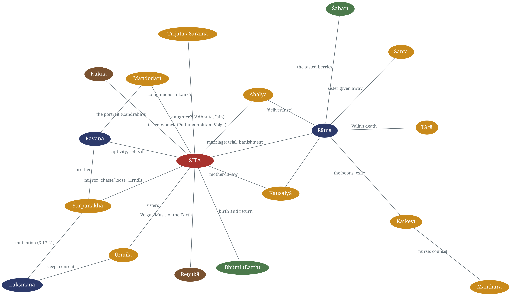
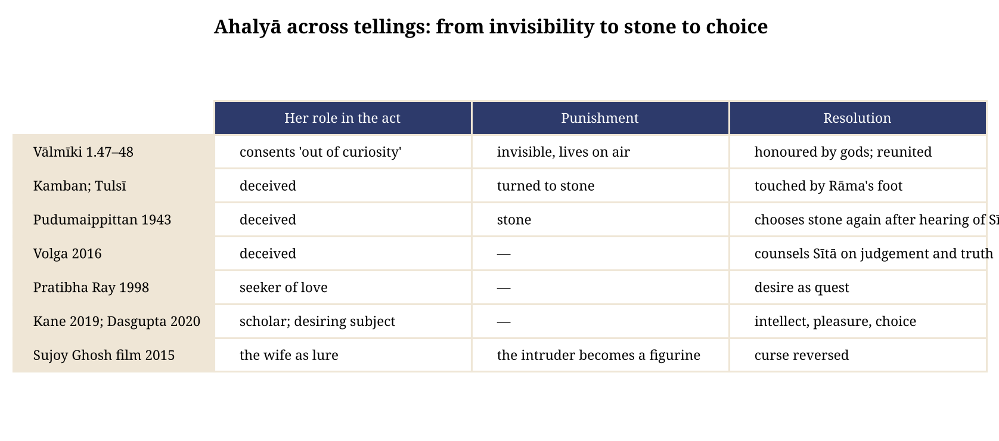

# Chapter 6. Stone, Sleep and Soil: Ahalyā, Ūrmilā and the Women at the Edges

::: {custom-style="Epigraph"}
*vāyubhakṣā nirāhārā tapyantī bhasmaśāyinī*\
*adṛśyā sarvabhūtānām āśrame 'smin nivatsyasi*

"Living on air, without food, practising austerity, lying on ashes, invisible to all beings, you shall dwell in this hermitage."

— Gautama's curse on Ahalyā, Vālmīki *Rāmāyaṇa* 1.47.29 (CE)
:::

## The argument of this chapter

The anti-epic indicted Rama and borrowed Sita. Another line of twentieth-century writing took a different path. It turned away from Sita, or rather beside her, to the women whose stories touch hers at the edges: Ahalyā, the sage's wife cursed for her encounter with Indra and released by Rama's arrival; Ūrmilā, Sita's sister and Lakshmana's wife, left behind in Ayodhya for fourteen years; and the Earth herself, Sita's mother, from whose furrow she was born and into whose embrace she returned.

This chapter argues four things.

1. The turn to the margins was, in part, a strategy for saying about Sita what could not be said directly. Ahalya, Urmila and the Earth became lenses through which Sita's story could be refracted and judged.

2. The most famous image of Ahalya, the woman turned to stone, is not in Vālmīki. In the critical edition, she is made invisible and lives on air; the stone is a later accretion. Modern retellings that "liberate Ahalya from stone" are, like many that liberate Sita from silence, liberating her from a later tradition while believing they liberate her from the original.

3. Urmila is the clearest test case in the corpus for Hypothesis B. Over a century and a half, in at least six languages, the "neglected" woman has been given a voice again and again, and each voice reflects the political needs of its moment: patriotic waiting in the nationalist epic, protest in the socialist play, administrative competence in the market novel, consent in the twenty-first-century theatre.

4. The Sita who returns to the earth was, in the 1950s to the 1970s, reinterpreted as soil, labour and nature. That ecological Sita was claimed both by a romantic ecofeminism that identified women with nature and by a materialist critique that insisted on land, labour and property. The most consequential use of "Sita, daughter of the earth" in modern India was neither a poem nor a film but a farmers' campaign to transfer land into women's names.

## Ahalyā: from invisibility to stone and back

### What Vālmīki says

The story of Ahalya is told in the first book of the Vālmīki *Rāmāyaṇa*, as Viśvāmitra leads the young Rama and Lakshmana towards Mithila. They pass a deserted hermitage, and the sage tells its story. It was once the hermitage of Gautama, who lived there with his wife Ahalya, practising austerities for many years. Indra, the king of the gods, knowing Gautama to be away, took on the sage's form and came to Ahalya, saying that he desired union with her.^[CE 1.47.15–18.]

The next verse is the one on which every later reading turns:

> *muniveṣaṃ sahasrākṣaṃ vijñāya raghunandana*\
> *matiṃ cakāra durmedhā devarājakutūhalāt*
>
> Recognising the thousand-eyed god in the sage's guise, O delight of the Raghus, she, foolish, consented, out of curiosity about the king of the gods.^[CE 1.47.19.]

She knew. She recognised Indra despite his disguise, and she consented, *devarājakutūhalāt*, out of curiosity, or eagerness, about the king of the gods. And afterwards, "with a satisfied heart" (*kṛtārthenāntarātmanā*), she told him to go quickly and to protect both himself and her.^[CE 1.47.20.] Indra, laughing, said he was pleased and would leave as he had come.^[CE 1.47.21.] At the door he met Gautama, returning from his bath with fuel and *kuśa* grass in his hands, blazing with ascetic power.^[CE 1.47.23.]

Gautama cursed Indra, who lost his testicles on the spot.^[CE 1.47.26–27.] Then he cursed Ahalya:

> You shall dwell here for many thousands of years, living on air, without food, practising austerity, lying on ashes, invisible to all beings. When Rama, son of Daśaratha, comes to this terrible forest, you will be purified. By offering him hospitality, free of greed and delusion, you will regain your own form and rejoin me in joy.^[CE 1.47.28–31.]

There is no stone. Ahalya is made invisible (*adṛśyā*), not petrified. She lives on air; she practises austerity. When Rama arrives, she is described as blazing like a flame veiled in smoke, like the moon behind clouds, "difficult to look at" (*durnirīkṣyā*) by Gautama's word until Rama saw her.^[CE 1.48.15–16.] The two princes touch her feet; she receives them as guests; flowers fall from the sky, and the gods cry "well done" and honour her, "her limbs purified by the power of her austerity".^[CE 1.48.17–20: *sādhu sādhv iti devās tām ahalyāṃ samapūjayan / tapobalaviśuddhāṅgīṃ gautamasya vaśānugām*.] Gautama returns, and the two live together happily.^[CE 1.48.21.]

The Vālmīki Ahalya, then, is a woman who knowingly chose a sexual encounter with a god, was punished with invisibility and asceticism, purified herself by her own austerity, and was honoured by the gods when Rama arrived. Notice where her purification comes from. The gods praise her as "purified by the power of her austerity": the purification is her own work. Rama's arrival is the occasion, not the cause. And notice what is absent: Rama does not touch a stone with his foot. The princes touch *her* feet, as one touches the feet of an elder.

### The stone

The stone came later. In the devotional tradition, above all in Tulsīdās, Ahalya becomes a stone, turned to rock by the curse, and is restored to life by the touch of Rama's foot: the dust of the Lord's feet, in the language of *bhakti*, redeems even a rock.^[Tulsīdās, *Rāmcaritmānas*, Bālakāṇḍa [W016]; Kathleen Erndl's and Wendy Doniger's work on Ahalya's transformations is a starting point; see Doniger, *Splitting the Difference* [W096].] The transformation has three consequences. First, it removes Ahalya's agency in the act; in most devotional tellings she is deceived, not consenting. Second, it removes her agency in the purification; she does nothing to earn her release, which comes entirely from Rama's grace. Third, it makes her redemption the occasion for a demonstration of Rama's divinity. The woman who, in Vālmīki, purified herself by her own austerity becomes, in the devotional tradition, a rock awaiting a god's foot.

I dwell on this because the pattern is now familiar. In Chapter 1, the silent Sita turned out not to be Vālmīki's. In Chapter 2, the Lakshmaṇa-rekhā turned out to be absent from Vālmīki. Here, the stone turns out to be absent too. In each case, the image that modern feminism takes as the emblem of traditional women's oppression (the silent wife, the line she must not cross, the woman turned to stone) is a later accretion, and in each case the accretion reduced the woman's agency relative to what Vālmīki had given her. The modern retelling that frees Ahalya from stone is freeing her from Tulsī. It is a worthwhile thing to do. But it should not be confused with freeing her from the tradition, because the oldest layer of the tradition never put her there.

### Pudumaippittan: the woman who chose stone

The most profound modern response to Ahalya, and one of the most profound responses to Sita, is a Tamil short story published in 1943 by Pudumaippittan (C. Viruthachalam, 1906–1948), the founder of the modern Tamil short story. Its title is "Sāpa Vimōcanam" (Deliverance from the Curse); it develops material he had first treated in an earlier story, "Akalikai" (1934).^[Pudumaippittan, "Saapa Vimochanam" (1943) [W039]; English translation in Paula Richman, ed., *Ramayana Stories in Modern South India: An Anthology* (Bloomington: Indiana University Press, 2008). Paraphrase; pinpoints to be verified.]

The story begins where the devotional tradition ends. Ahalya has been released from stone by Rama's touch and has returned to Gautama. She tries to resume her life, but the release has not released her. She is haunted by what happened and by the community's knowledge of it, and her marriage is shadowed by Gautama's knowledge too. Years later, she meets Sita, now returned from Laṅkā, and learns from her what Rama required at the end of the war: the ordeal by fire.

The effect on Ahalya is devastating. The man whose touch freed her, the man whose grace was supposed to have restored her to a world of forgiveness, has demanded of his own wife, who had done nothing, a public proof of purity. If this is the justice of the world to which she has been restored, then the restoration was a deception. Ahalya chooses to return to stone.

The corpus workbook calls this "one woman reads another's ordeal and refuses the world: a sharp case against liberation by voice alone".^[Corpus workbook, W039.] I would put it more strongly. Pudumaippittan's story is a critique of the very idea of liberation as restoration. The devotional tradition told Ahalya that she had been freed; Pudumaippittan's Ahalya discovers that she had merely been returned to the jurisdiction of the same order that had cursed her, an order that subjected even its innocent queen to trial by fire. Her return to stone is a refusal of that jurisdiction. It is, in the structure of this book's argument, exactly analogous to Sita's return to the earth: a withdrawal from a world whose judgement cannot be escaped except by leaving.

And the story makes a further point that only became central to feminist criticism decades later. Ahalya learns what freedom is worth by hearing another woman's story. It is Sita's account of the ordeal that tells her what Rama's world is. The knowledge that leads to the refusal passes between women. Volga's *The Liberation of Sita*, discussed in Chapter 8, reverses the direction: there, it is Sita who learns from Ahalya. But the structure, liberation as knowledge transmitted between wronged women, was established by a Tamil man in 1943.

### The modern Ahalyas

Since Pudumaippittan, Ahalya has become one of the most frequently retold women of the epic, and the range of the retellings is a small history of Indian feminist thought.

In Malayalam, N. S. Madhavan read Ahalya's story as a story of domestic abuse, and K. B. Sreedevi retold it as "Woman of Stone"; in Sri Lankan Tamil, S. Sivasekaram wrote an Ahalya poem.^[N. S. Madhavan, "Ahalya" [W117]; K. B. Sreedevi, "Woman of Stone" [W125]; S. Sivasekaram, "Ahalya" [W118]; all in Richman, *Ramayana Stories in Modern South India*.] In Odia, the Jnanpith laureate Pratibha Ray's novel *Mahāmoha* (1997–98) made Ahalya's story "a woman's eternal quest for love", centring her desire.^[Pratibha Ray, *Mahamoha* [W089]; the corpus workbook records a date conflict between 1997–98 and 2012.] In Hindi, Mridula Sinha gave Ahalya a first-person voice.^[Mridula Sinha, *Ahalya Uvach* [W135].] In English, Kavita Kane's *Ahalya's Awakening* (2019) made her a gifted scholar who wanted to become a *ṛṣikā*, a woman seer, and followed her intellect, her marriage and her choices rather than only the curse;^[Kavita Kane, *Ahalya's Awakening* (Chennai: Westland, 2019) [W166].] and Koral Dasgupta's *Ahalya* (2020), the first of her Sati Series, made pleasure part of the feminist claim: her Ahalya seduces her husband, and the novel traces her bonds with Brahmā, with her mother, and with Gautama.^[Koral Dasgupta, *Ahalya: The Sati Series I* (New Delhi: Pan Macmillan India, 2020) [W171].] In film, Sujoy Ghosh's fourteen-minute Bengali thriller *Ahalya* (2015) reversed the curse altogether: the intruding policeman, Indra Sen, ends up as one of the figurines in the old artist Goutam Sadhu's collection, while Ahalya, played by Radhika Apte, remains free and in control; critics debated whether the film freed her or merely fetishised her.^[Sujoy Ghosh, dir., *Ahalya* (2015) [W148].]

The arc is striking. The modern Ahalyas move from victim (Madhavan) to seeker of love (Ray) to scholar (Kane) to desiring subject (Dasgupta) to the one who controls the trap (Ghosh). And in that movement, they return, by a long detour, to something close to Vālmīki's Ahalya, who knowingly chose, out of curiosity, and was honoured by the gods. Hypothesis B suggests caution here. The modern Ahalya who desires and chooses is not new; Vālmīki's did both. What is new is the valuation. Vālmīki called her *durmedhā*, foolish, for her choice; the moderns call her brave. The tradition did not lack an Ahalya who desired. It lacked a vocabulary in which her desire could be admired.
