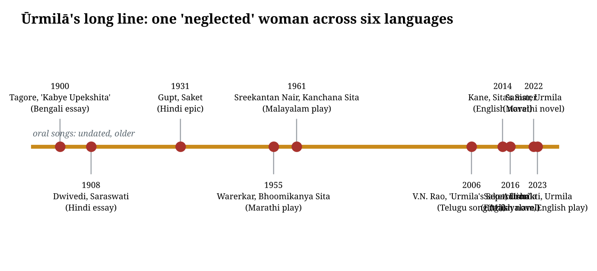

## Ūrmilā: the woman who slept through the epic

### An absence in Vālmīki

Urmila is Sita's younger sister, given in marriage to Lakshmana at the same ceremony at which Sita was given to Rama. When Rama is exiled and Sita insists on following him, Lakshmana insists on following too. Urmila stays behind. Vālmīki says almost nothing about her. She is named at the wedding, and then she disappears from the poem for fourteen years. When the brothers return, the poem does not record her reaction.

It was precisely this silence that Tagore noticed, around 1900, in his essay on "the women neglected in poetry", and that Mahāvīr Prasād Dvivedī asked Hindi poets to repair in 1908, and that Maithilīśaraṇ Gupt filled, in 1931, with *Sāket*.^[See Chapter 3; Rabindranath Tagore, "Kabye Upekshita" [W029]; Mahavir Prasad Dwivedi, essay in *Saraswati* (1908) [W030]; Maithili Sharan Gupt, *Saket* (1931) [W036].] Urmila's line, from Tagore's essay to the Adishakti theatre company's play of 2023, now runs for more than a century and through at least six languages. The corpus workbook's idea log records it as "one 'neglected' woman across about 150 years and five languages".^[Corpus workbook, My Ideas tab, idea 4.] It is the clearest test case in the corpus for the question this book asks.

### The sleep

The most potent image in the Urmila tradition does not come from Vālmīki at all, nor from Tagore. It comes from a folk and regional tradition, attested in Telugu and elsewhere, in which Lakshmana, to guard Rama and Sita night and day in the forest, asks the goddess of sleep, Nidrā, to release him from sleep for fourteen years. Nidrā agrees, on condition that someone else take his share. Urmila does. She sleeps through the entire exile, in Ayodhya, while her husband keeps watch in the forest.

The image is extraordinary, and it repays reflection. Urmila literally sleeps through the epic. The great events of the Rāmāyaṇa, the forest, the abduction, the war, the ordeal, all occur while she is unconscious. She is not merely absent from the story; she is absent from her own life. And her absence is the condition of the hero's vigilance: Lakshmana can stay awake only because Urmila sleeps for him. Her unconsciousness is, quite literally, the price of his heroism.

### The Telugu song: the wife who does not recognise her husband

Velcheru Narayana Rao's translation and study of a Telugu women's song, "The Song of Urmila's Separation", published in *Manushi* in 2006, shows what women singers did with this image.^[Velcheru Narayana Rao, "The Song of Urmila's Separation" (translation and essay), *Manushi* 153 (2006) [W116] (pinpoint to be verified).] In the song, when Lakshmana returns after fourteen years and comes to Urmila's room, she wakes and does not recognise him. Or rather, she refuses to recognise him. A strange man has entered her chamber; she treats him as an intruder and rebukes him. The song draws out the comedy and the pain of the scene at length, and it ends, according to the corpus record, with a wish: that men too should carry a bad name when their wives reject them.^[Corpus workbook, W116: "the song wishes men too would carry a bad name when wives reject them".]

This is an extraordinary inversion, and its sophistication deserves to be appreciated. The Rāmāyaṇa's central crisis, as Chapter 1 showed, is a crisis of recognition and reputation: Rama, returning from the war, refuses to "recognise" Sita as his wife until she has been purified, because her residence in another man's house has made her an object of public suspicion. The Telugu song reverses every term. The returning husband is the one who is not recognised; the wife is the one who refuses; and the song wishes upon men the reputational cost that the epic imposes on women. Urmila's anger lives in women's songs, as the workbook puts it, "long before modern novels".^[Corpus workbook, W116.] It is strong evidence for Hypothesis D: here, in an oral song, is a reasoned reflection on the gendered distribution of reputation, delivered through a reversal of the epic's central scene.

### Saket: the patriotic wait

Gupt's *Sāket*, discussed in Chapter 3, gave Urmila the first long poem in Hindi devoted to her. Its Urmila waits, and her waiting is filled with longing, with memory, with the seasons passing, with a lyrical intensity that made the poem a classic. But her waiting is also a patriotic sacrifice: she gives up her husband to the service of Rama, as the women of the national movement were asked to give up their husbands and sons to the service of the nation. Shanta Gokhale's verdict, recorded in the corpus, that the poem gave Urmila "no real substance or voice", is harsh but fair.^[Corpus workbook, W036.] *Sāket*'s Urmila feels intensely and acts not at all. Her contribution to the epic is to bear its cost with dignity. She is the nationalist Sita's younger sister in every sense.

Balkrishna Sharma "Naveen" (1897–1960), a Hindi poet and Congress politician, wrote a second Hindi epic called *Ūrmilā*, now out of print and untranslated, which the corpus records as evidence that "nationalist-era male poets turned to Urmila".^[Balkrishna Sharma 'Naveen', *Urmila* [W209]; year to be checked.] The pattern is clear. The nationalist imagination found in Urmila an ideal figure for its own needs: a woman whose virtue consisted in waiting while men did the work of history.

### Warerkar: the sister who protests

The decisive break came in Marathi, in 1950, in a play by Bhargavaram Vitthal "Mama" Warerkar (1883–1964), a progressive dramatist and later a nominated member of the Rajya Sabha. *Bhūmikanyā Sītā* (Sita, Daughter of the Earth), written in 1950 and published in 1955 (some sources give 1958), makes Urmila central, and makes her protest.^[B. V. (Mama) Warerkar, *Bhoomikanya Sita* (written 1950; published 1955 or 1958) [W042]. The corpus workbook records the date conflict and a reported Sanskrit translation by Ratnamayi Devi Dikshit.] In Warerkar's play, Urmila openly opposes the ordeals to which Sita is subjected; she is the voice of conscience in the royal household, refusing to accept what Rama has done. And Sita, at the end, returns to the earth, read in the play through the figure of the tiller of the land.

The play's fate is part of its meaning. The corpus records that Natya Niketan, the theatre company for which Warerkar had written many of his plays, refused to stage it.^[Corpus workbook, W042.] A play in which Urmila protests against Rama was, in the early years of the republic, too much for the stage that had made Warerkar's reputation. The Urmila who waits was acceptable; the Urmila who objects was not.

Warerkar's play does two things that later retellings would develop separately. It gives Urmila a political voice, the voice of protest against the ordeal, which Kane's *Sita's Sister* and the Adishakti play would later amplify. And it ties Sita to land and labour, to the plough from whose furrow she was born, which Aravindan's film would develop into an ecological vision. I return to the second in the final section of this chapter.

### The market and the theatre: Urmila in the twenty-first century

Kavita Kane's *Sita's Sister* (2014), the best-known modern Urmila in English, makes her a scholar of theology, a painter, an administrator and her elder sister's protector; her fourteen years of waiting become a story of choice and strength.^[Kavita Kane, *Sita's Sister* (New Delhi: Rupa, 2014) [W147].] Pervin Saket's *Urmila* (2016) sets a parallel story in contemporary Mumbai, where Urmila Karmarkar lives through a marriage that echoes the epic Urmila's long wait.^[Pervin Saket, *Urmila* (Mumbai: Jaico, 2016) [W222].] In Marathi, the novelist who writes as Samar published *Urmila* in 2022, a novel of her years alone, reported to have sold more than thirty thousand copies and translated into Hindi and English.^[Samar, *Urmila* (2022) [W230]; English translation as *Urmila: An Eternal Journey of Solitude*.] The corpus workbook poses the right question about it: "does the wait gain meaning, or only sympathy?"^[Corpus workbook, W230.]

And in 2023, the Kerala-based theatre company Adishakti, under Nimmy Raphel, staged *Urmila* with Meedhu Miriyam in the title role. The play is built around the sleep. Lakshmana, it observes, struck his bargain with Nidrā for Urmila's sleep without asking her. The play is about that missing consent.^[Nimmy Raphel (Adishakti), *Urmila* (2023) [W191]; the corpus workbook summarises: "Lakshmana strikes a deal with Nidra (sleep) for Urmila without her consent; the play is about that missing consent."]

### What the line shows

Lay the Urmilas side by side, as Figure 6.3 does, and the pattern of Hypothesis B becomes almost diagrammatic. Each era gives the neglected woman a voice. Each voice is the voice its era needs.

The nationalist era gave her a voice of patriotic longing: she waits, as the nation's women must wait, while the men serve the cause. The progressive moment gave her a voice of protest: she objects, as conscience must object, to the injustice of the powerful. The oral tradition, unaffiliated to any modern programme, gave her a voice of comic and furious reversal: she refuses to recognise the husband who abandoned her. The market novel of the 2010s gave her a voice of professional competence: she is a scholar, a painter, an administrator, the kind of capable woman the new Indian middle class admires. And the theatre of the 2020s, shaped by the global feminist vocabulary of the #MeToo years, gave her a voice of consent: she asks who agreed to the bargain that consumed her life.

None of these voices is false. All of them are partial, and each is partial in the direction of its moment. If one asks whether the history of Urmila is a history of a woman's changing possibilities of speech or a history of the changing political needs of the societies that rewrote her, the answer, on this evidence, is that the two cannot be separated: the possibilities of her speech were the political needs of each society. Only one voice in the line seems to belong to no programme at all, and that is the voice of the Telugu women who sang her refusal to recognise her husband, for no audience but themselves.

The Adishakti question, about consent, is in my judgement the sharpest question any modern retelling has asked of the Urmila story, and it reaches back, with uncanny precision, to the structure of the epic. Rama decided Sita's fate without hearing her; Lakshmana decided Urmila's without asking her. The brothers of the Ikṣvāku line, in both cases, disposed of their wives' lives for the sake of a duty that the wives had not been consulted about. The modern word is consent; the epic's word, in the case of Sita, was hearing. They are the same principle. A twenty-first-century theatre company discovered in Urmila's sleep what Ambedkar had discovered in Sita's banishment: a decision about a woman taken without her.

## Soil: the daughter of the earth

### The furrow and the return

Sita's name means "furrow". In Vālmīki's first book, Janaka tells how he found her while ploughing a field for a sacrifice: she rose from the furrow, and he raised her as his daughter. Her birth from the earth is part of her identity throughout the poem; at the fire, she reproaches Rama for having ignored it.^[CE 6.104.15.] And at the end, the Earth takes her back. Sita begins and ends in the soil.

The twentieth century discovered in this frame a set of meanings that earlier tellings had not drawn out. Sita's association with the furrow made her a figure of agriculture, and so of labour, land and the peasant; her return to the earth made her a figure of nature, and so of the environment and its violation; and her identity as the earth's daughter made her, potentially, a figure of a different relation between humanity and the world from the one embodied in Rama's kingdom. The corpus workbook's idea log puts the question exactly: "Earth and plough: Warerkar's tiller, Kanchana Sita's nature and Agarwal's critique. Is 'daughter of the earth' liberating or a trap?"^[Corpus workbook, My Ideas tab, idea 5.]

### Warerkar's tiller

In *Bhūmikanyā Sītā*, Warerkar read the myth, in the corpus workbook's phrase, "through the tiller of the land".^[Corpus workbook, W042.] Sita, the daughter of the furrow, belongs to the people who work the soil; her rejection by the king of Ayodhya and her return to the earth enact the alienation of the cultivator from the state that rules in her name. The reading is socialist in its sympathies, and it anticipates by four decades the materialist critique of ecofeminism that Bina Agarwal would develop.

### Kanchana Sita: Sita as nature

C. N. Sreekantan Nair's Malayalam play *Kāñcana Sīta* (1961), which received the Kendra Sahitya Akademi award, takes the *Uttarakāṇḍa* as its subject and makes a radical formal choice: Sita does not appear. She is absent in body and present as nature, while Rama is tested by his own idea of *dharma*.^[C. N. Sreekantan Nair, *Kanchana Sita* (1961) [W047]; English translation in *Retelling the Ramayana: Voices from Kerala* (New Delhi: Oxford University Press, 2005).] The title refers to the golden image of Sita that Rama, in some tellings, keeps beside him at the horse sacrifice in place of his banished wife: the *kāñcana sītā*, the Sita of gold. The play's real Sita is everywhere except in the image.

G. Aravindan's film of 1977, released in 1978, developed the play into one of the most original works of Indian cinema.^[G. Aravindan, dir., *Kanchana Sita* (made 1977; released 21 December 1978) [W054].] Sita never appears in human form; she is present as Prakṛti, nature itself, in the landscape, the river, the wind, the forest. Rama and his brothers are played by members of the Rama Chenchu, a tribal community of Andhra Pradesh; the epic's heroes are given the faces of the forest people. And Urmila, in one of the film's rare moments of dialogue, asks whether man can be separate from nature. Ankita Menon's recent reading of the film draws out its joining of nature, gender and caste.^[Ankita Menon, "Reimaging Rama, Reclaiming Sita: Nature, Gender, and Caste in *Kanchana Seeta*" (2025) [W200].]

The corpus workbook calls the film "the key film for Field V (ecofeminism) and for caste on screen (Field IV)".^[Corpus workbook, W054.] I agree, and I want to state precisely what is radical about it. Aravindan does not give Sita a voice. He does the opposite: he removes her body and her voice from the screen altogether. And in doing so, he makes the most powerful statement about her that any film in the corpus makes. Sita is not a woman who can be tested; she is the world in which the testing takes place. The king who banished her rules over her; the forest he rules is her body. Every scene in which Rama acts is a scene in which Sita is present, as the ground he stands on, and unconsulted.

### The debate: Shiva and Agarwal

Aravindan's film appeared a decade before the ecofeminist argument that would have claimed it. In *Staying Alive* (1988), Vandana Shiva argued that Western development had violated the "feminine principle" (*prakṛti*) embodied in nature and in women, and that Indian women's knowledge of the land was a resource for an alternative.^[Vandana Shiva, *Staying Alive: Women, Ecology and Survival in India* (New Delhi: Kali for Women, 1988) [W065]; Maria Mies and Vandana Shiva, *Ecofeminism* (London: Zed Books, 1993) [W081].] In 1992, Bina Agarwal answered her. Ecofeminism of this kind, she argued, treated women and nature as essentially linked, and so missed the material, class-specific and caste-specific relations through which particular women depend on particular resources; what was needed was a "feminist environmentalism" attentive to property, labour and power.^[Bina Agarwal, "The Gender and Environment Debate: Lessons from India," *Feminist Studies* 18, no. 1 (1992): 119–58 [W078].]

The debate maps directly onto the question of the earth's daughter. On Shiva's side, Sita's birth from and return to the earth make her an emblem of the feminine principle that patriarchal kingship violates. On Agarwal's side, that emblem is a trap: it identifies women with a nature that men rule, and it substitutes a symbolic kinship with the soil for a material claim to land.

### Lakshmi Mukti: the earth's daughter gets a title deed

There is a piece of evidence that bears on this debate more directly than any poem or film, and it comes, again, from Madhu Kishwar's essay of 1997. In the late 1980s, Kishwar worked with the Shetkari Sanghatana, the Maharashtra farmers' movement led by Sharad Joshi, on a campaign called Lakshmi Mukti: the liberation of Lakshmi. The campaign asked farmers to transfer a portion of family land into their wives' names, voluntarily, without waiting for the law to require it. From 1989, any village in which a hundred or more families did so was honoured as a Lakshmi Mukti village.^[Madhu Kishwar, "Yes to Sita, No to Ram! The Continuing Popularity of Sita in India," *Manushi* 98 (January–February 1997): 26.]

Joshi's speeches, Kishwar reports, "revolved around the Sita story". He would describe how a farmer's wife toils selflessly for her family, and then ask: "But then, how do we men treat our Lakshmis? Often no better than Ram treated Sita, one of the best wives anyone could have."^[Kishwar, "Yes to Sita," 26.] He would tell how Sita, after all her sacrifices, became a beggar overnight because her husband turned against her and she had nothing to call her own; how Rama could at least have given her a small house; how, if his subjects would not accept her, he could have gone with her.^[Kishwar, "Yes to Sita," 26–27.] And he would tell the legend of the Sita temple at Raveri, in Yavatmal district, where the pregnant, homeless Sita had begged for food and been refused, and had cursed the village so that no grain would grow in its fields.^[Kishwar, "Yes to Sita," 25, 27.] The peasantry, Joshi argued, had collectively invoked the curse of their Sitas by keeping their wives economically dependent; the transfer of land was "a long overdue debt" to Sita *mātā*.^[Kishwar, "Yes to Sita," 27.] "In village after village", Kishwar writes, "I would see men reduced to tears listening to the story of Sita. Hundreds of villages have already carried out the Lakshmi Mukti programme of land transfer to wives."^[Kishwar, "Yes to Sita," 27.]

This is the most consequential use of "Sita, daughter of the earth" in modern Indian history that I have been able to find, and it resolves the debate between Shiva and Agarwal in an unexpected way. It uses the symbolic kinship of Sita with the earth, the full devotional and mythic resonance that Shiva would claim, to produce exactly the material outcome that Agarwal demanded: land in women's names. The myth did not substitute for the title deed. It produced it. The story of a woman who was thrown out of her husband's house with nothing to call her own became an argument, in the mouths of male farmers' leaders addressed to male farmers, for giving women property.

I do not want to romanticise this. The campaign was voluntary; it lost momentum, Kishwar records, when the leadership's attention moved elsewhere; and the transfers were gifts from husbands, not rights claimed by wives.^[Kishwar, "Yes to Sita," 27.] But as evidence about what Sita can do in the world, it is decisive. The most effective feminist use of Sita in the corpus was made not by a novelist giving her a voice but by a farmers' movement giving her daughters land, and it worked because it told the old story, unaltered, and asked men to atone for Rama.

::: {custom-style="Box Title"}
Reading Against the Text
:::

::: {custom-style="Box"}
Urmila sleeps through the entire Rāmāyaṇa so that Lakshmana can stay awake. Is the epic's heroism, then, founded on a woman's enforced unconsciousness? And if Urmila had been awake, what would she have seen that the poem could not afford to show?
:::

::: {custom-style="Box Title"}
The Debate: Exile
:::

::: {custom-style="Box"}
**Position A:** Exile is punishment and dispossession: Sita in the forest, Ahalya invisible, Urmila alone in Ayodhya are women stripped of their place.\
**Position B:** Exile is the possibility of autonomy: outside the palace and the household, these women find powers the household denied them.\
**Where the evidence of this chapter leaves the argument.** Both, and the texts know it. Vālmīki's Ahalya, invisible and living on air, purifies herself by her own austerity and is honoured for it (1.48.20): exile as autonomy. Pudumaippittan's Ahalya, restored to the household, discovers that restoration is the real exile and chooses stone: return as dispossession. Urmila's exile is spent inside the palace, which suggests that the line between household and exile is not where we draw it. The Raveri legend and the Lakshmi Mukti campaign add a third term. Exile without property is dispossession; exile with property might have been autonomy. The difference is material, and a reading that attends only to the symbolic misses it.
:::

## Conclusion

The turn to the women at the edges produced some of the most searching work in the corpus. Pudumaippittan's Ahalya, returning to stone after hearing Sita's story, refuses the very idea that restoration to a patriarchal order is liberation. The Telugu women's Urmila, refusing to recognise her returning husband, reverses the epic's distribution of reputation. Warerkar's Urmila protests, and is refused a stage. Aravindan's Sita disappears from the screen and becomes the world. The Adishakti Urmila asks who consented to her sleep.

And yet the line of Urmila, laid out across a century and a half, shows how thoroughly each era's voice for the neglected woman was the voice that era needed. The question of this book is answered, for Urmila, with unusual clarity: her possibilities of speech were the political needs of her rewriters, except, perhaps, in the songs.

Part III turns to the women who took up the work of retelling explicitly as women and as feminists, beginning with the sixteenth-century Bengali poet whom Nabaneeta Dev Sen rediscovered in 1989, and with Dev Sen herself.
