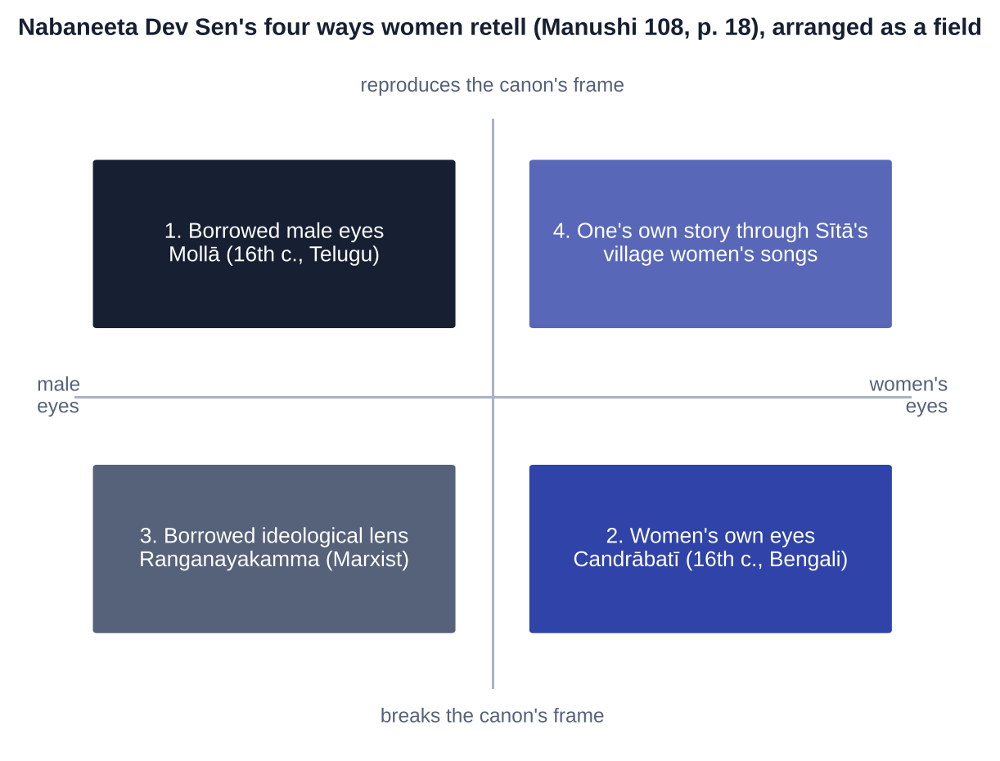

# Part III. Feminist Reconstruction {.unnumbered}

# Chapter 7. Women's Eyes: Candrābatī, Nabaneeta Dev Sen and the Recovery of a Lineage

::: {custom-style="Epigraph"}
"Who is Ram to reject me?\
I have rejected that entire society\
Which has converted\
Homes into prisons."

— Madhu Kishwar, "Agnipariksha", quoted in *Manushi* 98 (1997), p. 21
:::

## The argument of this chapter

Part II followed the men who rewrote Sita in the first two-thirds of the twentieth century: the poets of the interior turn, the anti-epicists, the dramatists of the women at the edges. Part III turns to the women who took up the work as women and, in most cases, as feminists. It begins not in the twentieth century but in the sixteenth, with a poet from eastern Bengal whose Rāmāyaṇa was dismissed for four hundred years as weak and incomplete, and whose rediscovery in 1989 by a Bengali poet and comparatist set the terms for much of what followed.

This chapter makes five claims.

1. Candrābatī's sixteenth-century Bengali Rāmāyaṇa is the founding text of a women's literary tradition of retelling, and its formal choices (beginning with Sita's birth, compressing the war, carrying the narrative through Sita's lament, locating the cause of the banishment in the household) define what Nabaneeta Dev Sen called telling the story "with your own women's eyes".

2. "Women's eyes" does not mean women's solidarity. Candrābatī's Sita is undone by another woman, Rama's sister Kukuā; the women's tradition knows the household as a site of enmity among women as well as of their common suffering.

3. In Candrābatī, as Dev Sen saw, the narrator's voice and the character's voice diverge: the poet condemns Rama while her Sita remains, largely, a docile wife. This divergence, between the teller's judgement and the told woman's speech, is a structural feature of women's retelling that Spivak's question illuminates.

4. The modern Bengali and Malayalam women who followed (Mallika Sengupta, Lalithambika Antharjanam) joined the feminist line to the anti-caste line that Chapter 5 found separated, and joined Sita's trial to the actual trials of women's chastity in their own communities.

5. Madhu Kishwar's evidence that Indian women say "yes to Sita, no to Ram" is the most important empirical finding in the corpus. It shows that the relation of ordinary women to Sita is more critical than the defenders of tradition suppose and less hostile than its feminist critics assume, and it supplies the strongest support for the argument that refusal, not voice, is what Sita means to the women who revere her.

## Candrābatī

### The poet

Candrābatī lived in the sixteenth century in Mymensingh, in what is now Bangladesh. She was the daughter of Dvija Baṃśīdās, a poet of the *Manasā-maṅgal*, the narrative poems in honour of the snake goddess Manasā, and she is said to have collaborated with her father on his work. Her own life became the subject of a ballad in the Mymensingh tradition, collected in the early twentieth century, which tells of a love affair with a young man, Jayacandra, who abandoned her; of her refusal to marry thereafter; of the Śiva temple her father built for her on the bank of the Phuleśvarī; and of Jayacandra's return, her refusal to receive him, and his death by drowning.^[On Candrābatī's life and the ballad tradition, see the introductions to Mandakranta Bose and Sarika Priyadarshini Bose, trans., *A Woman's Ramayana: Candrāvatī's Bengali Epic* (London: Routledge, 2013) and to Chandrabati, *Chandrabati's Ramayan*, trans. Nabaneeta Dev Sen (New Delhi: Zubaan, 2020) [W143; W015] (pinpoints to be verified). The ballad is part of the corpus collected in the *Mymensingh Gitika*.] In 2019 a film, *Chandrabati Kotha*, dramatised this life; it premiered at the Kolkata International Film Festival and was released in Bangladesh in 2021, and some of the experts it quotes call her Rāmāyaṇa a "Sitayan".^[N. Rashed Chowdhury, dir., *Chandrabati Kotha* (2019; released in Bangladesh 2021) [W167].]

I give these biographical details with the caution they require: the ballad is a ballad, not a record. But it matters, for the reading of her Rāmāyaṇa, that the tradition remembered Candrābatī as a woman abandoned by a man she loved, who refused to take him back when he returned, and who remained unmarried by choice. Dev Sen noted the parallel with Mollā: "Both remained unmarried out of choice in order to become professional poets, both worshipped Shiva, yet wrote a Ramayan."^[Nabaneeta Dev Sen, "When Women Retell the Ramayan," *Manushi* 108 (1998): 18.] The life the tradition attributes to Candrābatī rehearses, in a minor key, the ending the poem would give to Sita.

### The poem

Candrābatī's Rāmāyaṇa is short, by the standards of the genre, and it has been read for most of its history as unfinished or deficient. "Critics have rejected Chandrabati's as a weak and incomplete text," Dev Sen wrote in 1998.^[Dev Sen, "When Women Retell," 18.] The judgement measured it against Vālmīki and Kṛttibās and found it wanting in the things they excel at: the epic sweep, the war, the heroic deeds. It is wanting in these things because it is not interested in them. The corpus record summarises its structure: it "opens with Mandodari and Sita's birth and gives the story to Sita; the war is compressed; Sita's twelve-month lament (*baromasi*) carries the narrative; Rama's sister Kukua tricks Sita into drawing Ravana, which brings her banishment."^[Corpus workbook, W015.]

Each of these choices is an argument.

*The opening.* Vālmīki begins with Nārada's account of the ideal man and the story of Rama's birth. Candrābatī begins with Mandodarī, Ravana's queen, and with Sita's birth. In her telling, Sita is born to Mandodarī, an origin attested in several regional and Jain tellings and in the *Adbhuta Rāmāyaṇa*, and is cast away, to be found by others and raised in Mithila. The epic's first movement is the story of a girl child unwanted by her birth parents. It is, exactly, the first of Dev Sen's ten themes of women's Sita songs: "Sita, the foundling. The girl child as the essential orphan."^[Dev Sen, "When Women Retell," 20.] Candrābatī begins where the women's songs begin.

*The war.* Vālmīki gives the war a whole book, the longest in the poem. Candrābatī compresses it into a few passages. The heroic core of the male epic is, for her, an interruption of the woman's story rather than its climax. Dev Sen's general observation, that the women singers "are not interested in the heroic epic cycle, which has no relevance to their lives", describes Candrābatī's practice precisely.^[Dev Sen, "When Women Retell," 19.]

*The lament.* The narrative of Sita's captivity is carried by a *bāromāsī*, a twelve-month song in which the speaker passes through the year month by month, each month bringing its own season, its own work, its own grief. The *bāromāsī* is a women's form, widespread in eastern Indian folk poetry, associated with the separated wife's longing. Candrābatī uses it to give Sita's captivity duration and texture: not a single scene of defiance, as in Vālmīki, but the long slow passage of a year of separation, felt in the body and the seasons.

*The portrait.* And the banishment, in Candrābatī, has a cause that Vālmīki does not give it. Rama's sister Kukuā, jealous of Sita, asks her to draw a picture of Ravana. Sita, who had scarcely looked at him, at last reluctantly draws him. Kukuā takes the drawing to Rama as evidence that Sita still thinks of her abductor. Rama, already shadowed by the talk of the city, banishes her.

### "With your own women's eyes"

Nabaneeta Dev Sen built her typology of women's retellings on the contrast between Candrābatī and Mollā, and its four categories remain the most useful map of the field (Figure 7.1). One could tell the story by "borrowing the traditional eyes of the male epic poet", as Mollā did; or "with your own women's eyes", as Candrābatī did; or "by borrowing an ideological viewpoint", as Ranganayakamma did; or one could "tell your own story through the story of Sita, as the village women of India have been doing for hundreds of years".^[Dev Sen, "When Women Retell," 18.]

What does it mean to tell the story with women's eyes? On the evidence of Candrābatī's choices, it means three things. It means selecting the episodes that matter to women's lives (birth, marriage, separation, pregnancy, abandonment) and compressing those that matter to men's (war). It means using women's forms, the lament and the twelve-month song, to carry the narrative. And it means locating the causes of suffering where women experience them: not in the abstract demands of kingship or the honour of a lineage, but in the household, in the jealousy of a sister-in-law, in the credulity of a husband.

And on Dev Sen's evidence, it means one thing more: judging Rama. "Chandrabati calls Ram a deranged wimp, and to make the picture clearer, describes him in a way that makes him appear closer to a dragon than a king. She also holds him responsible for the fall of Ayodhya."^[Dev Sen, "When Women Retell," 20.] Dev Sen adds a sentence written in the late 1990s that has acquired a terrible weight: "Ironically, this did come true 400 years later in 1992, with the destruction of the Babri Masjid by Ram-worshipping fanatics."^[Dev Sen, "When Women Retell," 20.] I record the sentence because it is in the source and because it tells us something about the conditions under which feminist work on Sita was being done in the 1990s. I do not endorse its causal logic, and I note that it reads a sixteenth-century poet's curse on a mythic city as a prophecy about a twentieth-century political event. That reading is itself an instance of what this book describes: Sita's poet conscripted, four centuries later, to the political needs of her rediscoverer's moment.

### Women's eyes are not women's solidarity

The portrait episode deserves more attention than it usually receives, because it complicates the picture of women's retelling that the feminist recovery of Candrābatī has tended to paint.

In Vālmīki, the cause of Sita's banishment is the talk of the citizens, which is to say, of men in the public places of the city, reasoning about precedent and their own wives. In Candrābatī, the cause is a woman in the inner apartments, Rama's sister, acting out of jealousy. The move is characteristic of the women's tradition: the public catastrophe is retold as a domestic one, and the domestic is the domain of women's relations with each other. But the consequence is that the agent of Sita's ruin is another woman.

The women's songs that Dev Sen collected know this too. The Marathi *sāsurvās* songs show Sita tortured by her mother-in-law, Kaikeyī waiting behind the door "like a scorpion", Sita fed on neem leaves for twelve years.^[Dev Sen, "When Women Retell," 22.] The household is not a sisterhood. It is a hierarchy, and women occupy positions within it that set them against one another: the mother-in-law against the bride, the senior wife against the junior, the sister of the house against the wife who has married into it. Deniz Kandiyoti's account of the "patriarchal bargain", in which older women gain power within a patriarchal household by enforcing its rules on younger women, describes the logic exactly.^[Deniz Kandiyoti, "Bargaining with Patriarchy," *Gender & Society* 2, no. 3 (1988): 274–90 [W063].] Kukuā is a figure of the bargain. She secures her position in her brother's house by undermining the woman who threatens it.

This matters for the argument of Part III, because the modern feminist retellings, beginning with Volga, have often built their vision of Sita's liberation on women's solidarity: Sita freed through her encounters with other wronged women. That vision is powerful and, as Chapter 8 will show, has deep roots. But it is not the only thing the women's tradition knew about women. Candrābatī's eyes saw Kukuā as clearly as they saw Sita.

### The narrator's whip

Dev Sen's most penetrating remark about Candrābatī comes at the end of her essay, and it is a qualification of her own enthusiasm: "even in Chandrabati's poem, where Ram is severely criticised, Sita remains a docile wife while Chandrabati, the narrator, lashes her whip under her name."^[Dev Sen, "When Women Retell," 27.]

This is the structural feature of women's retelling that I want to name. In Candrābatī, the judgement of Rama is delivered by the narrator, in the narrator's voice, in epithets and descriptions; the character Sita, within the story, remains largely within the bounds of the devoted wife. The teller condemns; the told woman laments. The critique is real, but it is not placed in Sita's mouth.

Why? One answer is the answer Dev Sen gives: that the women who sang and wrote these stories had "been programmed not to rebel", and that "other women speak for her just as they expect others to speak up for them".^[Dev Sen, "When Women Retell," 25, 27.] Another answer, which I proposed in Chapter 2 as the theory of choral agency, is that the women's tradition located the case for the wronged woman in the community of tellers rather than in the wronged woman herself, and that this was a deliberate choice about how justice is to be sought, not merely a symptom of programming.

A third answer, which I think is the most important, is Spivak's. "Can the subaltern speak?" asks whether the voice attributed to the subaltern by those who represent her is hers or theirs.^[Gayatri Chakravorty Spivak, "Can the Subaltern Speak?," in *Marxism and the Interpretation of Culture*, ed. Cary Nelson and Lawrence Grossberg (Urbana: University of Illinois Press, 1988), 271–313 [W064].] Candrābatī, by keeping the critique in her own voice and not putting it into Sita's, avoids the ventriloquism that would later become the besetting problem of the first-person Sita novel. She does not pretend that Sita said what Candrābatī thinks. She says it herself, in her own name, and lets Sita remain what the tradition made her, while making clear what the poet thinks of the man who made her suffer. There is an honesty in this division of labour that the modern Sita who narrates her own story in perfect contemporary English cannot claim.

### Two translations

Candrābatī's poem now exists in two English translations, by Mandakranta Bose and Sarika Priyadarshini Bose (Routledge, 2013) and by Nabaneeta Dev Sen (Zubaan, 2020), published the year after Dev Sen's death in 2019. The Boses' study argues that the poem laments women's suffering "in the play of male ego", in the corpus's summary.^[Corpus workbook, W143.] A full comparison of the two translations, verse by verse, is beyond the scope of this chapter and must await an edition of the Bengali text with both versions in parallel; the research plan for this book identified it as the first task in the reading sequence, and I flag it here as unfinished work.^[Research plan, reading sequence; corpus workbook, Reading Plan tab, items 2 and 3.] Bisweswar Chakraborty's recent reading of the poem through a gendered lens, and Shruti Chakraborti's comparison of Candrābatī with Samhita Arni and Moyna Chitrakar's *Sita's Ramayana*, which drew on her, indicate how central Candrābatī has become to the field.^[Bisweswar Chakraborty, "A Ramayana of Her Own: Reading Chandrabati's Ramayana through a Gendered Perspective," *Journal of South Asian Exchanges* 1, no. 2 (2024) [W192]; Shruti Chakraborti, "Subverting Patriarchal Interpretation of the Ramayan through a Feminist Lens: A Critical Study of *Sita's Ramayana*," *Journal of International Women's Studies* 24, no. 2 (2022), article 11 [W183].]
