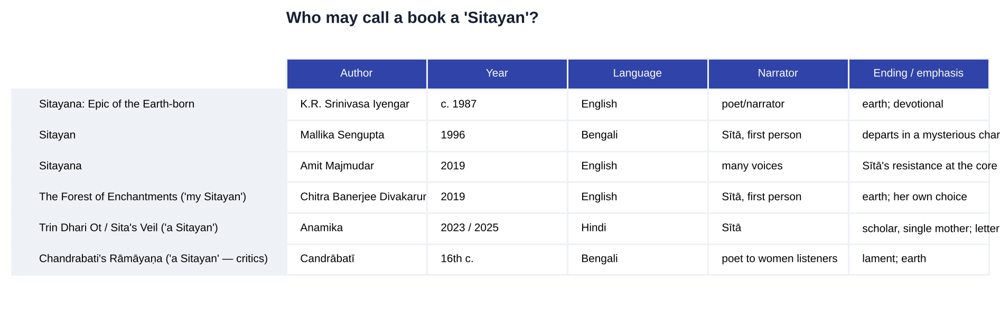

## Nabaneeta Dev Sen: the comparatist as recoverer

Nabaneeta Dev Sen (1938–2019), poet, novelist and professor of comparative literature at Jadavpur University, came to Candrābatī by accident. "For me it all started in 1989," she wrote, "with an accidental re-reading of the text of Chandrabati Ramayan. That is where I discovered that a women's Ramayan tells a different story."^[Nabaneeta Dev Sen, "When Women Retell the Ramayan," *Manushi* 108 (1998): 18.] She presented a paper on Candrābatī in February 1991, and A. K. Ramanujan, she recalled, was "vastly enthusiastic" and told her about Velcheru Narayana Rao's then-unpublished work on Telugu women's songs; Ramanujan "felt that a lot of Chandrabati's perceptions were shared by these Telugu women", and that "women's traditions held an alternative perception of Indian civilisation".^[Dev Sen, "When Women Retell," 18.] With Rao's references, she went to Andhra Pradesh, then to Bangladesh and Candrābatī's village, and her interest "spread its wings wider" to Marathi and Maithili.^[Dev Sen, "When Women Retell," 18–19.]

The sequence is worth recording because it shows how the field was formed. The recovery of the women's Rāmāyaṇa in the 1990s was not the work of a single discipline or a single method. It was the convergence of a comparatist's rereading of a Bengali text, a folklorist's work on Telugu songs, and a poet-scholar's encouragement, across three countries and four languages. And it began from a theoretical observation that only a comparatist would have made: that "out of the thirty-eight basic things upon which most epic narratives of the world are based, only nine are associated with women", and that "the ideals of the epic world obviously do not have much to share with women, nor do the women enjoy the heroic values".^[Dev Sen, "When Women Retell," 18.] If the epic as a genre was made for men, the question of what women did when they retold an epic was not a question about the Rāmāyaṇa alone. It was a question about the relation of women to the epic form everywhere.

Dev Sen's Bengali essays on the subject were collected as *Sītā Theke Śuru* (Beginning from Sita) in 1996.^[Nabaneeta Dev Sen, *Sita Theke Shuru* (Kolkata, 1996) [W088].] Her English essay of 1998 was first presented at the Sita Symposium held at Columbia University in April of that year, moderated by John Stratton Hawley, with papers by Linda Hess, Thomas Coburn, J. E. Llewellyn and Phyllis Herman, among others; their titles ("Once Upon a Time ... Sita Slew Ravana", "The Arya Sita and the Power of Self-Sacrifice", "Relocating Ramarajya: Sita's Kitchen in Ayodhya") mark the late-1990s turn to Sita in Western scholarship.^[Corpus workbook, W092.] Linda Hess's essay "Rejecting Sita", published in the *Journal of the American Academy of Religion* the following year, gathered the responses of audiences, performers and writers to Rama's treatment of Sita, from discomfort to open protest, and remains the most comprehensive survey of that reception.^[Linda Hess, "Rejecting Sita: Indian Responses to the Ideal Man's Cruel Treatment of His Ideal Wife," *Journal of the American Academy of Religion* 67, no. 1 (1999): 1–32 [W094].]

What Dev Sen added to this international conversation was a voice from inside the languages and a refusal of easy conclusions. Her final judgement on the women's songs, quoted in Chapter 2 and disputed there, is a sober one: that Sita "laments but does not challenge Ram", that "she lends dignity to suffering, makes forbearance a heroic quality", and that "for the silent majority of Indian women, justice remains a dream, equality an absurdity and suffering an everyday reality".^[Dev Sen, "When Women Retell," 27.] Her last sentence is the second epigraph of this book: "When women retell the Ramayan, Sita is the name they give themselves: the homeless female, the foundling, unloved, rejected and insecure."^[Dev Sen, "When Women Retell," 27.] I have argued that her evidence supports a more defiant reading than her conclusion. But the conclusion has the merit of refusing to celebrate. Dev Sen did not discover a feminist Sita in the songs and present her as a victory. She discovered a mirror, and reported what it showed.

## Mallika Sengupta's *Sitayan*

In November 1996, the same year as *Sītā Theke Śuru*, the Bengali poet Mallika Sengupta (1960–2011) published a novel called *Sītāyan* with Ananda Publishers in Kolkata.^[Mallika Sengupta, *Sitayan* (Kolkata: Ananda Publishers, 1996) [W214]. The corpus workbook notes that one journal article gives 1978, which is wrong; no English translation has been found.] It has not been translated into English, and it is, in consequence, almost unknown outside Bengal; the research for this book has had to rely on the corpus summary and on secondary accounts. What those accounts describe is, if accurate, one of the most important books in the corpus.

Sengupta's Sita narrates the *Uttarakāṇḍa* herself, from the day Lakshmana leaves her near Vālmīki's hermitage to her departure, at the end, not into the earth but in a mysterious chariot.^[Corpus workbook, W214.] Within that frame, three features stand out. Kausalyā, Rama's mother, takes Sita's side against her son. Ravana questions the ethics of the Aryans. And the killing of Śambūka is part of the story.

Each of these is significant, and together they make *Sītāyan* an exception to the division of labour that Chapter 5 identified. There, I argued that the feminist retellings had followed Sita and left Śambūka behind, while the anti-caste writers followed Śambūka and borrowed Sita. Sengupta's novel, on the evidence available, refuses that division. It puts the banished queen and the beheaded Śūdra in the same narrative, told by the queen, and it gives Ravana, the outsider to Aryan society, a voice that questions its ethics. The corpus workbook calls it a novel that "adds an Adivasi and anti-caste angle".^[Corpus workbook, W214.] If that is right, it joins in 1996 the two lines of critique that most of the corpus keeps apart, and it does so in a first-person Sita narrative two decades before the first-person Sita became a bestseller genre in English.

The ending is equally significant. Sengupta's Sita does not return to the earth. She leaves in a chariot whose destination the reader is not told. The earth, in Vālmīki, is Sita's mother, and the return to it, whatever else it is, is a return to origin. Sengupta's chariot is a departure to elsewhere. It refuses not only Rama's court but the closure of the myth itself, the circle that brings the daughter of the furrow back to the furrow. Her Sita does not go home. She goes.

The title, finally, gives this book its key word. *Sītāyan*, "the going of Sita" or "the way of Sita", on the model of *Rāmāyaṇa*, "the going of Rama". Sengupta was not the first to use it; K. R. Srinivasa Iyengar's English epic *Sitayana: Epic of the Earth-born* preceded her by a decade.^[K. R. Srinivasa Iyengar, *Sitayana: Epic of the Earth-born* (begun 1983; published c. 1987) [W061]; publisher and year to be checked.] Nor was she the last: Amit Majmudar's *Sitayana* (2019) and Chitra Banerjee Divakaruni's *The Forest of Enchantments* (2019), whose narrator calls her book a "Sitayan", and Anamika's Hindi novel, which its author calls a Sitayan, followed.^[Amit Majmudar, *Sitayana* (Gurugram: Penguin, 2019) [W227]; Chitra Banerjee Divakaruni, *The Forest of Enchantments* (Noida: HarperCollins India, 2019) [W169]; Anamika, *Trin Dhari Ot* (2023) [W201].] The corpus workbook asks: "Who may call a book a Sitayan?"^[Corpus workbook, My Ideas tab, idea 6.] Figure 7.2 lays out the answers. The title has been claimed by a devotional male poet in English, a feminist woman poet in Bengali, a male diaspora poet in English, a diaspora woman novelist in English and a Hindi woman poet. The word has no owner. That is, perhaps, the point.

## Lalithambika Antharjanam: from Sita to Satyavatī, and the trial of Thatri

In 1972, the Malayalam writer Lalithambika Antharjanam (1909–1987) published *Sīta Mutal Satyavati Vare* (From Sita to Satyavati), a book of essays on thirteen women of the Hindu epics; it received the Kerala Sahitya Akademi award the following year.^[Lalithambika Antharjanam, *Seetha Muthal Sathyavathi Vare* (Kottayam: NBS, 1972) [W213]. No English translation has been found.] The corpus workbook describes it as "an early Malayalam woman's re-reading of epic women" and as evidence for Hypothesis D.^[Corpus workbook, W213.]

The author's name is itself a document. *Antharjanam*, "one who lives within", was the term for a Nambūtiri Brahmin woman, and it described the condition of seclusion in which women of that community lived: confined to the inner quarters, veiled when they went out, married often as one of several wives of an elderly man, since only the eldest son of a Nambūtiri family could marry within the caste. Lalithambika Antharjanam grew up inside that seclusion and spent her literary life writing against it.

Among her best-known short stories is "Pratikāradēvata" (The Goddess of Revenge), written in the 1930s, about Kuriyedathu Thatri, a Nambūtiri woman who in 1905 was put on trial by her community in a *smārtavicāram*, a caste tribunal convened to examine a Nambūtiri woman accused of adultery.^[On "Pratikaradevatha" and the Thatri *smarthavicharam* of 1905, see the scholarship on Lalithambika Antharjanam's short fiction (pinpoint to be verified).] The *smārtavicāram* was an institution. The accused woman was confined, interrogated, sometimes for months, and if found guilty was cast out, declared dead by her family, and her funeral rites performed while she lived. Thatri, according to the historical record and the legend that grew around it, turned the trial against her accusers by naming the men with whom she had relations, dozens of them, many prominent, all of whom were in turn cast out. Antharjanam's story makes her a goddess of revenge.

I place this here because it supplies, from the history of a single Indian community within living memory of the twentieth century, an actual institution of trial for women's chastity, with procedures, judges, verdicts and punishments; and because the woman who wrote about it was the same woman who, decades later, wrote essays on Sita. The ordeal of Sita was not, for Lalithambika Antharjanam, a myth to be reinterpreted. It was the archetype of a procedure her own community had practised on women she could have known. And the story she told about it was not a story of a woman who suffered nobly, but of a woman who turned the tribunal's logic on its makers. Thatri's revenge is the anti-type of Sita's refusal: where Sita withdraws from the court, Thatri indicts it.

This is the strongest evidence I know for the claim, central to this book, that the meaning of Sita's trial in modern India has never been merely literary. The *smārtavicāram* was abolished; the trials of women's chastity by families, caste councils and village *panchāyats* were not. Archana Pathak Bhatt's study of what she calls "the Sita syndrome", the use of the Sita ideal to explain how South Asian women speak about, and stay silent about, domestic violence, shows the same structure persisting in diaspora households.^[Archana Pathak Bhatt, "The Sita Syndrome: Examining the Communicative Aspects of Domestic Violence from a South Asian Perspective," *Journal of International Women's Studies* 9, no. 3 (2008) [W132].] When women writers took up Sita, they were writing about something their readers lived.

## Yes to Sita, no to Ram

I come, finally, to the essay that I regard as the most important single piece of evidence in this book, and that I have drawn on in every chapter so far: Madhu Kishwar's "Yes to Sita, No to Ram! The Continuing Popularity of Sita in India", published in *Manushi* in January 1997 from a paper given at the School of Oriental and African Studies in London a year earlier.^[Madhu Kishwar, "Yes to Sita, No to Ram! The Continuing Popularity of Sita in India," *Manushi* 98 (January–February 1997): 20–31 [W091].]

Kishwar, the founding editor of *Manushi*, India's pioneering feminist journal, begins with a confession. "I grew up thinking of Sita as a much wronged woman—a slavish wife without a mind of her own. And precisely for that reason she was not for me a symbol of inspiration, but a warning. She was all that I did not want to be."^[Kishwar, "Yes to Sita," 20.] What changed her mind was the evidence of the journal's own submissions: "80 to 90 percent of the poems that came to us for the Hindi version of Manushi, and at least half of those for English Manushi, revolved around the mythological Sita, or the writer as a contemporary Sita."^[Kishwar, "Yes to Sita," 20.] And then the biggest surprise: her own first poem, written in Hindi, was titled "Agnipariksha", and it is the epigraph of this chapter.^[Kishwar, "Yes to Sita," 21.]

Over the following years, Kishwar asked men and women whom they held up as an ideal. Married women and women about to marry "very frequently mention Sita", including her own students at a Delhi University college.^[Kishwar, "Yes to Sita," 21.] But when she asked why, the answers did not endorse the slavish wife she had grown up despising. "My interviews indicate that Indian women are not endorsing female slavery when they mention Sita as their ideal."^[Kishwar, "Yes to Sita," 22.] Sita "is seen as a person whose sense of dharma is superior to and more awe inspiring than that of Ram".^[Kishwar, "Yes to Sita," 22.] Her steadfastness is perceived "as a sign of emotional strength and not slavery, because she refuses to forsake her dharma even though Ram forsook his dharma as a husband".^[Kishwar, "Yes to Sita," 23.] Her ordeal is seen "as an act of defiance".^[Kishwar, "Yes to Sita," 23.] Her refusal of the second ordeal is seen "as a momentous but dignified rejection of Ram as a husband".^[Kishwar, "Yes to Sita," 23.] And the judgement on Rama is unequivocal: "Ram's rejection of Sita is almost universally condemned while her rejection of him is held up as an example of supreme dignity."^[Kishwar, "Yes to Sita," 24.] People will say approvingly that a man is "a Ram-like son, a Ram-like brother, or a Ram-like king", but "they will never say as a mark of approval, 'He is a Ram-like husband.'"^[Kishwar, "Yes to Sita," 29.]

Kishwar draws two conclusions from this evidence that bear directly on the argument of this book.

The first concerns the relation of Indian women to their tradition. Kishwar contrasts the Indian attitude to Rama and Sita with "the popular western view that assumes that people in by-gone ages were less knowledgeable, were far less aware and conscious of their rights and dignity". "This linear view of human society makes the past something to be studied and kept in museums."^[Kishwar, "Yes to Sita," 22.] Hindus, she observes, "talk of Ram and Sita, Shiv and Parvati and sundry other gods in very human ways and feel no hesitation in passing moral judgements on them"; gods "are expected to live up to the expectations of fair play demanded by their present day worshippers", and such criticism "is not seen as a sign of being irreligious or irreverent".^[Kishwar, "Yes to Sita," 23.] This, she suggests, "provides a far greater sense of freedom and volition to individuals within the Hindu faith than in religions where god's commandments are to be unconditionally obeyed".^[Kishwar, "Yes to Sita," 23.] One may dispute the comparison; but the observation about Hindu practice is borne out by every women's song in Chapter 2. The capacity to judge Rama is not a modern import. It is part of how Rama has always been worshipped.

The second conclusion concerns agency. Kishwar argues that "there are several practical reasons why Sita-like behaviour makes sense to Indian women". A woman's security in marriage depends on her relations with her marital family and her children as much as on her husband; if she is "seen as being more or less above reproach", she can count on them to intervene on her behalf.^[Kishwar, "Yes to Sita," 30.] "By shaping themselves in the Sita mould, women often manage to acquire enormous clout and power over their husbands and family."^[Kishwar, "Yes to Sita," 31.] This is Kandiyoti's patriarchal bargain, stated from inside, and it is Mahmood's agency within norms, stated without theory. And Kishwar adds a sentence that the liberation narrative has never answered: "The Hindu tradition might valourise wives who put up with tyrannical husbands gracefully but it does not valourise unreasonable husbands."^[Kishwar, "Yes to Sita," 30.]

I am aware that Kishwar's essay is sometimes read, and that her later intellectual trajectory has encouraged readers to read it, as a defence of tradition against feminism. That is not how I read it, and it is not, I think, what it says. It is better read as evidence: evidence that ordinary Indian women's relation to Sita was, at the end of the twentieth century, more critical than tradition's defenders supposed and less hostile than its feminist critics assumed. Ruth Vanita, Kishwar's former colleague, had already criticised predictable feminist readings, including Kathleen Erndl's of Śūrpaṇakhā, and warned against romanticising "people's" versions; her review of *Many Ramayanas*, "We Make It Better", is a model of internal critique.^[Ruth Vanita, "We Make It Better" (review of *Many Ramayanas*), *Manushi* 78 (c. 1993) [W083]; issue year to be checked.] Kishwar's essay belongs to the same honest tradition. It reports what women said, and what they said was: yes to Sita, no to Ram.

::: {custom-style="Box Title"}
Reading Against the Text
:::

::: {custom-style="Box"}
In Candrābatī, the cause of Sita's banishment is Rama's sister Kukuā, who tricks her into drawing Ravana. If the women's tradition retells the public catastrophe as a domestic one, does it thereby relieve Rama, and the city, of their responsibility? Or does it reveal that the household was always where the city's judgements were enforced?
:::

::: {custom-style="Box Title"}
The Debate: Agency
:::

::: {custom-style="Box"}
**Position A:** Agency is resistance: Sita has agency only where she defies Rama, Ravana or the order they uphold.\
**Position B:** Agency is negotiation within constraint: Sita, and the women who revere her, exercise agency by inhabiting norms strategically.\
**Where the evidence of this chapter leaves the argument.** Kishwar's interviews, which I take as the best evidence we have of how ordinary women relate to Sita, support Position B at the level of daily life ("by shaping themselves in the Sita mould, women often manage to acquire enormous clout") and Position A at the level of the story ("her rejection of him is held up as an example of supreme dignity"). Women live by negotiation and admire refusal. That is not a contradiction; it is a division of labour between practice and ideal, and it explains why Sita, rather than Draupadī, is the figure they choose. Draupadī resists; Sita negotiates, and then, at the decisive moment, refuses.
:::

## Conclusion

The recovery of a women's lineage of retelling, from Candrābatī to Dev Sen, is the foundation on which feminist reconstruction rests. It established that women had been retelling the Rāmāyaṇa "with their own eyes" for four centuries before the term "feminist retelling" existed; that their eyes selected different episodes, used different forms and located causes differently; and that their judgement of Rama, often voiced by the teller rather than the told, was severe. Mallika Sengupta joined that lineage to the anti-caste critique and sent her Sita away in a chariot. Lalithambika Antharjanam joined it to the history of an actual tribunal for women's chastity. And Madhu Kishwar showed that ordinary women, far from being the passive objects of the Sita ideal, had long since made it into an instrument of their own judgement.

Chapter 8 turns to the writer who did most to make this lineage the basis of a modern feminist fiction: the Telugu novelist Volga, whose *The Liberation of Sita* imagined, for the first time at book length, a Sita freed through her encounters with the women her world had wronged.
