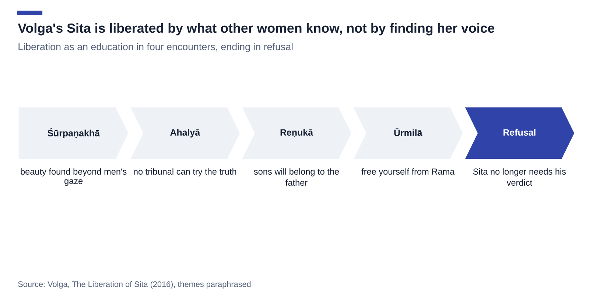

# Chapter 8. The Solidarity of the Wronged: Volga's *The Liberation of Sita*

::: {custom-style="Epigraph"}
"Sita's exile,\
Let us share it among ourselves."

— Marathi women's song, quoted by Nabaneeta Dev Sen, *Manushi* 108 (1998), p. 26
:::

## The argument of this chapter

If one book has come to stand, for the contemporary reader and the contemporary syllabus, as *the* feminist retelling of Sita, it is Volga's *Vimukta*, a collection of linked Telugu stories written between 2003 and 2009, awarded the Sahitya Akademi Award in 2015, and published in English in 2016 as *The Liberation of Sita*.^[Volga (P. Lalitha Kumari), *Vimukta* (Telugu stories, 2003–09; Sahitya Akademi Award 2015); English translation, *The Liberation of Sita*, trans. T. Vijay Kumar and C. L. L. Jayaprada (Noida: HarperPerennial, 2016) [W107]. The corpus workbook places it fourth in the reading sequence.] Its premise is simple and its execution subtle. Sita, after her banishment, meets in turn a series of women whom Rama's world has wronged: Śūrpaṇakhā, mutilated; Ahalyā, cursed; Reṇukā, beheaded at her husband's command by her own son; and Ūrmilā, left behind. From each she learns something, and the sum of what she learns is her liberation.

This chapter reads the book closely and argues five things.

1. Volga's liberation is not liberation by voice. It is liberation by knowledge, transmitted between women, and it culminates in refusal. The book is the clearest modern confirmation of this study's central claim.

2. Volga stands at the end of a specifically Telugu lineage of rationalist and feminist rewriting, from Chalam through Kodavatiganti Kutumba Rao and Ranganayakamma, and behind them the Telugu women's songs. Her achievement is to have turned the anti-epic's borrowed Sita into a Sita who borrows from no one.

3. The solidarity that liberates Volga's Sita is a solidarity of the wronged. Its members are, nonetheless, mostly women of the epic's upper registers. The forest woman, Śabarī, is absent from the first book; Volga's 2025 novel about her is, in effect, an answer to that absence.

4. Volga's liberation has a striking affinity with renunciation. The liberated Sita resembles, in important respects, the Jain Sita of the *Paumacariya* who takes initiation as a nun. The most celebrated modern feminist Sita thus rejoins one of the oldest sectarian tellings. Tradition, once again, supplies the exit that the liberation narrative thought it was inventing.

5. The public response to Volga's work, including threats over a newspaper story about Mandodarī in 2016, shows that the stakes of retelling Sita in contemporary India are not merely literary.

## Volga and the Telugu lineage

Volga, the pen name of Popuri Lalitha Kumari (born 1950), is one of the founding figures of the women's movement in Andhra Pradesh and one of its most prolific writers: novelist, short-story writer, poet, screenwriter, translator and activist, associated with the feminist organisation Asmita and with a body of work, from the novel *Svecchā* (Freedom, 1987) onward, that has made the conditions of women's lives in Telugu society its constant subject.^[On Volga's career and associations, see the translators' introduction to *The Liberation of Sita* and her interviews (pinpoints to be verified).] In a 2017 interview, recorded in the corpus, she placed her Rāmāyaṇa work in a Telugu lineage: Chalam's *Sita Agnipravesam*, Kodavatiganti Kutumba Rao's rationalist stories, Ranganayakamma's *Ramayana Vishavruksham*.^[Corpus workbook, W034 and W044, recording Volga's account in *Scroll* (2017).]

The lineage matters for what Volga inherited and what she refused. From Chalam she inherited the audacity to make Sita judge Rama and the conviction that a woman's freedom must include freedom of desire. From Ranganayakamma she inherited the conviction that the Rāmāyaṇa's "ideal" order is a structure of domination. From both she inherited a Telugu public in which the epic could be argued over. What she refused was the anti-epic's characteristic move, analysed in Chapter 5: the borrowing of Sita to indict Rama. Volga's Sita is not a witness, not an instrument, not collateral damage. She is the subject of her own story, and the story is about what she comes to know.

Behind the literary lineage stands the older one that Velcheru Narayana Rao documented: the Telugu women's songs in which Sita's banishment is supported by the women of the household, in which Urmila refuses to recognise her returning husband, in which the epic's war gives way to the life of a woman.^[Velcheru Narayana Rao, "A Rāmāyaṇa of Their Own: Women's Oral Tradition in Telugu," in *Many Rāmāyaṇas*, ed. Paula Richman (Berkeley: University of California Press, 1991), 114–36 [W072]; Nabaneeta Dev Sen, "When Women Retell the Ramayan," *Manushi* 108 (1998): 20, noting that "the support that Sita receives from all the women of the household when she is being sent off to the forest is to be found only in Telugu songs".] Dev Sen observed that the support of the women of the household at the moment of banishment "is to be found only in Telugu songs".^[Dev Sen, "When Women Retell," 20.] Volga's book is, among other things, a modern prose expansion of that Telugu motif. Her Sita, sent out of the household, finds outside it the women's support that the Telugu songs had placed inside.

## The structure: liberation as a sequence of encounters

The book is built as a sequence of encounters, each a story in its own right and each a stage in a single movement. I summarise its design rather than its plot, because the design is the argument.^[The summary that follows paraphrases the book's movement as described in the corpus workbook (W107) and in published reviews and scholarship (W158, W188, W196); quotations are avoided and pinpoints are to be verified against the HarperPerennial edition.]

### Śūrpaṇakhā in the garden

In the epic, Śūrpaṇakhā is the woman whose desire is punished by mutilation: Rama, in Vālmīki's critical edition, tells Lakshmana to disfigure this "misshapen, unchaste, wildly intoxicated, pot-bellied *rākṣasī*", and Lakshmana cuts off her ears and nose.^[CE 3.17.20–21: *imāṃ virūpām asatīm atimattāṃ mahodarīm / rākṣasīṃ puruṣavyāghra virūpayitum arhasi*.] She is never seen again except as the cause of the war. Volga finds her years later, living in the forest, tending a garden.^[Corpus workbook, W107: "Surpanakha tending a garden in the forest".]

The image is chosen with exactness. The woman who was punished for her pursuit of beauty in men, whose own beauty was destroyed by men, has turned to the cultivation of beauty in the earth. She has found a form of fulfilment that does not depend on any man's gaze, and she has found it in the forest, the domain outside the kingdom. When Sita meets her, the queen who was abducted meets the woman whose mutilation provoked the abduction; the two halves of the epic's central transaction face each other. And it is Śūrpaṇakhā who has something to teach: that beauty, and the self, can be found beyond the economy in which men confer and withdraw value.

Kathleen Erndl's study of the mutilation of Śūrpaṇakhā across tellings showed that the episode depends on a split between the chaste good woman (Sita) and the "loose" bad woman (Śūrpaṇakhā), each defined against the other.^[Kathleen M. Erndl, "The Mutilation of Śūrpaṇakhā," in Richman, *Many Rāmāyaṇas*, 67–88 [W075].] Volga's first move is to heal the split. The good woman and the bad woman meet, not as opposites but as two victims of the same order, and the "bad" woman turns out to be the wiser.

### Ahalyā and the question of judgement

The second encounter is with Ahalya, the woman who was cursed for an act of desire (or, in the devotional tellings, of deception) and released by Rama's arrival. Chapter 6 traced her long transformation from Vālmīki's invisible ascetic to the stone of the devotional tradition and back. Volga's Ahalya knows something Sita does not yet know about the nature of judgement.

What she knows, in the reading that the reviews and scholarship converge on, is that the truth of a woman's conduct cannot be established by a tribunal whose judges have already decided what they need to find; that to submit to such a tribunal is to concede its authority; and that the only freedom available to a woman under such a jurisdiction is to cease to seek its verdict.^[See Geetanjali Mahajan, "Rebel not Revolutionary: Sita's Agency and Quest for Selfhood," *The Criterion* 8, no. 6 (2017) [W158], and the readings collected in the corpus under W188 and W196 (pinpoints to be verified).] Ahalya, in Volga, has passed through the experience Sita is about to undergo, and she offers Sita not consolation but understanding. The scene is the mirror image of Pudumaippittan's 1943 story: there, Ahalya learned from Sita's ordeal that her own restoration was worthless, and chose stone; here, Sita learns from Ahalya's experience what her own ordeal meant, and prepares to choose.

### Reṇukā and the question of motherhood

The third encounter takes Sita outside the Rāmāyaṇa altogether, to Reṇukā, the wife of the sage Jamadagni and mother of Paraśurāma. In the *Mahābhārata* and the Purāṇas, Reṇukā is beheaded by her son at her husband's command, for a moment's lapse of attention, a glimpse of a king bathing; and the son, asked to name a boon for his obedience, asks that she be restored to life. She is the archetype of the mother whose son's obedience to his father is greater than his love for her.

Volga's Reṇukā questions motherhood. The corpus summary records it simply: "Renuka who questions motherhood".^[Corpus workbook, W107.] What she questions, in the context of Sita's situation, is precise. Sita is the mother of Rama's sons. When the sons are grown, they will belong to their father; the patrilineal order will claim them, as it claimed Paraśurāma, and their obedience will go to the father who banished their mother. Reṇukā knows this because her own son killed her. To Sita, who has built her life in exile around her sons, the knowledge is devastating and necessary. Motherhood, the one domain in which the banished queen still held authority, is revealed as a domain the patriarchal order will reclaim.

The research plan identified motherhood as one of the debates that should run through this book: is motherhood "a source of authority" or "an instrument of social confinement"?^[Research plan, §3.] Volga's Reṇukā answers: it is a source of authority for exactly as long as the patriarch permits. The answer is bleak, and it is supported by the epic. In Vālmīki's seventh book, the sons whom Sita raised sing Rama's poem at Rama's sacrifice, are recognised by Rama as his, and remain with him when she leaves.

### Ūrmilā and the choice of solitude

The fourth encounter is with Urmila, Sita's sister, who stayed behind in Ayodhya. Volga's Urmila has used her fourteen years of solitude not to wait but to think; she has found in solitude a freedom that marriage denied her; and she tells Sita, in the corpus's summary, "to free herself from Rama".^[Corpus workbook, W107.]

Urmila's counsel is the culmination of the sequence, and it deserves to be read against the line traced in Chapter 6. The nationalist Urmila of *Sāket* waited, patriotically; the socialist Urmila of *Bhūmikanyā Sītā* protested; the Telugu women's Urmila refused to recognise her husband; the market Urmila of the 2010s would be an administrator. Volga's Urmila is a contemplative. She has discovered, in the condition imposed on her, a discipline of self-knowledge, and she offers it to her sister as a way out.

### Rama

The final movement of the book, as reviewers and critics have read it, turns to Rama, and its handling of him is the book's most surprising and most debated choice. Volga's Sita, liberated by what the women have taught her, comes to understand that Rama too is unfree: that he is bound by the role of king, by the demands of his lineage and his subjects, by the very *dharma* in whose name he banished her. Her liberation includes a kind of compassion for him, the compassion of one who has escaped a prison for one who has not.

This choice has divided readers. For some, it is the book's crowning generosity: a feminism that does not need an enemy, that understands patriarchy as a structure that imprisons men as well as women, and that liberates Sita without condemning Rama. For others, it dissolves the structural critique into a personal epiphany: if Rama is a victim of his role, who is responsible for the role? I shall return to this question in the second half of the chapter, after considering what kind of liberation Volga's Sita achieves.
