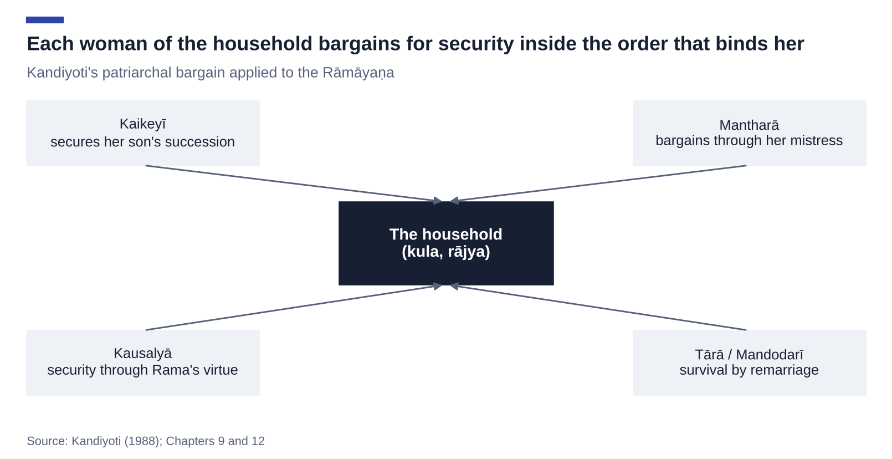

# Chapter 9. Counter-Memory in the Monologue: Sarah Joseph, Ambai and the Southern Retellings

::: {custom-style="Epigraph"}
"Ram is reading about Sita's exile\
In a book ..."

— Marathi women's song, quoted by Nabaneeta Dev Sen, *Manushi* 108 (1998), p. 25
:::

## The argument of this chapter

Volga's method, in *The Liberation of Sita*, is the encounter: Sita meets women and learns from them. In the same years, in Malayalam, Tamil and Kannada, women writers and the women's songs that scholars were translating for the first time used a different method. They did not send Sita on a journey of education. They let the women of the epic speak, each in her own monologue, about what the epic had forgotten. The monologue was a form of counter-memory: a memory held against the official record, by those whom the record had used and left out.

This chapter makes four claims.

1. Sarah Joseph's Malayalam Rāmāyaṇa stories, translated in 2005, are the most sustained example of the monologue as counter-memory in the corpus. Their decisive choice is to give voice not only to Sita but to Mantharā and Śūrpaṇakhā: the servant and the *rākṣasī*, the two women the epic most consistently blames.

2. The figure of Mantharā, the hunchbacked servant who counsels Kaikeyī, is the corpus's best test of whether feminist retelling can extend its sympathy across class. The Mantharā cluster (Sarah Joseph, P. Vijayakumari Amma, Anand Neelakantan) shows both the possibility and the limits.

3. The southern women's songs translated in Paula Richman's 2008 anthology, especially the Kannada song "Do You Accept My Truth, My Lord?", articulate a theory of proof that is the exact antithesis of the ordeal: that a woman's word is sufficient evidence of her truth. This is a jurisprudential claim, and it is the women's tradition's most direct answer to Vālmīki's sixth book.

4. Humour, in Kumudini's satirical letters from Sita and in the women's songs that laugh at Sita and at themselves, is a mode of critique that the solemn tradition of the feminist retelling has largely lost, and that deserves to be recovered.

## Counter-memory

The term is Michel Foucault's, from his essay on Nietzsche and genealogy: history understood not as the unfolding of a single origin but as a multiplicity of descents, and counter-memory as the memory that the official history excludes and that can be mobilised against it.^[Michel Foucault, "Nietzsche, Genealogy, History," in *Language, Counter-Memory, Practice: Selected Essays and Interviews*, ed. Donald F. Bouchard (Ithaca, NY: Cornell University Press, 1977) [W055].] I use it with caution, because Foucault was not thinking of the Rāmāyaṇa and because the Indian tradition had its own vocabulary for the multiplicity of tellings long before genealogy became a method. Ramanujan's "pool of signifiers" and Bulcke's patient tracing of variants are, in their way, genealogies. But the term is useful for one specific purpose: to name the work done by a retelling that sets out not to replace the official story but to remember what it forgot, and to remember it in the voice of someone the official story used.

The marathi song in the epigraph to this chapter is counter-memory in its purest form. "Ram is reading about Sita's exile / In a book." The official record, the book, is held by Rama, who reads it from outside. The memory of the exile is held by the women who sing, from inside. The song does not deny the book's existence. It asserts that the book is not the story.

## Sarah Joseph

### The writer and her milieu

Sarah Joseph (born 1946) is one of the most important novelists in Malayalam and a founding figure of Kerala's women's movement; in the 1980s she was among the founders of a forum for women's writing and activism in Thrissur, and her novel *Ālāhayuṭe Peṇmakkaḷ* (Daughters of God the Father, 1999) received the Kendra Sahitya Akademi award.^[On Sarah Joseph's career, see K. Satchidanandan's afterword to *Retelling the Ramayana: Voices from Kerala* (New Delhi: Oxford University Press, 2005) [W114] (pinpoints to be verified).] Her Rāmāyaṇa stories, written between the 1990s and the early 2000s, were published in English in 2005 in a volume titled *Retelling the Ramayana: Voices from Kerala*, together with C. N. Sreekantan Nair's play *Kanchana Sita*, with an afterword by the poet K. Satchidanandan.^[*Retelling the Ramayana: Voices from Kerala* (New Delhi: Oxford University Press, 2005) [W114].]

The pairing in that volume is telling. Sreekantan Nair's *Kanchana Sita*, discussed in Chapter 6, removes Sita from the stage and makes her present as nature. Sarah Joseph's stories do the opposite: they bring onto the page not only Sita but the women whom even a sympathetic tradition had kept in the wings. The two works together represent the two poles of Kerala's twentieth-century engagement with Sita: the poetic sublimation of her into the world, and the prose insistence on the particular women who lived in it.

### The stories

The corpus records four of Sarah Joseph's stories: "Black Holes", told from Mantharā's side; "Asoka"; "Mother Clan"; and "What is Not in the Story". Between them they give monologues to Sita, Mantharā and Śūrpaṇakhā.^[Corpus workbook, W114. The assignment of particular stories to particular speakers beyond "Black Holes" is to be checked against the OUP edition; quotations are avoided.]

The title of the last, "What is Not in the Story", names the method of the whole. Each monologue is spoken from the position of someone the epic has narrated but not heard. Each tells the part of the story that the epic left out, because the epic's narrator had no access to it, or no interest in it, or reason to suppress it. And each, by its existence, makes the official story incomplete: a reader who has heard Mantharā's account of the palace cannot read Vālmīki's account of Kaikeyī's chamber in the same way again.

The title of the second, "Asoka", names the place where Sita was held: the Aśoka grove in Laṅkā. The choice to give Sita's monologue that setting is pointed. The grove is the place where, in Vālmīki, Sita speaks most and is most alone; it is the scene of the *Sundarakāṇḍa* in which Sutherland Goldman found her voice.^[Sally J. Sutherland Goldman, "The Voice of Sita in Vālmīki's *Sundarakāṇḍa*," in *Questioning Ramayanas*, ed. Paula Richman (Berkeley: University of California Press, 2001) [W103].] It is also the place that the later tradition most wanted to forget, because what happened there (or what might be said to have happened there) was the cause of the ordeal. The devotional tradition removed Sita from the grove altogether, replacing her with a shadow. Sarah Joseph returns her to it, and lets her remember.

### Why the monologue?

The monologue is a form with a specific relation to power. It is the form of the testimony, the deposition, the confession; it is spoken by one person, without interruption, and it asks to be heard to the end. It does not argue with an interlocutor, as Vālmīki's Sita argued with Rama before the fire; nor does it move through a sequence of encounters, as Volga's Sita does. It simply speaks, and in speaking constitutes a record.

That is why it suits counter-memory. A counter-memory does not need to win an argument with the official story. It needs to exist alongside it, as a second record, so that the reader who holds both cannot take either as complete. Sarah Joseph's monologues do not refute Vālmīki. They supplement him, in the strict sense that Derrida gave the word: they add what was missing, and in adding it reveal that the original was not whole.

There is a risk in this, which Spivak's question names and which this book has raised before. The monologue claims to give voice to the voiceless, and it is the novelist who supplies the voice. When Sarah Joseph writes Mantharā's monologue, the words are Sarah Joseph's. The question is not whether this ventriloquism can be avoided (it cannot; all fiction is ventriloquism) but whether the writer acknowledges it, and whether the voice she supplies is one that the woman, so far as we can reconstruct her position, could have had. On this test, I think Sarah Joseph's choice of Mantharā is her most important and most difficult.

## Mantharā: the servant's memory

### The epic's scapegoat

In Vālmīki's second book, Mantharā is a hunchbacked maidservant of Kaikeyī, who came with her from her father's house. Seeing preparations for Rama's consecration, she rouses Kaikeyī's fear: once Rama is king, Kaikeyī will be a servant to Kausalyā, and Bharata will be nothing. She reminds Kaikeyī of the two boons Daśaratha once promised her, and counsels her to demand Rama's exile and Bharata's consecration. Kaikeyī, at first delighted by the news of Rama's consecration, is persuaded. The exile follows.

The epic, and still more the tradition, makes Mantharā the scapegoat. She is deformed in body and, it is implied, in mind. When Śatrughna later finds her, he drags her by the hair and would kill her, and is restrained only by Bharata. In the devotional tradition, her counsel is attributed to the goddess Sarasvatī, who entered her mind to set the divine plan in motion; even her malice is not her own. In popular speech, "Mantharā" means a malicious woman who poisons a household with whispers.

### Three Mantharās

The corpus records three modern attempts to remember Mantharā otherwise. Sarah Joseph's "Black Holes" is told from her side.^[Corpus workbook, W114.] P. Vijayakumari Amma's short Malayalam novel *Manthara*, of ninety-six pages, enters her mind, though the bookseller's description, recorded in the corpus, says it "shows her cunning".^[P. Vijayakumari Amma, *Manthara* (Kottayam: NBS, c. 2014) [W217]; year of first edition to be checked.] And Anand Neelakantan's *Valmiki's Women* (2021) makes her, in the corpus's summary, "a loving foster-mother with a deformed body".^[Anand Neelakantan, *Valmiki's Women: Five Tales from the Ramayana* (Chennai: Westland, 2021) [W178].]

The three approaches correspond to three possibilities. The first remembers Mantharā as a woman with a history and a perspective of her own, a servant who saw the palace from below. The second remembers her as a woman whose cunning is the subject, rather than the object, of the narrative: her intelligence is hers, even if it is turned to harm. The third remembers her as a mother: the woman who raised Kaikeyī, whose loyalty to her charge is love, and whose counsel is the counsel of a mother protecting her daughter's son.

### The patriarchal bargain from below

What all three make visible, and what the epic obscures, is Mantharā's position. She is a servant, and a servant who came with her mistress from another kingdom: an outsider twice over, by class and by origin. Her security depends entirely on Kaikeyī's; if Kaikeyī falls, Mantharā falls further. When she counsels Kaikeyī to secure Bharata's succession, she is securing her own survival.

Deniz Kandiyoti's account of the patriarchal bargain was developed to explain why women in "classic patriarchy", in which a young bride enters her husband's family as its least powerful member, invest in the system that subordinates them: because the system promises them, in old age and as mothers of sons, power over the next generation of brides.^[Deniz Kandiyoti, "Bargaining with Patriarchy," *Gender & Society* 2, no. 3 (1988): 274–90, at 275† [W063].] The bargain explains Kaikeyī, who as the mother of Bharata stands to become the queen mother; and it explains Kausalyā, whose security rests on Rama. But it explains Mantharā with special force, because Mantharā has no son. Her stake in the bargain is entirely derivative: she bargains through Kaikeyī, as Kaikeyī bargains through Bharata. She is two removes from power, and her counsel is the counsel of someone who knows exactly how fragile her position is.

A feminist retelling that extends its sympathy to Mantharā must therefore extend it across class. It must imagine a servant's perspective on the royal household, and it must do so without simply reversing the epic's judgement, without turning the scapegoat into a heroine. Sarah Joseph's "Black Holes", by its title, suggests what that perspective might be: the gaps in the epic's record into which the servant's life has fallen, the places from which no light returns. Neelakantan's foster-mother is a more sentimental solution, and it is worth noticing that it is a male bestselling author who makes Mantharā a figure of love: the corpus workbook flags his book as "a male bestseller voicing the margins", to be compared with Kane and Volga under Hypothesis C.^[Corpus workbook, W178.] The sentimental rehabilitation of the epic's villainesses (Mantharā as mother, Kaikeyī as feminist, Śūrpaṇakhā as unwanted daughter) is one of the characteristic moves of the market retelling, which Chapter 12 examines; it buys sympathy at the cost of the structural analysis that Kandiyoti's model provides.
