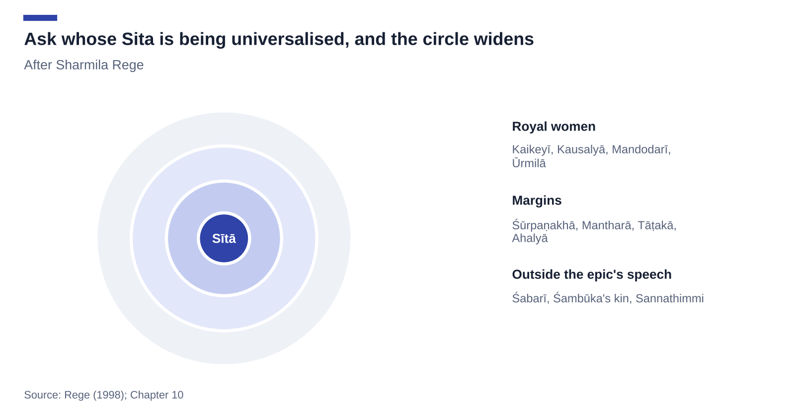
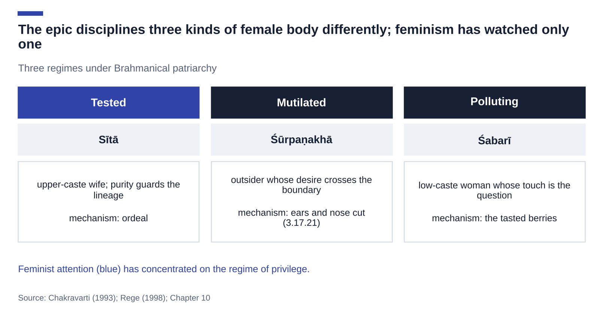

# Chapter 10. Whose Sita? Caste, Desire and the Limits of the Feminist Canon

::: {custom-style="Epigraph"}
*imāṃ virūpām asatīm atimattāṃ mahodarīm*\
*rākṣasīṃ puruṣavyāghra virūpayitum arhasi*

"This misshapen, unchaste, wildly intoxicated, pot-bellied *rākṣasī*: tiger among men, you should disfigure her."

— Rāma to Lakṣmaṇa on Śūrpaṇakhā, Vālmīki *Rāmāyaṇa* 3.17.20 (CE)
:::

## The argument of this chapter

The research plan for this book named Sharmila Rege as "indispensable when we ask whose Sita is being universalised in the first place".^[Research plan, §2.] This chapter asks that question directly. It is the question the preceding chapters have repeatedly approached and deferred: in the anti-epic's borrowing of Sita and neglect of the women below her (Chapter 5), in the membership of Volga's sisterhood (Chapter 8), in the difficulty of extending sympathy to Mantharā (Chapter 9). Here I take it up, through the writers who have insisted that the feminist canon of Sita retellings, for all its achievements, has its own exclusions.

The chapter makes five claims.

1. The corpus itself is evidence of exclusion. Its primary works are overwhelmingly about Sita; after her come Śūrpaṇakhā, Ahalyā and Ūrmilā; Śabarī appears in a handful. The canon of feminist retelling, like the devotional canon before it, is a canon about a queen.

2. Under what Uma Chakravarti calls Brahmanical patriarchy, the epic distributes three regimes of control over women's bodies: the *tested* body of the upper-caste wife whose purity guards the lineage (Sita); the *mutilated* body of the outsider woman whose desire threatens the boundary (Śūrpaṇakhā); and the *polluting* body of the low-caste woman whose touch is the question (Śabarī). A feminism that attends only to the first regime universalises the experience of the upper-caste wife.

3. Śūrpaṇakhā's recent passage "from villainess to victim" in popular retellings recovers her suffering but hides the caste and racial logic of her mutilation.

4. The anti-caste women poets, Meena Kandasamy and Hira Bansode among them, and the Dalit woman storyteller of Du. Saraswathi's *Sannathimmi's Ramayana*, change not only who speaks but what is said: they bring desire, anger, labour and caste into the story in ways the upper-caste feminist canon did not.

5. The anti-caste feminist retelling is not exempt from the question this book asks of every retelling. Kandasamy's Sita who desires Ravana answers a political need too. The difference is that the need is declared.

## The canon's composition

Let me begin with the evidence of the corpus, because the argument of this chapter is not only interpretive. The workbook on which this book rests was assembled over several years with the explicit aim of breadth: twenty-two languages, every form, every period, and five kinds of book from feminist retellings to devotional tellings. And yet its distribution by character, described in the Introduction, is starkly unequal. Sita is a central character in well over a hundred of the primary and source texts. Śūrpaṇakhā appears in some twenty; Ahalya and Urmila in about fifteen each; Kaikeyī and Mandodarī in about ten. Śabarī appears in a handful.

The workbook's own "so what" line, computed automatically, makes the point: "After Sita, the woman with most primary works is Surpanakha (Meenakshi) ... the fewest: Renuka."^[Corpus workbook, Dashboard, "So what" lines.] And its idea log records the finding in the form of a research task: "Who is missing: the P1 list is Sita-heavy and mostly upper-caste; Shabari, Shambuka and Dalit women's voices are few. Name the gap as a finding."^[Corpus workbook, My Ideas tab, idea 3.] Its Sources and Method tab lists, among the gaps still to be searched, "Dalit and Adivasi voices", noting that Hindi and Marathi Dalit women's poetry and Adivasi Sita and Śabarī songs remain thin in the corpus.^[Corpus workbook, Sources and Method tab, "Gaps to search next".]

I take the gap as a finding, as the workbook asks. It is partly a finding about my own research, which has relied on the anthologies, translations and publishers through which the field has been constituted, and which therefore inherits their selections. But it is also a finding about the field. The anthologies, translations and publishers that made Sita retellings visible to scholarship were, overwhelmingly, the anthologies, translations and publishers of an English-educated, upper-caste, metropolitan feminism. They found the women's songs of Brahmin households in Andhra and the Kāyastha women of Mithila; they found Candrābatī and Volga and Sarah Joseph; they found fewer Dalit and Adivasi women's tellings because they were not looking where those tellings lived. Smita Tewari Jassal's work on songs sung by lower-caste women in eastern Uttar Pradesh is a notable exception, and its exceptional status is itself evidence of the rule.^[Smita Tewari Jassal, *Unearthing Gender: Folksongs of North India* (Durham, NC: Duke University Press, 2012) [W142].]

## Three regimes of the body

Uma Chakravarti's account of Brahmanical patriarchy is the necessary starting point. Her argument, in its essentials, is that in early India the control of women's sexuality, above all the sexuality of upper-caste women, was the means by which caste purity was maintained: since caste was transmitted by birth, the purity of the caste depended on the purity of the women who bore its children, and the institutions of early marriage, seclusion, widowhood and the ideology of the *pativratā* were mechanisms for securing it.^[Uma Chakravarti, "Conceptualising Brahmanical Patriarchy in Early India: Gender, Caste, Class and State," *Economic and Political Weekly* 28, no. 14 (3 April 1993): 579–85 [W079]; Uma Chakravarti, *Gendering Caste: Through a Feminist Lens* (Calcutta: Stree, 2003) [W106].] The control was not uniform across castes. The sexuality of upper-caste women was guarded; that of lower-caste women was, in the same system, available to upper-caste men, and its exploitation was part of how caste hierarchy was enacted.

Read with this account in mind, the Rāmāyaṇa distributes three regimes of control over women's bodies, and the three are embodied in three women.

**The tested body.** Sita is a princess of Mithila and the wife of the heir of Ayodhya. Her body carries the purity of a royal lineage, and it is precisely for that reason that it must be tested. Rama's charge before the fire, as Chapter 1 showed, is framed in terms of the lineage: he fought "to wipe away the stain on my illustrious lineage"; he asks "what man of good family" would take back a woman who has lived in another's house.^[CE 6.103.16, 6.103.19.] The ordeal is the regime of the upper-caste wife. Its cruelty is real. But it is the cruelty reserved for women whose purity matters.

**The mutilated body.** Śūrpaṇakhā is a *rākṣasī*, the sister of Ravana, a woman of the forest and of the enemy. She approaches Rama and then Lakshmana with open desire. She is not tested; there is no lineage whose purity she carries. She is mutilated. Rama, in the critical edition, calls her "misshapen, unchaste, wildly intoxicated, pot-bellied", and tells Lakshmana to disfigure her; Lakshmana cuts off her ears and nose.^[CE 3.17.20–21.] The mutilation is the regime of the outsider woman whose desire threatens the boundary between the Aryan kingdom and the forest, between the twice-born and the others. Its purpose is not to establish purity but to mark impurity on the body, permanently and visibly.

**The polluting body.** Śabarī is a forest woman of low birth, a disciple of the sage Mataṅga, who has waited years for Rama. She is not sexualised in the major tellings; she is old and devout. Her body is at issue not for its purity or its desire but for its touch. In the tellings that make the episode famous, she tastes the berries she offers Rama to make sure they are sweet, and he eats them.^[Philip Lutgendorf, "Dining Out at Lake Pampa: The Shabari Episode in Multiple Ramayanas," in *Questioning Ramayanas*, ed. Paula Richman (Berkeley: University of California Press, 2001) [W098].] The tasted berries, food polluted by the saliva of a low-caste woman, are the whole of her significance. The regime is the regime of pollution: of the body whose contact defiles, and whose acceptance by a god is therefore a sign of grace.

The three regimes are not equally visible in the feminist canon. The tested body has received almost all the attention: the ordeal is the scene that every feminist retelling must address, and the rescue of Sita from the ordeal is the central gesture of the liberation narrative. The mutilated body has received a good deal of attention in the last thirty years, and I discuss it below. The polluting body has received very little. And yet, in the logic of Brahmanical patriarchy as Chakravarti describes it, the three regimes are interdependent. The upper-caste wife is tested because her purity distinguishes her from the outsider who is mutilated and the low-caste woman who pollutes. Her ordeal is the price of her privilege. A feminism that rescues her from the ordeal while leaving the other two regimes in place has rescued the privilege along with the woman.

This is what I take Sharmila Rege's Dalit feminist standpoint to require of a study of Sita. Rege argued that Indian feminism of the 1970s and 1980s had spoken of "women" as though the category were uniform, and that its universal woman was in practice an upper-caste woman whose experience of patriarchy (seclusion, dowry, the control of sexuality within marriage) was taken as the experience of all; Dalit women, she argued, "talk differently", because their experience of patriarchy is inseparable from their experience of caste: sexual violence by upper-caste men, the exploitation of their labour, the denial of their very womanhood.^[Sharmila Rege, "Dalit Women Talk Differently: A Critique of 'Difference' and Towards a Dalit Feminist Standpoint Position," *Economic and Political Weekly* 33, no. 44 (31 October 1998): WS39–WS46; see also Sharmila Rege, *Writing Caste/Writing Gender: Narrating Dalit Women's Testimonios* (New Delhi: Zubaan, 2006).] Sita, the tested wife, is the emblem of the first kind of experience. Śabarī, the woman whose touch is the question, and Śūrpaṇakhā, the outsider whose desire is punished by mutilation, are closer to the second. Whose Sita is being universalised? The answer, in most of the canon, is the upper-caste wife's.

### A fourth regime: the killed

The three regimes describe the women whose bodies the epic tests, mutilates or treats as polluting. There is a fourth, which precedes them all in the poem's own order, and which the feminist canon has almost entirely ignored: the woman who is killed. The first woman Rama is told to kill is Tāṭakā, a *yakṣī* cursed into a man-eating form, whom Viśvāmitra orders him to destroy in the first book. The sage anticipates the boy's reluctance: "You must not feel disgust at killing a woman … for those charged with kingship, this is the eternal dharma", and he cites the precedents of Indra and Viṣṇu, who killed women "devoted to adharma".^[CE 1.24.15–19.] Rama hesitates still. He cannot bring himself to kill her, "protected as she is by her woman's nature", and proposes instead to cut off her ears and nose; when she charges, he kills her, and the gods applaud.^[CE 1.25.11–15.]

The Tāṭakā episode supplies the logic of the other regimes in their earliest form. A woman outside the household order is judged dangerous; a male authority supplies the argument that overrides the hero's reluctance to harm a woman; the alternative to death is mutilation, the very punishment that Śūrpaṇakhā will suffer in the third book.^[CE 3.17.20–21; see Chapter 28.] Tāṭakā is a forest woman, like Śabarī; she is disfigured by a curse before she is killed, like Śūrpaṇakhā; and her death is the first proof of the hero's fitness to rule. The feminist canon, which has concentrated on the tested wife, has rarely looked back this far. The epic's violence against women begins not with Sita's fire but with a boy prince learning, from a sage, that killing a woman can be dharma.

## Śūrpaṇakhā: from villainess to victim

### The split

Kathleen Erndl's 1991 essay on the mutilation of Śūrpaṇakhā, comparing the episode in Vālmīki, Kamban, the *Adhyātma Rāmāyaṇa*, Tulsīdās and modern Hindi verse (Maithilīśaraṇ Gupt's *Pañcavaṭī* among it), identified the structural principle on which the episode rests: a split between the chaste good woman, Sita, and the "loose" bad woman, Śūrpaṇakhā, each defined against the other.^[Kathleen M. Erndl, "The Mutilation of Śūrpaṇakhā," in *Many Rāmāyaṇas*, ed. Paula Richman (Berkeley: University of California Press, 1991), 67–88 [W075]; Maithili Sharan Gupt, *Panchavati* (1925) [W035].] Sita is the woman whose desire is wholly directed to her husband; Śūrpaṇakhā is the woman whose desire is directed openly at men who are not hers. Sita's chastity is defined by contrast with Śūrpaṇakhā's lust, and Śūrpaṇakhā's punishment is the visible inscription of that contrast on a woman's face.

Ruth Vanita criticised Erndl's reading as predictable, and warned against assuming that every traditional telling simply endorses the split.^[Ruth Vanita, "We Make It Better" (review of *Many Ramayanas*), *Manushi* 78 (c. 1993) [W083].] The warning is salutary; Kamban's Śūrpaṇakhā, for instance, is given a beauty and an eloquence that complicate any simple condemnation. But the split itself is in the text, and the critical edition's verse quoted at the head of this chapter shows how starkly. Rama's description of Śūrpaṇakhā as "misshapen, unchaste, wildly intoxicated, pot-bellied" (*virūpām asatīm atimattāṃ mahodarīm*) is a list of every quality the ideal woman lacks.^[CE 3.17.20.] *Asatī*, "unchaste", is the precise negation of *satī*, the word for the faithful wife. The verse defines Śūrpaṇakhā as the anti-Sita.

### The rehabilitation

In the last three decades, Śūrpaṇakhā has become, after Sita, the most frequently retold woman of the epic. The corpus records a Telugu story, Kavanasarma's "Shurpanakha's Sorrow", that tells the episode through her grief;^[Kavanasarma, "Shurpanakha's Sorrow," in Paula Richman, ed., *Ramayana Stories in Modern South India* (Bloomington: Indiana University Press, 2008) [W124].] a Bengali story by Nabaneeta Dev Sen, "Rājkumārī Kāmāballī", in which she becomes Princess Kamaballi;^[Nabaneeta Dev Sen, "Rajkumari Kamaballi" [W097]; year to be checked.] a Bangladeshi Bengali novel by Harisankar Jaladas, which its publisher calls a bold feminist re-examination;^[Harisankar Jaladas, *Shurpanakha* [W228]; year to be checked.] Kavita Kane's English novel *Lanka's Princess* (2016), in which Meenākṣī, as she is called, grows up the unwanted only daughter of a mother who preferred sons;^[Kavita Kane, *Lanka's Princess* (New Delhi: Rupa, 2016) [W155].] Volga's gardener; Anand Neelakantan's Meenākṣī who speaks back; and Meena Kandasamy's "Traitress".

Anindita De's comparison of Kane's novel with Dev Sen's Bengali story, and Nancy Sharma and Smita Jha's reading of *Lanka's Princess* as the story of "an unwelcomed girl child", in a family that preferred sons, connect the rehabilitated Śūrpaṇakhā to contemporary debates about sex selection and son preference.^[Anindita De, "Surpanakha's Mutilation or That of Womanhood? An Inquiry into Two Feminist Retellings," *Journal of the Department of English, Vidyasagar University* 13, no. 1 (2020) [W173]; Nancy Sharma and Smita Jha, "Assertion or Transgression: A Critical Study of Surpankha as an Unwelcomed Girl Child in Kavita Kane's *Lanka's Princess*," *Journal of International Women's Studies* 25, no. 5 (2023) [W186].] The historian Manu S. Pillai asked in a newspaper column of 2017 "who speaks for Surpanakha?"^[Manu S. Pillai, "Who speaks for Surpanakha?" (newspaper column, 14 October 2017) [W161]. A public essay, not peer-reviewed scholarship.]

### What the victim hides

Sohini Sarah Pillai's study of contemporary representations of Śūrpaṇakhā tracks precisely this movement "from villainess to victim", and asks what the move hides.^[Sohini Sarah Pillai, "From Villainess to Victim: Contemporary Representations of Surpanakha" [W181]; publication details to be confirmed.] The question is the right one. The rehabilitation of Śūrpaṇakhā as a victim, an unwanted daughter, a woman whose desire was punished, recovers her suffering and condemns her mutilation. But it tends to do so in the idiom of individual psychology and family dysfunction: she was unloved by her mother; she was hurt; her revenge was the revenge of a wounded child. What this idiom hides is the logic of the mutilation itself, which is not psychological but political.

In Vālmīki, Śūrpaṇakhā is a *rākṣasī*, a woman of the forest-dwelling peoples whom the Aryan princes have come to clear from the sages' hermitages. Her approach to Rama is an approach across the boundary between the kingdom and the forest, between the twice-born and the others. Her mutilation is the boundary reasserting itself on her body. Periyar's reading, discussed in Chapter 5, saw this clearly, though in the racial idiom of Aryan and Dravidian that I have argued he borrowed from the colonial archive. The rehabilitated Śūrpaṇakhā of the market novel, an unloved princess with a difficult mother, has been detached from this boundary. She has been made a victim of her family rather than of the order that sent two armed princes into her forest. The victim move recovers her as a woman and loses her as a *rākṣasī*.

This is why Meena Kandasamy's Śūrpaṇakhā matters, and I turn to her now.
