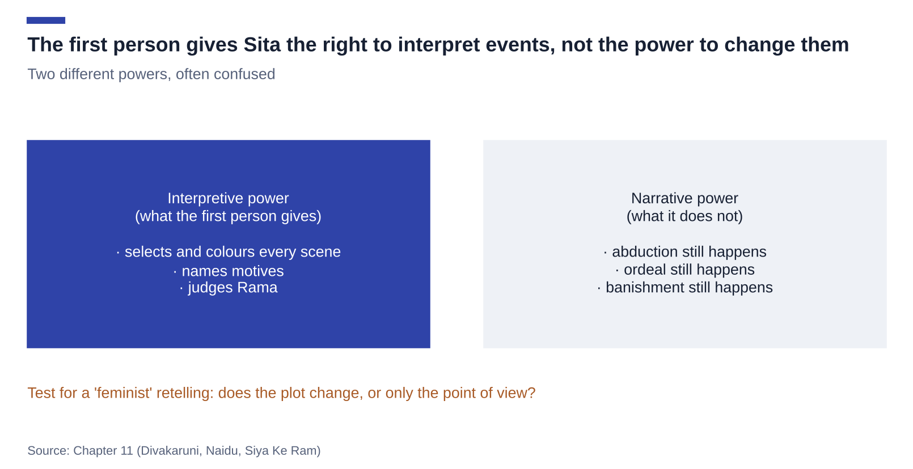

# Part IV. The Market, the Screen and the Nation {.unnumbered}

# Chapter 11. The Sitayan Moment: The First-Person Sita in the Age of the Bestseller

::: {custom-style="Epigraph"}
"For me it all started in 1989 with an accidental re-reading of the text of Chandrabati Ramayan. That is where I discovered that a women's Ramayan tells a different story."

— Nabaneeta Dev Sen, *Manushi* 108 (1998), p. 18
:::

## The argument of this chapter

Between 2013 and 2026, English-language publishing in India and its diaspora produced more book-length retellings of the women of the Rāmāyaṇa than had appeared in English in the preceding century. The corpus records, in that period alone, novels narrated by or centred on Sita, Urmila, Śūrpaṇakhā, Ahalya, Mandodarī, Kaikeyī, Tārā and Śāntā, from Rupa, Westland, Penguin, HarperCollins, Hachette, Pan Macmillan and their international partners. Many of them are narrated in the first person. Several call themselves, or are called by their authors, a "Sitayan". I call this the *Sitayan moment*: the period in which the first-person Sita became a publishing genre.

This chapter makes five claims.

1. The rise of the first-person Sita is a measurable fact about the corpus, and it is overwhelmingly a phenomenon of the 2010s and 2020s and of English.

2. First person is not authority. A Sita who narrates her own story has been given the narrator's position, but the narrator's position does not by itself confer the power to change the story. Several of the most celebrated first-person Sitas narrate a plot their authors leave substantially intact.

3. The first-person Sita has been written by men as often as by women, and some of the most interesting examples are male ventriloquisms: S. L. Bhyrappa's Kannada *Uttarakāṇḍa*, Aditya Iyengar's *Bhumika*, Amit Majmudar's *Sitayana*. Spivak's question applies to them with special force, and so does Hypothesis C.

4. The Sitayan moment is, in significant part, a diaspora moment. Its Sitas answer the needs of readers who encounter the Rāmāyaṇa as heritage, and they are shaped by the vocabulary of identity, representation and empowerment that the diaspora brings to its heritage.

5. The genre has a conservative twin. Alongside the feminist first-person Sita, the same publishers and the same years have produced devotional and "back to Vālmīki" Sitas that use the vocabulary of empowerment to defend the ideal. The convergence of the two is the subject of Chapter 12.

## The measurement

A simple count from the corpus workbook makes the point: the primary works in which a woman of the epic narrates, speaks in monologue or is the focal voice, rise sharply by decade of first publication. The count is crude: it depends on the workbook's descriptions, which were written for other purposes, and it under-records oral and untranslated works. But its shape is unmistakable. A handful of such works appear in each decade from the 1860s to the 1990s, scattered across Bengali, Malayalam, Telugu, Tamil, Marathi and Hindi. In the 2000s the number rises. In the 2010s it multiplies. The 2020s, of which only seven years have passed at the time of writing, are on course to match it.

The distribution by language is equally telling. Of the first-person and focal-voice works of the 2010s and 2020s in the corpus, the large majority were first published in English. The vernacular first-person Sitas that this book has examined, Mallika Sengupta's in Bengali, Bhyrappa's in Kannada, Anamika's in Hindi, are exceptions in a field that has become, in its commercial centre, an English-language field.

Two factors explain the rise, and neither is primarily literary. The first is the transformation of Indian English publishing after liberalisation: the arrival of multinational publishers, the growth of a large English-reading middle class, and the discovery, from the late 2000s, that mythological fiction sold in quantities previously reserved for cricket memoirs and self-help. Amish Tripathi's Shiva trilogy (2010–13) demonstrated the market; the Rāmāyaṇa and the *Mahābhārata* were its obvious next territories. The second is the arrival of the feminist retelling as a recognised category in global publishing, after the success of works like Margaret Atwood's *The Penelopiad* (2005) and, later, Madeline Miller's *Circe* (2018), which taught publishers in London and New York that the women of old epics, given first-person voices, could sell to a readership with no prior attachment to the epic. The Sitayan moment is the meeting of these two markets.

I state this not to dismiss the books, several of which are serious and accomplished, but to place them. The first-person Sita of the 2010s was not, in the first instance, a discovery made by readers of Vālmīki. It was a form supplied by a market that had learned the form's value elsewhere. That does not make it inauthentic. But it means that the question this book asks of every retelling, whose needs does it answer, has a commercial as well as a political answer in this chapter.

## Chitra Banerjee Divakaruni: *The Forest of Enchantments*

### The book that named the moment

Chitra Banerjee Divakaruni (born 1956), a Kolkata-born novelist and poet who has lived and taught in the United States for most of her career, had already retold the *Mahābhārata* from Draupadī's point of view in *The Palace of Illusions* (2008), a novel that became a staple of syllabi in India and abroad. In 2019 she published *The Forest of Enchantments*, a retelling of the Rāmāyaṇa narrated by Sita.^[Chitra Banerjee Divakaruni, *The Forest of Enchantments* (Noida: HarperCollins India, 2019) [W169]. Quotations are avoided; the account follows the corpus record and published reviews, and pinpoints are to be verified against the HarperCollins edition.] Its Sita calls her book a "Sitayan", and the corpus workbook notes that the novel "gives your project its key word".^[Corpus workbook, W169.]

### What the novel changes

The corpus records several of the novel's departures from the inherited story. Kaikeyī is compassionate. Rama admits vulnerability. Sita meets Ahalya, who has taken a vow of silence. And Saramā and Trijaṭā, the two women of Laṅkā who befriend Sita in captivity, are given the role of her companions there.^[Corpus workbook, W169.]

Each change is characteristic of the genre. The compassionate Kaikeyī belongs to the market's rehabilitation of the epic's villainesses, which Chapter 12 examines. The vulnerable Rama belongs to a contemporary ideal of masculinity, in which a man's admission of weakness is a sign of emotional health; it softens the king without indicting him. The silent Ahalya is an inversion of Volga's, who counsels Sita: here, the woman who was wronged has chosen silence, and Sita must interpret it. And the companions in Laṅkā recall Madhusudan Dutt's Saramā, to whom his Sita told her story in 1861.^[See Chapter 3; Michael Madhusudan Dutt, *Meghnadbadh Kavya* (1861) [W027].]

### What the novel keeps

What the novel keeps is, in the judgement of several critics, the plot. Sita narrates; she reflects; she feels; she judges. But the events she narrates are, in their main lines, the events of the inherited story. The corpus workbook records the debate: "critics debate whether her voice changes the plot (Hypothesis B)".^[Corpus workbook, W169.]

This is the crux of the Sitayan moment, and Divakaruni's novel is its clearest instance. The first-person narrator is a position of great literary privilege: everything the reader learns is filtered through her consciousness; her interpretation of events is the only one offered; her feelings colour every scene. But the narrator's privilege is the privilege of the teller, not the actor. A Sita who narrates the abduction, the ordeal and the banishment, with a full account of her feelings about each, has been given the power to *interpret* what happened to her. She has not thereby been given the power to make it not happen.

The distinction matters because the liberation narrative tends to treat the acquisition of the first person as itself the liberation. If Sita tells her own story, the reasoning goes, she has been freed from the male narrator who told it about her. But Chapter 1 showed that Vālmīki's Sita already speaks at length in her own voice at every decisive moment; Chapter 4 showed that Kumaran Asan gave her an entire poem of interior reflection in 1919. What Divakaruni's first person adds is continuity: Sita narrates not only the decisive moments but everything in between. That is a real addition. It is not a change in the structure of power the story records.

### The ending

The ending is where any retelling of Sita must show its hand, and Divakaruni's, as reviewers describe it, makes Sita's return to the earth her own decision: an act of will rather than a miracle or a submission.^[On the ending, see the reviews recorded in the corpus workbook under W169 (pinpoint to be verified).] This is, on the argument of this book, the right choice, and it is the choice Vālmīki's last scene already supports. Divakaruni's contribution is to make the decision legible as a decision, by giving the reader access to the reasoning that leads to it. In this respect her novel stands in the line of Kumaran Asan: the earth opens because Sita has thought her way to it.

But it is worth noticing that the novel's most significant act, like Vālmīki's Sita's, is a refusal and a departure. The first-person voice that narrated the whole story ends by withdrawing from it. The Sitayan, in this sense, ends where the Rāmāyaṇa ended. The form changed; the exit did not.

## Vayu Naidu: *Sita's Ascent*

Vayu Naidu, a storyteller and performer working in Britain and India, published *Sita's Ascent* with Penguin India around 2012–13.^[Vayu Naidu, *Sita's Ascent* (New Delhi: Penguin India, c. 2013) [W216]; year to be checked.] It is a novella set at Vālmīki's hermitage after the banishment, in which each of the main characters narrates a chapter and Sita's voice frames the whole.^[Corpus workbook, W216.]

The book's reception is instructive. The corpus records two reviews: one, in the Pakistani newspaper *Dawn*, judged it "less a revision than a slightly different retelling"; another, in the Indian *DNA*, asked whether it was feminist at all.^[Corpus workbook, W216, recording the reviews in *Dawn* and *DNA*. These are newspaper reviews and are cited as such.] The questions were fair. Naidu's book, like Divakaruni's, grants the women of the epic a voice without granting them the power to change what happens. Its structure, many narrators framed by Sita, is closer to the choral method of the women's songs than Divakaruni's single first person; but its plot is the plot.

What makes *Sita's Ascent* interesting is its title. An ascent is the opposite of Vālmīki's descent into the earth. Whether the book's Sita rises or sinks at the end, its title proposes that her departure is an elevation: a movement upward, towards transcendence, rather than downward, towards the mother. The proposal belongs to a broadly spiritual reading of Sita's exit that the market retellings share with the devotional ones, and that this chapter's last section examines.
