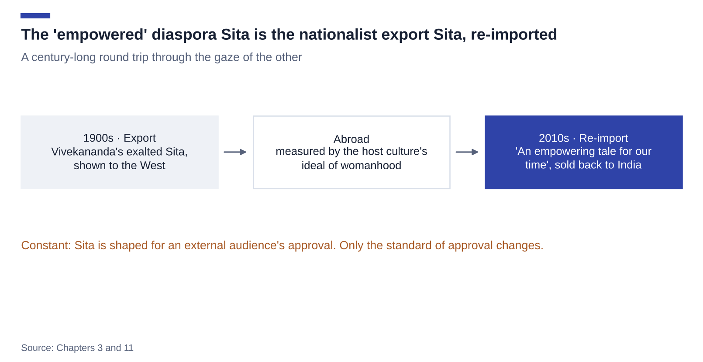

## The male first person

### Bhyrappa's *Uttarakāṇḍa*: a realist's Sita

Santeshivara Lingannaiah Bhyrappa, the most widely read Kannada novelist of the late twentieth century and a writer whose politics have placed him, in the corpus workbook's phrase, among the "famous conservative" novelists of his language, published *Uttarakāṇḍa* in January 2017; an English translation appeared in 2020.^[S. L. Bhyrappa, *Uttarakaanda* (2017); English translation, *Uttara Kaanda* (Chennai: Eka/Westland, 2020) [W223].] Bhyrappa had already retold the *Mahābhārata*, in his celebrated novel *Parva* (1979), as a realist narrative stripped of the supernatural: gods as men, miracles as rumours, the epic as the history of a society. *Uttarakāṇḍa* does the same for the Rāmāyaṇa, and it does so in Sita's voice.

In the corpus's summary, Bhyrappa's Sita "looks back in the first person, out of time order: abandoned at birth and again by her husband, she says that power changed Rama".^[Corpus workbook, W223.] Each element is significant. The first person makes this a Sitayan in form. The disordered chronology makes it a memory rather than a chronicle: Sita remembers as a person remembers, out of sequence, returning to wounds. The double abandonment, at birth (as a foundling) and in marriage, gives her life a shape that the women's songs had given it: the "essential orphan" of Dev Sen's first theme, orphaned twice.^[Nabaneeta Dev Sen, "When Women Retell the Ramayan," *Manushi* 108 (1998): 20.] And the judgement that "power changed Rama" is a historian's judgement, the judgement of a realist novelist who reads the Rāmāyaṇa as the story of how kingship corrupts a man.

A recent essay has read Bhyrappa's Sita through the lens of historiographic metafiction, as a subversion of patriarchal narratives.^[On Bhyrappa's Sita and historiographic metafiction, see the article in *The Grove* (Universidad de Jaén), "Subverting Patriarchal Narratives: Exploring Bhyrappa's Depiction of Sita through Historiographic Metafiction" (publication details to be confirmed).] I am more cautious. The corpus workbook calls the novel "a first-person Sita by a famous conservative novelist: a contrast case for Hypotheses B and C (a woman's voice inside a man's frame)".^[Corpus workbook, W223.] The frame is the realist's: the conviction that the epic is history in disguise, that its gods are men and its miracles politics. Within that frame, Sita's voice is the voice of a witness to history, and her judgement on Rama is a historical judgement. It is a powerful judgement. But it is the novelist's thesis about power, voiced by Sita, and Spivak's question applies: is this Sita speaking, or is Bhyrappa speaking through her?

The answer, I think, is the second, and the interest of the novel lies in the fact that its thesis coincides with the judgement of the women's tradition. "Ram may have been a great man, but what good did it do Sita?" ask Kishwar's informants.^[Madhu Kishwar, "Yes to Sita, No to Ram! The Continuing Popularity of Sita in India," *Manushi* 98 (January–February 1997): 29.] "Power changed Rama," says Bhyrappa's Sita. A conservative Kannada realist and the women of North India reach the same verdict by different roads. That convergence is evidence for this book's third proposition: the critique of Rama is not the property of any one politics. It is available to the devout and the sceptical, the conservative and the radical, because it is in the story.

### Majmudar's *Sitayana*: many voices, one resistance

Amit Majmudar, an American poet and physician, a former poet laureate of Ohio and a translator of the *Bhagavad Gītā*, published *Sitayana* with Penguin India in January 2019.^[Amit Majmudar, *Sitayana* (Gurugram: Penguin India, 2019) [W227].] It is the third book in the corpus to bear the title, after K. R. Srinivasa Iyengar's English epic and Mallika Sengupta's Bengali novel, and it is the only one of the three that is not narrated principally by Sita. Its voices are many: Hanumān, Ravana, Vibhīṣaṇa, even the squirrel that helped build the bridge to Laṅkā, each take a turn. Its publisher, the corpus records, stressed "Sita's fierce resistance" as its core.^[Corpus workbook, W227.]

The choice is formally interesting. A book titled *Sitayana* that gives its narration to everyone but Sita makes her the centre of a story told around her, the subject of other people's speech. That is precisely the condition the liberation narrative set out to correct. But it is also the condition in which Vālmīki's Sita lived, and the condition in which the women's songs placed her: the subject of a chorus. Majmudar's many voices can be read either way. The corpus workbook flags the book as "a male diaspora poet's take on Sita's voice", to be read under Hypotheses B and C.^[Corpus workbook, W227.]

### Iyengar's *Bhumika*: the life she did not live

Aditya Iyengar's *Bhumika: A Story of Sita* (Hachette India, 2019) makes the most explicit experiment in the genre.^[Aditya Iyengar, *Bhumika: A Story of Sita* (Gurugram: Hachette India, 2019) [W242].] Sita, old and living in Vālmīki's hermitage, is shown by Viśvāmitra the life she might have had, as Bhūmikā, had she never met Rama. Reviewers, the corpus records, describe Bhumika as rebelling against patriarchy.^[Corpus workbook, W242.] The workbook calls the book "a 'what if' Sita: the clearest test of whether choice, not voice, makes a retelling feminist".^[Corpus workbook, W242.]

The test is worth taking seriously, because it isolates a variable that the other retellings leave mixed. Divakaruni's Sita has a voice and the same life; Iyengar's Sita has a voice and a different life. If choice is what liberates, then the counterfactual Bhūmikā, who chose otherwise, should be the liberated one, and the actual Sita, who looks on, should be the unliberated one. And the device has a melancholy built into it: the liberated life is the life that did not happen. Iyengar's Sita, watching what she might have been, is in exactly the position of the reader of the liberation narrative. She can see the freedom; she cannot have it.

I find this the most honest of the male first-person experiments, because it acknowledges the limit of the genre within the fiction. A retelling cannot change what happened to Sita; it can only show what might have happened instead. *Bhumika* stages that limit. Its Sita knows she is in a story.

### Ventriloquism

The three male first-person or Sita-centred books examined here have one thing in common, and it is the thing Hypothesis C asks about: the voice of the woman is supplied by a man. In this they continue the line of Chalam and Kumaran Asan, and before them of Vālmīki himself. The male poet speaking as Sita is the oldest form of the Rāmāyaṇa's feminism.

That is not an indictment. Kumaran Asan's Sita is among the great creations of modern Indian poetry, and Asan was a man. But it does mean that the first-person form, which promises the reader direct access to the woman's experience, cannot by itself guarantee it. The promise of the first person is the promise of testimony: *I was there; this is what happened to me*. When the testimony is supplied by an author who was not there, and who is not a woman, the promise is a literary convention, and the reader should treat it as such. The question to ask of a male first-person Sita is not whether a man may write it (he may) but whether the Sita he writes says anything that the man could not have said in his own voice. Bhyrappa's says that power changed Rama, which Bhyrappa could have said. Iyengar's watches a life she did not live, which is, perhaps, the only thing a man writing Sita can honestly give her.

## The women's first person: Panicker and Agrawal

Two more recent women's first-person novels complete the picture, and both press against the genre's limits from inside.

Sini Panicker's *Sita: Now You Know Me* (Rupa, 2021; reissued 2025) has Sita narrate her own life and end, in the corpus's words, "as a poor, homeless mother of twins".^[Sini Panicker, *Sita: Now You Know Me* (New Delhi: Rupa, 2021) [W177].] The workbook notes that it is "a first-person Sita that stresses poverty", useful for Field IV.^[Corpus workbook, W177.] The ending matters. Most first-person Sitas end with the earth, an exit that preserves the queen's dignity. Panicker's ends with destitution, the condition that Sharad Joshi described to Maharashtra's farmers: a queen who "became a bhikarin [beggar] overnight simply because her husband turned against her and pushed her out".^[Kishwar, "Yes to Sita," 26.] It is the queen's story told with the material consequences that Chapter 10's Sannathimmi made central.

Pragya Agrawal's *The Renunciation* (Rupa, November 2025) is the newest Sita novel in the corpus. It opens after the banishment: Sita raises Lava and Kuśa at Vālmīki's hermitage under the name Vandevī, "the forest goddess" or "the goddess of the forest", and her return to the earth, in the corpus's summary, "is written as her own choice, neither condemning nor absolving Ram".^[Pragya Agrawal, *The Renunciation* (New Delhi: Rupa, 2025) [W235]; corpus workbook, W235.] The title names the reading this book has offered of the final scene: renunciation, the exit of the ascetic in ochre. And the refusal either to condemn or to absolve Rama is the posture of Vālmīki's own text, which, as Chapter 1 argued, stages the conflict and lets Sita have the last word without telling the reader what to think of the king.

The corpus workbook calls *The Renunciation* "a test case for Hypothesis B (is renouncing a form of agency?)".^[Corpus workbook, W235.] On the evidence of this book's argument, the answer is yes, and it is the oldest form of Sita's agency. Agrawal's novel, published at the end of the Sitayan moment, returns the genre to the point from which Vālmīki started.

## The diaspora's Sita

Several of the principal authors of the Sitayan moment live, or have long lived, in the diaspora, in the United States, Britain and Europe: Divakaruni, Majmudar, Vaishnavi Patel, Dena Merriam, Vayu Naidu, Athena Kashyap, Rashi Rohatgi and Rajani LaRocca among them.^[Corpus workbook, W169, W227, W182, W232, W216, W224, W231, W236.] The fact deserves analysis, because it shapes the Sitas they produce.

For a reader of Indian origin in the United States or Britain, the Rāmāyaṇa is heritage before it is anything else: a story told by grandparents, performed at Diwali in community halls, encountered on television and in comics, and increasingly, in school and university, set beside the Greek and Norse myths as part of a multicultural canon. The heritage reader's relation to Sita is shaped by two pressures that the reader in Kerala or Mithila does not feel in the same way. The first is the pressure of representation: the need for a heritage figure who can be presented to the surrounding culture without embarrassment. The second is the pressure of the surrounding culture's own vocabulary of womanhood: autonomy, choice, consent, empowerment, voice.

The diaspora Sita answers both pressures at once. She is a heritage figure, recognisably the Sita of the grandparents' stories; and she speaks the vocabulary of the host culture, in which her suffering is a story of empowerment and her exit a choice. The subtitle of Dena Merriam's novel names the combination exactly: *The Untold Story of Sita: An Empowering Tale for Our Time*.^[Dena Merriam, *The Untold Story of Sita: An Empowering Tale for Our Time* (SitaRam Press, 2019; Motilal Banarsidass, 2023) [W232].] Rajani LaRocca's young-adult novel *Such Great Heights* (2026), in which an Indian American teenager in a mock-trial competition draws on Sita's story of not being believed, takes the heritage figure into an American high school.^[Rajani LaRocca, *Such Great Heights* (New York: Quill Tree/HarperCollins, 2026) [W236].] Rashi Rohatgi's *Sita in Exile* (2023) makes exile the experience of migrant mothers in pandemic Europe.^[Rashi Rohatgi, *Sita in Exile* (Oxford, OH: Miami University Press, 2023) [W231].]

I do not say that these books are inauthentic. I say that their Sita is a translation: a figure carried across from one cultural setting into another and made to speak the second setting's language. And here the decolonial argument of this book has its most uncomfortable application. The liberation narrative, I argued in the Introduction, measures Sita's freedom by a yardstick borrowed from the history of Western liberal individualism. In the diaspora, that yardstick is not borrowed; it is the local standard. The diaspora Sita is liberated by the standards of the culture in which her readers live. When she is re-exported to India, as most of these books are, through the Indian arms of the same multinational publishers, she brings that standard back with her, now dressed as heritage.

The irony is sharp. The Sita whom the nineteenth-century nationalists constructed for export, to show the West the superiority of Indian spiritual womanhood (Chapter 3), has returned, a century later, re-imported from the West, to show India the empowerment of its heroine by Western standards. In both cases, the Sita who circulates is shaped by the gaze of the other. Coloniality, in the sense this book has used the term, is not only a matter of colonial rule. It is the persistence, in the self-presentation of the formerly colonised, of the categories through which they were once judged. The diaspora's empowered Sita is the nationalist's exalted Sita turned inside out.

## The devotional twin

Finally, and briefly, since Chapter 12 develops the point: the Sitayan moment has a twin. In the same years, and often from the same publishers, a stream of devotional and conservative Sitas has appeared, and they too speak the language of empowerment.

K. R. Srinivasa Iyengar's English epic *Sitayana: Epic of the Earth-born*, begun in 1983, presented Sita as the daughter of the earth in a devotional key.^[K. R. Srinivasa Iyengar, *Sitayana: Epic of the Earth-born* (c. 1987) [W061].] Mridula Sinha, a Hindi writer who later served as Governor of Goa, wrote *Sītā Punī Bolī* (Sita Spoke Again), in which Sita speaks again in the first person as a guide for modern girls.^[Mridula Sinha, *Sita Puni Boli* [W129]; year to be checked.] Devdutt Pattanaik's *Sita: An Illustrated Retelling of the Ramayana* (2013), a composite of regional tellings with his own line drawings, presented a Sita who is "not shown as a victim", and his children's book *The Girl Who Chose* (2016) retold the epic as a series of Sita's choices.^[Devdutt Pattanaik, *Sita: An Illustrated Retelling of the Ramayana* (New Delhi: Penguin India, 2013) [W145]; *The Girl Who Chose: A New Way of Narrating the Ramayana* (New Delhi: Puffin, 2016) [W221].] Dena Merriam's novel presented Sita as an incarnation of the goddess Devī Nārāyaṇī and as Rama's equal.^[Corpus workbook, W232.] And in September 2026, Penguin's Tattva imprint published Yashodeep Deodhar's *Valmiki's Sita: An Icon of Courage, Resilience, and Love*, which goes back to Vālmīki's text to present "the real Sita", a woman who kept her principles, dignity and *dharma* through exile, abduction and public scrutiny.^[Yashodeep Deodhar, *Valmiki's Sita: An Icon of Courage, Resilience, and Love* (Gurugram: Penguin Tattva, 2026) [W243].]

The last of these is, on the surface, closest to the method of this book: back to Vālmīki, read the text, find the real Sita. And I welcome its premise, which is that Vālmīki's Sita is a woman of courage. But the vocabulary of its subtitle (courage, resilience, love) and the description of its Sita as one who "kept her principles, dignity and *dharma*" mark it as a devotional reading in the language of empowerment: a Sita who is strong *within* the ideal, not against it. The corpus workbook files it as "a contrast case for Hypothesis C and Field VII".^[Corpus workbook, W243.]

What the devotional twin shows is that the vocabulary of the Sitayan moment (choice, voice, strength, empowerment) has no fixed politics. It can be used to liberate Sita from the ideal, and it can be used to show that the ideal was always liberating. The first-person Sita who chooses the earth and the devotional Sita who chooses *dharma* speak the same language. Chapter 12 examines what happens when that language is spoken in a nationalist key.

::: {custom-style="Box Title"}
Reading Against the Text
:::

::: {custom-style="Box"}
A first-person narrator is, by convention, someone who survived to tell the story. If Sita narrates her own "Sitayan" and the story ends with her entering the earth, from where is she telling it, and to whom? Does the first-person Sita, by the mere fact of narrating, quietly cancel the ending she describes?
:::

::: {custom-style="Box Title"}
The Debate: Voice
:::

::: {custom-style="Box"}
**Position A:** The first-person Sita is a liberation: for the first time, she tells her own story, and the male narrator who spoke for her is dismissed.\
**Position B:** The first-person Sita is a convention: the narrator's position confers interpretive privilege but not power over events, and the voice is supplied by an author whose needs it serves.\
**Where the evidence of this chapter leaves the argument.** Position B is better supported by the corpus. The first-person form multiplied in the 2010s with the market, not with a discovery about Sita; several of its most celebrated examples leave the plot intact; and several of its most interesting examples are male ventriloquisms. But Position A identifies something real in the best of the genre: the capacity of continuous first-person narration to make Sita's final refusal legible as the outcome of reasoning, as Asan had done in verse. The first person does not liberate Sita. It can make her liberation, when it comes, intelligible.
:::

## Conclusion

The Sitayan moment made the first-person Sita a genre, and it did so through the convergence of an expanding Indian English publishing market and a global appetite for feminist retellings of old epics. Its books are uneven and several are accomplished. Its most important lesson is the one Hypothesis B anticipated: that the narrator's position is not the same as power. Divakaruni's Sita narrates everything and changes little; Bhyrappa's voices her novelist's thesis about power; Iyengar's watches a life she did not live; Panicker's ends in poverty; Agrawal's renounces. The diaspora's Sita speaks heritage in the language of empowerment, and the devotional Sita speaks the same language to defend the ideal.

Chapter 12 follows the language of empowerment to its most consequential destination: the warrior Sita, the prime minister of Mithila, and the nation.
