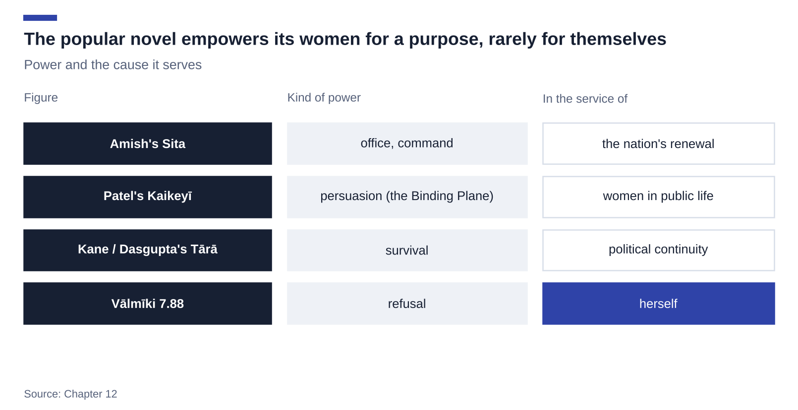
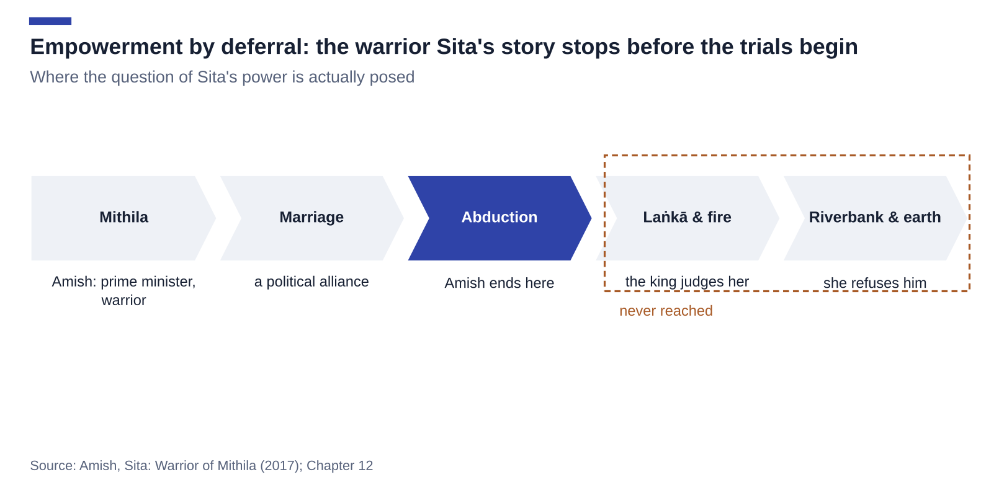

# Chapter 12. The Warrior and the Prime Minister: Empowerment, Nation and the Popular Novel

::: {custom-style="Epigraph"}
*sa te jīvitaśeṣasya rāghavo 'ntakaro balī*\
*paśor yūpagatasyeva jīvitaṃ tava durlabham*

"Rāghava, mighty, will make an end of what life you have left. Like a beast tied to the sacrificial post, your life is hard to keep."

— Sītā to Rāvaṇa, Vālmīki *Rāmāyaṇa* 3.54.9 (CE)
:::

## The argument of this chapter

In Vālmīki, Sita tells Ravana how he will die, and she tells him that Rama will kill him. In the *Adbhuta Rāmāyaṇa*, she kills the thousand-headed Ravana herself. In the popular fiction of the 2010s and the cinema of the 2020s, the second Sita has come to dominate: Sita the warrior, Sita the strategist, Sita the leader, and, in the most successful mythological novel of the decade, Sita the prime minister of Mithila and the chosen Viṣṇu of her age. This chapter examines that Sita, and the related rehabilitation of the epic's other women, Kaikeyī, Mandodarī, Tārā and Śūrpaṇakhā, as figures of competence and power.

The chapter makes five claims.

1. The warrior Sita has a classical warrant, in the *Adbhuta Rāmāyaṇa* and the Odia *Bilaṅkā Rāmāyaṇa*, and the warrant is genuine; but the modern warrior Sita draws less on those texts than on the global idiom of the action heroine and the corporate leader.

2. The language of empowerment that the popular novel speaks has no fixed politics. In Amish Tripathi's *Sita: Warrior of Mithila* it is spoken in a nationalist key, and it gives Sita political agency of a high order while leaving her sexual agency, and the question of caste, almost untouched.

3. The popular novel's rehabilitation of the epic's villainesses (Kaikeyī as a feminist, Mantharā as a mother, Śūrpaṇakhā as an unwanted daughter) buys sympathy at the cost of analysis. Its characteristic move is absolution.

4. The tradition itself had already honoured women whose lives exceeded the ideal of the *pativratā*. The verse of the five *kanyās* (Ahalyā, Draupadī, Kuntī, Tārā, Mandodarī) names three women of the Rāmāyaṇa, every one of whom had a sexual history the ideal would condemn, and does not name Sita. Koral Dasgupta's Sati Series, built on that verse, is the most interesting popular engagement with this inheritance.

5. A decolonial reading must resist the temptation to welcome the nationalist warrior Sita as an "Indic" answer to Western feminism. Her idiom is the idiom of global management culture. Nationalism is not decolonisation.

## The classical warrant

The research plan for this book, and the corpus that accompanies it, both note that the *Adbhuta Rāmāyaṇa* was cited, in the debates before the release of the 2026 Ramayana film, as "the classical warrant for a 'warrior Sita'".^[Corpus workbook, W009 and W206.] The warrant is real. Chapter 2 described the *Adbhuta*'s sequel, in which the thousand-headed Ravana strikes Rama down and Sita, taking the form of Kālī, destroys him. The Odia *Bilaṅkā Rāmāyaṇa* tells a parallel story.^[*Adbhuta Ramayana* [W009]; *Bilanka Ramayana* [W012].] Women's songs from Mithila show the girl Sita lifting Śiva's bow with her left hand while sweeping the floor with her right.^[Nabaneeta Dev Sen, "When Women Retell the Ramayan," *Manushi* 108 (1998): 21; Madhu Kishwar, "Yes to Sita, No to Ram! The Continuing Popularity of Sita in India," *Manushi* 98 (January–February 1997): 28.] And Vālmīki's Sita, though she does not fight, speaks to Ravana with the confidence of a woman who knows how battles end.^[CE 3.54.4–9.]

But a warrant is not a source. Ruth Vanita's reading of the *Adbhuta*, discussed in Chapter 2, cautions that its Kālī-Sita remains a wife, fighting on her fallen husband's behalf, a smiling goddess rather than an autonomous destroyer.^[Ruth Vanita, "The Sita Who Smiles: Wife as Goddess in the *Adbhut Ramayana*," *Manushi* 148 (2005) [W115].] The warrior Sitas of the 2010s owe something to this tradition, but they owe more to another: the global action heroine of the cinema and the young-adult novel, the woman who trains, fights, leads and wins in the idiom of Hollywood and the international fantasy market. When the 2026 film's makers defended a warrior Sita by citing the *Adbhuta*, they were citing a text to authorise a figure whose visual and narrative vocabulary came from elsewhere.

## Amish: *Sita: Warrior of Mithila*

### The book and its success

Amish Tripathi, who writes as Amish, is the most commercially successful author of Indian mythological fiction in English. His Shiva trilogy (2010–13) sold in the millions and established the genre. His Ram Chandra series began with *Scion of Ikshvaku* (2015) and continued with *Sita: Warrior of Mithila* (2017), *Raavan: Enemy of Aryavarta* (2019) and *War of Lanka* (2022).^[Amish, *Sita: Warrior of Mithila* (Chennai: Westland, 2017) [W160]. Quotations are avoided; the account follows the corpus record and the published scholarship (W207), and pinpoints are to be verified.] The series uses a multilinear structure: each of the first three books begins at a different point and follows a different protagonist until their stories converge at the abduction.

*Sita: Warrior of Mithila* gives Sita her own volume, and its Sita is, in the corpus's summary, "an adopted princess, a warrior, strategist and prime minister of Mithila, chosen as the next Vishnu; the book ends with her abduction".^[Corpus workbook, W160.] She is found as an infant, raised by Janaka and Sunayanā, trained in arms and statecraft, made prime minister of Mithila in her own right, and identified by the order of the Malayaputras, guardians of a divine mission, as the next incarnation of Viṣṇu, the protector who will lead India in its time of crisis. Her marriage to Rama is a political alliance between two potential Viṣṇus. The book ends where the abduction begins, so that its Sita never faces the fire or the banishment.

The novel has been adapted for dance-theatre, and it has been read in recent scholarship as presenting a "culturally rooted New Woman".^[Belraj Soni, *Sita* (dance-theatre) [W168]; Malika Payal and Pinki Chugh, "Reinterpreting Sita: Feminist Agency and the New Woman in Amish Tripathi's *Sita: The Warrior of Mithila*," *International Journal of Special Education* 41, no. 10s (2026): 1110–20 [W207].] The corpus workbook notes that such readings show "how popular warrior-Sita fiction is being read as feminist (Hypothesis C)".^[Corpus workbook, W207.]

### What the novel gives

What Amish gives Sita is political agency of a kind no earlier telling in the corpus gives her. She governs. She commands. She makes strategy. She is chosen, not as a wife, but as a leader of the nation. On the agency matrix drawn for this book, Amish's Sita scores "strong" on political agency, a score shared, among the twenty texts coded, only by Samhita Arni's journalist-led *The Missing Queen*, Vaishnavi Patel's *Kaikeyi*, and, in the anti-caste register, Ranganayakamma and the Kandasamy poems in part.

This is a real achievement, and it answers a question that the corpus workbook's idea log posed sharply: "Voice is not power: many retellings give Sita a voice, few give her public authority."^[Corpus workbook, My Ideas tab, idea 8.] Amish gives her public authority. The liberation narrative, which measures Sita's freedom by her voice, has no way to register what Amish does, because his Sita's power is not primarily a matter of speech. It is a matter of office.

### What the novel withholds

But the matrix also shows what Amish's Sita lacks. Her sexual agency is absent: her marriage is a political alliance and her desire is not a subject. Her caste and class agency is absent: she is a princess and a chosen leader, and the forest peoples, the Śūdras and the women below her appear, so far as the record shows, as the governed rather than as agents. And her story ends before the ordeal and the banishment, so that the scenes in which, in every other telling, the question of her power is actually tested, never arrive.

This last point is decisive. A Sita who is prime minister of Mithila until the moment of her abduction has been given power in exactly the part of the story where power was never the question. The question of Sita's agency, in Vālmīki and in the whole tradition after him, is posed in Laṅkā, before the fire, on the riverbank and in the assembly: in the scenes where a woman confronts a king who has the power to judge her. Amish's novel gives her a kingdom and then stops before she meets the king who will take it from her. It is empowerment by deferral.

### The nationalist key

The idiom in which Amish's Sita is empowered deserves attention, because it is the idiom of the novel's politics. The Viṣṇu she is chosen to become is not only a god but a role: the leader who restores a civilisation in crisis. The India of the novels is a civilisation with a mission, beset by decline, awaiting renewal, and its renewal will come through leaders chosen by an order of guardians. The vocabulary of the novel blends the epic's language with the language of modern statecraft and management: prime minister, strategist, mission.

This is the language of a particular political moment. The decade in which the Ram Chandra series appeared was the decade in which Hindu nationalism became the dominant force in Indian politics, and in which the temple at Ayodhya, the object of the movement whose mobilisation in the 1990s is recorded in this book's chronology, was built and consecrated in January 2024. The movement had long made use of Rama's image, and Anuradha Kapur showed, in a study written at the height of the Ayodhya campaign, how the iconography of Rama shifted in its posters from a gentle, smiling deity to a muscular warrior with a drawn bow.^[Anuradha Kapur, "Deity to Crusader: The Changing Iconography of Ram," in *Hindus and Others: The Question of Identity in India Today*, ed. Gyanendra Pandey (New Delhi: Viking, 1993) [W080].] The corpus workbook asks of Kapur's essay: "where does Sita go?"^[Corpus workbook, W080.]

The warrior Sita is one answer. If Rama becomes a crusader, Sita becomes a warrior at his side: not the wife who is protected but the comrade who fights. Tanika Sarkar's study of the Rashtrasevika Samiti, the women's organisation of the Hindu nationalist movement, in its role in the Ram Janmabhoomi campaign, showed how women were mobilised not only as symbols but as agents, and how the ideal of womanhood the Samiti held up combined domestic virtue with martial readiness.^[Tanika Sarkar, "The Woman as Communal Subject: Rashtrasevika Samiti and Ram Janmabhoomi Movement," *Economic and Political Weekly* 26, no. 35 (31 August 1991): 2057–62 [W076]; see also Paola Bacchetta, *Gender in the Hindu Nation: RSS Women as Ideologues* (New Delhi: Women Unlimited, 2004) [W108]; Tanika Sarkar and Urvashi Butalia, eds., *Women and the Hindu Right: A Collection of Essays* (New Delhi: Kali for Women, 1995) [W087].] The corpus workbook calls Sarkar's essay evidence of "women as agents of the Ram movement, not only symbols (Hypothesis B)".^[Corpus workbook, W076.] The warrior Sita of the popular novel is the literary sister of the Samiti's ideal: empowered, competent, armed, and wholly in the service of a national mission.

I want to be careful here, because the argument can easily be made crudely. I do not say that Amish's novel is a work of Hindu nationalist propaganda, or that its readers are mobilised by it. I say that its Sita answers a political need of its decade, as the nationalist Sita of *Ram Rajya* answered the need of 1943 and the reformer's Sita answered the need of 1860, and that the need, in this case, is for a heroine who can stand beside a warrior Rama in the service of a civilisational renewal. The corpus workbook's description is precise: "Agency as martial power, in a mass-market and nationalist-friendly key."^[Corpus workbook, W160.]

### Nationalism is not decolonisation

And here this book must address a temptation that its own decolonial framing creates. If the liberation narrative measures Sita by a Western liberal yardstick, and if the decolonial reading rejects that yardstick, should not the decolonial reader welcome Amish's Sita, an Indian heroine, drawn from Indian sources, written by an Indian author for an Indian market, as an alternative to the Western-feminist Sita?

The answer is no, and the reason is instructive. Amish's Sita is not drawn from Indian sources in any sense that distinguishes her from the diaspora Sita of Chapter 11. Her idiom is the idiom of the global action heroine and the management seminar: she trains, she leads, she strategises, she is chosen for a mission. Her empowerment is measured by her competence in the public sphere, which is precisely the measure the liberal yardstick uses. What distinguishes her from the liberal-feminist Sita is not the yardstick but the cause to which her competence is applied: the nation rather than the self. A nationalist reading of the Rāmāyaṇa that measures Sita by her usefulness to the nation has not escaped coloniality. It has substituted one external programme for another. The decolonial reading this book has attempted asks Sita to be measured by her own tradition's standards, which include, as Chapter 1 showed, the refusal of the king's jurisdiction. A Sita who is the nation's chosen leader cannot refuse the nation. That is the limit of the warrior.
