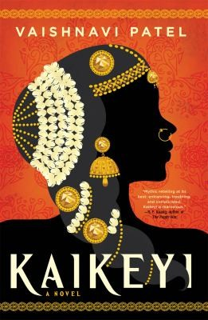

## Kaikeyī: the villainess as feminist

### Patel's novel

Vaishnavi Patel's *Kaikeyi*, published in New York in April 2022 by Redhook and in London by Orbit, became one of the most widely read Rāmāyaṇa retellings of the decade, and the most successful in the American market.^[Vaishnavi Patel, *Kaikeyi* (New York: Redhook, 2022) [W182]. Quotations are avoided; the account follows the corpus record and published reviews, and pinpoints are to be verified.] Its narrator is Kaikeyī, the queen whose demand for Rama's exile sets the epic in motion, and whom the tradition has made its archetypal wicked stepmother.

Patel's Kaikeyī, in the corpus's summary, is a woman "whose mother was banished", who "trains as a warrior and uses a magic 'Binding Plane' to push for women's place in public life against men who want them at home; she fears the power of godmen".^[Corpus workbook, W182.] The workbook calls it "the diaspora bestseller that rehabilitates Kaikeyi" and records that "critics say the absolution makes the story confused (Hypothesis B)".^[Corpus workbook, W182.]

### The Binding Plane

The novel's central invention, the Binding Plane, deserves reflection, because it is an image of a kind of power that the epic attributes to women and that the novel makes literal. In Vālmīki, Kaikeyī's power over Daśaratha is the power of a bond: the two boons he promised her long ago, which she now calls in. The boons bind him; his word, once given, cannot be withdrawn without dishonour. Kaikeyī's power, in other words, is the power to hold a man to his promise. Patel's Binding Plane is that power turned into magic: a plane of existence on which the bonds between people are visible and can be manipulated, strengthened, tightened.

Read with Kandiyoti's model in mind, the image is precise. The patriarchal bargain, as Chapter 9 described it, is a woman's strategy for security within a system that subordinates her: she secures her position through the bonds of the household, as wife and above all as mother of a son.^[Deniz Kandiyoti, "Bargaining with Patriarchy," *Gender & Society* 2, no. 3 (1988): 274–90 [W063].] Kaikeyī's demand for Bharata's consecration is the bargain called in. The Binding Plane makes visible the web of bonds within which the bargain operates, and gives the woman who can see it the power to pull the threads. It is a magical figure for the oldest form of women's power in the patriarchal household: leverage over the obligations that bind men.

But Patel's Kaikeyī uses the Binding Plane not to secure her son's succession but, in the corpus's description, "to push for women's place in public life". The bargain's logic is reversed. Where the epic's Kaikeyī bargains within the household for her son, the novel's bargains against the household for women in general. She becomes, in effect, a feminist reformer: a queen who wants women to be able to leave the inner apartments and take part in public affairs.

### Absolution

It is here that the critics' objection, recorded in the corpus, bites. If Kaikeyī's demand for Rama's exile was in the service of women's public life, then the exile becomes, somehow, a feminist act, and the epic's catastrophe is absolved. The novel must explain why a reformer devoted to women's freedom would send a prince into the forest for fourteen years, separate a wife from her husband, kill a king with grief, and set in motion the chain of events that ends with a pregnant woman abandoned on a riverbank. Its answer, the corpus summary suggests, involves a fear of "godmen": Kaikeyī sees in the cult forming around Rama, the divine hero, a danger to the very freedoms she is fighting for.

The answer is ingenious, and it has a contemporary edge: a diaspora novelist of the 2020s, writing a Kaikeyī who fears the deification of Rama, is writing about the politics of her parents' country in the decade of the Ayodhya temple. But it produces exactly the confusion the critics noticed. The epic's villainess becomes a heroine by having been right all along, and the cost of her rightness is borne by Sita and Urmila and Kausalyā, whose suffering the novel must either ignore or justify. This is the characteristic move of the market rehabilitation: absolution. The villainess is not understood; she is acquitted.

### The market's acquittals

The pattern extends across the popular fiction of the decade, and it is worth naming it as a pattern. Kaikeyī becomes a feminist (Patel). Mantharā becomes a loving foster-mother (Neelakantan). Śūrpaṇakhā becomes an unwanted daughter (Kane). Mandodarī becomes a strategist (Dasgupta) or a ruler (Anandani). In each case, a woman the epic blamed is shown to have had good reasons, and the showing is the point. Kaikeyī's exile of Rama, Mantharā's counsel, Śūrpaṇakhā's revenge: each becomes an act of a sympathetic woman under pressure.

I have argued, in Chapter 9, that Kandiyoti's model of the patriarchal bargain gives a better account of these women than either villainy or victimhood. It explains why Kaikeyī, Mantharā and Kausalyā each act as they do (to secure, through a son or a mistress, a place in a household that offers women no security of their own) without requiring the reader to condemn or to acquit them. The bargain is a structure, and women within it act rationally and often cruelly. The market's acquittals substitute psychology for structure: Kaikeyī was wounded by her mother's banishment; Śūrpaṇakhā by her mother's neglect; their actions are the actions of hurt daughters. Psychology invites sympathy. Structure invites analysis. The market, which needs readers to identify with its heroines, prefers the first.

## The *kanyās*: what the tradition already honoured

There is a piece of evidence that bears on all of this and that the popular retellings have, in one case, made the basis of an entire series. It is a single verse, widely recited in devotional practice, which names five women as *kanyās*, "maidens", whose remembrance destroys great sins:

> *ahalyā draupadī kuntī tārā mandodarī tathā*\
> *pañcakanyāḥ smaren nityaṃ mahāpātakanāśanam*
>
> Ahalyā, Draupadī, Kuntī, Tārā and Mandodarī: one should always remember the five maidens, the destroyer of great sins.†^[The verse circulates widely in devotional practice; its textual source and variants require separate study. Some versions substitute Sītā for Kuntī.]

Three of the five are women of the Rāmāyaṇa: Ahalyā, Tārā, Mandodarī. Every one of them has a sexual history that the ideal of the *pativratā* would condemn. Ahalyā, in Vālmīki, knowingly accepted Indra.^[CE 1.47.19.] Tārā, wife of the monkey king Vālin, married his brother Sugrīva after Vālin's death at Rama's hand. Mandodarī, Ravana's chief queen, is said in several tellings to have married his brother Vibhīṣaṇa after Ravana's death. The other two, Draupadī with her five husbands and Kuntī with her sons by gods, have histories no less irregular. And in the most widely recited form of the verse, Sita is not among them.

I do not wish to build too much on a verse whose source and variants require a study of their own, and I note that some versions do name Sita. But the existence of the verse, in its common form, is significant for the argument of this book. The tradition itself possessed a canon of honoured women whose lives exceeded the ideal of the one-husband, one-life *pativratā*: women who had more than one husband, or a lover, or children by gods, and who were nonetheless (or therefore) to be remembered daily as destroyers of sin. The liberation narrative, which assumes that tradition honoured only the chaste wife, cannot explain this verse. The popular novel, which presents the rehabilitation of Ahalya, Tara and Mandodari as a modern feminist recovery, is recovering women the tradition had never forgotten.

### Koral Dasgupta's Sati Series

The novelist who has built on this verse most explicitly is Koral Dasgupta, whose Sati Series, published by Pan Macmillan India, devotes a novel to each of the five *kanyās*: *Ahalya* (2020), followed by volumes on Kuntī and Draupadī, *Mandodari* (2023) and *Tara* (2024).^[Koral Dasgupta, *Ahalya: The Sati Series I* (2020) [W171]; *Mandodari: The Sati Series IV* (2023) [W187]; *Tara: The Sati Series V* (2024) [W197]; all New Delhi: Pan Macmillan India.] The series title is itself a provocation: *satī*, the faithful wife, applied to the five women whose fidelity the ideal would question.

Dasgupta's *Ahalya*, as Chapter 6 noted, makes pleasure part of the feminist claim: her Ahalya seduces her husband, and the novel traces her relations with Brahmā, with her mother and with Gautama.^[Corpus workbook, W171.] Her Mandodarī is "a strategist torn between Ram Rajya and Ravan Raj, frustrated by Sita's captivity and wary of Surpanakha".^[Corpus workbook, W187.] Her Tārā rises "from obscurity to royalty, balancing wisdom and turmoil", and the Ahalya of the first book returns.^[Corpus workbook, W197.] Kavita Kane's *Tara's Truce* (Rupa, 2023), published a year before Dasgupta's *Tara*, focuses on Tārā's compromises, "including marrying her husband's killer", in the corpus's phrase.^[Kavita Kane, *Tara's Truce* (New Delhi: Rupa, 2023) [W190].] And Manini J. Anandani's *Mandodari: Queen of Lanka* (Penguin, 2018), drawing on a Jaina telling in which Sita is the daughter of Ravana and Mandodarī, has the queen narrate, and has her marry Vibhīṣaṇa "as a political necessity".^[Manini J. Anandani, *Mandodari: Queen of Lanka* (Gurugram: Penguin Random House India, 2018) [W163].]

These novels share with the rest of the popular fiction of the decade a tendency to psychologise and to acquit. But they do something the Kaikeyī and Śūrpaṇakhā rehabilitations do not. By building on the *kanyā* verse, they connect their heroines to a traditional canon of honoured women whose honour did not depend on the *pativratā* ideal. They are, in this respect, recoveries in the strict sense: they recover a valuation the tradition held and the colonial-nationalist ideal of Chapter 3 obscured. Tārā marrying her husband's brother and Mandodarī marrying hers were not, in the tradition that named them *kanyās*, scandals to be explained away. They were facts about women whose remembrance destroys sin.

The question these novels raise, and that the warrior Sita does not, is the question of political marriage and widowhood: what a queen does when her husband is killed, and how she survives in the household of the man who killed him or his ally. That question, of women's survival through remarriage within a political order, is closer to the experience of most women in most of history than the question of whether a princess can be prime minister. It is a question about the patriarchal bargain. Tārā's truce and Mandodarī's "political necessity" are bargains, and the *kanyā* verse honours the women who made them.

## Śāntā and the forgotten daughter

One more figure of the popular rehabilitation deserves mention, because she connects the market's recoveries to the oldest theme of the women's songs. Śāntā is Rama's elder sister, a daughter of Daśaratha given away in childhood to King Romapāda, and later married to the sage Ṛṣyaśṛṅga, whose sacrifice produced the sons Daśaratha longed for. She appears briefly in some tellings and not at all in others. The corpus records Kranti Trivedi's Hindi novel *Chir Kalyāṇī*, one of the few book-length tellings of her story, translated into English in 2025; Anand Neelakantan's *Valmiki's Women*, which makes her "the daughter given away"; and Kalyani Sardesai's collection *Lost Among the Myths* (2025), which gives her a voice among seven women of the epic.^[Kranti Trivedi, *Chir Kalyani* [W149]; Anand Neelakantan, *Valmiki's Women* (Chennai: Westland, 2021) [W178]; Kalyani Sardesai, *Lost Among the Myths: Her Stories from the Ramayana* (Pune: Sakal, 2025) [W233].]

Śāntā is the girl child given away so that sons may be born. She is the first of Dev Sen's ten themes, the foundling, the "girl child as the essential orphan", in its most literal form: a daughter who was not lost but deliberately given.^[Dev Sen, "When Women Retell," 20.] Her near-total absence from the epic, and her recovery in the 2020s, belong to the same history as the recovery of Urmila a century earlier: a daughter neglected by the poets, remembered when the needs of a later age made her useful. In the 2020s, the need is the critique of son preference and sex selection, which Chapter 10 found in the rehabilitation of Śūrpaṇakhā as an unwanted daughter. The forgotten sister of Rama becomes a figure for the missing girls of the census.

::: {custom-style="Box Title"}
Reading Against the Text
:::

::: {custom-style="Box"}
Amish's Sita is prime minister of Mithila and the chosen Viṣṇu of her age, and her story ends at the abduction. Patel's Kaikeyī exiles Rama to save women's freedom from a cult of godmen. Each novel gives its heroine power by changing what the power is for. Is there a popular retelling in the corpus in which a woman's power is used for nothing but herself? And if not, is that a failure of the genre or a truth about power?
:::

::: {custom-style="Box Title"}
The Debate: Tradition (second round)
:::

::: {custom-style="Box"}
**Position A:** Tradition is patriarchal continuity: the epic's women were honoured only when chaste and obedient, and the popular retellings recover them from that ideal.\
**Position B:** Tradition is plurality and contestation: the epic's women were honoured in many registers, and the popular retellings recover valuations tradition already held.\
**Where the evidence of this chapter leaves the argument.** The *kanyā* verse is strong evidence for Position B: three women of the Rāmāyaṇa whose histories the *pativratā* ideal would condemn were named in daily devotion as destroyers of sin. The *Adbhuta*'s warrior Sita is further evidence. But the popular retellings rarely cite this plurality; they present their heroines' rehabilitation as modern discovery, and they psychologise where the tradition had simply honoured. The market recovers what tradition held and sells it as what tradition denied.
:::

## Conclusion

The popular fiction of the 2010s and 2020s gave the women of the Rāmāyaṇa power: political power in Amish's prime minister, persuasive power in Patel's Kaikeyī, strategic power in Dasgupta's Mandodarī, the power of survival in Kane's Tārā. Its Sitas and its rehabilitated villainesses are more competent, more public and more active than any before them. But the power is almost always power for something: the nation, women's public life, a political necessity. And the rehabilitation of the epic's blamed women proceeds, characteristically, by acquittal, substituting the psychology of the wounded daughter for the structure of the patriarchal bargain. Where the popular novel builds on the tradition's own plurality, as in the *kanyā* series, it recovers a valuation that the colonial-nationalist ideal had obscured. Where it builds on the global idiom of the action heroine and the corporate leader, it gives Sita a kingdom and stops before the king arrives.

Chapter 13 turns to three works that took a different path: not empowering Sita but making her disappear, and making her disappearance the subject.
