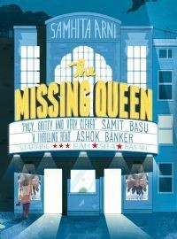
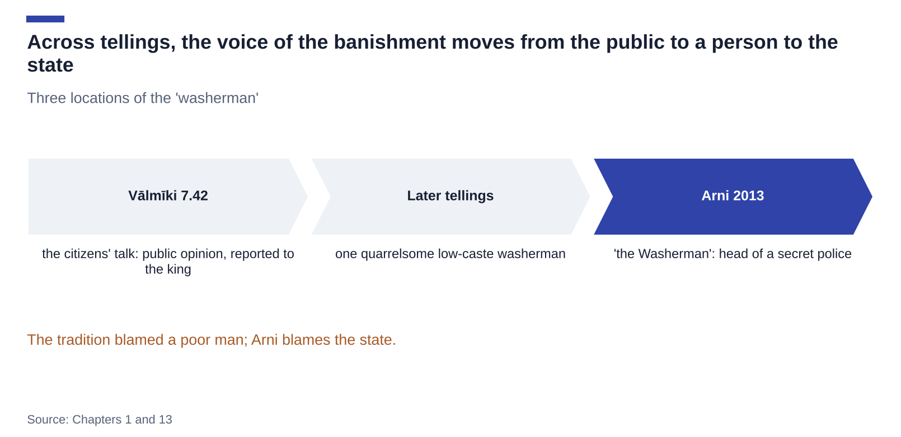

# Chapter 13. Sita Disappears: Arni, Chitrakar, Paley and the Politics of Form

::: {custom-style="Epigraph"}
*asmākam api dāreṣu sahanīyaṃ bhaviṣyati*\
*yathā hi kurute rājā prajā tam anuvartate*

"Now we too shall have to put up with this in our wives. For as the king does, so the subjects follow."

— The citizens of Ayodhya, Vālmīki *Rāmāyaṇa* 7.42.19 (CE)
:::

## The argument of this chapter

The popular novel of Chapter 12 empowered Sita by giving her office, skill and a mission. The three works examined in this chapter did something else. They made her disappearance the subject. In Samhita Arni's novel *The Missing Queen* (2013), Sita has vanished, and a journalist in a prosperous, surveilled Ayodhya sets out to find her. In *Sita's Ramayana* (2011), a graphic novel made by Arni with the Paṭuā scroll painter Moyna Chitrakar, Sita tells her story in images drawn from a tradition of women painters who sing as they unroll the scroll. And in Nina Paley's animated film *Sita Sings the Blues* (2008), Sita's story is told by three shadow puppets who cannot agree on the details, intercut with the story of an American animator's divorce and sung in the voice of a jazz singer of the 1920s.

The chapter makes four claims.

1. Arni's *The Missing Queen* is the corpus's most acute political reading of the *Uttarakāṇḍa*. It takes the citizens' talk of Vālmīki's seventh book, the "washerman" of later tellings, and turns it into an institution: a secret police that governs by managing public opinion. Its Sita is not banished but disappeared.

2. *Sita's Ramayana* makes form the argument. A story told in the visual idiom of a women's artisan tradition, painted before it was written, gives Sita's perspective without putting modern speeches in her mouth. Its restraint is a method.

3. *Sita Sings the Blues* stages Ramanujan's plurality as comedy, and Dev Sen's observation that Sita is "the name women give themselves" as autobiography. Its reception, a campaign for a ban in India and a scholarly debate about appropriation in the United States, shows that the question of who may tell Sita's story is as live as the question of what the story says.

4. Disappearance is the modern form of refusal. In each of these works, Sita's absence, rather than her voice, carries the argument.

## Samhita Arni: *The Missing Queen*

### Ayodhya after the war

Samhita Arni, who published a retelling of the *Mahābhārata* as a child and has since become one of the most thoughtful writers on the epics in English, published *The Missing Queen* with Zubaan and Penguin in 2013.^[Samhita Arni, *The Missing Queen* (New Delhi: Zubaan and Penguin, 2013) [W146]. Quotations are avoided; the account follows the corpus record and published reviews, and pinpoints are to be verified.] Its premise, in the corpus's summary: "A woman TV journalist asks 'Where is Sita?' in a prosperous, surveillance-state Ayodhya whose secret-police chief is 'the Washerman', while Lanka lies ruined by war."^[Corpus workbook, W146.]

The setting is the decisive invention. Arni's Ayodhya is not the mythic city of the epic but a modern state after a victorious war: prosperous, media-saturated, triumphant, and watched. Its ruler is Rama; its victory over Lanka is the foundation of its legitimacy; its prosperity is the reward of that victory. And Lanka, across the sea, lies in ruins. The war that the epic narrates as the recovery of a wife is, in Arni's novel, the founding violence of a security state.

Readers have heard in this setting echoes of the end of Sri Lanka's civil war in 2009, and of the Indian state's own relation to its peripheries; the novel invites such readings without insisting on any one of them. What it insists on is the structure: a capital that prospers on the ruins of the enemy it defeated, and that will not speak of what was done there, or of the woman for whom it was supposedly done.

### The Washerman

The secret police chief of Arni's Ayodhya is called the Washerman. The name reaches back through the whole history of the *Uttarakāṇḍa*'s reception.

In Vālmīki, as Chapter 1 showed, the talk that leads to Sita's banishment is reported to Rama by his companion Bhadra, who tells him what the citizens are saying in the squares and the countryside.^[CE 7.42.17–20.] In later tellings, the citizens' talk is condensed into a single speaker: a washerman (*dhobī*) who, quarrelling with his own wife after she has spent a night away from home, refuses to take her back and declares that he is not like Rama, who took back a wife who had lived in another man's house. The washerman's remark, overheard and reported, becomes the immediate cause of the banishment. Madhu Kishwar's informants remembered it this way; Sharad Joshi, in his speeches to the farmers of Maharashtra, spoke of "the mere hint of a slanderous remark by a dhobi".^[Madhu Kishwar, "Yes to Sita, No to Ram! The Continuing Popularity of Sita in India," *Manushi* 98 (January–February 1997): 26.]

The washerman is, in these tellings, a figure of the ordinary man's moral judgement: crude, censorious, and decisive. He is the precedent-anxiety of Vālmīki's citizens ("now we too shall have to put up with this in our wives") personified in a single, low-caste, quarrelsome husband. And it is worth noticing how the condensation works. In Vālmīki, the judgement belongs to the citizens as a body; it is public opinion. In the later tellings, it belongs to a washerman, a man of a "low" occupation, whose very lowliness makes his remark the more shaming for a king. The tradition moved the responsibility for Sita's banishment from the public to a single lower-caste man, and from Rama to the man who shamed him.

Arni reverses the condensation and institutionalises it. Her Washerman is not a quarrelsome husband but the head of the state's apparatus of surveillance. Public opinion, in her Ayodhya, is not something the king overhears; it is something the state manufactures, monitors and enforces. The citizens' talk that, in Vālmīki, the king anxiously consulted has become an instrument by which the king governs.

This is, in my judgement, the most penetrating reading of Vālmīki's seventh book in the corpus, and it extends the argument of Chapter 1 in a direction I had not anticipated. I read the citizens' talk at 7.42.19 as an argument about precedent: the king's conduct sets the norm for his subjects' households. Arni sees the other face of the same logic. If the king's household is the model for every household, then the state has an interest in every household, and an apparatus for watching it. The washerman who judged one wife becomes the Washerman who watches all of them. Veena Das's account of violence as something that descends into the ordinary, that inhabits the everyday rather than the spectacular, describes precisely the regime Arni imagines: a state whose violence is the violence of the neighbour's remark, the informer's report, the silence about what happened to the queen.^[Veena Das, *Life and Words: Violence and the Descent into the Ordinary* (Berkeley: University of California Press, 2007).]

### Disappeared

And Sita is not banished. She is missing. The difference is the difference between an exile, which is a public sentence, and a disappearance, which is a state secret. In Vālmīki, the banishment is ordered by the king, carried out by his brother, and known to everyone; it is a public act, however unjust. In Arni's novel, no one will say where Sita is. The journalist's question, "Where is Sita?", is a question the state does not want asked.

The modern word for this is *disappearance*, and its political history (in Argentina and Chile, in Sri Lanka, in Kashmir, where the women whose husbands have vanished in custody are called "half-widows") gives Arni's title its weight. *The Missing Queen* reads Sita's story as the story of a woman whom the state removed from public life and from public memory, and it makes the recovery of her memory the work of another woman, a journalist, whose profession is to ask what the state will not answer.

The corpus workbook calls the novel an instance of "Sita as a political disappearance: Field VII and the politics of public memory".^[Corpus workbook, W146.] I would add that it is the corpus's clearest example of what Chapter 9 called counter-memory, transposed from the women's song to the investigative novel. The official record of Arni's Ayodhya is Rama's story, told in triumph. The counter-memory is the question of what happened to Sita. The journalist is the singer at the grindstone, with a microphone.

### The journalist as Sita's successor

The figure of the journalist deserves one further remark. Arni's novel does not give Sita a voice. Sita is absent; that is the premise. The voice belongs to the woman looking for her. This is a formal decision with an ethical content. Arni does not presume to speak as Sita; she speaks as a modern woman trying to find out what happened to Sita, and the gap between the two is the space of the novel. It is the same honesty that Chapter 7 found in Candrābatī, whose narrator condemns Rama in her own voice while her Sita remains within the story's bounds. The teller and the told are kept distinct. And the novel's political force comes precisely from that distinction: the journalist's question is a question any reader can ask, about any woman the state has silenced, because the journalist is not Sita but someone who refuses to stop asking about her.

On the agency matrix of Chapter 12, *The Missing Queen* scores "strong" on political agency, alongside Amish's Sita and Patel's Kaikeyī. But the agency is of a different kind. Amish's Sita holds office; Patel's Kaikeyī wields influence; Arni's journalist asks a question. The question is the most dangerous of the three, because it is the only one directed at the king.
