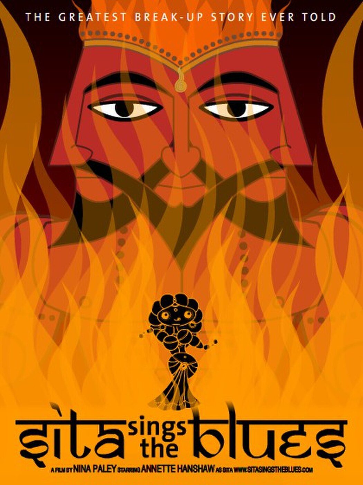

## *Sita's Ramayana*: the painter's Sita

### The book

*Sita's Ramayana*, published by Tara Books in Chennai and Groundwood in Toronto in 2011, is a graphic novel with text by Samhita Arni and art by Moyna Chitrakar, a Paṭuā scroll painter from the village of Naya in West Bengal.^[Samhita Arni and Moyna Chitrakar, *Sita's Ramayana* (Chennai: Tara Books; Toronto: Groundwood, 2011) [W140].] It was named an American Library Association Notable Book in 2012. Its story is told by Sita, and it draws, in the corpus's summary, on Candrābatī; it "does not openly judge Rama".^[Corpus workbook, W140.] And it was made in an order that reverses the usual practice of illustrated books: "Moyna Chitrakar painted the Patua pictures first and the text followed."^[Corpus workbook, W140.]

### The painters of Naya

The Paṭuā painters of Bengal, whose tradition Chapter 2 touched on, are artisans who paint long vertical scrolls of narrative images and perform them, unrolling the scroll frame by frame while singing the story. The tradition is hereditary, and many Paṭuā families are Muslim by name while painting and singing stories from the Hindu epics and Purāṇas, as well as Islamic, secular and topical subjects; the boundary between the communities, in this tradition, has always been porous. Women painters, Moyna Chitrakar among them, have in recent decades become prominent, and Mandakranta Bose's study of Bengali folk paintings of the Rāmāyaṇa shows that the scrolls dwell on Sita's abduction and invite sympathy for her.^[Mandakranta Bose, *Ramayana in Bengali Folk Paintings* (New Delhi: Niyogi Books) [W157]; on Manimala Chitrakar and the women painters of Naya, corpus W112.] The corpus records a scroll titled "Sita Haran" and a documentary, "In Search of her Ramayana", on the women painters of Naya.^[Corpus workbook, W112.]

The decision to paint first and write after is therefore more than a production detail. It means that the book's Sita is, in the first instance, the Sita of a women's artisan tradition, rendered in the visual vocabulary that tradition developed for performance before village audiences: flat colour, bold outline, figures arranged in frames, animals and trees and rivers given the same weight as gods and kings. The text, written to the images, follows the painter's selection and emphasis. Sita's story, in this book, is told first in a woman painter's images and only then in words.

### Restraint as method

The book's most debated quality is its restraint. Its Sita narrates; she tells her story from her own point of view, and her perspective governs what is shown. But she does not, as the corpus notes, "openly judge Rama". There is no speech of indictment, no modern feminist argument put into her mouth, no reinterpretation of the plot. The events are the events of the tradition, seen from her side.

For some readers this restraint is a weakness: a Sita who narrates without judging has been given a voice and denied the use of it. For others, and I count myself among them, it is the book's method and its integrity. Dhruvee Sinha and Zeeshan Ali, in an open-access essay published in 2024, argue that *Sita's Ramayana* amplifies an agency already present in Vālmīki rather than breaking from it, and the corpus workbook flags their essay as "a recent, open-access counter-argument" to the liberation narrative, directly relevant to Hypothesis B.^[Dhruvee Sinha and Zeeshan Ali, "From Agni to Agency: Sita's Liberation in Arni and Chitrakar's Graphic Retelling of the Ramayana," *Humanities* 13, no. 4 (2024): 97 [W194].] Shruti Chakraborti reads the book through Adrienne Rich's concept of re-vision and alongside Candrābatī.^[Shruti Chakraborti, "Subverting Patriarchal Interpretation of the Ramayan through a Feminist Lens: A Critical Study of *Sita's Ramayana*," *Journal of International Women's Studies* 24, no. 2 (2022), article 11 [W183].]

I agree with Sinha and Ali's premise, which is the premise of Chapter 1 of this book: Vālmīki's Sita already has agency, and a retelling that brings it into view is amplifying, not inventing. And I would add that the book's restraint is the restraint of the tradition it draws on. The Paṭuā scroll does not editorialise; it shows. The women's songs, as Dev Sen observed, voice the critique through the singer and the chorus rather than through Sita.^[Nabaneeta Dev Sen, "When Women Retell the Ramayan," *Manushi* 108 (1998): 27.] Candrābatī's narrator lashes Rama while her Sita laments. *Sita's Ramayana* places itself in this line. Its Sita's perspective is the critique; the reader who sees the story from where Sita stood does not need to be told what to think of the man who put her there.

Saraswati Nagpal's *Sita: Daughter of the Earth* (Campfire, 2011), a mass-market graphic novel published the same year, retells the epic with Sita at the centre in the visual idiom of the Indian comic book; the corpus workbook suggests setting it beside *Sita's Ramayana* for Field VI, form and visual politics.^[Saraswati Nagpal, *Sita: Daughter of the Earth* (New Delhi: Campfire, 2011) [W215].] The comparison is instructive. Both give Sita the narrative centre. One draws its images from a women's artisan tradition performed in villages; the other from the commercial comic, descended from the *Amar Chitra Katha* series that taught several generations of Indian children their mythology in a standardised visual style. The two books make the same story mean different things by drawing it differently. Form, in the graphic retelling, is argument.

## *Sita Sings the Blues*

### The film

In 2008, the American animator Nina Paley completed *Sita Sings the Blues*, a feature-length animated film that she made almost entirely by herself over several years.^[Nina Paley, dir., *Sita Sings the Blues* (2008) [W130].] It tells the story of Sita, from the exile to the earth, in three interwoven modes. In the first, Sita's story is animated in a style drawn from Indian painting and calendar art, and at key moments Sita sings, in the voice of Annette Hanshaw, an American jazz singer of the 1920s whose recordings of torch songs about faithless men and faithful women Paley used as the film's soundtrack. In the second, three shadow puppets, voiced by Indian Americans speaking unscripted, argue among themselves about the story: who did what, in which version, and why, contradicting one another and confessing what they do not remember. In the third, Paley's own story is told in a sketchier animated style: her husband takes a job in India, she follows him, he breaks off their marriage, by email, while she is in New York.

The film was released under a Creative Commons licence, after a long struggle over the rights to the Hanshaw recordings, and circulated freely online; Paley later placed it in the public domain.^[Corpus workbook, W130; the licence history is recorded on the film's Wikimedia Commons pages.] It is one of the most widely seen Rāmāyaṇa retellings ever made outside India.

### Ramanujan's plurality as comedy

The shadow puppets are the film's intellectual centre, and they stage, with great wit, the argument of A. K. Ramanujan's "Three Hundred Rāmāyaṇas". The puppets know the story in different versions; they remember it differently; they disagree about why Rama did what he did and whether Sita was right to do what she did; they ask each other questions they cannot answer. Their conversation is the tradition's plurality, rendered as the talk of people who grew up hearing the story and never agreed on it. Ipshita Chanda's intermedial reading of the film shows how its combination of media (painting, puppetry, jazz recording, autobiography) makes its argument through form.^[Ipshita Chanda, "An Intermedial Reading of Paley's *Sita Sings the Blues*," *CLCWeb: Comparative Literature and Culture* 13, no. 3 (2011) [W138].]

Ramanujan's essay, as Chapter 1 noted, was removed from the Delhi University history syllabus in October 2011, three years after Paley's film was completed, after protests that it offended religious sentiment.^[Corpus workbook, W062.] The film's puppets, arguing cheerfully about which Rāmāyaṇa is the real one, represent exactly the plurality whose teaching was then curtailed. It is a small irony of the history traced in Figure 5.2 that an American animation made the argument of an Indian scholar's essay more widely known than the essay itself, in the same years that the essay was taken off an Indian syllabus.

### "Sita is the name they give themselves"

The autobiographical strand is the film's most controversial element, and its most poignant. Paley, abandoned by her husband, identified with Sita, and the film makes the identification explicit: an American woman's divorce is set beside the banishment of a queen. Nabaneeta Dev Sen's last sentence, that when women retell the Rāmāyaṇa "Sita is the name they give themselves", describes precisely what Paley did.^[Dev Sen, "When Women Retell," 27.] She gave herself the name. In this sense the film belongs to Dev Sen's fourth category of women's retelling: telling "your own story through the story of Sita".^[Dev Sen, "When Women Retell," 18.]

But the identification raises the question that Chandra Talpade Mohanty taught feminist scholarship to ask: does the comparison of an American woman's divorce with Sita's banishment universalise a particular experience, or erase the differences that make each what it is?^[Chandra Talpade Mohanty, "Under Western Eyes: Feminist Scholarship and Colonial Discourses," *boundary 2* 12, no. 3 / 13, no. 1 (1984): 333–58.] The village women whom Dev Sen recorded gave themselves Sita's name because their lives shared Sita's conditions: child marriage, abuse by in-laws, childbirth alone, abandonment without resources. Paley's life shared some of those conditions (abandonment by a husband) and not others (she was a professional artist in New York, with resources, a career, and a legal system that would grant her a divorce). The film's identification is sincere, and it is also a translation, of the kind Chapter 11 found in the diaspora Sita. A grievance specific to one history is made to speak for another.

### The storm

The film's reception divided along lines that this book has traced throughout. In India, in 2009, the Hindu Janajagruti Samiti sought to have the film banned, and its screenings drew protests.^[Corpus workbook, W130.] The objection was to the treatment of sacred figures: the jazz, the comic puppets, the autobiographical parallel, the sexuality of the animation. In the United States, the feminist scholar Sharmila Lodhia published an extended critique asking who owns the Rāmāyaṇa and whether an outsider's feminist animation of it was critique or appropriation; the corpus workbook flags the essay for Field VII and Hypothesis C, "whose feminism counts".^[Sharmila Lodhia, "Deconstructing Sita's Blues: Questions of Mis/representation, Cultural Property, and Feminist Critique in Nina Paley's Ramayana," *Feminist Studies* 41, no. 2 (2015): 371–408 [W150]; the full title should be confirmed.]

The two objections are very different in their premises and their politics, and I do not equate them. The first sought to prohibit; the second sought to criticise. But they share a question: who has the standing to tell Sita's story, and to tell it in a way that makes light of what others hold sacred or suffered? This book has argued that the Rāmāyaṇa tradition was always plural, that it was always told across religious lines (Chapter 2's Persian, Malay and Mappila tellings), and that its plurality included comedy (Chapter 9's grindstone and Kumudini's letters). On that view, Paley's film belongs in the tradition, and the shadow puppets, Indian Americans arguing about the story they grew up with, are its best defence. But the view does not dissolve Lodhia's question. A tradition can be plural and still have an inside and an outside. The women singing at the grindstone were inside. Paley, however sincere, came from outside, and her film's circulation in the West as *the* feminist Rāmāyaṇa, for audiences who knew no other, gave her Sita an authority that the Telugu women's Sita never had.

## Disappearance as refusal

I return, in closing, to the claim with which this chapter began. In each of the three works examined here, Sita's absence carries the argument.

In *The Missing Queen*, Sita is missing, and the question of where she is indicts the state. In *Sita's Ramayana*, Sita is present as narrator but refuses (or is refused) the modern speech of indictment, and her restraint lets the images and the reader do the judging. In *Sita Sings the Blues*, Sita's story ends, as Vālmīki's does, with the earth, and the film's final images of her return to the earth are among its most beautiful; but the film's last word belongs to Paley, the woman who has taken Sita's name and gone on living.

Disappearance, in these works, is the modern form of the refusal that Vālmīki's last scene stages. The earth that opens in 7.88 is, in the political imagination of the twenty-first century, the disappearance that the state will not explain; the silence that the painter's images fill; the exit that leaves a modern woman to carry the story on. Meena Kandasamy's phrase, from Chapter 10, names it: Sita "perfected the vanishing act".^[Meena Kandasamy, *Ms Militancy* (New Delhi: Navayana, 2010), "Princess-in-Exile," as recorded in the corpus workbook, W136 (page to be verified).] These works take the vanishing act seriously, as a political act, and ask what it reveals about the world she vanished from.

::: {custom-style="Box Title"}
Reading Against the Text
:::

::: {custom-style="Box"}
In *The Missing Queen*, the Washerman is the head of the secret police. In the tradition, he is a quarrelsome low-caste husband whose remark shamed a king. Which is the more dangerous reading: the one that blames a poor man for Sita's banishment, or the one that blames the state? And what does it tell us that the tradition chose the poor man?
:::

::: {custom-style="Box Title"}
The Debate: Silence (second round)
:::

::: {custom-style="Box"}
**Position A:** A Sita who does not speak, or is absent, is a Sita denied: the retelling has failed to give her what feminism requires.\
**Position B:** A Sita who does not speak, or is absent, can carry the argument more powerfully than one who speaks: absence indicts what caused it.\
**Where the evidence of this chapter leaves the argument.** The three works examined here make the strongest case in the corpus for Position B, but only because each places a speaking agent beside the absent Sita: Arni's journalist, Chitrakar's images, Paley's own story. Absence alone is not an argument; it becomes one when someone asks about it. The women's songs knew this: Sita's exile was "distributed amongst us all", and it was the women who sang about it who made it speak.
:::

## Conclusion

Three works of the decade between 2008 and 2013, a novel, a graphic novel and an animated film, made Sita's disappearance their subject. Arni's *The Missing Queen* read the *Uttarakāṇḍa*'s citizens' talk as an apparatus of state surveillance and Sita's banishment as a political disappearance. Arni and Chitrakar's *Sita's Ramayana* let a women's artisan tradition tell Sita's story in images, with a restraint that amplifies the agency Vālmīki already gave her. Paley's *Sita Sings the Blues* staged the tradition's plurality as comedy and gave Sita's name to an American woman, provoking a demand for prohibition in India and a debate about appropriation in the United States. In each, the question was not what Sita says but where she has gone, and who is left to ask.

Chapter 14 turns to a work that asks the question in Hindi, and that claims for its answer a feminism rooted in the soil of the language: Anamika's *Trin Dhari Ot*, translated as *Sita's Veil*.
