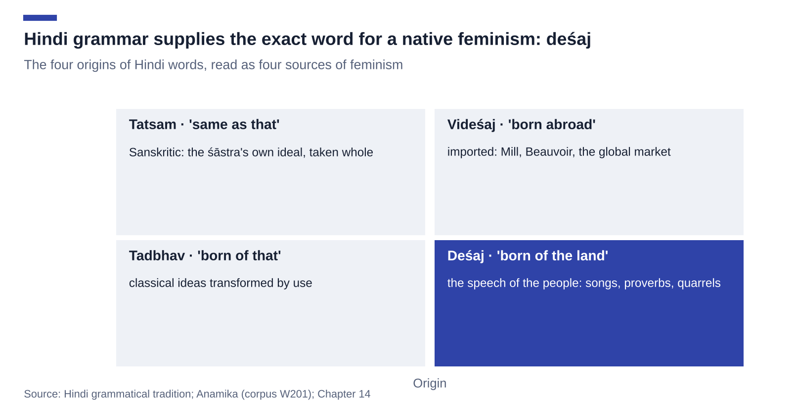
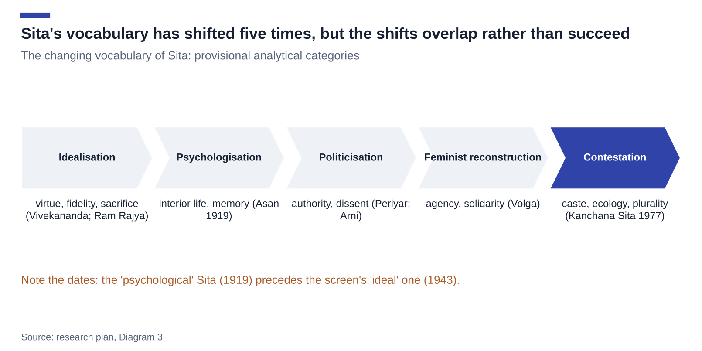

# Chapter 14. Behind the Blade of Grass: Anamika's *Sita's Veil* and the Claim of a *Deśaj* Feminism

::: {custom-style="Epigraph"}
*tṛṇam antarataḥ kṛtvā pratyuvāca śucismitā*\
*nivartaya mano mattaḥ svajane kriyatāṃ manaḥ*

"Placing a blade of grass between them, she of the pure smile answered: 'Turn your mind away from me; set it on your own people.'"

— Sītā to Rāvaṇa, Vālmīki *Rāmāyaṇa* 5.19.3 (CE)
:::

## The argument of this chapter

Every chapter of this book has asked whose needs a retelling of Sita answers, and several have found that the answer lies outside India: in the colonial tribunal of Chapter 3, in the global market of Chapter 11, in the diaspora's vocabulary of empowerment. This chapter examines a work that claims, explicitly, to answer that question from inside. The Hindi poet Anamika's novel *Tṛn Dhari Oṭ* (2023), translated into English as *Sita's Veil* (2025), is called by its author a "Sitayan", and its feminism is described by her as "integrated" or *deśaj*: a feminism of the soil, native to the land and the language.^[Anamika, *Trin Dhari Ot* (New Delhi: Vani Prakashan, 2023); English translation, *Sita's Veil* (New Delhi: Yatra Books with Vani Prakashan, 2025) [W201]. The account below follows the corpus record and the author's published statements as summarised there; quotations from the novel are avoided and pinpoints are to be verified.]

The chapter makes four claims.

1. Anamika's title returns to the blade of grass, the image with which Vālmīki's Sita defied Ravana, through Tulsīdās's Hindi rendering of it. The return is a claim about where a Hindi Sita's resources lie: not in imported vocabulary but in the language's own scripture.

2. The concept of *deśaj* feminism is a precise and productive one, drawn from the Hindi grammatical tradition's classification of words. It names what this book has called the decolonial reading of Sita: a feminism whose materials are native rather than borrowed.

3. Anamika's Sita answers political needs of her own moment too, above all the need to speak about women in war, and the novel declares this openly by modelling its Sita on women caught in contemporary conflict. A *deśaj* feminism is not a feminism without a politics.

4. The claim of nativeness raises the question Sharmila Rege taught this book to ask: whose *deś*? A soil-rooted feminism must say which soil, and whose labour tilled it.

## The blade of grass, again

In Vālmīki, the blade of grass appears twice in Sita's confrontations with Ravana: in the forest, when he has revealed himself and she answers "fearless though worn down by grief", and in the Aśoka grove, when he renews his proposal and she answers "with a pure smile".^[CE 3.54.1; 5.19.3.] In both scenes she places the grass between them before she speaks. Its meaning has been debated (a barrier, a sign of contempt, a refusal to address him directly), but its function in the scene is clear. It marks a boundary that Ravana's power cannot cross. She is in his power, physically; she speaks from behind a line he cannot pass.

Tulsīdās, in the *Sundarakāṇḍa* of the *Rāmcaritmānas*, renders the image in a half-line that every Hindi speaker who has heard the *Mānas* recited knows by heart: *tṛn dhari oṭ kahati baidehī*, "holding a blade of grass as a screen, Vaidehī spoke".^[Tulsīdās, *Rāmcaritmānas*, Sundarakāṇḍa [W016] (verse locator to be verified).] The word *oṭ* means a screen, a cover, a shelter; to speak from behind an *oṭ* is to speak from a protected place. Anamika takes her title from this half-line, and the English title translates *oṭ* as "veil".

The choice is significant in three ways. First, it reaches past the modern feminist vocabulary to the scripture that the Hindi-speaking world actually knows: not Vālmīki in Sanskrit, but Tulsī in Awadhi, the text Chapter 2 identified as the source of the devotional, protected, shadow Sita. Anamika finds in that very text an image of defiance. Second, it locates Sita's power in the grass rather than in the fire: not in the ordeal that proves her purity to Rama, but in the gesture by which she refuses Ravana. It is the Sita of the Aśoka grove, not the Sita of the pyre, whom Anamika takes as her starting point. And third, the translation "veil" introduces a resonance the Hindi title does not insist on: a veil is what modesty requires and what some feminisms reject. Anamika's Sita speaks from behind a veil of her own making, a grass-blade veil, a boundary she draws. The image claims modesty as a form of power.

## The Sita who will not lecture

The corpus records that Anamika's Sita "refuses to lecture Ravana".^[Corpus workbook, W201.] This is a deliberate departure from Vālmīki, whose Sita, behind the blade of grass, tells Ravana at length who Rama is, how he will die, and what political course he should take.^[CE 3.54.2–9; 5.19.18.] It is also a departure from the modern liberation narrative, which would expect a liberated Sita to deliver to her captor a speech of resistance.

What does the refusal mean? On the evidence of the novel's design, it extends the logic of the blade of grass. The grass marks a boundary; speech across it, even speech of defiance, crosses it. To lecture Ravana is to engage him, to treat him as an interlocutor whose mind can be changed. Anamika's Sita withholds even that. Her refusal is a refusal of relation. It is, in the vocabulary of this book, the most complete form of the refusal that Vālmīki's last scene stages: not a speech against the captor but a silence that denies him the dignity of being argued with.

This links Anamika's Sita to the line traced in Chapters 4 and 13: Kumaran Asan's Sita, who reaches her verdict on Rama alone and never tells him; Arni's missing queen, whose absence indicts the state; Kandasamy's Sita, who "perfected the vanishing act". The modern Sitas who refuse most completely are those who withhold their speech from the men who would judge or possess them.

## Women in war

The corpus records a second feature of the novel that its author has emphasised: its Sita "is modelled on women caught in conflict, such as in Gaza".^[Corpus workbook, W201.] The novel was published in 2023, the year in which the war in Gaza began, after a decade in which women caught in conflict, in Syria and Ukraine, in Manipur and Kashmir, in Afghanistan and Sudan, had become a recurring subject of the world's news.

The modelling makes explicit what the epic leaves implicit. Sita in Laṅkā is a captive of war: a woman taken by a hostile king, held in his city, threatened with death, and finally released by the destruction of that city by her husband's armies. Laṅkā burns, twice: once when Hanumān sets it alight, and again in the war. The women of Laṅkā, Mandodarī and the *rākṣasīs* of the Aśoka grove and the countless unnamed wives of Ravana's soldiers, lose everything. Samhita Arni's *The Missing Queen*, examined in Chapter 13, imagined Laṅkā after the war as a ruin; Anamika imagines Sita during it as a woman in a war zone.

This is a political need of a particular moment, and Anamika declares it. Her Sita answers the need of a Hindi poet writing in a decade of wars to speak about women in conflict without speaking only about contemporary politics; the epic gives her a figure through whom every captive woman can be seen. On the argument of this book, the declaration matters. A retelling that answers a political need and says so is in a different position from one that answers it and calls the answer Sita's own voice. Anamika's Sita is avowedly a figure for women in war. She is not presented as the recovery of an original Sita who was always a war correspondent.

## The letter to Śūrpaṇakhā

The novel ends, in the corpus's summary, with a Sita who "becomes a scholarly single mother and writes a letter to Shoorpanakha".^[Corpus workbook, W201.] Two choices are joined here.

The first is the Sita who is a scholar and a single mother. Her independence is intellectual and domestic at once: she thinks, and she raises her children, without Rama. This is Du. Saraswathi's Sannathimmi's Sita (Chapter 10), "a single woman and single mother who manages without heroes", raised from the labourer's hut to the scholar's study. It is also Pragya Agrawal's Vandevī (Chapter 11), raising her sons in the hermitage. The forest, in all three, is the place where a woman without a husband makes a life. The difference in Anamika is the word "scholar": her Sita's independence is the independence of a mind trained in the learning from which the epic's women were excluded, the learning Volga's Śabarī knew differently and Kane's Ahalya wanted to master.

The second is the letter. Sita writes to Śūrpaṇakhā: the woman whose mutilation provoked the war, the woman the epic made the anti-Sita, the "bad" woman of Erndl's split.^[Kathleen M. Erndl, "The Mutilation of Śūrpaṇakhā," in *Many Rāmāyaṇas*, ed. Paula Richman (Berkeley: University of California Press, 1991), 67–88 [W075].] The letter heals the split, as Volga's garden encounter did, but in a different form: not a meeting but a correspondence, a written act of solidarity across the line that the war drew. In a novel about women in war, the letter to the enemy's sister is the novel's last political act. It says that the women on both sides of the war have more in common with each other than with the men who fought it.

The form of the letter recalls Madhusudan Dutt's *Bīraṅganā Kābya* of 1862, in which the women of myth wrote letters to the men who failed them, Śūrpaṇakhā to Lakshmana among them.^[Michael Madhusudan Dutt, *Birangana Kabya* (1862) [W238]; see Chapter 3.] There, the letters were addressed to men. Here, Sita writes to a woman. A century and a half separates the two, and the change of addressee measures what the feminist retelling has learned.

## *Deśaj*: the feminism of the soil

### The word

Anamika has described her approach as "integrated" or *deśaj* feminism, and has called her novel a Sitayan.^[Corpus workbook, W201.] The second claim places her in the line traced in Chapter 7: Iyengar, Sengupta, Majmudar, Divakaruni, and now a Hindi poet. The first claim deserves more extended attention, because the word she chose is precise and its precision supports, and tests, the argument of this book.

In the grammatical tradition through which Hindi is taught in Indian schools, the vocabulary of the language is divided into four classes by origin. *Tatsam* words are Sanskrit words used in their Sanskrit form: "the same as that". *Tadbhav* words are words descended from Sanskrit and transformed by centuries of use: "born of that". *Videśaj* words are foreign, borrowed from Persian, Arabic, Portuguese or English: "born abroad". And *deśaj* words are words born in the land itself, of no known Sanskrit or foreign origin: "born of the country", native to the speech of the people.

To call a feminism *deśaj* is therefore to make a claim about its origin with a precision that "indigenous" or "native" lacks. A *deśaj* feminism is not *tatsam*: it is not a Sanskritic feminism derived from the śāstras, the learned tradition's own resources taken in their classical form. It is not *videśaj*: it is not a feminism borrowed from abroad, from Mill or Beauvoir or the global market of retellings. And it is not quite *tadbhav* either: it is not a classical idea transformed by use. It is a feminism born in the speech of the country's people, in their songs and proverbs and household arguments, of no learned pedigree at all.

### What the word names

If this is what Anamika means, then the word names, more exactly than any term this book has used, the tradition traced in Chapter 2: the women's songs at the grindstone, the Maithili wedding songs, the Telugu songs of Urmila, the Avadh song in which Sita refuses to see Rama's face. These are *deśaj* in the strict sense. They are not derived from Vālmīki or Tulsī, though they know both; they are not borrowed from abroad; they were born in the speech of women who sang them, and their feminism, their judgement of Rama, their distribution of Sita's exile among the women who share it, is native to that speech.

And the word names the decolonial reading this book has attempted. I have argued that the liberation narrative measures Sita by a yardstick borrowed from the history of Western liberal individualism (*videśaj*); that the nationalist and devotional readings measure her by a classical ideal reconstructed under colonial pressure (a false *tatsam*); and that the resources for Sita's freedom lie within the tradition, above all in the women's songs and the regional tellings. A *deśaj* feminism is the name for a feminism built from those resources.

### Whose *deś*?

But the word also exposes the question that Sharmila Rege taught this book to ask, and I would be untrue to the argument of Chapter 10 if I did not ask it here. *Deś* means country, land, region; it also, in Hindi, carries the sense of the homeland, the village of one's origin. Whose *deś* is the soil of a *deśaj* feminism?

The danger in any claim of nativeness is that it naturalises one community's culture as the culture of the land. The Hindi of Anamika's novel is the Hindi of an educated, urban, literary readership; the *Mānas* from which her title comes is the scripture of the Hindi heartland's upper and middle castes; the soil of the Hindi belt has been tilled, for most of its history, by people whose relation to that scripture was the relation of those whom its notorious *Sundarakāṇḍa* line about "the drum, the rustic, the Śūdra, the animal and the woman" names together.^[Tulsīdās, *Rāmcaritmānas*, Sundarakāṇḍa [W016]; see Chapter 2.] A feminism of the soil must say whose soil. The women whose songs Smita Tewari Jassal recorded in eastern Uttar Pradesh, lower-caste women singing of Sita's trials as a language for their own labour and caste, are *deśaj* in the deepest sense, and their Sita may not be Anamika's.^[Smita Tewari Jassal, *Unearthing Gender: Folksongs of North India* (Durham, NC: Duke University Press, 2012) [W142].]

There is a second danger, which Bina Agarwal named in the ecofeminist debate of Chapter 6: the danger of essentialising the bond between women and the land, of making the soil a symbol rather than a material resource.^[Bina Agarwal, "The Gender and Environment Debate: Lessons from India," *Feminist Studies* 18, no. 1 (1992): 119–58 [W078].] The Lakshmi Mukti campaign showed what a material *deśaj* feminism could look like: land transferred into women's names, justified by the story of Sita.^[Madhu Kishwar, "Yes to Sita, No to Ram! The Continuing Popularity of Sita in India," *Manushi* 98 (January–February 1997): 26–27.] A *deśaj* feminism that stayed in the language of literature, without asking who owns the soil it claims, would be *deśaj* in name only.

I raise these questions not as objections to Anamika's novel, which I cannot fully assess until I have read it in a citable edition, but as the questions the concept itself invites. The concept is the right one. Its test is whether it can be extended from the language of a literary elite to the speech of the women who actually work the land, and whether its feminism can include those whom the scripture of its title excluded.

## The Hindi Sita between Tulsī and Anamika

Anamika's novel enters a Hindi field that this book has touched at several points, and it may be useful to draw them together. Tulsīdās's *Mānas*, at the end of the sixteenth century, gave Hindi its scriptural Sita: protected by a shadow, spared the banishment, the ideal wife of an ideal husband (Chapter 2). Maithilīśaraṇ Gupt's *Sāket* (1931) gave it its nationalist Urmila, patriotic and waiting (Chapters 3 and 6). Ācārya Tulsī's Jain *Agni-parīkṣā* (1961), sympathetic to Sita as a woman let down by men and society, provoked protests in 1970 (Chapter 5).^[Acharya Tulsi, *Agni-pariksha* (1961) [W212].] Omprakash Valmiki's *Shambuk's Severed Head* gave it its Dalit counter-telling of the *Uttarakāṇḍa* (Chapters 1 and 5). Mridula Sinha's *Sītā Punī Bolī* gave it a conservative first-person Sita as a guide for modern girls (Chapter 11).^[Mridula Sinha, *Sita Puni Boli* [W129].] Madhu Kishwar's interviews recorded that most of the poems sent to the Hindi *Manushi* in the 1980s and 1990s were about Sita (Chapter 7).^[Kishwar, "Yes to Sita," 20.]

In this field, Anamika's novel occupies a distinctive position. It returns to Tulsī's image but not to Tulsī's protected Sita; it takes the blade of grass from the scripture and the war from the present; it gives Sita a scholar's mind and a single mother's life; and it names its feminism in the grammar of Hindi itself. If the Hindi Sita has, for four centuries, been the Sita of the *Mānas*, Anamika's is the first major Hindi Sita of the twenty-first century to claim the *Mānas*'s own image against the *Mānas*'s ideal.

::: {custom-style="Box Title"}
Reading Against the Text
:::

::: {custom-style="Box"}
Vālmīki's Sita speaks to Ravana from behind the blade of grass; Anamika's will not lecture him. Is silence behind a boundary a stronger refusal than speech across it? And if the blade of grass is a veil, who decides when a veil is a woman's protection and when it is her confinement?
:::

::: {custom-style="Box Title"}
The Debate: Tradition (third round)
:::

::: {custom-style="Box"}
**Position A:** A feminism rooted in tradition is a contradiction: tradition is the problem, and the resources for women's freedom must come from outside it.\
**Position B:** A feminism rooted in tradition is possible: the tradition contains its own resources for women's freedom, and a native feminism can be built from them.\
**Where the evidence of this chapter leaves the argument.** Anamika's *deśaj* feminism is the most explicit statement of Position B in the corpus, and the grammatical metaphor gives it precision: native, neither Sanskritic nor foreign. The evidence of this book supports it, but on a condition that Rege's question imposes. The tradition that supplies a native feminism is not the scripture alone but the songs of those whom the scripture excluded. A *deśaj* feminism built only from Tulsī would be *tatsam* in disguise.
:::

## Conclusion

Anamika's *Trin Dhari Ot* returns to the blade of grass behind which Vālmīki's Sita defied Ravana, through Tulsīdās's Hindi half-line that every listener of the *Mānas* knows, and it makes of the grass a veil of refusal: a Sita who will not even lecture her captor. It models her on women in war, declaring the political need it answers. It makes her a scholar and a single mother, and has her write to Śūrpaṇakhā across the line the war drew. And it names its feminism *deśaj*, born of the soil, with a precision drawn from the grammar of Hindi itself: neither Sanskritic nor foreign, native to the speech of the people.

The concept names what this book has been arguing for. Its test, as Rege's question insists, is whether it can reach the women whose soil it claims. Chapter 15, the last before the Conclusion, turns to the medium through which more Indians have encountered Sita in the last century than through any book: the screen.
