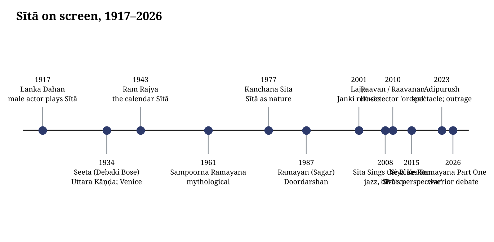

# Chapter 15. Sita on Screen and in the Street: Television, Cinema and Reception

::: {custom-style="Epigraph"}
"In this new text, determined by contemporary devotees, maryada purushottam Ram was being ordered to behave better."

— Madhu Kishwar on viewers' letters to the makers of the televised *Ramayan*, *Manushi* 98 (1997), p. 29
:::

## The argument of this chapter

More Indians have met Sita on a screen in the last century than in any book. The silent film, the mythological talkie, the Sunday-morning television serial, the art film, the multiplex thriller, the animated feature and the big-budget spectacle have each given her a face, a voice and a posture, and each has been received by audiences who argued with what they saw. This chapter surveys Sita on screen from Phalke's *Lanka Dahan* (1917) to the Ramayana film released in November 2026, and makes four claims.

1. The screen has been the principal medium through which the ideal Sita was fixed in modern India, and the televised *Ramayan* of 1987–88 was its decisive instance. Romila Thapar's warning that the serial turned many Rāmāyaṇas into one remains the starting point.

2. But the screen has also been a site of contest, and the audience has not been passive. Viewers' letters forced the makers of the televised *Ramayan* to soften the fire ordeal; Madhu Kishwar's phrase for this is that the god "was being ordered to behave better". Reception is itself a form of retelling.

3. Popular cinema has repeatedly staged Sita's refusal through modern women who stand in for her: Janki in *Lajja* (2001), who refuses the ordeal on a village stage and is attacked by the audience; Ragini in *Raavan* (2010), who leaves the husband who asks her to take a lie-detector test. These films are more radical than most literary retellings, and they show how far the refusal has travelled into popular consciousness.

4. The spectacles of the 2020s, *Adipurush* (2023) and the Ramayana film of 2026, have made Sita once again a national property, contested in courts, in the press and across borders, and have revived the warrior Sita of Chapter 12 as a matter of public debate.

## From *Lanka Dahan* to *Ram Rajya*

Chapter 3 examined the first screen Sitas: Anna Salunke, a man, playing both Rama and Sita in Phalke's *Lanka Dahan* (1917); Durga Khote in Debaki Bose's *Seeta* (1934), the first Indian talkie shown at an international festival; and Shobhana Samarth in Vijay Bhatt's *Ram Rajya* (1943), whose gentle, luminous Sita passed into the calendar art of the following decades.^[Dadasaheb Phalke, dir., *Lanka Dahan* (1917) [W032]; Debaki Bose, dir., *Seeta* (1934) [W037]; Vijay Bhatt, dir., *Ram Rajya* (1943) [W038].] I add here only the observation that the first two of these films chose the *Uttarakāṇḍa*, the banishment and the exile, as their subject. *Seeta* and *Ram Rajya* both told the story of Sita after the war. Early Indian cinema, like the women's songs and Vidyāsāgar, found in the banishment the episode that could make an audience weep, and it made Sita's suffering its subject. The nationalist cinema did not suppress the banishment; it made it beautiful. Samarth's Sita, banished and serene, taught a generation that a wronged woman's highest virtue was composure.

The mythological film genre that followed, through the 1950s and 1960s, multiplied these images; Babubhai Mistry's *Sampoorna Ramayan* (1961) is a representative example. Heidi Pauwels's study of Sita and Rādhā "in scripture and on screen" traces how Hindi cinema took up and transformed the devotional Sita, comparing the screen's heroines with Vālmīki, Tulsīdās and Sūrdās, and the corpus workbook calls her book "your main book on Sita on screen".^[Heidi R. M. Pauwels, *The Goddess as Role Model: Sītā and Rādhā in Scripture and on Screen* (New York: Oxford University Press, 2008) [W131].] Pauwels shows that the cinema's Sita, far from simply reproducing the ideal, moved between scriptural models and contemporary pressures, and that the films' heroines named Sita were often staging conflicts the scriptural Sita never faced.

## Aravindan's absent Sita

Chapter 6 discussed G. Aravindan's *Kanchana Sita* (1977, released 1978), the Malayalam art film in which Sita never appears in human form and is present as nature, and in which Rama and his brothers are played by members of a tribal community.^[G. Aravindan, dir., *Kanchana Sita* (1977–78) [W054].] In the history of Sita on screen, it is the great exception: a film that refuses to show her, in a medium whose whole power is showing. Every other film in this chapter gives Sita a body, an actress, a costume; Aravindan gives her the forest. The decision anticipates by thirty years the disappearing Sitas of Chapter 13, and it remains the most radical cinematic answer to the question of how Sita should be represented: by not representing her at all.

## The Sunday serial

### The event

On 25 January 1987, Doordarshan, India's state television network, broadcast the first episode of Ramanand Sagar's *Ramayan*. The serial ran weekly until July 1988, and its sequel, covering the *Uttarakāṇḍa*, followed. Its reception has no precedent in Indian media history: by every account, streets emptied on Sunday mornings; television sets were garlanded and worshipped; viewers bathed before watching; the actors who played Rama and Sita were treated, in public, as the deities themselves. The corpus workbook records that the serial "fixed a pan-Indian image of a calm, obedient Sita; Sunday mornings emptied the streets".^[Ramanand Sagar, creator, *Ramayan* (Doordarshan, 1987–88) [W060].]

The scholarship on the serial is substantial, and the corpus records its main landmarks. Philip Lutgendorf studied the making of the serial and its devotional viewing.^[Philip Lutgendorf, "Ramayan: The Video," *TDR: The Drama Review* 34, no. 2 (1990): 127–76 [W070].] Romila Thapar, in an essay titled "The Ramayana Syndrome", warned that the serial was turning the many Rāmāyaṇas into one official version, homogenising a plural tradition into a single state-broadcast text.^[Romila Thapar, "The Ramayana Syndrome," *Seminar* 353 (January 1989) [W069].] Purnima Mankekar's ethnography of women viewers in Delhi showed how they watched, interpreted and argued with the serial, and how it shaped their ideas of community and nation.^[Purnima Mankekar, *Screening Culture, Viewing Politics: An Ethnography of Television, Womanhood, and Nation in Postcolonial India* (Durham, NC: Duke University Press, 1999), chap. 4 [W095].] Arvind Rajagopal linked the serial to the rise of Hindu nationalist politics and the reshaping of the Indian public in the years that followed.^[Arvind Rajagopal, *Politics after Television: Hindu Nationalism and the Reshaping of the Public in India* (Cambridge: Cambridge University Press, 2001) [W101].]

### Thapar's syndrome and its limits

Thapar's warning is the starting point of any analysis, and the argument of this book has repeatedly confirmed it. The serial broadcast a Sita drawn principally from Tulsīdās and the devotional tradition, rendered in the visual idiom of the Ravi Varma oleograph and *Ram Rajya*, to a national audience, at the same hour, every week, for eighteen months. No telling in the history of the Rāmāyaṇa had ever reached so many people so simultaneously. The plurality that Ramanujan celebrated and Chapter 2 traced, the Sitas of Assam and Mithila, of the Bengali women's songs and Candrābatī, of the Jain nuns and the *Adbhuta*'s Kālī, was, for that audience, overwritten by one Sita: calm, obedient, devoted. Judith Butler's account of gender as repetition that "congeals" into the appearance of nature, which Chapter 3 applied to the oleograph, applies with greater force to the weekly broadcast.^[Judith Butler, *Gender Trouble: Feminism and the Subversion of Identity* (New York: Routledge, 1990), 33†.] The serial's Sita became, for a generation, simply Sita.

### The audience answers back

And yet the serial's history also contains the strongest evidence in this book that audiences do not receive passively. Madhu Kishwar records it:

> As the story began approaching the point when Sita was supposed to undergo her agnipariksha the serial makers were flooded in advance with so many letters of protest against the depiction of Sita going through the fire ordeal that Sagar was forced to deviate from his text and show the agnipariksha to be a mock one. The TV Ram was made to clarify that he did not doubt Sita's chastity.^[Madhu Kishwar, "Yes to Sita, No to Ram! The Continuing Popularity of Sita in India," *Manushi* 98 (January–February 1997): 29.]

"Clearly," she continues, "Ram's injustice to Sita has hung so heavily on the collective conscience of Indians that they are willing to demand that a sacred text be altered. In this new text, determined by contemporary devotees, maryada purushottam Ram was being ordered to behave better."^[Kishwar, "Yes to Sita," 29.]

The episode deserves to be weighed carefully, because it complicates Thapar's warning in an important way. The serial did homogenise; Thapar was right. But the homogenised text was not simply imposed. Its most contested episode, the fire ordeal, was rewritten in response to its audience, and rewritten in Sita's favour. The viewers who wrote to Sagar were, in the main, devout Hindus watching a devotional serial. They were not feminists, not rationalists, not anti-caste activists. And they demanded that Rama not doubt Sita.

This is the most direct evidence I know for this book's third proposition, that the critique of Rama is indigenous. It is also evidence that the devotional tradition itself contains the critique, and that the devout can exercise it. Kishwar's phrase is exact: the devotees "ordered" Rama "to behave better". The god was corrected by his worshippers. In the history of Sita's retellings, Sagar's mock ordeal belongs beside Tulsī's shadow Sita: both are devotional devices for sparing Sita the full humiliation of Vālmīki's scene. But Tulsī's device came from a poet; Sagar's came from the letters of his audience.

## The refusal in popular cinema

### *Lajja*

Rajkumar Santoshi's *Lajja* (2001) is a Hindi film built around four women whose names are all names of Sita: Vaidehi, Maithili, Janki and Ramdulari. Each, in a different part of India, suffers a different form of patriarchal violence. In the episode that bears most directly on this book, Janki, played by Madhuri Dixit, is a performer in a travelling theatre troupe playing Sita in a village Rāmlīlā. On stage, at the moment of the fire ordeal, she refuses: she will not undergo the test, and she says why. The village audience, enraged, attacks her.^[Rajkumar Santoshi, dir., *Lajja* (2001) [W100].]

The corpus workbook records the scene as one in which "popular cinema stages Sita's refusal and the violence it provokes".^[Corpus workbook, W100.] The structure is precise and deserves analysis. Janki's refusal takes place inside a performance of the Rāmāyaṇa, before an audience that has come to see the ordeal. Her refusal is therefore a refusal of the script: not only of Rama's demand but of the audience's expectation. And the audience's violence is the violence of a public that will not tolerate the change. In Vālmīki, the citizens of Ayodhya demand Sita's banishment as a matter of precedent: "now we too shall have to put up with this in our wives".^[CE 7.42.19.] In *Lajja*, the villagers attack the actress who refuses the ordeal for the same reason. If Sita refuses on stage, their wives may refuse at home.

The film thus restages the *Uttarakāṇḍa*'s logic of precedent in a twenty-first-century village, and shows that the logic is alive. It is a bold scene for a mainstream Hindi film, and it is notable that it appeared in 2001, a decade after the Ayodhya demolition, when the Rāmāyaṇa had become an instrument of national politics. Its Sita who refuses, and is beaten for refusing, is the Sita of Kishwar's interviewees and the Avadh song, transposed to the stage of a village fair and confronted with the public that would rather she burned.

### *Raavan* and *Raavanan*

Mani Ratnam's bilingual *Raavan* (Hindi) and *Raavanan* (Tamil), released in 2010, transposes the Rāmāyaṇa into a story of insurgency and policing in a forest region. Ragini, the wife of a police officer, is abducted by Beera, a forest leader hunted by the police, in revenge for a police atrocity against his sister. In the forest, Ragini comes to understand Beera and his cause. When her husband rescues her, he doubts her, and asks her to take a lie-detector test. She leaves him, and goes back to find Beera.^[Mani Ratnam, dir., *Raavan* / *Raavanan* (2010) [W137].]

The corpus workbook describes the film as offering "a modern fire test, a sympathetic 'Ravana' from the margins, and a wife who walks out".^[Corpus workbook, W137.] Each element connects to a chapter of this book. The lie-detector is the ordeal in its modern, technocratic form: proof of a woman's chastity demanded not by fire but by a machine, by the state's forensic apparatus. Beera, the forest leader, is the Ravana of the anti-caste and anti-conquest readings of Chapter 5, the leader of a people the state wants cleared from the forest, whose sister's violation sets the story in motion as Śūrpaṇakhā's mutilation set the epic in motion. And Ragini's departure is the refusal of Chapter 1, made explicit: she does not take the test, and she does not stay.

The film is, in one respect, a return to Chalam's 1924 play: its Sita leaves her husband for the man who abducted her. Chapter 5 raised the question whether such a Sita is freed or merely transferred. *Raavan* leaves the question open; Ragini's return to Beera is ambiguous, and the film's ending is tragic. But its significance for the history this book traces is its audience. A refusal that was, in 1924, a scandal in a Telugu play read by a small circle had become, by 2010, the climax of a bilingual star vehicle released across India. The refusal had travelled into the mainstream.

## *Siya Ke Ram*: "Sita's perspective"

Between November 2015 and November 2016, the Hindi entertainment channel Star Plus broadcast *Siya Ke Ram*, a serial of more than three hundred episodes that told the Rāmāyaṇa, as its title announced, from the perspective of Sita.^[Nikhil Sinha, creator, *Siya Ke Ram* (Star Plus, 2015–16) [W151].] Drawing on Vālmīki and the *Adbhuta Rāmāyaṇa*, with Devdutt Pattanaik as consultant, it gave Sita, played by Madirakshi Mundle, a narrative centrality that Sagar's serial had not, and it featured Rama's sister Śāntā. The corpus workbook calls it the moment when "mainstream TV adopts a 'Sita's perspective'", to be compared with Sagar's serial.^[Corpus workbook, W151.]

The comparison is instructive. Thirty years after Sagar, commercial television adopted the vocabulary of the Sitayan moment of Chapter 11: Sita's perspective, Sita's story, the Rāmāyaṇa "through her eyes". The change registers the success of the feminist retelling in reshaping what a mainstream audience expected. But it also registers the limit identified in Chapter 11: a perspective is not a plot. *Siya Ke Ram* told the same story from Sita's side; it did not tell a different story.

## The spectacles: *Adipurush* and *Ramayana*

### *Adipurush*

Om Raut's *Adipurush*, released in Hindi and Telugu in June 2023, was a big-budget spectacle with Kriti Sanon as Sita. Its colloquial dialogues provoked outrage across India, petitions to the courts and demands for a ban.^[Om Raut, dir., *Adipurush* (2023) [W185].] The corpus records a further consequence: a line calling Sita a "daughter of India" led the city authorities of Kathmandu to halt the screening of Hindi films, because Nepal claims Sita's birthplace, Janakpur, as its own.^[Corpus workbook, W185.]

The Kathmandu episode is a small but telling coda to the history of Sita as a national property. Chapter 2 described Mithila, which spans the border of India and Nepal, as the region that claims Sita as the daughter of every household. In 2023, the claim became a dispute between nation-states over a line of film dialogue. Sita's birth from the furrow, which the women's songs of Mithila had made a sign that she belonged to every family in the region, had become a question of national sovereignty. A daughter of the earth was being claimed by two countries.

### *Ramayana: Part One*

On 5 November 2026, as this book was being completed, Nitesh Tiwari's *Ramayana: Part One* was released worldwide, with Sai Pallavi as Sita, on a budget reported at about four thousand crore rupees; the corpus records an opening-day worldwide gross reported at about one hundred and fifty-five crore.^[Nitesh Tiwari, dir., *Ramayana: Part One* (2026) [W206]. Budget and box-office figures are as reported in the press and recorded in the corpus workbook; the release date of Part Two is reported variously as Diwali 2027 or 2028.] Before its release, the film was the subject of a public debate over whether Sita would be shown as a warrior, and its makers defended a martial Sita by citing the *Adbhuta Rāmāyaṇa*.^[Corpus workbook, W206.]

The debate brings together the threads of Chapters 2 and 12. The *Adbhuta*'s Kālī-Sita, a medieval Śākta text's answer to the question of what Sita could do that Rama could not, has become the classical warrant for a twenty-first-century blockbuster's action heroine. Ruth Vanita's caution, that the *Adbhuta*'s Sita remains a wife fighting on her husband's behalf, applies to the film as it applies to Amish.^[Ruth Vanita, "The Sita Who Smiles: Wife as Goddess in the *Adbhut Ramayana*," *Manushi* 148 (2005) [W115].] So does the argument of Chapter 12: a warrior Sita is empowered for a purpose, and the purpose, in a national spectacle released two years after the consecration of the Ayodhya temple, is not hard to read. The film's reception, which the corpus workbook flags as "live reception data for Field VII", will be the subject of scholarship for years. At the time of writing, it is too early to say what Sita it will have fixed for its generation, as Sagar's fixed one for his.

::: {custom-style="Box Title"}
Reading Against the Text
:::

::: {custom-style="Box"}
In 1987, devout viewers wrote to Ramanand Sagar demanding that Rama not doubt Sita, and the ordeal was softened. In 2001, the village audience in *Lajja* attacked the actress who refused the ordeal. Which audience is the real one? And what does it mean that the same public can demand that a god behave better and beat a woman for asking him to?
:::

::: {custom-style="Box Title"}
The Debate: Agency (second round)
:::

::: {custom-style="Box"}
**Position A:** The screen's Sita is a product imposed on a passive audience: the televised *Ramayan* homogenised the tradition and fixed an ideal.\
**Position B:** The audience is an agent: viewers interpret, resist and rewrite what they are shown.\
**Where the evidence of this chapter leaves the argument.** Both, in sequence. Thapar was right that the serial homogenised; Kishwar's evidence shows that the homogenised text was itself rewritten by its viewers on the ordeal. Mankekar's women viewers argued with what they watched. And *Lajja* shows the darker face of audience agency: the public that enforces the script against the woman who refuses it. Reception is a form of retelling, and like every other form this book has examined, it can liberate Sita or punish her.
:::

## Conclusion

On screen, Sita has been played by a man, made beautiful in her banishment, broadcast every Sunday to a nation, softened by her viewers' letters, absented into nature, transposed into a village actress who refuses the ordeal and a policeman's wife who refuses the lie-detector, told from her own perspective in three hundred episodes, claimed by two countries over a line of dialogue, and armed for a blockbuster. The screen has been the most powerful instrument for fixing the ideal Sita, and it has also been the medium through which her refusal reached the largest audience. Its history confirms, at the largest scale, the central claim of this book: that every Sita answers the needs of her moment, and that the needs include, again and again, the need to say no to Rama.
