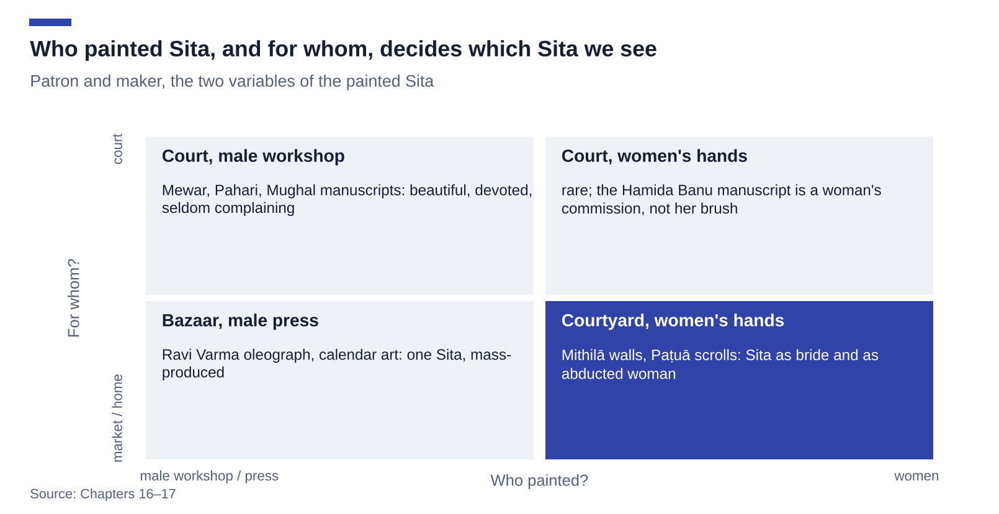
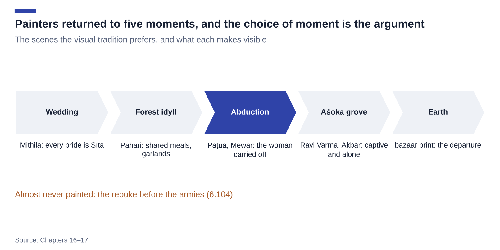
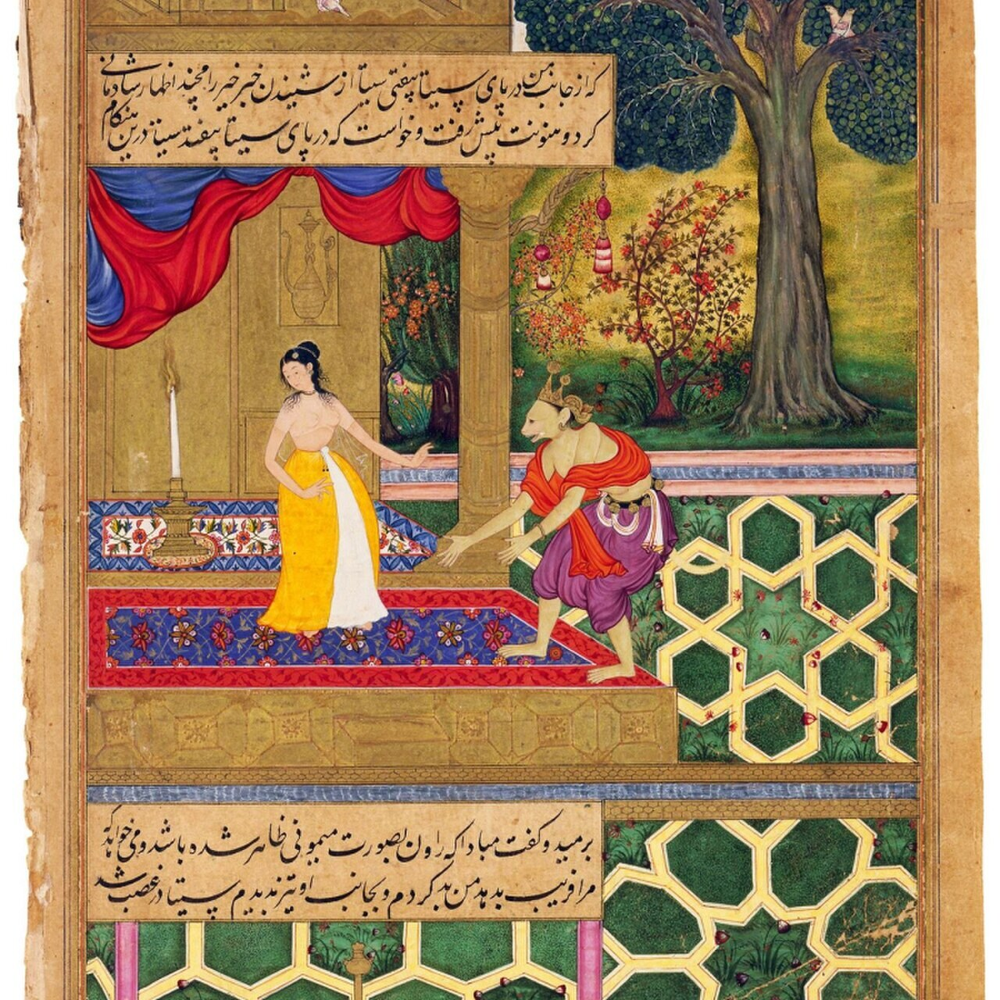
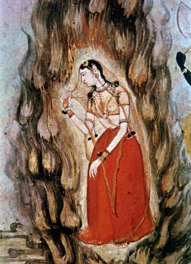
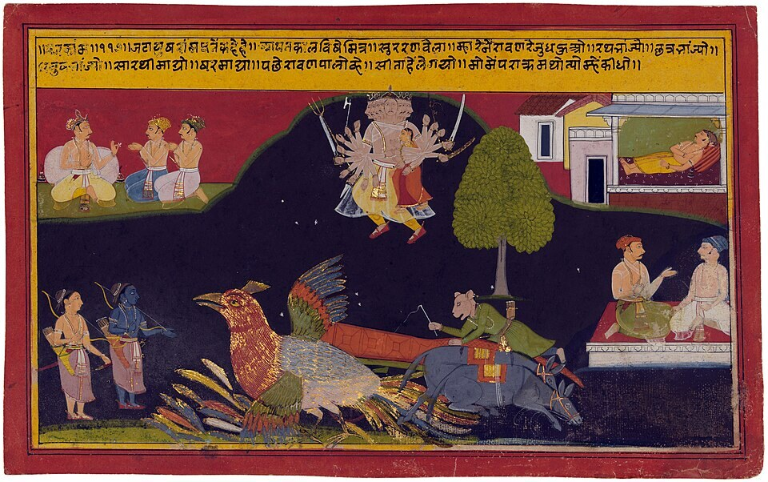
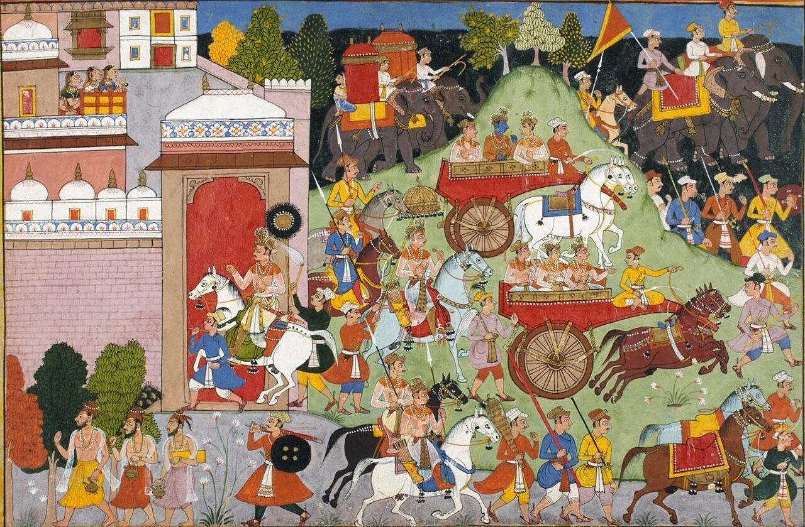
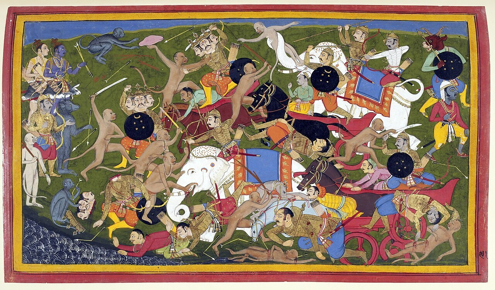
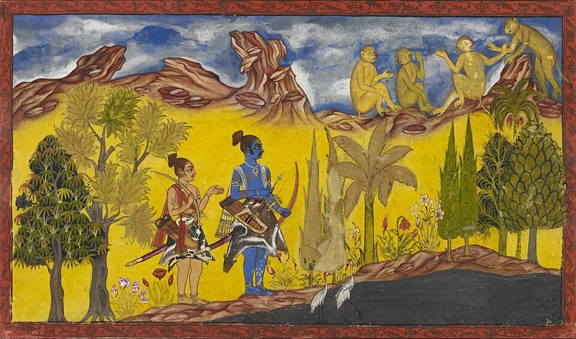

# Part V. Image, Law and the World Beyond {.unnumbered}

# Chapter 16. The Painted Sita I: Manuscript, Miniature and the Choice of Moment

::: {custom-style="Epigraph"}
*taruṇādityasaṃkāśāṃ taptakāñcanabhūṣaṇām*\
*raktāmbaradharāṃ bālāṃ nīlakuñcitamūrdhajām*

"Radiant as the rising sun, adorned with burnished gold, dressed in red, young, her dark hair curling."

— Agni returning Sītā from the fire, Vālmīki *Rāmāyaṇa* 6.106.2 (CE)
:::

## The argument of this chapter

When Vālmīki brings Sita out of the fire, he paints her. The god rises with her in his lap, and the poet stops to describe what the assembled armies saw: a young woman radiant as the morning sun, adorned with gold, dressed in red, her dark hair curling, her garland unwithered.^[CE 6.106.2–3.] It is one of the few moments in the poem where Sita is described as a picture rather than heard as a voice, and it comes at the precise moment when her voice has just finished its work. She has rebuked the king; the fire has vindicated her; and the poem, as if relieved, turns her into an image.

The painters of India did, for the most part, what Vālmīki did at that moment. They turned Sita into an image. The question this chapter and the next ask is what kind of image, and for whom. Over four centuries of manuscript painting, mural, miniature, scroll, oleograph, calendar print, comic book, poster and film still, Sita has been painted more often than any other woman in Indian art. And the painters, like the poets, made choices: which moments to paint, which to omit, how to show her, in whose company, before whose eyes.

This chapter examines the court traditions of the sixteenth to the early nineteenth centuries (the Mughal Persian Rāmāyaṇas, the great Mewar manuscript, the Pahari series) and the women's traditions of the courtyard and the scroll. It makes five claims.

1. Painters returned again and again to five moments: the wedding, the forest idyll, the abduction, the Aśoka grove and the earth. The choice of moment is the argument of the image.

2. The one moment painters almost never chose is the moment this book has placed at the centre of Sita's story: the rebuke before the armies. The painted tradition is, in this sense, structurally biased towards the silent Sita, and part of the bias belongs to the medium. Paint shows; it does not argue.

3. The court manuscripts painted Sita for kings. Their Sita is beautiful, devoted and seldom shown complaining, and their patrons sometimes painted themselves into the frame.

4. Within the court tradition there are nonetheless images that resist the ideal: the Mughal Sita standing composed in the fire, the Pahari forest scene in which Lakshmana cooks while Sita makes garlands, the minute boat on the vast river that foreshadows her abandonment.

5. The women's painting traditions of Mithila and the Bengal scroll, made by women for women's occasions, show a different Sita: the bride and the abducted woman. They are the visual equivalent of the songs.

## The problem of the painted voice

Let me begin with a difficulty that is easily overlooked and that governs everything that follows. A painting cannot speak. It can show a figure with an open mouth, a raised hand, an averted face; it can place a figure in a posture that a viewer trained in the conventions of the tradition will read as anger, grief, refusal or love. But it cannot render an argument. The speech in which Vālmīki's Sita tells Rama that he speaks "like a common man to a common woman" has no visual equivalent.^[CE 6.104.5.] The best a painter can do is show the scene in which she says it.

The Indian theory of painting knew this. The *Citrasūtra*, the section on painting in the *Viṣṇudharmottara Purāṇa*, a text of the second half of the first millennium, discusses how the painter is to show the emotions and the *rasas*, the aesthetic moods, through posture, gesture, gaze and colour.^[*Viṣṇudharmottara Purāṇa*, book 3, the *Citrasūtra* (pinpoint and date to be verified).] It is a theory of how feeling becomes visible. It is not, and could not be, a theory of how argument becomes visible. A painted Sita can grieve, can be afraid, can be composed, can be beautiful. She cannot reason.

The consequence for the history of Sita's image is decisive. If one asks which Sita the painted tradition was equipped to show, the answer is: the Sita of feeling, not the Sita of argument. The suffering Sita, the devoted Sita, the beautiful Sita, the frightened Sita, the serene Sita: all can be painted. The Sita who wins an argument with her husband by taunting him, or who turns a trial into a counter-indictment, cannot. When the nineteenth century set out to fix the image of the ideal wife, it found in the painted tradition a ready-made iconography of the Sita of feeling, and almost nothing of the Sita of argument. The silence of the calendar Sita is, in part, the silence of paint.

This is not to excuse the painters, nor to suggest that the visual tradition was innocent of the ideal it helped to fix. Painters chose their moments, and the moments they chose were not neutral. But it is to say that a study of the painted Sita must attend not only to what the painters chose to show but to what their medium allowed them to show. The rebuke before the armies is almost never painted, and the reason is partly that it cannot be.

## The Mughal Rāmāyaṇas: the epic in Persian, the fire in paint

### An emperor's translation

The first great illustrated Rāmāyaṇas that survive were made not for a Hindu king but for a Muslim emperor. In the 1580s, the Mughal emperor Akbar commissioned Persian translations of the Sanskrit epics as part of a programme of translation that also produced the *Razmnāma*, the Persian *Mahābhārata*. The imperial Rāmāyaṇa, completed around 1588–89, was illustrated by the artists of the imperial atelier; copies were made for members of the court. One of these, made around 1594, belonged to Akbar's mother, Hamida Banu Begum; it survives, with fifty-six paintings, in the Museum of Islamic Art in Doha, and has been studied by John Seyller, Marika Sardar and Audrey Truschke.^[John Seyller, Marika Sardar and Audrey Truschke, *The Ramayana of Hamida Banu Begum, Queen Mother of Mughal India* (Doha: Museum of Islamic Art; Milan: Silvana Editoriale, 2020) [W017] (pinpoints to be verified).] Another, made for the nobleman ʿAbd al-Raḥīm Khān-i Khānān at the turn of the seventeenth century, is in the Freer Gallery in Washington.

Chapter 2 noted the significance of the Hamida Banu manuscript for the history of women's relation to the Rāmāyaṇa: a woman, and the most senior woman of the empire, owned and presumably read a richly illustrated copy of the epic. I add here only that the painted Rāmāyaṇa begins, in the surviving record, as a Persian book in a Muslim court. The tradition of painting Sita that the nineteenth century would claim as the heritage of Hindu womanhood was inaugurated, so far as the surviving manuscripts show, by painters working for an emperor who wanted to read the epic in his own language.

### The captive and the messenger

A folio from a Mughal Persian Rāmāyaṇa shows the scene in the Aśoka grove in which Hanumān finds Sita. The composition is characteristic of the imperial atelier. The Persian text runs in panels above and below; the painted field between is organised as architecture, with a canopy, a patterned floor in interlocking hexagons, a balustrade, a flowering tree beyond. Sita stands under the canopy, dressed in yellow, upright and alone; Hanumān, in red, comes towards her from the right, his body inclined in approach.

Two features deserve notice. The first is that Sita stands. In much later painting, and above all in Ravi Varma's version of the same scene (Chapter 17), the captive Sita sits on the ground, bowed, surrounded by her guards: the posture of grief. The Mughal painter gives her the posture of a person receiving a visitor. The second is that the setting is a palace pavilion, not a forest. The Aśoka grove, in the Mughal imagination, is a garden of the kind the Mughals themselves built, with geometric floors and canopied platforms. Sita is a queen in a garden, not a prisoner in a wood. The image is of dignity under constraint.

### The woman in the fire

A small Mughal image of about 1600 shows Sita in the fire. She stands upright within an oval of flame, dressed in red, her head inclined, one hand raised to her face; the flames rise around her on every side, dark and tongued, and do not touch her. The image is almost a portrait: there is no Rama, no Lakshmana, no army, no Agni. There is only the woman and the fire.

The choice to isolate Sita in the flames, without the witnesses, is the most significant interpretive decision in the image. In Vālmīki, the ordeal is a public act before "the witness of the world", performed in front of the armies; its publicity is its point.^[CE 6.104.24–27.] The Mughal painter removes the public. What remains is Sita's own composure, which is to say, her interiority: the ordeal as something she undergoes, not something that is done to her before others. The red of her garment, which Vālmīki gives her as she comes out of the fire, is here the red she wears in it. And her raised hand, at her face, is ambiguous in the way the best images are: it may be modesty, or grief, or the gesture of someone shielding herself, or of someone who is thinking.

If one were looking, in the visual tradition, for an image of the Sita who appeals to the fire as her witness, rather than the Sita who is tested by it, this would be a candidate. The fire surrounds her as an element she has chosen. She is not burned, and she is not watched.

## The Mewar Rāmāyaṇa: the epic as a royal library

### The commission

The most ambitious illustrated Rāmāyaṇa ever made was commissioned in the middle of the seventeenth century by Mahārāṇā Jagat Singh I of Mewar, at Udaipur. Its volumes were painted between 1649 and 1653 by the court workshops, among whose artists the names of Sahibdin and Manohar are recorded; the greater part of the surviving folios is now in the British Library, which has digitised them, and J. P. Losty's study of the manuscript remains the standard account.^[J. P. Losty, *The Ramayana: Love and Valour in India's Great Epic. The Mewar Ramayana Manuscripts* (London: British Library, 2008) (pinpoints to be verified).] The manuscript illustrates the whole of Vālmīki's poem in several hundred large paintings, each faced or headed by the relevant Sanskrit text. It is, in effect, a royal library of the epic: a king's assertion that his dynasty, which claimed descent from the solar line of Rama himself, possessed the story of its ancestor in its most complete visual form.

Sheldon Pollock's argument about the Rāmāyaṇa and political imagination, that from the twelfth century onward the epic became a text through which kings imagined their own rule and their enemies, is directly relevant here.^[Sheldon Pollock, "Rāmāyaṇa and Political Imagination in India," *Journal of Asian Studies* 52, no. 2 (1993): 261–97 [W082].] The Mewar Rāmāyaṇa was painted for a Rajput king who claimed Rama as his ancestor, at a time when Mewar's relation to the Mughal empire was one of negotiated subordination. The epic of a righteous king who defeats a powerful adversary had obvious resonance. Sita, in this political imagination, is the queen whose abduction is the occasion of the righteous war.

### Continuous narration

The Mewar painters, like the painters of many Indian narrative traditions, used continuous narration: a single painted field shows several successive moments of the story, with the same figures appearing more than once. A Mewar folio of the abduction, painted later in the century than Jagat Singh's manuscript, shows, on a deep blue-black ground, the multi-armed Ravana in his flying chariot carrying Sita through the air; below, the great vulture Jaṭāyu attacking; at the lower left, the brothers; at the right, the hermitage and its sages. The eye moves through the field as through a sequence.

Continuous narration has a consequence for the image of Sita that is worth stating. A figure who appears several times in one painting is a figure in time: her identity persists across changing circumstances, and the viewer follows her through them. The Mewar Sita is not a single icon fixed in a pose, as the calendar Sita would be; she is a character moving through a story. In a folio from another Rāmāyaṇa series of the late seventeenth century, now in the Metropolitan Museum of Art, the brothers appear again and again across a pale blue landscape of stylised trees and a lake, searching in vain for her; the repetition of their figures is the visual form of the search itself, and Sita's absence from the field is its subject.

This painting of an absence is, in its way, a remarkable anticipation of the disappearing Sitas of Chapter 13. A painting whose subject is a woman who is not there, and the men who cannot find her, is a painting about loss as it is experienced by those who lost her. It is, of course, the men's loss that it shows. But the empty field, the lake and the trees without her, is also the visual form of what the epic's women's tradition knew: that Sita's story is a story of being absent from the places where she ought to be.

### The wedding and the war

The Mewar Rāmāyaṇa's most crowded folios are its processions and its battles. The wedding procession of Rama, painted by Manohar in 1649, fills the field with chariots, horses, elephants, banners and musicians moving out from a city gate across a green hill: a royal procession of the kind the court of Udaipur would have known, in which the bride is, as so often in royal processions, almost invisible.^[On the wedding procession folio and the painter Manohar, see Losty, *The Ramayana* (pinpoint to be verified).] The battle at Laṅkā, painted in Sahibdin's workshop, is a field of monkeys, bears, demons, elephants and chariots so dense that individual figures dissolve into the movement of the whole.

The battle folios deserve one remark in the light of Chapter 1. The war that Rama, before the fire, declared was "not undertaken for your sake" occupies, in the Mewar manuscript, the largest and most elaborate paintings of the whole cycle.^[CE 6.103.15.] The visual weight of the manuscript falls where the heroic epic's weight falls: on the war. Sita, in these folios, is absent. The court painting of the Rāmāyaṇa was, in its proportions, the painting of a king's war. The women's songs, which compressed the war to nothing, have their visual counterpart elsewhere, as we shall see.

### The landscape of the search

A Mewar folio of 1653 shows Rama and Lakshmana arriving at Lake Pampā, on a bright yellow ground, with the monkeys watching from the rocks above. Pampā is the lake on whose banks, in Vālmīki and in Volga's novel of 2025, Śabarī waited for Rama.^[Volga, *On the Banks of the Pampa* (c. 2025) [W234]; see Chapter 8.] The painting shows the place from the brothers' side: the landscape through which the princes pass on their search, peopled by the forest's inhabitants as spectators. It is a reminder that the forest, in the court tradition, is a landscape seen by those who travel through it, not by those who live in it. Volga's Śabarī, whose forest knowledge is set against the learning of the sages, belongs to a different way of seeing the same lake.
