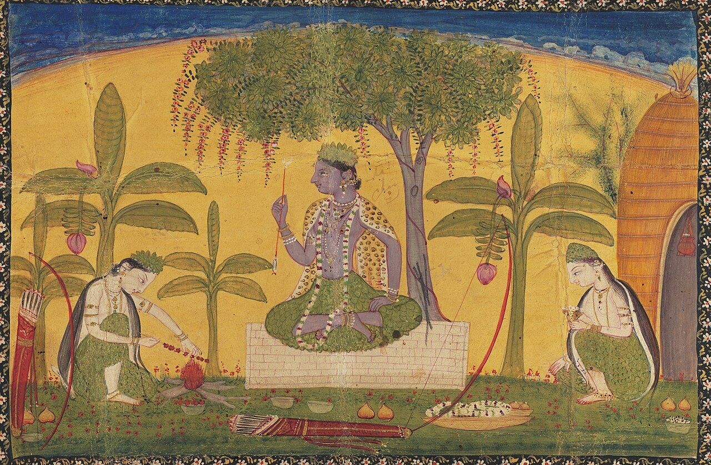
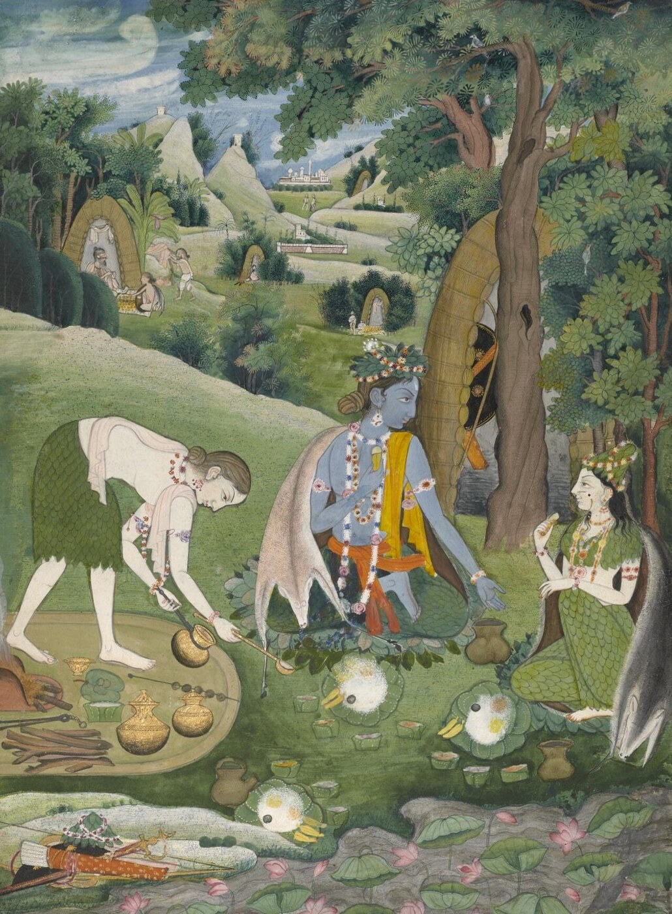
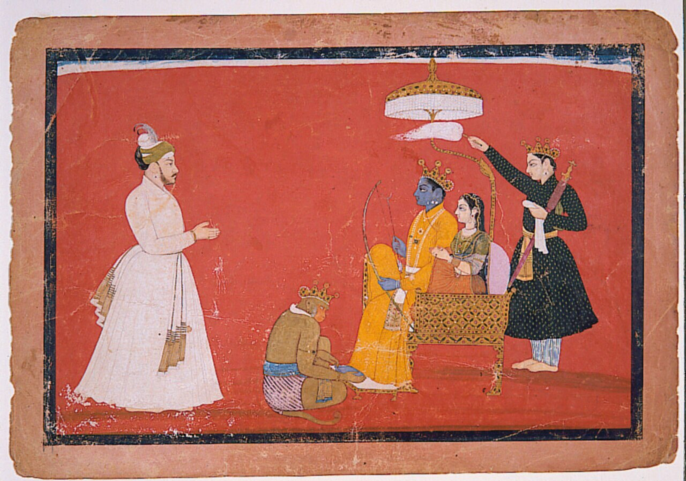
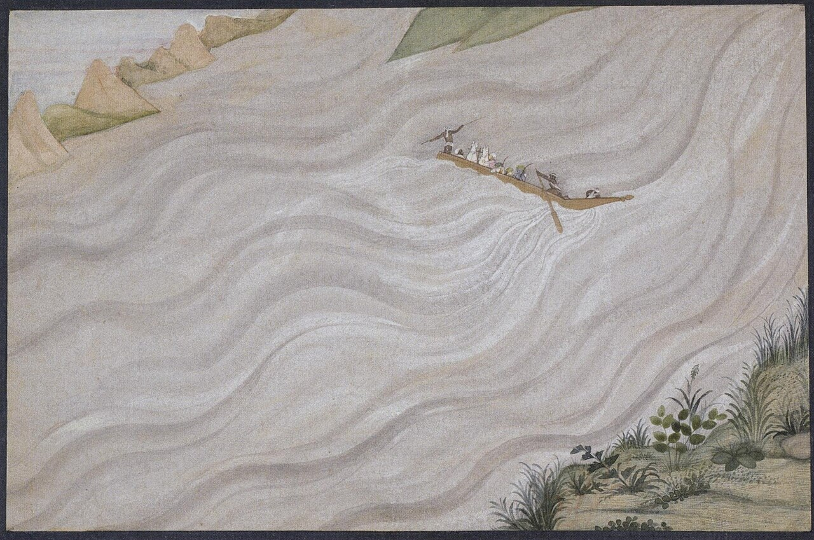
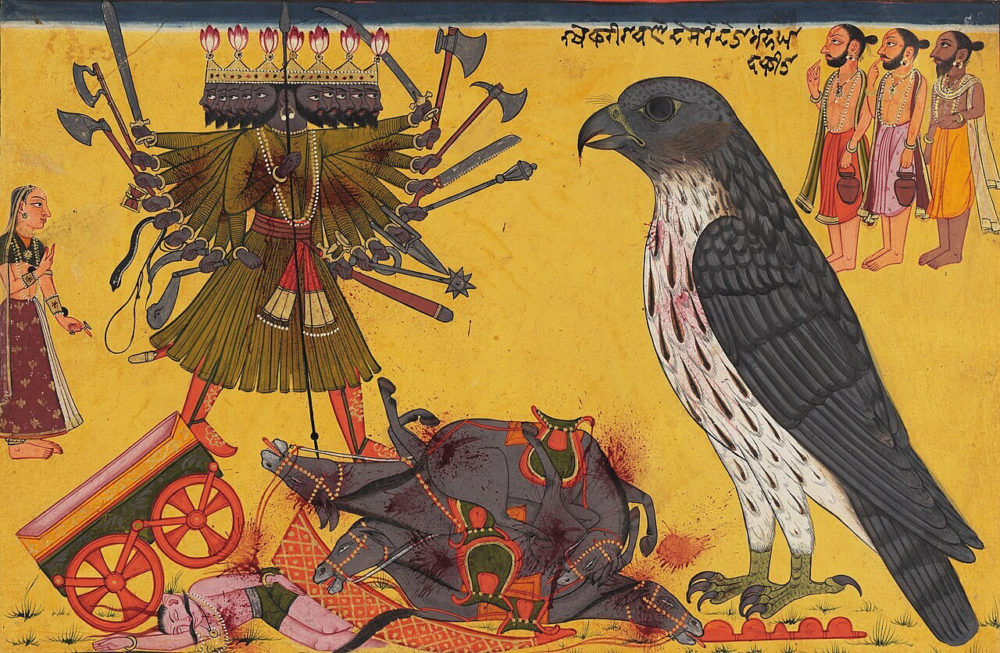
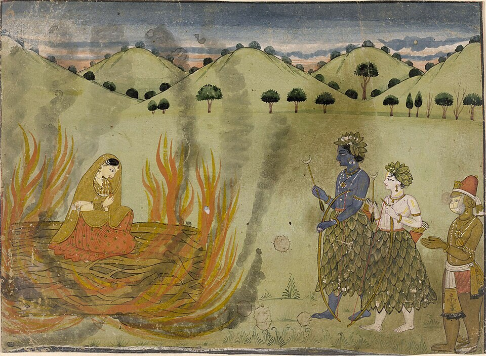

## The Pahari Sita: intimacy in exile

### The forest as household

The painters of the Pahari kingdoms of the western Himalaya (Guler, Kangra, Basohli, Kulu, Mandi and their neighbours) produced, between the late seventeenth and the early nineteenth centuries, some of the most intimate images of Sita in the whole tradition. Where the Mewar painters gave the epic the scale of a royal chronicle, the Pahari painters, especially the family workshop of Pandit Seu and his sons Manaku and Nainsukh and their descendants, gave it the scale of a household.

A Pahari painting of the late eighteenth century shows the three exiles at Pañcavaṭī. On a bright yellow ground, under a spreading tree flanked by banana plants, Rama sits on a raised platform at the centre. At the left, Lakshmana kneels at a small fire, preparing food. At the right, Sita sits on the ground, making a garland of flowers. A thatched hut stands at the edge of the clearing.

The division of labour is worth noticing, because it reverses what a modern viewer might expect. It is Lakshmana, the prince, who cooks. Sita makes a garland. The forest household, in this image, is not a reproduction of the palace's gendered order but something looser: three people in a clearing, each occupied, none subordinate in posture. Rama sits higher, at the centre, as befits the elder brother and the incarnate god; but Sita is not serving him. She is making something beautiful.

A second Pahari painting, of the turn of the nineteenth century, shows the three at a meal in a dense green forest: Lakshmana bending to serve, Rama seated with his food before him, Sita seated a little apart, at the right, on leaves. The scene is ordinary in the best sense: a meal in a forest, food on leaf plates, water in vessels. The painters of the Pahari courts, working for patrons steeped in Vaiṣṇava devotion, found in the forest exile not a punishment but an idyll: the time when the divine couple lived simply, close to the earth, attended by a devoted brother.

Hypothesis A of this research, that the domestic is a counter-epic, finds an unexpected confirmation here. The women's songs, as Chapter 2 showed, compressed the war and dwelt on the household; so, in their own way, did these court painters. Their forest is a home. And it is a home in which, for a while, the roles of the palace are suspended. The exile that Sita insisted on sharing, against Rama's will, in Vālmīki's second book, is pictured by the Pahari painters as the happiest time of her life.^[CE 2.27.17: "with you it is heaven; without you, hell".] The pictures take her at her word.

### The enthroned couple and the patron

A painting attributed to Seu, of around 1730, shows Rama and Sita enthroned on a red ground. A parasol is held above them; an attendant waves a whisk; Hanumān kneels at their feet. At the far left, a tall figure in a long white robe of Mughal court fashion stands facing the couple, hands folded: not a figure of the epic, but, it would seem, a courtier or a patron, painted into the scene of the divine court.

The image is a compact statement of the politics of patronage that Pollock's argument describes. The enthroned couple is *Rāmrājya*: the righteous kingdom, with Sita at Rama's side. The figure in white inserts the patron's own world into that kingdom, as a devotee standing before it. The painting is at once an object of devotion, a vision of ideal kingship and a portrait of a contemporary relation of loyalty. And in it, Sita is a queen on a throne beside her husband, receiving homage. This is the Sita of the *Mānas*'s *Uttarakāṇḍa*, in which there is no banishment: the ideal couple ruling together for ever.^[See Chapter 2 on Tulsīdās's omission of the banishment.] The painting shows the ending that Tulsī chose, not the ending Vālmīki wrote.

### The river

One Pahari folio, from a series of the 1770s attributed to the generation of painters after Nainsukh, is almost entirely water. A vast river, rendered in rhythmic waves of grey and white, fills the page; at its upper edge, a strip of bank and hills; at its lower right corner, a fringe of grass. In the middle of the water, very small, a boat carries the exiles across the Gaṅgā at the beginning of their journey into the forest.

The image is extraordinary in its proportions. The figures are tiny; the river is everything. It is a painting about crossing: about the line between the kingdom and the forest, the settled world and the wild, the life before exile and the life after. And for a reader of the whole Rāmāyaṇa, it carries a terrible foreshadowing. Sita will cross the Gaṅgā again, in the seventh book, with Lakshmana alone, and on the far bank she will be told that she has been abandoned.^[CE 7.47.1–18.] The first crossing, which the painter shows, is a crossing into the exile she chose. The second, which no one in this series painted, is a crossing into the exile chosen for her. The vast indifferent river is the same.

### The abduction, again

An early-eighteenth-century Pahari painting shows the fight between Ravana and Jaṭāyu with a violence that the later lyrical style would soften. On a yellow ground, the many-headed, many-armed Ravana stands bristling with weapons; the great vulture, rendered with startling naturalism, faces him at the right; between them lie the wreck of the chariot and its slain animals. Sita stands at the far left, small, almost marginal. The sages watch from a corner.

The composition makes visible a truth about the abduction that the epic's narrative can obscure. The abduction of Sita is, in the moment of its happening, a contest between males: the demon who takes her and the bird who tries to stop him, as it will later be a contest between Ravana and Rama. Sita is the object over which the contest is fought, and the painter, with complete honesty, makes her small and places her at the edge. This is precisely the structure that Chapter 5 found in the anti-epic's reversal of heroes, and that Ravi Varma's dramatic versions of the same scene, examined in Chapter 17, would turn into spectacle.

## The ordeal in paint

A painting of around 1820 shows the ordeal itself. Sita sits within a ring of flames, veiled, her hands folded, composed; the fire rises around her in tall orange tongues; to the right, Rama, blue, and Lakshmana stand watching, and a further figure, perhaps an attendant or one of the monkey host, stands at the edge; behind, green hills dotted with trees. The image is calm. The fire is decorative. Sita is untouched.

Set this beside the Mughal image of about 1600, and the difference is instructive. The Mughal painter isolated Sita in the fire and removed the witnesses; the later painter restores them. Rama stands beside the pyre, watching his wife sit in the flames. The painting is faithful to the narrative fact that the ordeal took place before Rama's eyes. But its calm, its composure, its decorative fire, turn the scene into an icon of serene purity rather than a picture of a public humiliation. Rama's presence is the presence of a devotee at a miracle, not of a judge at a trial.

This is the visual equivalent of the devotional transformation that Chapter 2 traced in the texts. The shadow device of the *Adhyātma* and the *Mānas* made the ordeal a ritual exchange; the painted ordeal of the early nineteenth century makes it a tableau of serenity. In neither is there a scandal. The judge does not confess, because there is nothing to confess; the fire does not command the king, because the king has nothing to be commanded about. The painters gave the ordeal the composure that the devotional poets had given it.

And this is why the Mughal image matters so much. In the whole surviving record of court painting that this book has been able to examine, it is the image that comes closest to showing the ordeal from inside Sita's experience: alone, upright, her hand at her face, the fire around her and no one watching.

## The courtyard and the scroll

The court traditions were not the only painted Rāmāyaṇas, and for the argument of this book they are not the most important. Two women's traditions, examined briefly in Chapter 2, painted a different Sita, for different occasions, by different hands.

### Mithila: every bride is Sita

In Mithila, the region of north Bihar and southern Nepal that claims Sita as its daughter, women have for generations painted the walls and floors of their houses for weddings and household rituals: the *kohbar*, the nuptial chamber, decorated with symbols of fertility and union; the *aripan*, the floor designs; and, among the figures, Rama and Sita at their wedding. Transferred to paper from the 1960s onward, when a drought led to programmes encouraging women painters to sell their work, Mithila painting became one of India's best-known folk traditions. The painter Sita Devi of Jitwarpur (c. 1912–2005), honoured with the Padma Shri in 1981, painted the Rāmāyaṇa in this idiom.^[Corpus workbook, W051.] And in April 2024, an exhibition of one hundred Madhubani paintings by thirty-seven women artists at the Lalit Kala Akademi in Delhi presented a whole Mithila Rāmāyaṇa, framed by the saying that "every bride is Sita and every groom is Ram".^[Corpus workbook, W195.]

The Mithila Sita is first of all a bride. Her wedding, the episode the women's songs of the region dwell on, is the episode the painters return to; she is painted as the women of the house were painted, at the moment of their own marriages. And the identification runs both ways. Every bride is Sita; but Sita is also every bride, which means that her fate is every bride's possible fate. Madhu Kishwar's report that the people of Mithila avoid marrying their daughters westward, towards Avadh, and in the month of Sita's wedding, is the shadow side of the same identification.^[Madhu Kishwar, "Yes to Sita, No to Ram! The Continuing Popularity of Sita in India," *Manushi* 98 (January–February 1997): 28.] The painted bride on the *kohbar* wall is a blessing and a warning at once.

The corpus records a review of a Mithila exhibition in which Sita was painted with her lips erased: a figure whose silence the reviewer read as a form of agency, while finding the exhibition as a whole "more devotional than feminist".^[Corpus workbook, W198.] The erased lips are the visual form of the problem with which this chapter began. A painter who wants to show Sita's refusal to speak can do so only by removing her mouth.

### The Paṭuā scroll: the abducted woman

In Bengal, the Paṭuā painters, many of them Muslim by name and many of them women, paint long vertical scrolls and sing the story as they unroll them, frame by frame, before village audiences. Mandakranta Bose's study shows that their Rāmāyaṇa scrolls dwell on the abduction of Sita and invite sympathy for her.^[Mandakranta Bose, *Ramayana in Bengali Folk Paintings* (New Delhi: Niyogi Books) [W157] (year to be confirmed).] A scroll titled *Sītā Haraṇ*, "the abduction of Sita", is among the works the corpus records from the women painters of Naya.^[Corpus workbook, W112.] Moyna Chitrakar's paintings for *Sita's Ramayana*, discussed in Chapter 13, belong to this tradition.

The scroll's form has a decisive consequence. It is performed. The painter sings as she unrolls, and the song is the narrative; the images are its stations. The scroll is therefore a form in which the painted Sita does, after all, speak: not in the image, which remains silent, but in the voice of the woman who sings beside it. The medium that could not render argument in the court painting renders it, in the Paṭuā performance, through the singer. The scroll is the visual equivalent of the women's songs because it is, literally, accompanied by one.

It is worth adding that the Paṭuā tradition's choice of the abduction as its central episode is itself significant. The court painters gave the abduction a dramatic composition, a contest of demon and bird; the women painters dwell on it as the story of a woman carried off against her will. The same scene, painted for a king and painted for a village, means different things, and Hypothesis D, that vernacular women's narratives constitute intellectual history, extends here to the visual: the women painters of Naya are reasoning, in paint and song, about what it means to be abducted and then blamed for it.

::: {custom-style="Box Title"}
Reading Against the Text
:::

::: {custom-style="Box"}
In the court paintings examined here, Sita is beautiful, devoted, composed, and almost never shown speaking. In Vālmīki, she speaks at every decisive moment. If a painting cannot argue, was the visual tradition ever able to show the Sita this book has been describing? Or does the history of the painted Sita explain, better than any history of texts, how the silent Sita became the one everyone could see?
:::

::: {custom-style="Box Title"}
The Debate: Silence (third round)
:::

::: {custom-style="Box"}
**Position A:** The painted Sita is silent because the painters, serving patriarchal patrons, chose to show her silent.\
**Position B:** The painted Sita is silent because paint cannot speak; the medium, not the ideology, imposed the silence.\
**Where the evidence of this chapter leaves the argument.** Both, and the difference matters. The medium explains why the rebuke before the armies is almost never painted (Position B). The patrons explain which silent moments were chosen: the court painters chose the war, the procession and the enthroned couple; the women painters chose the wedding and the abduction (Position A). And the scroll shows that the medium's silence can be overcome, when a woman sings beside the image. The silent Sita of the calendar is the product of a medium that could not argue, chosen by patrons who did not want an argument, and separated, in print, from the singers who once gave the images a voice.
:::

### The scenes the painters did not choose

A history of what was painted is also a history of what was not. The painted Rāmāyaṇas examined in this chapter and the next return again and again to the same moments: the bride-choice, the exile, the golden deer, the abduction, the Aśoka grove, the war, the coronation, and, less often, the fire and the descent. Some of the moments this book has found most significant in the critical edition are, so far as I have been able to discover, rarely if ever the subject of an independent painting: Sita's speech against the sword on the way into the Daṇḍaka forest, Rama's brothers sworn to silence in the palace, Lakshmaṇa weeping at the river while Sita comforts him.^[See Chapters 25 and 28; the statement reflects the collections and catalogues consulted for this book and is offered as a provisional finding.] They are scenes of argument and conscience, in which the drama is in what is said and not said, and a painter who must choose a single moment has little to show in them but figures talking.

The absence is not the painters' fault; it is the limit of their medium, which this chapter has called the problem of the painted voice. But it has a consequence for the visual afterlife of Sita. The Sita of paint is the Sita of the visible moments: the bride, the captive, the woman in the fire. The Sita who argued, warned, judged and prayed is, in paint, almost invisible. The medium chose for her the moments in which she is looked at, and passed over the moments in which she speaks.

## Conclusion

The painted tradition, from the Mughal Persian Rāmāyaṇas through the Mewar manuscript and the Pahari series to the women's walls and scrolls, chose its moments: the wedding, the forest idyll, the abduction, the Aśoka grove, the earth. It almost never chose the rebuke, partly because a painting cannot argue and partly because its patrons did not want one. Within the court tradition there are images that resist the ideal: the Mughal Sita standing alone and composed in the fire, the Pahari forest in which Lakshmana cooks while Sita makes garlands, the tiny boat on the vast river. The women's traditions of Mithila and the Bengal scroll painted the bride and the abducted woman, and in the scroll the image was accompanied by a singer who could say what the image could not.

Chapter 17 follows the painted Sita into the age of mechanical reproduction: the oleograph, the calendar print, the comic, the political poster and the film still, in which a single image of Sita was reproduced millions of times and separated from every singer.
