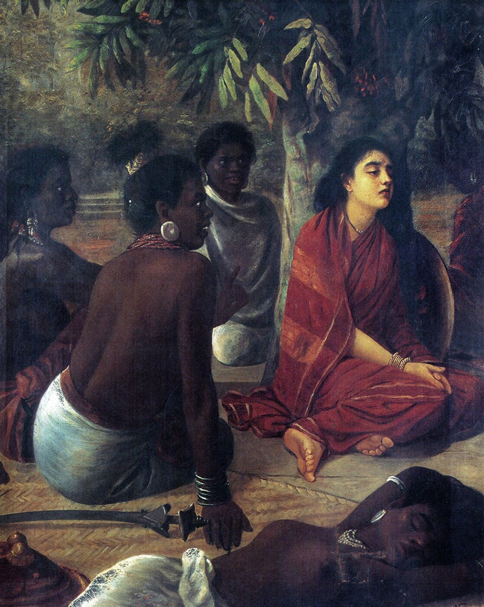
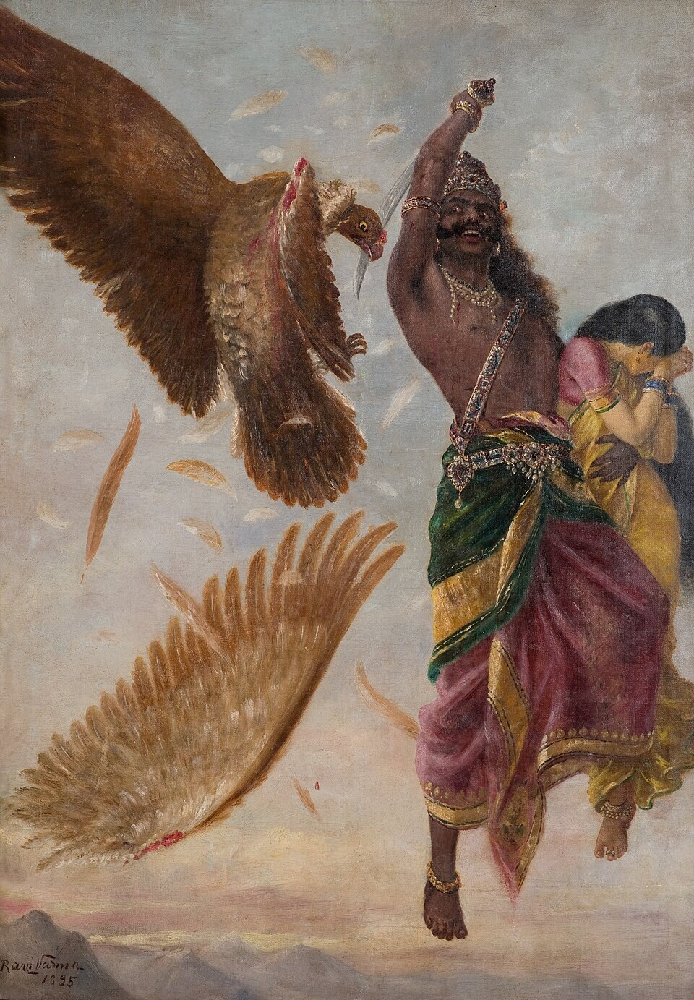
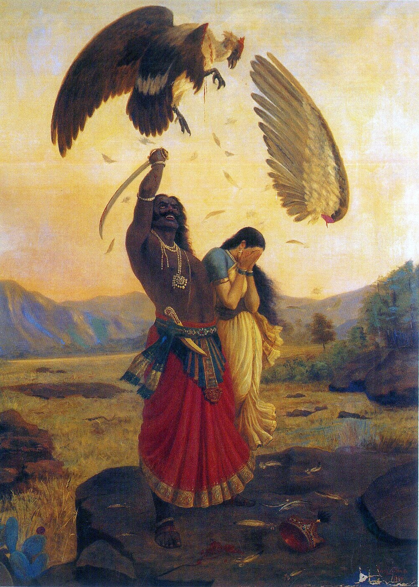
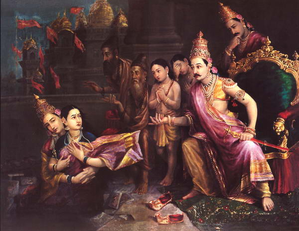

# Chapter 17. The Painted Sita II: Oleograph, Calendar, Comic and Poster

::: {custom-style="Epigraph"}
"He is seen as incomplete without her. He stands alone only in the BJP's propaganda and posters. Otherwise he is never worshipped without his spouse."

— Madhu Kishwar, *Manushi* 98 (1997), pp. 24–25
:::

## The argument of this chapter

Chapter 16 followed the painted Sita through the manuscript, the miniature, the wall and the scroll: images made one at a time, for particular patrons and occasions, and in the case of the scroll accompanied by a singer. This chapter follows her into the age of mechanical reproduction, when a single image could be printed in hundreds of thousands of copies and hung in homes across the subcontinent, and when the image was separated, once and for all, from any voice that might have accompanied it.

The chapter makes five claims.

1. Raja Ravi Varma's paintings and the oleographs printed from them gave the modern Sita her face, and the face was made with a European academic technique applied to an Indian subject. The "traditional" Sita of the twentieth century is, visually, a colonial-modern invention.

2. Ravi Varma's Sita is shown in moments of passive suffering and spectacle (carried off, captive, sinking), and his rendering of Ravana and the *rākṣasī* guards as dark-skinned against a fair Sita brought into Indian visual culture a racial coding that the nineteenth century's theories of Aryan and Dravidian had prepared.

3. The bazaar prints that followed were sometimes more faithful to the text than the academic painter: a cheap print of Sita's descent shows the throne rising on serpents' heads exactly as Vālmīki describes it.

4. The devotional gaze of *darśan*, in which the devotee sees and is seen by the deity, coexists with the objectifying gaze that Western feminist film theory describes. A decolonial reading of the calendar Sita must hold both.

5. In the political posters of the Ayodhya movement, Sita disappeared, and Rama stood alone. The image that the women's tradition had always refused, the Rama without Sita, became the image of a political campaign.

## Raja Ravi Varma: the academic Sita

### The painter and the press

Raja Ravi Varma (1848–1906), born into an aristocratic family of Kilimanoor in Travancore, taught himself European oil painting at a time when the medium was almost unknown in India, won prizes at exhibitions in Madras and Vienna, and became the most celebrated Indian painter of his age. His subjects were portraits of the princely and colonial elite, scenes from Indian life, and, above all, the epics and Purāṇas: Śakuntalā, Damayantī, Draupadī, and the women of the Rāmāyaṇa. In 1894 he founded, with his brother, a lithographic press in Bombay, later moved to Malavli near Lonavala, which reproduced his mythological paintings as cheap chromolithographs and distributed them across India.^[On Ravi Varma and his press, see Kajri Jain, *Gods in the Bazaar: The Economies of Indian Calendar Art* (Durham, NC: Duke University Press, 2007) (pinpoint to be verified).] The press is said to have been sold, a few years before his death, to a German technician who had worked there. The pictures it had printed were by then everywhere.

The significance of the press for the history of Sita cannot be overstated. Before it, an Indian household that wished to see Sita saw a local image: a temple sculpture, a wall painting, a scroll, a festival effigy, a woodcut. After it, the household could buy a mass-produced image in the European academic manner, identical to the one hanging in a household five hundred miles away. The press standardised Sita's face. And the face it standardised was Ravi Varma's.

### The captive

Ravi Varma's *Sita in the Ashoka Grove* (1894) shows Sita seated on the ground in a red sari, her body turned away, her face lifted in sorrow; around her, the *rākṣasī* guards sit and recline, one asleep in the foreground, their bodies dark, heavy, their faces turned towards her or away in boredom. Behind, the leaves of the grove close the scene.

Compare this with the Mughal folio of the same scene in Chapter 16. There, Sita stood upright under a canopy in a palace garden and received Hanumān as a visitor. Here, she sits on the ground, alone among her guards, in the posture of grief. The Mughal Sita was a queen in captivity; Ravi Varma's is a captive. The difference is the difference between a court image of dignity and an academic image of pathos. Ravi Varma's whole training, in the European tradition of history painting, was in the representation of emotion through the body, and the emotion he chose for Sita was sorrow.

And then there are the guards. Ravi Varma painted the *rākṣasīs* of the Aśoka grove as dark-skinned women, heavily built, in the clothing and adornment of the working women of South India: women of the kind a Travancore aristocrat would have seen labouring in fields and households. Against them, Sita is fair, slender, delicate. The contrast was not invented by Ravi Varma; the epic's *rākṣasīs* are described as hideous, and the identification of the forest peoples and the *rākṣasas* had already been made by nineteenth-century Orientalist and missionary scholarship, which read the Rāmāyaṇa as the story of an Aryan conquest of the dark-skinned south. But the painting gave the identification a face, and the press gave the face to the nation.

Chapter 5 argued that Periyar's reading of the Rāmāyaṇa as an Aryan war on the Dravidian south drew its frame from colonial ethnology. Ravi Varma's *Ashoka Grove* shows the same frame entering visual culture from the other side: an upper-caste painter, trained in a European technique, rendering the epic's enemies as dark labouring women and its heroine as fair. The racial reading of the Rāmāyaṇa was not only a Dravidian polemic against Aryan domination. It was, before that, a visual convention of the most popular painter of Hindu mythology, reproduced in every bazaar.

### The spectacle of the abduction

Ravi Varma painted the abduction more than once, and the paintings of 1895 and 1906 show his characteristic treatment of the scene. Ravana, dark, muscular, his arm raised with a sword, holds Sita against his body; Jaṭāyu, the great vulture, descends on him from above, wings spread; a severed wing falls in a shower of feathers. Sita, in the 1895 version, twists in Ravana's grip, her face turned away, her hand at her mouth; in the 1906 version, she clings to him in terror, her face buried, her yellow sari bright against his dark body.

The paintings are magnificent spectacles, and they are spectacles in the European manner: the composition of Baroque history painting, the dramatic diagonal, the contrast of light and dark bodies, the moment of maximum violence frozen. Compare them with the Pahari painting of the same scene in Chapter 16, in which Sita stood small at the edge while the demon and the bird faced each other. Ravi Varma brings Sita to the centre, into Ravana's arms, and makes her the visual focus of the violence. She is no longer marginal. She is the spectacle.

Is this an advance? In one sense, yes: the painting refuses to marginalise the woman at the centre of the event. In another, it is the opposite. The Pahari painter, by making Sita small, made visible the fact that the abduction was a contest between males. Ravi Varma, by bringing her into Ravana's grip at the centre of the composition, made her body the site of the drama: the object whose possession the violence is about, displayed in a posture of terror for the viewer's gaze. The Pahari Sita was marginal and therefore free of the spectacle; the Ravi Varma Sita is central and therefore its object.

John Berger's formulation, in *Ways of Seeing*, of the conventions of European painting describes the Ravi Varma Sita with uncomfortable precision: "men act and women appear. Men look at women. Women watch themselves being looked at."^[John Berger, *Ways of Seeing* (London: BBC and Penguin, 1972), 47†.] In the abduction paintings, Ravana acts and Jaṭāyu acts; Sita appears. She is the one the viewer looks at. And the viewer, for the oleographs printed from these paintings, was everyone.

### The descent, staged as a court

The painting of Sita's descent attributed to Ravi Varma stages the scene as a court tragedy. At the left, Sita sinks into the arms of the crowned Earth, who rises from below to receive her; at the right, Rama, crowned and enthroned, half rises, one hand extended, in a gesture of dismay; between them stand the twins, Lava and Kuśa, and the sage Vālmīki; courtiers fill the background. The composition is a European history painting of a royal crisis: the moment of a queen's departure from a king's court, with the court as witness.

What the painting shows, and what it does not, is instructive when set beside the text. Vālmīki describes a throne rising from the earth, borne on the heads of serpents, on which the Earth seats Sita and with which the two descend.^[CE 7.88.11–14.] Ravi Varma omits the throne and the serpents. His Earth receives Sita in her arms, as a mother receives a fainting daughter, and the emotional centre of the painting is the exchange of gazes between the departing queen and the dismayed king. The painting is about Rama's loss. It is, in this, closer to Bhavabhūti than to Vālmīki: a drama of the husband's remorse, with the wife as its occasion.
