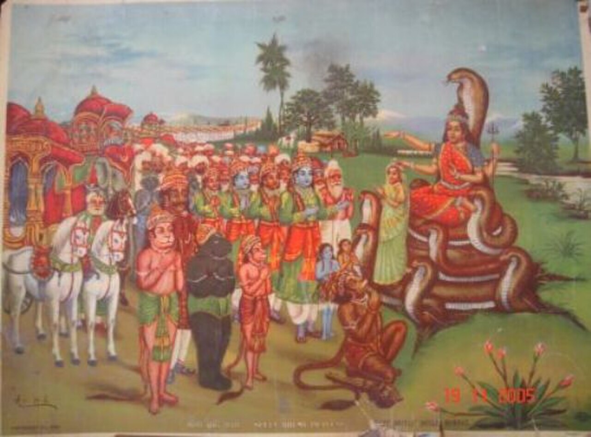
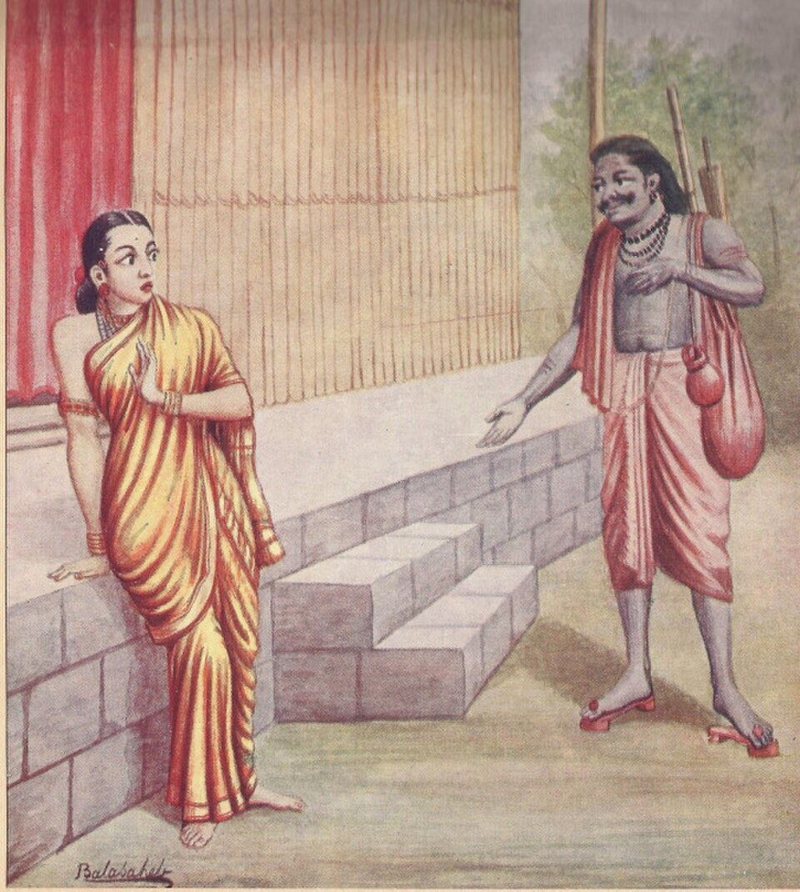
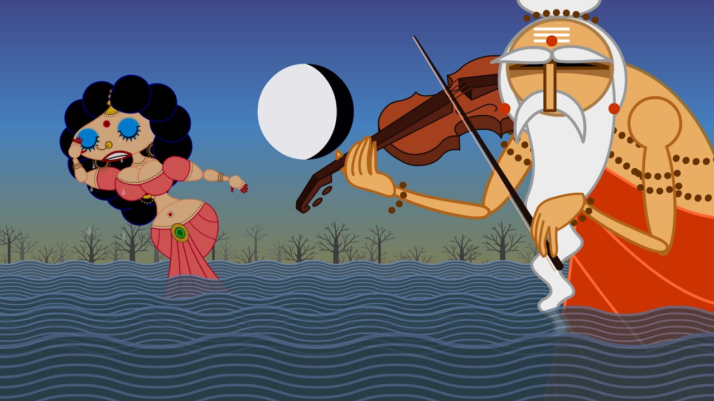

## The bazaar print: closer to the text than the academy

The presses that followed Ravi Varma's, in Bombay, Calcutta, Pune and, from the middle of the twentieth century, Sivakasi in Tamil Nadu, produced devotional prints in enormous quantities, painted by artists whose names are mostly unrecorded and sold in bazaars for a few annas. A bazaar print of Sita's descent from the middle of the twentieth century shows something Ravi Varma's academic canvas did not. At the right of a crowded scene (Rama and the court, the monkeys and bears, horses and chariots), Sita sits on a throne that rises from the ground on the coiled bodies and spread hoods of serpents.

This is exactly what Vālmīki describes: "a divine throne, unsurpassed, rose from the surface of the earth, borne on their heads by serpents of immeasurable power".^[CE 7.88.11–12: *bhūtalād utthitaṃ divyaṃ siṃhāsanam anuttamam / dhriyamāṇaṃ śirobhis tan nāgair amitavikramaiḥ*.] The cheap print, made for devotional use by an anonymous painter, is more faithful to the critical edition than the most celebrated painter of his age. It shows Sita enthroned, not fainting; carried by the earth's own creatures, not caught in a mother's arms; a queen departing on a throne, not a wife collapsing. The bazaar remembered the text's image of sovereignty better than the academy did.

The observation generalises. The academic tradition that Ravi Varma inaugurated was trained in European conventions of history painting, in which the climax of a drama is a moment of emotional crisis, legible in faces and bodies. The bazaar tradition, for all its debt to Ravi Varma's style, was also nourished by older devotional iconography, in which the miraculous is shown as miraculous: the throne, the serpents, the divine. The academic Sita faints; the devotional Sita ascends her throne. A decolonial reading of the visual tradition should notice that, at this point at least, the less prestigious image was the more faithful one.

## The threshold

A printed image of 1916 shows Ravana, disguised as a mendicant with a begging bowl and a staff, approaching Sita at the threshold of the forest hut. She stands in the doorway, in a yellow sari, one hand raised; he stands below the steps, extending his hand. The scene is the moment before the abduction: the woman at the edge of the household, the stranger at the edge of her world, the step between them.

The threshold is the most charged space in the modern iconography of Sita, because it is where the twentieth century placed the Lakshmaṇa-rekhā. Chapter 2 noted, following Dev Sen, that the line Lakshmana draws on the ground to protect Sita is "not to be found in Valmiki".^[Nabaneeta Dev Sen, "When Women Retell the Ramayan," *Manushi* 108 (1998): 24.] It is a later addition, widespread in the regional tellings and the women's songs, and in the twentieth century it became, through prints, comics and the televised serial, the dominant image of the scene. In Indian English, "crossing the Lakshman rekha" now means transgressing a limit, and it is used, overwhelmingly, of women. The image of Sita at the threshold, about to step over the line, became the visual emblem of the woman who brings disaster on herself by leaving the protected space. Dev Sen's analysis of the songs, in which Sita's crossing of the line is the basis of the "she deserved it" mentality, describes the work this image does.^[Dev Sen, "When Women Retell," 24.]

The 1916 print does not, so far as its reproduction allows one to see, draw the line. Its Sita stands at the threshold with the step between her and Ravana, and the step does the work of the boundary. But the image belongs to the same iconography: the woman at the door, the danger outside, the moment of decision. It is worth remembering, before this image, that in Vālmīki there is no line, and that Sita is alone not because she crossed a boundary drawn for her protection but because she had sent both men away, against their judgement, on the strength of her own.^[CE 3.43.20; see Chapter 1.]

## The calendar and the gaze

### The calendar Sita

From the 1930s, and above all from the 1950s and 1960s, the devotional print became the calendar print: an image of a deity reproduced at the top of a calendar, distributed by businesses to their customers, and hung for a year, often for much longer, on the walls of homes, shops and offices. The calendar art industry, centred on the printing presses of Sivakasi and nourished by painters trained in the Nathdwara tradition of Rajasthan and in the Ravi Varma manner, produced the images through which most Indians of the second half of the twentieth century saw their gods. Kajri Jain's study of this "bazaar" economy shows how its images circulated between devotion and commerce, the sacred and the commodity, without ever settling in either.^[Jain, *Gods in the Bazaar* (pinpoint to be verified).]

The calendar Sita is the Sita of the *Rām Darbār*: seated at Rama's side on a throne, with Lakshmana and Hanumān in attendance, serene, adorned, her eyes lowered or gently forward. She is also the Sita of *Ram Rajya* (1943), whose star, Shobhana Samarth, became, through the calendar, the face of the goddess for a generation.^[See Chapter 3.] Madhu Kishwar's essay of 1997 is illustrated with exactly such images: "a modern calendar representation of Ram and Sita".^[Madhu Kishwar, "Yes to Sita, No to Ram! The Continuing Popularity of Sita in India," *Manushi* 98 (January–February 1997): 21.] The calendar Sita is the visual consolidation of the ideal wife: repeated in every household, on every wall, year after year, until, in Judith Butler's phrase, the repetition "congeals" into the appearance of nature.^[Judith Butler, *Gender Trouble: Feminism and the Subversion of Identity* (New York: Routledge, 1990), 33†.]

### Two gazes

How is such an image looked at? Western feminist theory, and above all Laura Mulvey's analysis of classical cinema, has given an influential answer: the image of a woman in a patriarchal visual culture is made for a "male gaze", which takes pleasure in looking at her as an object, and which the image itself, by its composition, solicits.^[Laura Mulvey, "Visual Pleasure and Narrative Cinema," *Screen* 16, no. 3 (1975): 6–18.] Berger's formulation, quoted above, belongs to the same analysis. Applied to Ravi Varma's abduction paintings, the answer fits: the composition presents Sita's terrified body for the viewer's gaze.

But the calendar Sita was not, for most of those who hung her on their walls, an object of that kind of gaze. She was an object of *darśan*: the act of seeing the deity and being seen by her, which is the centre of Hindu devotional practice. Diana Eck's study of *darśan* emphasises its reciprocity: the devotee goes to the temple not only to look at the image but to be looked at by it, and the eyes of the deity are the most important part of the image.^[Diana L. Eck, *Darśan: Seeing the Divine Image in India* (Chambersburg, PA: Anima Books, 1981) (pinpoint to be verified).] A woman standing before the calendar Sita in her kitchen was not, in the main, consuming her as a spectacle. She was being seen by her.

A decolonial reading of the calendar Sita must hold both gazes in view, and resist the temptation to collapse either into the other. To read the calendar Sita only through Mulvey is to impose a theory developed for Hollywood cinema on a devotional object whose primary mode of reception was reciprocal seeing; that would be coloniality in the reading of images. To read it only through *darśan* is to ignore the fact that the image was made by painters trained in a European academic tradition designed for the male gaze, and that the face it fixed was the face of an actress and a painter's model. The calendar Sita is both an icon for *darśan* and an academic beauty for the eye. That double nature is precisely what made her so powerful as an ideal: the devotee who sought her gaze was also, without knowing it, being taught what a beautiful, devoted wife looked like.

And here the argument of this book about the women's songs bears on the images. The women who sang "Ram, you've lost your mind" and "that sinner Ram" at the grindstone did so, in many cases, in houses where the calendar Rām Darbār hung on the wall.^[Dev Sen, "When Women Retell," 19, 26.] The image and the song coexisted. The image showed the ideal couple; the song judged the husband. There is no evidence that the women saw any contradiction. The calendar was for *darśan*; the song was for the truth.

## The comic

In 1967, the Bombay publisher Anant Pai began the *Amar Chitra Katha* series, comic-book retellings of Indian mythology, history and legend for children, which became, over the following decades, the principal source through which several generations of English-educated Indian children learned the epics. The series' visual style, a clean, standardised, illustrational manner derived partly from Western comics and partly from the calendar, gave Sita yet another fixed face: fair, slender, sari-clad, gentle. Its retellings of the Rāmāyaṇa followed, in the main, the devotional and Tulsī-influenced version, and its Sita is the Sita of the ideal.^[On Amar Chitra Katha, see the scholarship on the series (pinpoints to be verified).]

Chapter 13 noted the contrast between two graphic retellings of 2011: Arni and Chitrakar's *Sita's Ramayana*, drawn in the idiom of a women's artisan tradition, and Saraswati Nagpal's *Sita: Daughter of the Earth*, drawn in the idiom of the commercial comic that *Amar Chitra Katha* had established.^[Samhita Arni and Moyna Chitrakar, *Sita's Ramayana* (Chennai: Tara Books, 2011) [W140]; Saraswati Nagpal, *Sita: Daughter of the Earth* (New Delhi: Campfire, 2011) [W215].] The contrast is the contrast of this chapter and the last: the scroll, with its accompanying singer, against the mass-produced image without one. Moyna Chitrakar's Sita comes from the courtyard; the comic's Sita comes from the press.

## The poster: Rama alone

The most consequential visual transformation of the Rāmāyaṇa in the late twentieth century took place not in a gallery or a bazaar but on walls, banners and stickers during the Ayodhya movement of the late 1980s and early 1990s. Anuradha Kapur's study of the movement's posters, written at its height, traced the transformation of Rama's image from the gentle, smiling, often blue-skinned deity of the calendar, standing beside Sita, to a muscular warrior, alone, his bow drawn, striding forward against a background of the projected temple.^[Anuradha Kapur, "Deity to Crusader: The Changing Iconography of Ram," in *Hindus and Others*, ed. Gyanendra Pandey (New Delhi: Viking, 1993) [W080].] The corpus workbook asks of her essay: "where does Sita go?"^[Corpus workbook, W080.]

The answer is that she went out of the picture. The warrior Rama of the posters stood alone. And Madhu Kishwar, writing in 1997, saw the significance of this at once: "Her name precedes Ram's in the popular greeting in North India: Jai Siya Ram ... He is seen as incomplete without her. He stands alone only in the BJP's propaganda and posters. Otherwise he is never worshipped without his spouse. There is no Ram mandir without Sita by his side."^[Kishwar, "Yes to Sita," 24–25.]

This is, in my judgement, one of the most important observations about the visual history of the Rāmāyaṇa that anyone has made, and it was made in passing. The devotional tradition, in temple and calendar alike, had shown Rama with Sita; the women's tradition had judged him as a husband and preferred her; the popular greeting put her name first. The political poster removed her. And in removing her, it removed precisely the relation in which, as this book has argued throughout, Rama's moral standing was most open to question. A Rama alone is a Rama who cannot be judged as a husband. The poster's warrior had no wife to banish.

It would be wrong to read this as a deliberate erasure; the poster's logic was the logic of a mobilisation, which needed a single martial figure, and the warrior Sita of the 2010s and 2020s, examined in Chapter 12, can be read as an attempt to restore her to the picture in a form the martial iconography could accommodate. But the visual history is clear. In the decade in which the Rāmāyaṇa became the centre of Indian politics, the dominant political image of Rama was an image without Sita.

## After the poster: screen, spectacle, scroll

The images of Sita in the twenty-first century are produced, above all, by the screen. The publicity stills and posters of *Adipurush* (2023) and of the 2026 *Ramayana*, discussed in Chapter 15, circulate in quantities that dwarf the oleograph's, through social media, in forms that are cut, recoloured, captioned and remixed by millions of users. The warrior Sita debated before the 2026 film's release is, in this sense, a visual as well as a narrative question: what she will look like, and in what posture, has been argued over in images before it was argued over in words.^[Corpus workbook, W206.]

Against this torrent, two kinds of image hold their own. One is the artisan's: the Mithila wall and the Paṭuā scroll, now sold in galleries and craft markets, painted still by women and still, in the case of the scroll, sung. The other is the artist's: the images made by individual artists who use the Rāmāyaṇa against its official iconography. Nina Paley's animation, discussed in Chapter 13, is one example; its frame in which Sita weeps a river, a cartoon figure in a sea of tears while a sage plays the violin beneath the moon, belongs to no tradition and quotes all of them. The paintings of Shabari by Nandalal Bose and Atul Dodiya, which the corpus records, are others: images that move the forest woman from the margin of the story to the centre of the frame.^[Corpus workbook, W159.]

::: {custom-style="Box Title"}
Reading Against the Text
:::

::: {custom-style="Box"}
The cheap bazaar print of Sita's descent shows the serpent-borne throne that Vālmīki describes; Ravi Varma's celebrated canvas shows a fainting woman in her mother's arms. Which image is "traditional"? And if the less prestigious image is the more faithful, what does that tell us about whose idea of tradition the twentieth century accepted?
:::

::: {custom-style="Box Title"}
The Debate: The Gaze
:::

::: {custom-style="Box"}
**Position A:** The modern image of Sita is made for the male gaze: an object of visual pleasure, composed to display a woman's body.\
**Position B:** The modern image of Sita is an object of *darśan*: the devotee sees and is seen, and the image is a presence, not a spectacle.\
**Where the evidence of this chapter leaves the argument.** Both, in the same object. Ravi Varma's abduction paintings and their academic descendants were composed for the gaze Mulvey describes; the calendar Rām Darbār was hung for *darśan*. The power of the modern image of Sita lay in the fusion: the devotee who sought her gaze was also being taught what a beautiful, devoted wife looked like. To apply only the first theory is coloniality in the reading of images; to apply only the second is to ignore how the images were made.
:::

## Conclusion

The age of mechanical reproduction gave Sita a face, and the face was Ravi Varma's: a European academic beauty in a sari, captive, carried off, fainting into her mother's arms, set against dark-skinned guards and a dark-skinned abductor in a racial coding the nineteenth century had prepared. The bazaar print, less prestigious, sometimes remembered the text better, enthroning Sita on her serpents as Vālmīki did. The calendar fused the academic gaze with the devotional *darśan* and hung the result in every home. The comic standardised her for children. And the political poster of the Ayodhya movement removed her, leaving Rama alone, in the one relation in which he could not be judged.

The painted history confirms, in images, what the textual history has shown in words. Every age painted the Sita it needed, and the Sita most often painted was the one whose speech a painting could not show. The singer who once stood beside the image is the figure this book has been listening for throughout. Chapter 18 turns from the image to the law, and to the trial that the images so seldom painted.
