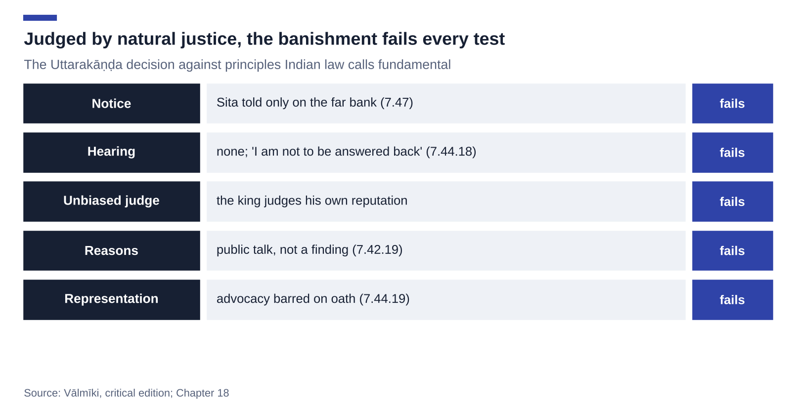

# Chapter 18. The Law of the Ordeal: Proof, Hearing and Precedent from Ayodhya to the Supreme Court

::: {custom-style="Epigraph"}
*na cāsmi prativaktavyaḥ sītāṃ prati kathaṃ cana*

"I am not to be answered back concerning Sita in any way."

— Rāma to his brothers, Vālmīki *Rāmāyaṇa* 7.44.18 (CE)
:::

## The argument of this chapter

I have, throughout this book, read the Rāmāyaṇa as a lawyer reads a record: attending to charges, evidence, procedure, verdicts and the reasons given for them. This chapter makes that method its subject. It asks what the trial before the fire and the banishment on the riverbank look like when they are measured against three bodies of law: the Sanskrit jurisprudence of proof (*dharmaśāstra*) that the epic's first audiences knew; the principles of natural justice that Indian constitutional law, since 1978, has read into the guarantee of life and personal liberty; and the long struggle in modern Indian criminal law over whether a woman's word about her own body is evidence.

The chapter makes five claims.

1. By the standards of the *dharmaśāstra* itself, the ordeal of Sita was irregular. Divine proofs were a last resort, to be used when human evidence was lacking; human evidence was not lacking.

2. By the standards of natural justice, the banishment of Sita fails every test: there was no notice, no hearing, no impartial judge, no reasoned finding, and an express bar on representation.

3. The logic of the banishment, the king's household as a precedent for every household, is a theory of the relation between sovereign conduct and social norm. It is the most sophisticated political argument in the *Uttarakāṇḍa*, and the most dangerous.

4. The ordeal did not end with the epic. It survived as an institution: in caste tribunals that tried women's chastity, in village councils, and in forensic practices that the Supreme Court of India has, within living memory, had to condemn. Modern Indian law has moved, slowly and under pressure, towards the principle that the Kannada women's song stated: a woman's word about her own body is evidence.

5. In the courts of the Indian republic, Rama has appeared as a litigant; Sita has not. The law has learned from her case without ever hearing it.

## Reading the epic as a record

Let me begin with a caution about method, because a lawyer's reading of a sacred text invites an obvious objection. The Rāmāyaṇa is not a law report. Its scenes are poetry, its characters are gods and heroes, and its purposes are devotional, aesthetic and moral. To measure Rama's conduct against the principles of administrative law is, the objection runs, a category error: like criticising the *Iliad* for Achilles' failure to observe the Geneva Conventions.

I accept the premise and reject the conclusion. The Rāmāyaṇa is not a law report, but it is a text about kingship, and kingship in the Indian tradition was inseparable from the administration of justice. The *dharmaśāstra* literature devotes long sections to the king's duty of *vyavahāra*, the conduct of lawsuits; the epic itself repeatedly presents Rama as a king who judges; and the poem's two most consequential scenes after the war, the trial before the fire and the banishment, are scenes of judgement. The poet did not need a modern lawyer to notice this. He gave Sita a defence that uses the vocabulary of evidence (*parīkṣitā*, *pramāṇīkṛta*, *sākṣin*), gave the fire god a verdict that commands the king, and gave the king a confession.^[CE 6.104.7, 6.104.16, 6.104.24; 6.106.9; 6.106.13–14. See Chapter 1.] A reading that attends to the juridical structure of these scenes is attending to something the text put there.

And the reading has a further justification that is specific to this book's argument. The liberation narrative, I have argued, measures Sita by a yardstick borrowed from Western liberal individualism. A decolonial reading asks that she be measured first by her own tradition's standards. For the trial and the banishment, the tradition's own standards include a body of jurisprudence, the *dharmaśāstra*, that is directly relevant and almost never consulted. If one wishes to know whether Rama's conduct was just by the lights of his own civilisation, one should ask what that civilisation's law said about proof, witnesses and the conduct of a judge. That is what this chapter does first.

## The *dharmaśāstra* on proof

### The hierarchy of means

The Sanskrit legal tradition developed, over the first millennium of the common era, an elaborate procedural law. Its principal texts, the *smṛtis* attributed to Manu, Yājñavalkya, Nārada, Bṛhaspati and Kātyāyana, and the commentaries upon them, describe the stages of a lawsuit (plaint, answer, proof, judgement), the qualifications of judges and assessors, the competence of witnesses, and the means of proof (*pramāṇa*) by which a disputed fact is to be established.

The means of proof fall into two classes. The human means (*mānuṣa*) are documents (*likhita*), possession (*bhukti*) and witnesses (*sākṣin*). The divine means (*divya*) are ordeals: the balance, in which the accused is weighed twice and must weigh less the second time; fire, in which the accused carries a heated iron or walks through flames; water, in which the accused is submerged; poison; and the sacred libation (*kośa*). And the relation between the two classes is stated with great clarity in a verse of the *Yājñavalkya Smṛti* that later commentators treated as foundational:

> *pramāṇaṃ likhitaṃ bhuktiḥ sākṣiṇaś ceti kīrtitam*\
> *eṣām anyatamābhāve divyānyatamam ucyate*
>
> Documents, possession and witnesses are declared to be the means of proof. In the absence of any one of these, one of the divine proofs is prescribed.^[*Yājñavalkya Smṛti* 2.22†. The verse number and reading should be checked against a standard edition.]

The ordeal is a last resort. It is prescribed only when human evidence is wanting. The jurists knew that ordeals could be manipulated, and the later commentarial literature surrounds them with restrictions: who may undergo which ordeal, at what season, under what supervision, and in what kinds of case.

### Applied to Sita

Now apply the rule. At the moment of the trial before the fire, what human evidence was available on the question of Sita's fidelity in Laṅkā?

First, there was a witness, and an unimpeachable one. Hanumān had entered the Aśoka grove, seen Sita there under guard, spoken with her, heard her refuse Ravana and refuse rescue on another man's terms, and carried her message and her token back to Rama.^[CE 5.19.3; 5.35.62; 5.36.33.] He was the king's own envoy, sent precisely to find out how she was. His report was evidence of the most direct kind.

Second, there was the accused's own testimony, offered on oath. "I am not as you take me to be," Sita says; "trust me; I swear to you by my own conduct."^[CE 6.104.6.] The *dharmaśāstra* is cautious about the testimony of parties, but an oath was itself a recognised form of proof, and the oath of a woman of Sita's standing was not a trivial thing.

Third, there was the judge's own knowledge. Rama tells the assembled gods, after the ordeal, that he "knew" Sita was devoted to him alone, that her heart was his.^[CE 6.106.13.] A judge who possesses knowledge of the fact in issue is, in any system of law, in an anomalous position; but that is a problem for the judge's impartiality, not for the availability of evidence. The evidence existed. The judge had it.

By the rule of Yājñavalkya, then, the divine proof was not prescribed. Human evidence was available in abundance. The ordeal was resorted to not because evidence was lacking but because, as Rama himself said, it was needed "for the conviction of the three worlds" (*pratyayārthaṃ tu lokānām*).^[CE 6.106.14.] The ordeal was not a means of proof. It was a means of persuasion, addressed to an audience that had not seen the evidence and would not accept it.

This is, I think, the most precise statement available of what was wrong with the ordeal by the standards of Sita's own tradition. It was not that ordeals were unknown or illegitimate; the tradition recognised them. It was that this ordeal was used outside the conditions the tradition prescribed, for a purpose the tradition did not recognise. The fire was asked to do what evidence had already done, because evidence was not enough for the public.

### The witness Sita chose

Chapter 9 drew attention to a single word in Sita's last speech before the fire. She addresses the fire as *lokasya sākṣī*, "the witness of the world".^[CE 6.104.24.] *Sākṣin* is precisely the term of the *dharmaśāstra* for a human witness, the third of the human means of proof. Sita does not invoke the fire as a *divya*, an ordeal; she invokes it as a witness. She converts the divine proof into a human one, and calls as her witness the one being who, in the tradition's cosmology, is present everywhere and sees everything.

It is worth adding one more provision of the śāstra, because it shows what was absent from Sita's trial. The *Manusmṛti*, in its rules on the competence of witnesses, prescribes that women should be witnesses for women, as twice-born men for the twice-born and Śūdras for Śūdras.^[*Manusmṛti* 8.68†: *strīṇāṃ sākṣyaṃ striyaḥ kuryuḥ*. Reading and number to be verified.] The rule is in many ways a rule of segregation, and it reflects the hierarchies of its time. But its premise is that a person's peers are the best judges of their conduct. At Sita's trial, no woman testified. The court that judged her was an assembly of monkeys, bears, *rākṣasas* and men; the god who vindicated her was male. The only women in the story who could have spoken to her conduct in Laṅkā were the *rākṣasīs* who guarded her and Trijaṭā and Saramā who befriended her, and none of them was called. When the *Uttarakāṇḍa* sends Sita to the forest, it is the female ascetics of Vālmīki's hermitage who receive her and care for her "as for a child".^[CE 7.48.11.] The women came after the verdict, not before it.

## Natural justice

### The principles

I turn from the śāstra to the law of the Indian republic. The principles of natural justice, which Indian courts inherited from the common law and have developed into a body of doctrine of their own, are usually stated as two maxims and a corollary. *Audi alteram partem*: hear the other side; no one shall be condemned unheard. *Nemo judex in causa sua*: no one shall be a judge in his own cause. And, as courts have developed the doctrine, a decision adverse to a person must be supported by reasons that relate to the facts.

In *Maneka Gandhi v. Union of India* (1978), the Supreme Court of India held that the "procedure established by law" by which, under Article 21 of the Constitution, a person may be deprived of life or personal liberty must itself be just, fair and reasonable, and that the principles of natural justice are part of what fairness requires.^[*Maneka Gandhi v. Union of India* (1978) (Supreme Court of India; report citation to be verified).] The judgement transformed Indian constitutional law. It meant that a state action depriving a person of liberty could be struck down not only for want of legal authority but for want of a fair procedure.

### The banishment tested

Apply these principles to the banishment of Sita as Vālmīki records it.

**Notice.** Was Sita told what was alleged against her and what was proposed? She was not. Rama gave his order to his brothers; Sita was told nothing. Lakshmana took her across the Gaṅgā on the pretext of the visit to the hermitages she had asked for, and told her the truth only on the far bank.^[CE 7.44.15–17; 7.47.1.]

**Hearing.** Was she heard before the decision? She was not. The decision was taken in her absence, on the evening of the day Bhadra reported the citizens' talk, and executed the next morning.^[CE 7.42–44.]

**Representation.** Could anyone speak for her? No one could. Rama forbade it in terms: "I am not to be answered back concerning Sita in any way", and bound his brothers by an oath on his arms and his life not to try to dissuade him.^[CE 7.44.18–19.]

**An impartial judge.** Was the decision taken by someone without a personal interest in the outcome? It was not. The decision was taken by the king to protect his own reputation: "for fear of disgrace I would give up my own life, or you, let alone the daughter of Janaka".^[CE 7.44.13.] The judge's own *kīrti* was the interest at stake.

**Reasons related to the facts.** Was the decision supported by a finding about what Sita had done? It was not. No finding was made. The decision rested on what the citizens were saying, not on anything Sita had done; Rama had himself, years before, declared her pure and accepted the fire god's verdict.^[CE 6.106.9–14.]

The banishment fails every test. And it fails them not by inference but on the face of the record: the poem itself records the absence of notice, of hearing, of representation, of impartiality and of a finding. Ambedkar, as Chapter 5 noted, saw this; his indictment of the banishment was, in its essentials, a jurist's objection to a decision taken without inquiry and without a hearing.^[B. R. Ambedkar, "The Riddle of Rama and Krishna," in *Dr. Babasaheb Ambedkar: Writings and Speeches*, vol. 4 (Bombay: Government of Maharashtra, 1987) [W045] (pinpoints to be verified).]

I want to be clear about what this argument does and does not establish. It does not establish that Rama was a bad king by the standards of his own age, or that Vālmīki intended him to be read as one. The epic presents him as the ideal king, and the banishment as an act of terrible self-sacrifice in the service of his duty. What the argument establishes is that the epic records, with complete clarity, the procedural features of the decision, and that those features are precisely the ones that natural justice, in the tradition of the *dharmaśāstra* and of the Indian Constitution alike, condemns. The poet did not hide them. He set them down, and left the reader to judge.
