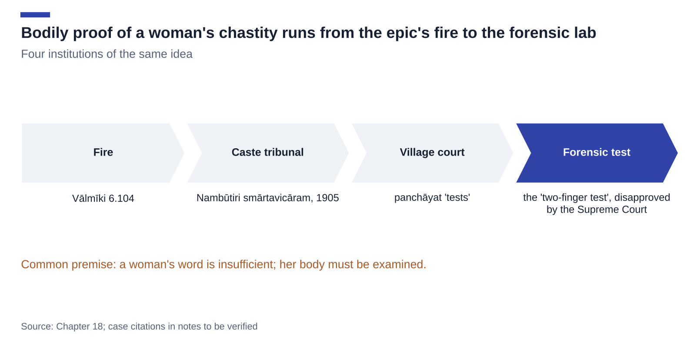

## The precedent theory of kingship

The procedural failures of the banishment are clear. Its substantive logic deserves more respectful attention, because it is the most sophisticated political argument in the *Uttarakāṇḍa*, and because it remains, in modern dress, an argument that governments make.

The citizens' reasoning, as Bhadra reports it to Rama, is this: "Now we too shall have to put up with this in our wives. For as the king does, so the subjects follow."^[CE 7.42.19.] The premise is that the king's conduct is normative: what he tolerates in his household, his subjects may claim the right to tolerate, or be obliged to tolerate, in theirs. The king is not merely a ruler but an exemplar, and his private life is a public text.

The idea is old and widespread in Indian political thought. A maxim repeated in the *Mahābhārata*'s book on kingship holds that "the king is the cause of the age": that the moral condition of an era depends on the conduct of its rulers.^[The maxim *rājā kālasya kāraṇam* appears in the *Mahābhārata*, Śānti Parvan (locator to be verified).] On this view, the king who tolerated an impure queen would corrupt not only his household but his age. Rama's decision to banish Sita is, within this theory, an act of governance: the sacrifice of a private relation to preserve the public norm.

I take this argument seriously, because it is not foolish. It recognises something true about power: that the conduct of the powerful sets norms, that the private lives of rulers are never merely private, that a society takes its standards partly from those it watches. Modern democracies make versions of the same argument when they demand that public officials meet standards of conduct higher than the law requires of ordinary citizens. The precedent theory of kingship is the ancestor of the idea that public office is a public trust.

But the argument has a fatal flaw, and the epic itself exposes it. The precedent the king sets is not determined by what he does but by what is said about what he does. The citizens do not know what happened in Laṅkā; they know only that Sita lived there. The fire god's verdict, delivered before the armies, did not reach them, or did not persuade them. The norm the king protects is therefore not a norm of conduct but a norm of reputation: not "wives must be faithful" but "wives must not be suspected". And a norm of reputation can be satisfied only by sacrificing the suspected, whether or not they are guilty. The precedent theory, applied to reputation rather than conduct, requires the punishment of the innocent whenever public opinion is mistaken.

This is the danger I named at the outset of this chapter. A government that governs by managing the precedents it sets in the eyes of the public, rather than by establishing the truth, will sacrifice whoever the public suspects. Samhita Arni's *The Missing Queen*, discussed in Chapter 13, imagined exactly such a government: an Ayodhya whose secret police chief is called the Washerman, and in which public opinion is no longer something the king consults but something the state manufactures and enforces.^[Samhita Arni, *The Missing Queen* (New Delhi: Zubaan and Penguin, 2013) [W146].] Arni saw that the logic of 7.42.19, carried to its conclusion, is the logic of the surveillance state.

## From fire to forensics

The ordeal did not end with the epic. It survived, in changing forms, as an institution through which Indian societies examined women's bodies for proof of their chastity, and the history of that institution is the history against which the modern law of sexual offences has had to be built.

### The caste tribunal

Chapter 7 described the *smārtavicāram*, the caste tribunal by which the Nambūtiri Brahmins of Kerala tried a woman of their community accused of adultery: the confinement, the interrogation, sometimes for months, and the sentence of expulsion, after which her family performed her funeral rites while she lived. The trial of Kuriyedathu Thatri in 1905, in which the accused turned the proceedings against her accusers by naming the men with whom she had had relations, is the most famous case, and Lalithambika Antharjanam's story "Pratikāradēvata" made her a goddess of revenge.^[See Chapter 7 and the scholarship on Lalithambika Antharjanam (pinpoints to be verified).] The *smārtavicāram* is the ordeal of Sita institutionalised: a procedure in which a woman's chastity is a matter for the community's judges, and in which the presumption runs against her.

### The village and the family

The *smārtavicāram* was a Nambūtiri institution, and it is long abolished. But the practice of examining a woman's chastity before a community tribunal is not confined to one caste or one century. Caste councils and village assemblies in many parts of India have, within living memory, subjected women to tests and humiliations to "prove" their purity, and the press continues to report them. The Avadh women's song quoted by Kishwar, in which Sita says "the Ram who put me in the fire, who threw me out of the house", was sung by women who knew what it was to be judged by a household and a village.^[Madhu Kishwar, "Yes to Sita, No to Ram! The Continuing Popularity of Sita in India," *Manushi* 98 (January–February 1997): 24.] Archana Pathak Bhatt's study of the "Sita syndrome" in South Asian diaspora households shows the ideal shaping the silence of women who suffer domestic violence.^[Archana Pathak Bhatt, "The Sita Syndrome," *Journal of International Women's Studies* 9, no. 3 (2008) [W132].] The ordeal is not a metaphor for these women. It is a procedure they know.

### The forensic test

And the ordeal entered the courts. For decades, medical examinations of women who reported rape in India included what was called the "two-finger test": a physical examination purporting to assess whether the woman was "habituated to sexual intercourse", the results of which were used in court to impugn her character and her testimony. In *Lillu alias Rajesh v. State of Haryana* (2013), the Supreme Court held that the test violated the woman's right to privacy, physical and mental integrity and dignity, and that its results could not be used to presume consent; in *State of Jharkhand v. Shailendra Kumar Rai* (2022), the Court condemned its continued use and directed that it be removed from medical practice and curricula.^[*Lillu @ Rajesh v. State of Haryana* (Supreme Court of India, 2013); *State of Jharkhand v. Shailendra Kumar Rai* (Supreme Court of India, 2022) (report citations to be verified).]

The continuity with the epic is exact. The two-finger test was a bodily proof of a woman's sexual history, administered by an authority, whose purpose was to determine whether her word could be believed. It was the fire, with a medical licence. And its premise was the premise of Rama's trial: that a woman's testimony about her own body is insufficient, and that her body must be examined to establish what her word cannot.

### The law turns towards the word

Against this history, Indian criminal law has moved, slowly and under pressure, towards the principle that the Kannada women's song stated in a single question: "Do you accept my truth, my lord?"^[See Chapter 9; women's song in Paula Richman, ed., *Ramayana Stories in Modern South India* (Bloomington: Indiana University Press, 2008) [W133].]

The decisive turn came after a judgement that provoked a national campaign. In *Tukaram v. State of Maharashtra* (1979), the Supreme Court acquitted two policemen accused of raping a young Adivasi woman, Mathura, in a police station, reasoning in part from her supposed sexual history and her failure to raise an alarm. Four law teachers, Upendra Baxi, Lotika Sarkar, Raghunath Kelkar and Vasudha Dhagamwar, wrote an open letter to the Chief Justice protesting the judgement, and the campaign that followed led to the Criminal Law (Amendment) Act of 1983.^[On the Mathura case and the open letter, see the standard accounts of the Indian women's movement (citations to be verified).] Among its provisions was a presumption, in certain prosecutions for rape, that where intercourse is proved and the woman states in her evidence that she did not consent, the court shall presume that she did not consent. After the Delhi gang rape of December 2012, the Criminal Law (Amendment) Act of 2013 went further, providing among other things that evidence of the character of the victim or of her previous sexual experience is not relevant on the issue of consent.^[Indian Evidence Act, 1872, sections 114A (inserted 1983) and 53A (inserted 2013); these provisions were carried into the Bharatiya Sakshya Adhiniyam, 2023, which replaced the Evidence Act from 2024 (section numbers to be verified).]

The trajectory is clear, and it is the trajectory this book has traced in the literature. The law began from the premise of the ordeal: that a woman's body, and her history, are the evidence, and her word is suspect. Under pressure from women and from scholars who refused to accept that premise, it moved towards the premise of the song: that her word is evidence, and her history is not. It has not arrived; the gap between the statute and the courtroom remains wide. But the direction is the direction of the Kannada women who asked Rama whether he accepted Sita's truth.

## The deity in court

There is a final observation to make about the law and the Rāmāyaṇa, and it concerns who has been heard.

In the litigation over the site at Ayodhya, which reached its conclusion in the Supreme Court's judgement of November 2019, one of the parties was the deity himself: Bhagwān Śrī Rām Lallā Virājmān, Rama in the form of an infant, represented in law as a juristic person through a next friend. The Court decreed the suit of the deity, and the temple consecrated in January 2024 enshrines Rama as a child.^[*M. Siddiq (D) through LRs v. Mahant Suresh Das* (Supreme Court of India, 9 November 2019) (report citation to be verified).] Indian law, which has long recognised Hindu deities as juristic persons capable of holding property and suing through human representatives, heard Rama's case.

Sita has never been a party. No court has heard her case, because no one has brought it. And yet the law of the Indian republic, in the principles of natural justice it read into Article 21, in the evidentiary reforms of 1983 and 2013, in its condemnation of the two-finger test, has slowly adopted the very principles whose violation her story records. The law has learned from her case without ever hearing it.

I do not draw from this any conclusion about the Ayodhya judgement, which turned on questions of title and evidence quite separate from the argument of this book. I draw a conclusion about the relation between law and narrative. A legal order does not learn only from the cases it decides. It learns from the stories its people tell about justice, and among those stories, for the people of India, the story of the queen condemned without a hearing has been one of the most widely known and the most often judged. The women who sang that Rama had lost his mind, and the four law teachers who wrote to the Chief Justice about Mathura, were making the same argument in different registers.

::: {custom-style="Box Title"}
Reading Against the Text
:::

::: {custom-style="Box"}
In law, a deity can be a party: the infant Rama sued and won. Imagine Sita's case brought as a suit. Who would be the defendant (Rama the husband, Rama the king, or the citizens of Ayodhya)? What relief would she ask for? And which court, earthly or divine, would she accept as having jurisdiction, given that her last act was to leave every court there was?
:::

::: {custom-style="Box Title"}
The Debate: Rāmrājya and the Rule of Law
:::

::: {custom-style="Box"}
**Position A:** Rāmrājya is the ideal of righteous rule: a king who sacrifices his private happiness to public duty, governing by example.\
**Position B:** Rāmrājya, as the *Uttarakāṇḍa* records it, is rule by reputation: a king who sacrifices the innocent to public opinion, without notice, hearing or reasons.\
**Where the evidence of this chapter leaves the argument.** The epic supports both and lets the reader see the cost. Its precedent theory of kingship (7.42.19) recognises a truth modern constitutions also recognise, that power sets norms. But it applies that truth to reputation rather than conduct, and so requires the punishment of the suspected. The modern rule of law, as Indian courts have developed it since 1978, is in significant part a set of guarantees against precisely this: that no one shall be condemned unheard, by a judge with an interest, without reasons. Rāmrājya, if it is to remain an ideal for a constitutional democracy, must be read with the seventh book, not without it.
:::

## Conclusion

Read as a record, the Rāmāyaṇa's two great judgements fail the tests of law: the ordeal by the śāstra's own rule that divine proof is a last resort, and the banishment by every principle of natural justice. The precedent theory of kingship that underlies the banishment is serious and dangerous: serious because it recognises that power sets norms, dangerous because it protects reputation at the cost of truth. The ordeal survived the epic as an institution, in caste tribunals, village councils and forensic tests, and modern Indian law has moved, under pressure from women and their advocates, from the premise of the fire to the premise of the song. Rama has been heard in court; Sita has not. The law has learned from her anyway.

Chapter 19 crosses the sea to Laṅkā, to the women on the other side of the war that was fought, as Rama said, not for Sita's sake.
