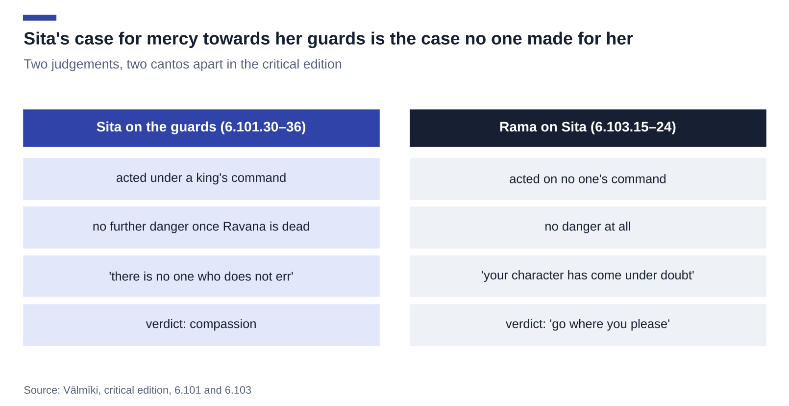

## Saramā: the friend who listened

On the eve of the battle, Ravana has tried a last deception: he has shown Sita a magically fashioned head that he claims is Rama's, and she has collapsed in grief. A *rākṣasī* named Saramā comes to her. The poem describes her in terms of intimate friendship: she is Sita's "dear, affectionate friend" (*priyāṃ praṇayinī sakhī*), a woman "made a friend by Sita while she was guarding her", "protecting her from Ravana, beloved, compassionate, firm in her vows".^[CE 6.24.1–2.] She finds Sita lying in the dust, "like a mare rolled in the earth", and comforts her.^[CE 6.24.3–4.]

And then Saramā tells Sita what she has done for her:

> Out of a friend's love, timid one, I heard everything, hidden in a lonely thicket, casting aside my fear of Ravana. For your sake, wide-eyed one, my life is not dear to me.^[CE 6.24.5.]

She has spied on Ravana. She knows that the head is false, that Rama lives, that the armies are gathering. She tells Sita the truth, and the truth restores her.^[CE 6.24.6–19; 6.25.1.]

Saramā is identified in many tellings as the wife of Vibhīṣaṇa; the critical edition's account of this scene emphasises not her marriage but her friendship with Sita. She is the one woman in the epic who befriends Sita across the line of the war, and she risks her life to do it. Michael Madhusudan Dutt saw her significance in 1861: in the *Meghnādbadh Kābya*, it is to Saramā that Sita tells her story, and the conversation of the two women is one of the poem's most moving passages.^[Michael Madhusudan Dutt, *The Slaying of Meghanada*, trans. Clinton B. Seely (New York: Oxford University Press, 2004) [W027]; see Chapter 3.]

The friendship of Sita and Saramā is the epic's own image of the solidarity across difference that Volga's *The Liberation of Sita*, a century and a half later, would make the basis of a feminist fiction.^[See Chapter 8.] Volga's Sita meets Śūrpaṇakhā in a garden; Vālmīki's Sita has already been befriended by a *rākṣasī* in a grove. The modern retelling, once again, recovers rather than invents.

## Sita's mercy

### The scene

After the war, before Sita is brought to Rama, Hanumān goes to her in the Aśoka grove with the news of the victory. And he makes her an offer. The *rākṣasīs* who threatened her for months, who described to her the ways they would kill and eat her, are still there, "speaking cruel words". Hanumān asks permission to kill them, and describes how: with fists and palms, with feet and knees, by knocking out their teeth, by biting off their ears and noses, by tearing out their hair.^[CE 6.101.25–28.] The list is, deliberately, a list of the tortures the guards had threatened.

Sita refuses. And her reasons are among the most considered speeches in the poem:

> *rājasaṃśrayavaśyānāṃ kurvatīnāṃ parājñayā*\
> *vidheyānāṃ ca dāsīnāṃ kaḥ kupyed vānarottama*
>
> Who would be angry, best of monkeys, with slave-women dependent on a king's protection, acting at another's command, obedient to orders?^[CE 6.101.30.]

They threatened her, she says, because Ravana commanded it; now that he is dead, they will not.^[CE 6.101.33.] She quotes an old verse, sung once by a bear to a tiger: "The good do not take on the sins of others who do evil; the compact must be kept; the good are adorned by their conduct."^[CE 6.101.34–35.] And she concludes with the verse that is the epigraph to this chapter: whether they are wicked or good, or even deserving death, a noble person should show compassion, "for there is no one who does not err".^[CE 6.101.36.]

### A jurisprudence of mercy

Read as law, Sita's speech contains three distinct arguments.

The first is an argument about responsibility under command. The guards were slaves (*dāsī*), dependent on the king, acting on his orders. Their responsibility for the threats they made is diminished by their subordination. This is, in essence, the argument that modern international criminal law has debated under the heading of "superior orders": the question of how far a subordinate who acts on command is responsible for what she does. Sita's answer is not that the guards bear no responsibility, but that anger against them is misplaced while the one who commanded them is the proper object of judgement, and he is dead.

The second is an argument about the cessation of danger. The guards threatened her because Ravana told them to; with Ravana dead, they will not threaten her again. Punishment is not needed to protect her. This is the logic of a jurisprudence that asks what punishment is *for*, and declines to punish where no purpose is served.

The third is an argument about universal fallibility: "there is no one who does not err." This is not an argument about the guards in particular. It is an argument about the judge. A noble person shows compassion even to those who deserve death, because the noble person knows that she too is fallible. The judge who punishes must know that she is not without fault.

### The opposite of her own trial

And now set this speech beside the trial that follows it within two cantos. Sita, asked to judge the women who tormented her, refuses to punish them, on the grounds that they acted under command, that they pose no further danger, and that no one is without fault. Rama, asked by no one to judge the woman who had done nothing, condemns her before the armies, on the grounds of what people might say about his lineage. Sita's jurisprudence is one of mercy towards the guilty; Rama's is one of suspicion towards the innocent.

The juxtaposition is in the critical edition, and it is, I think, one of the most deliberate structural effects in the whole of the sixth book. The poet places Sita's speech of mercy immediately before Rama's speech of condemnation. The reader who attends to the sequence sees two theories of judgement in the space of a few pages, and sees which of them the poem gives to the woman.

Chapter 18 measured Rama's judgements against the principles of natural justice and found them wanting. It should be added that the epic itself supplies a standard against which to measure them, and that the standard is Sita's. The case for mercy she makes for her guards is the case no one made for her.

## Laṅkā in the modern imagination

### Madhusudan's city

Chapter 3 described Michael Madhusudan Dutt's *Meghnādbadh Kābya* (1861) as the first modern epic told from Laṅkā's side. Its women deserve a further word here. Pramīlā, wife of Ravana's son Meghanāda, leads a band of armed women through Rama's lines to join her husband in the besieged city, and, when he is killed, dies on his pyre. Mandodarī grieves for her son. Saramā befriends Sita. Laṅkā, in Madhusudan, is a city of women as much as of warriors, and its fall is a catastrophe for them.

Madhusudan's sympathy for Laṅkā was, as he admitted, partly a Romantic sympathy for the defeated rebel learned from Milton; and partly, as Chapter 5 argued of the later anti-caste readings, it anticipated the reversal of heroes that the twentieth century would make political. But his women are not merely the reversed images of Ayodhya's. Pramīlā's martial courage has no counterpart in Ayodhya, and her death on the pyre complicates any reading of her as a liberated heroine. Madhusudan imagined a Laṅkā whose women had more freedom than Ayodhya's and died more terribly.

### The Mandodarī novels

The modern novel has turned to Mandodarī with particular interest. Manini J. Anandani's *Mandodari: Queen of Lanka* (2018) draws on a Jain telling, Saṅghadāsa's, in which Sita is the daughter of Ravana and Mandodarī, abandoned at birth; its Mandodarī narrates, and she later marries Vibhīṣaṇa "as a political necessity".^[Manini J. Anandani, *Mandodari: Queen of Lanka* (Gurugram: Penguin Random House India, 2018) [W163]; corpus workbook, W163.] Koral Dasgupta's *Mandodari* (2023), the fourth of her Sati Series, makes her "a strategist torn between Ram Rajya and Ravan Raj, frustrated by Sita's captivity and wary of Surpanakha".^[Koral Dasgupta, *Mandodari: The Sati Series IV* (New Delhi: Pan Macmillan India, 2023) [W187].] Volga's Telugu newspaper story "Aśōkam" (2016) imagined a sympathetic Mandodarī and drew threats against its author.^[Volga, "Asokam," *Andhra Jyothi* (December 2016) [W154].]

The three novels share an inheritance from Vālmīki that they rarely acknowledge. The Mandodarī who counsels peace and is ignored, who judges her husband's desire as the cause of his death, who asserts her own worth against Sita, who grieves with a compassion she calls a woman's nature, is already in the critical edition. The modern novels develop her as a strategist and a ruler, and they draw on the Jain and *Adbhuta* traditions that make her Sita's mother. But the core of their Mandodarī is the woman of the lament.

The Jain telling that makes Sita Mandodarī's daughter adds a dimension that the modern novels have found irresistible: the war becomes a war over a daughter who does not know her mother, fought by a father who does not know his daughter. In the *Adbhuta Rāmāyaṇa*, as Chapter 2 noted, Sita is also born of Mandodarī.^[*Adbhuta Ramayana* [W009].] And in Candrābatī's Bengali poem, the story opens with Mandodarī and Sita's birth.^[Candrābatī, *Chandrabati's Ramayan*, trans. Nabaneeta Dev Sen (New Delhi: Zubaan, 2020) [W015].] The idea that Sita's true mother is the queen of the enemy city is, in other words, a recurrent element of women's and sectarian tellings. It turns the war between Ayodhya and Laṅkā into a war within a family, and it gives Laṅkā's women a claim on Sita that Ayodhya's men never acknowledged.

### Laṅkā and Sri Lanka

There is a final, contemporary dimension to the modern turn to Laṅkā, and I note it with the caution that a question of another country's politics requires. In Sri Lanka, in recent decades, Ravana has been reclaimed by some Sinhala nationalists as an ancient indigenous king rather than a demon, and the country's first satellite, launched in 2019, was named Ravana-1. The epic's enemy has become, for some across the strait, a national hero. Samhita Arni's *The Missing Queen*, with its ruined Laṅkā across the sea from a prosperous Ayodhya, was published in 2013, four years after the end of Sri Lanka's civil war, and readers have heard in its image of a devastated island the echo of that war.^[Samhita Arni, *The Missing Queen* (2013) [W146]; see Chapter 13.]

These developments return us to the question this book has asked of every retelling: whose need does it serve? The rehabilitation of Laṅkā serves anti-caste politics in Periyar, Romantic rebellion in Madhusudan, feminist solidarity in Volga, the market's appetite for sympathetic villains in the popular novel, and national pride in contemporary Sri Lanka. In none of these is it primarily about the women of Laṅkā. And yet the women are there, in Vālmīki, in the lament, the dream, the friendship and the mercy: voices of a city that lost a war fought, as the victor said, not for the woman who was its occasion.

::: {custom-style="Box Title"}
Reading Against the Text
:::

::: {custom-style="Box"}
Within two cantos of the critical edition, Sita refuses to punish the guards who threatened her, because they acted on command and no one is without fault; and Rama condemns Sita, who did nothing, because of what people might say. If the poet placed these speeches side by side, what was he asking the reader to see? And why has the speech of mercy been so much less remembered than the speech of condemnation?
:::

::: {custom-style="Box Title"}
The Debate: Solidarity
:::

::: {custom-style="Box"}
**Position A:** Solidarity among women is a modern feminist ideal, imported into the Rāmāyaṇa by retellings such as Volga's.\
**Position B:** Solidarity among women, across the lines of war and household, is already in the epic.\
**Where the evidence of this chapter leaves the argument.** The critical edition supports Position B. Saramā befriends the captive and risks her life to tell her the truth (6.24.1–5); Trijaṭā protects her with a dream (5.25.5–6); Sita refuses to punish the guards who threatened her (6.101.30–36). What the epic does not supply is solidarity *against* the order that sets the women against one another: Mandodarī asserts her worth against Sita (6.99.16), and Rama sends the grieving women home (6.99.30). The modern retellings add the critique of the order; the solidarity was already there.
:::

## Conclusion

The women of Laṅkā are, in Vālmīki, among the most fully voiced women in the epic. Mandodarī's lament judges her husband's desire as the cause of his death, asserts her own worth against Sita, and sets a woman's compassion against the warrior's ethic. Trijaṭā protects the captive with a dream. Saramā befriends her at the risk of her life. And Sita, when the war is over, refuses to punish the guards who threatened her, in a speech of mercy that the poem places immediately before her own condemnation. The modern turn to Laṅkā, from Madhusudan to the Mandodarī novels, recovers these women, and serves, as every retelling does, the needs of its moment. But the women were there before the retellings. The war was not fought for them either.

Chapter 20 follows the story further still, across the Bay of Bengal to the courts and temples of Southeast Asia, and across the oceans on the ships that carried indentured labourers, and their Rāmāyaṇas, to the Caribbean, Africa and the Pacific.
