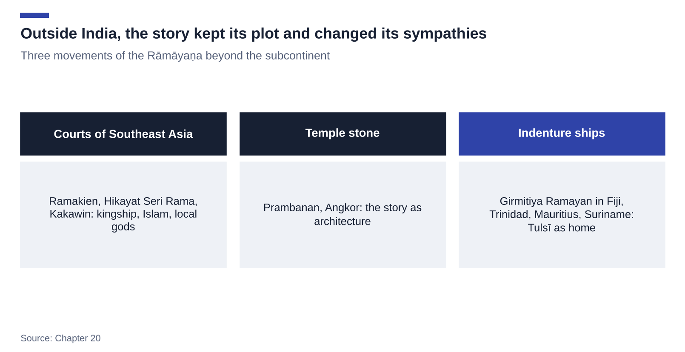
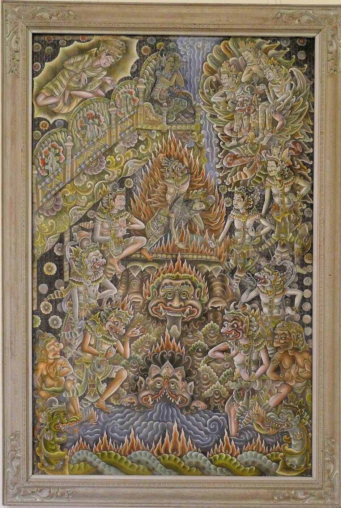

# Chapter 20. Beyond the Border: Sita in Southeast Asia and on the Indenture Ships

::: {custom-style="Epigraph"}
"Sita's exile, / Is happening every moment, everywhere."

— Marathi women's song, quoted by Nabaneeta Dev Sen, *Manushi* 108 (1998), p. 26
:::

## The argument of this chapter

The Rāmāyaṇa has never been confined to the subcontinent. For more than a thousand years it has been told, carved, painted, danced and sung across Southeast Asia, in courts that were Hindu, Buddhist and Muslim; and in the nineteenth and twentieth centuries it travelled, in the bundles of indentured labourers, to the plantations of Mauritius, the Caribbean, Fiji and southern Africa. In each place the story kept its outline and changed its sympathies. This chapter follows Sita across those borders, more briefly than the subject deserves, and asks what the journeys reveal about her.

It makes four claims.

1. In the Southeast Asian tellings, the Rāmāyaṇa became a royal and often a national epic, and Sita's story was reshaped by the needs of courts whose religions and cosmologies differed from Vālmīki's. Several of these tellings make Sita the daughter of Ravana, a motif they share with Jain and Indian women's tellings.

2. The testing of Sita is, across these tellings, one of the most variable episodes: softened, reversed, transformed or refused. Harry Aveling's comparative study shows how far the ordeal could travel from Vālmīki's scene.

3. For the indentured labourers who crossed the oceans between 1834 and 1917, Tulsīdās's *Rāmcaritmānas* became a portable homeland, and Rama's fourteen-year exile a figure for their own. In that setting, the devotional Sita of the *Mānas* served as a model of endurance, while the actual lives of indentured women exposed, with great cruelty, the cost of the ideal.

4. Outside India, as inside it, every Sita answers a need: of a Thai dynasty, a Malay sultanate, a Javanese temple, a plantation village in Trinidad. The question this book has asked of every retelling applies across every border.

## The courts of Southeast Asia

### An epic of kings

The Rāmāyaṇa reached Southeast Asia in the first millennium of the common era, with the Sanskrit learning, Hindu and Buddhist, that shaped the courts of Java, Cambodia, Champa and the Malay peninsula. V. Raghavan's edited volume *The Ramayana Tradition in Asia* (1980), the product of an international seminar, remains a useful introduction to its range.^[V. Raghavan, ed., *The Ramayana Tradition in Asia* (New Delhi: Sahitya Akademi, 1980) [W056] (pinpoints to be verified).] In Java, the Old Javanese *Kakawin Rāmāyaṇa*, among the earliest works of Javanese literature, retold the story in Sanskrit metres; in the ninth century, the temple complex at Prambanan carved it in relief around its central shrines. At Angkor, in the twelfth century, the builders of Angkor Wat carved the battle of Laṅkā in a great bas-relief on one of its galleries. In Cambodia the story became the *Reamker*; in Laos, *Phra Lak Phra Lam*; in Burma, the *Yama Zatdaw*; in Thailand, the *Ramakien*; in the Malay world, the *Hikayat Seri Rama*.

What these tellings share, despite their differences, is a relation to kingship. Sheldon Pollock's argument, that the Rāmāyaṇa became a text through which Indian kings imagined their rule, applies with at least equal force to Southeast Asia, where kings took Rama's name and claimed his lineage.^[Sheldon Pollock, "Rāmāyaṇa and Political Imagination in India," *Journal of Asian Studies* 52, no. 2 (1993): 261–97 [W082].] The Chakri dynasty of Thailand, founded in 1782, styled its kings Rama, and its first king, Rama I, sponsored the definitive version of the *Ramakien*; the cloisters of the Temple of the Emerald Buddha in Bangkok are painted with its story. The Rāmāyaṇa in Southeast Asia was, in large part, a dynastic epic.

### Sita as Ravana's daughter

The *Ramakien* of the court of Rama I, in the corpus record, contains an episode closely related to one in Candrābatī's Bengali poem: a demoness tricks Sita into drawing a portrait of Ravana, which is placed under Rama's bed and leads to her banishment.^[*Ramakien* [W023]; see Chapter 2 on Candrābatī and the portrait motif.] It also belongs to the family of tellings, Jain and Indian alike, in which Sita is born as Ravana's daughter, cast away because of a prophecy that she will bring destruction, and found by another king.

The motif deserves reflection, because it recurs too widely to be an accident. In the Jain telling that Manini Anandani drew on for her Mandodarī novel, in the *Adbhuta Rāmāyaṇa*, in Candrābatī, and in the *Ramakien*, Sita's true parents are the king and queen of the enemy city.^[See Chapter 19.] The war over her becomes a war within a family, and Ravana's desire for her becomes, unknown to him, a desire for his own daughter. Psychologically, the motif intensifies the tragedy. Politically, it does something else: it unsettles the line between Ayodhya and Laṅkā, between the righteous kingdom and the demonic one, by making the heroine a child of both. A Sita who is Ravana's daughter cannot be simply the prize of a war between good and evil. She belongs to both sides.

### The Malay Sita: Siti Dewi

The *Hikayat Seri Rama*, the Malay prose telling whose oldest surviving manuscript reached the Bodleian Library at Oxford in 1635, places the story inside the culture of a Muslim court.^[*Hikayat Seri Rama* [W018].] Its Sita is Siti Dewi. Its Ravana, Maharaja Wana, is, in the corpus's summary, more sympathetic than "an arrogant Rama", and the story is framed within an Islamic cosmology.^[Corpus workbook, W018.] The Malay telling is one of the clearest demonstrations of the argument Chapter 2 made about the Rāmāyaṇa's plurality: the story could be told by Muslims, for Muslims, without ceasing to be the Rāmāyaṇa, and in the telling its sympathies could shift towards the figure the Sanskrit tradition condemned.

### The ordeal abroad

Harry Aveling's comparative study of the testing of Sita in Indonesian, Malay and Thai literature takes its title from one of its most striking variants: "Sita puts out the fire".^[Harry Aveling, "'Sita Puts Out the Fire': Some Depictions of the Testing of Sita's Virtue in Indonesian, Malay, and Thai Literature," *Kritika Kultura* 18 (2012) [W141] (pinpoints to be verified).] In the Southeast Asian tellings, the ordeal is staged, softened, transformed and reversed: the fire may become a lotus throne, may be quenched by Sita's purity, may be replaced by another test altogether. The corpus workbook records Aveling's essay as evidence for "the ordeal beyond India".^[Corpus workbook, W141.]

The image of a Sita who puts out the fire, rather than surviving it, is worth pausing on. In Vālmīki, the fire god rises from the flames with Sita in his lap and gives her back to Rama with a command; the fire testifies.^[CE 6.106.4–9.] In a telling where Sita puts out the fire, the fire does not testify; it is extinguished. Her purity is not proved by the element; it overpowers it. The ordeal becomes a demonstration of Sita's power rather than a test of her character. It is, in its way, a Southeast Asian cousin of the *Adbhuta*'s warrior Sita: a heroine whose capacity exceeds the trial set for her.

A twentieth-century Balinese painting of the ordeal by I Gusti Nyoman Moleh, now in a museum in Ubud, shows how far the visual imagination of the scene could travel from the Indian traditions examined in Chapters 16 and 17. The field is crowded from edge to edge with figures and patterns in the Balinese manner; the fire rises in the centre, surrounded by demons, gods and attendants, and the scene is less an image of a woman being tested than of a cosmic event. Sita is one element of a densely populated universe. The Balinese painting does what Kamban did in Tamil, as Chapter 2 described it, following David Shulman: it makes the ordeal the cosmos's affair.^[David Shulman, "Fire and Flood: The Testing of Sītā in Kampaṉ's *Irāmāvatāram*," in *Many Rāmāyaṇas*, ed. Paula Richman (Berkeley: University of California Press, 1991), 89–113 [W073].]

### Sida's anger: the Thai ending

The *Ramakien*'s treatment of the final separation shows how differently a royal tradition could resolve the question with which Vālmīki ends. In the Thai telling, as scholars have summarised its later episodes, Sida (Sita), banished after the episode of the portrait, is spared by Phra Lak (Lakshmaṇa), who cannot bring himself to kill her as ordered, and she gives birth in a hermitage. When, years later, Phra Ram (Rama) learns the truth and wishes her back, she refuses. Phra Ram then resorts to a stratagem: he pretends to be dead, so that Sida will come to his funeral. She comes; she discovers the deception; and, in anger, she leaves him again, departing for the underworld. The couple are reconciled only when the god Phra Isuan (Śiva) intervenes.^[On the final episodes of the *Ramakien*, see the studies cited in this chapter and the corpus record [W023]† (pinpoints to be verified).]

The Thai ending keeps the shape of Vālmīki's, a second summons refused and a departure below the earth, and gives it a different meaning. Sida's departure is not a response to a demand for an oath; it is a response to a lie. Phra Ram does not ask her to prove anything. He tricks her, and her anger is the anger of a woman who has been deceived by a husband who would not simply ask. And the reconciliation, when it comes, requires a god: the marriage cannot be restored by the husband alone, only by an authority above him.

The *Ramakien* was composed under the patronage of a dynasty whose kings took Rama's name, and its happy ending serves, as the Sanskrit stage's happy endings did, the needs of a court for whom the story of the royal couple was the story of the realm's harmony.^[See Chapter 21 on the drift of the Sanskrit stage towards reunion.] But even a royal telling, committed to reunion, kept Sita's refusal. Sida says no to the summons, and when Phra Ram deceives her, she says no again. The Thai court could reconcile its Rama and Sida only by bringing a god down to do it. The refusal travelled across the Bay of Bengal intact.

On the stage, the *Ramakien* is performed in *khon*, the masked dance-drama of the Thai court, which UNESCO inscribed on its list of the intangible heritage of humanity in 2018, the same year as the Cambodian *lakhon khol* of Wat Svay Andet, a masked dance of the *Reamker*.^[UNESCO, Representative List of the Intangible Cultural Heritage of Humanity, inscriptions of 2018† (to be verified).] In both, the human heroes and heroines, Sida among them, characteristically appear without masks, while the demons and monkeys wear them. The convention gives Sita a human face in a theatre of masks, as Chapter 21 found the Indian stage giving her a body that the audience must look at.

## The indenture ships

### The jahājī's book

Between 1834, when the first ships left Calcutta for Mauritius after the abolition of slavery in the British Empire, and 1917, when the system was ended, more than a million Indians left their homes as indentured labourers (*girmitiyās*, from the English "agreement") for the sugar plantations of Mauritius, British Guiana, Trinidad, Jamaica, Suriname, Natal and Fiji, and the tea and rubber estates of Ceylon and Malaya. Most came from the Bhojpuri- and Awadhi-speaking districts of eastern Uttar Pradesh and western Bihar, and from the Tamil and Telugu regions of the south. They carried few possessions. Among the things they carried, in the accounts of the indenture experience by historians such as Brij V. Lal, was the *Rāmcaritmānas*.^[Brij V. Lal, *Chalo Jahaji: On a Journey through Indenture in Fiji* (Canberra: Australian National University, 2000) (pinpoint to be verified).]

The *Mānas* became, for the indentured and their descendants, something close to a portable homeland. It was recited in the barracks and the villages that grew up around the plantations; it was sung by *Rāmāyaṇ maṇḍalīs*, devotional groups that met weekly; it was performed in the open-air *Rāmlīlās* that the villages of Trinidad and Guyana have staged since the nineteenth century. And its central episode, the fourteen-year exile of Rama, became a figure for the indentured labourer's own exile: a banishment from home for a fixed term, to a distant and dangerous land, from which return was promised and, for most, never came.

### The Sita of the plantation

In this setting, Sita meant something specific. The *Mānas*'s Sita is, as Chapter 2 described her, the devotional ideal: protected by the shadow device, spared the banishment, the faithful wife who follows her husband into exile and endures. For the indentured community, she was a model of endurance in exile, and of fidelity under conditions that tested it severely. She was also, inevitably, a standard by which indentured women were judged.

The conditions were extreme. The recruiters, under pressure from the colonial authorities to send women, never met the ratio of women to men that the regulations required; women were a minority on every plantation, and their scarcity made them the objects of intense contention among men. The historian and journalist Gaiutra Bahadur, in her study of her own great-grandmother's journey to British Guiana, documents what followed: women who left marriages, women who formed new attachments, the colonial and community stereotype of the "immoral coolie woman", and a pattern of violence against women by men who suspected their fidelity, which the colonial records called "wife murders".^[Gaiutra Bahadur, *Coolie Woman: The Odyssey of Indenture* (London: Hurst; Chicago: University of Chicago Press, 2013) (pinpoints to be verified).]

The juxtaposition is terrible, and it is exact. In the plantation barracks, the *Mānas* was recited, with its Sita of perfect fidelity and its Rama who never banishes her. Outside the barracks, indentured women lived under the suspicion that Vālmīki's seventh book describes, the suspicion of the citizens of Ayodhya, without any fire god to vindicate them; and some of them were killed by men who believed what was said about them. The devotional ideal that removed the banishment from scripture did not remove it from life. It moved it out of the text and onto the bodies of women who had crossed an ocean.

I state this with care, because the history of indenture is the history of a community that suffered enormously and survived with great dignity, and its women are not to be reduced to victims of their own men any more than of the colonial system. Bahadur's book is, among other things, a record of indentured women's resourcefulness, mobility and refusal: of women who used the scarcity that endangered them to choose their partners and leave their marriages, who worked, bargained and survived.^[Bahadur, *Coolie Woman* (pinpoint to be verified).] But the conjunction of the *Mānas*'s ideal and the plantation's violence is a fact of the history, and it bears directly on the argument of this book. An ideal Sita who is never banished is a Sita who cannot help a woman who is.

### Sita in the Caribbean Rāmlīlā

The village *Rāmlīlās* of Trinidad, staged in open fields in the autumn for well over a century, are among the most remarkable survivals of the Rāmāyaṇa tradition anywhere: performances in which the whole village takes part, in which the story is acted across several nights with effigies, processions and the burning of Ravana. In them, Sita has for most of their history been played, as in the north Indian *Rāmlīlā*, by a young man or boy, and more recently in some villages by young women. The question of who may play Sita, and how she should be shown, is in the Caribbean as in India a question about the community's relation to its women.

I raise the *Rāmlīlā* here not to analyse it, which would require fieldwork this book has not done, but to mark it as a site where the arguments of this book are conducted in practice by communities outside India. The *Lajja* scene discussed in Chapter 15, in which an actress playing Sita on a village stage refuses the ordeal and is attacked by the audience, is a fiction. Whether a Trinidadian village Sita has ever refused, and what happened if she did, is a question for the ethnographer.

### Fiji: the *Mānas* in the lines

The indentured community of Fiji, whose labourers arrived between 1879 and 1916 to work the sugar plantations, has been studied with particular care by its own historians, among them Brij V. Lal, himself the grandson of an indentured labourer.^[Brij V. Lal, *Girmitiyas: The Origins of the Fiji Indians* (Canberra: Journal of Pacific History, 1983)†; Lal, *Chalo Jahaji*† (pinpoints to be verified).] In the "lines", the barrack rows in which indentured families were housed, the *Mānas* was recited and sung, and *Rāmāyaṇ maṇḍalīs* continued the practice in the villages after indenture ended; the language of recitation, Awadhi, became the foundation of the Fiji Hindi that the community still speaks.^[Lal, *Chalo Jahaji*† (pinpoint to be verified).] The *Mānas*'s Sita, who follows her husband into exile and endures, was sung in a setting in which exile was not a metaphor. Its Rama returns to Ayodhya after fourteen years. Most of the girmitiyas never returned at all. The story's promise of homecoming, which the indentured sang each week, was the promise their own lives did not keep; and the Sita of the songs, faithful in a far country, was the image held up to women whose fidelity, as Bahadur's history shows, was suspected and policed in the lines.

## The contemporary diaspora

Chapter 11 examined the Sitas of the contemporary diaspora in the United States, Britain and Europe, and argued that they translate the heritage figure into the host culture's vocabulary of empowerment. The indentured diaspora, older and differently formed, received a different Sita: not a heroine for an English-language market but a devotional ideal for a community in exile, recited in Awadhi in the barracks. Between the two lies the whole difference between the indentured labourer of the nineteenth century and the software engineer or doctor of the twenty-first. But the structure is the same in both. The diaspora takes Sita with it, and makes her answer its needs: endurance in the one case, empowerment in the other.

Rashi Rohatgi's novella *Sita in Exile* (2023), in which Sita's exile becomes the experience of migrant mothers in pandemic Europe, connects the two diasporas without naming either: its title could stand for the whole history traced in this chapter.^[Rashi Rohatgi, *Sita in Exile* (Oxford, OH: Miami University Press, 2023) [W231].] The Marathi women's song that is this chapter's epigraph says the same thing more briefly: "Sita's exile / Is happening every moment, everywhere."^[Nabaneeta Dev Sen, "When Women Retell the Ramayan," *Manushi* 108 (1998): 26.]

## Janakpur: the birthplace across the border

One border deserves a final word, because it runs through the land where Sita was born. Janakpur, which tradition identifies as the capital of Janaka's kingdom and the place of Sita's birth and wedding, lies today in Nepal, a few miles north of the border with Bihar. Its great Jānakī temple, built in the early twentieth century, draws pilgrims from both countries, and the annual festival of Sita's wedding, *Vivāh Pañcamī*, is celebrated there with processions that re-enact the arrival of Rama's party. The region of Mithila, which claims Sita as the daughter of every household, spans the border.^[See Chapter 2 and Madhu Kishwar, "Yes to Sita, No to Ram! The Continuing Popularity of Sita in India," *Manushi* 98 (January–February 1997): 28.]

When, in 2023, a line in the film *Adipurush* called Sita a "daughter of India", the authorities of Kathmandu halted the screening of Hindi films, as Chapter 15 recorded.^[Corpus workbook, W185.] The dispute was over a single line, and it was resolved. But it brought into the open a fact that the women of Mithila had always known: that Sita belongs to a region before she belongs to a nation, and that the region does not coincide with any state. The daughter of the furrow was found in a field. The field did not have a passport.

::: {custom-style="Box Title"}
Reading Against the Text
:::

::: {custom-style="Box"}
For the indentured labourers of the nineteenth century, the *Mānas*, in which Rama never banishes Sita, was a portable homeland; on the plantations, women suspected of infidelity were killed. If the devotional tradition removed the banishment from scripture, did it thereby remove the means of judging it? What would the women of the barracks have needed: the *Mānas*'s Sita, or Vālmīki's?
:::

::: {custom-style="Box Title"}
The Debate: Plurality (abroad)
:::

::: {custom-style="Box"}
**Position A:** The Rāmāyaṇa abroad is a sign of India's civilisational reach: a single story carried to many lands.\
**Position B:** The Rāmāyaṇa abroad is many stories: each court and community made its own, with its own sympathies and its own Sita.\
**Where the evidence of this chapter leaves the argument.** Position B, firmly. The *Ramakien*'s Sita is Ravana's daughter; the *Hikayat*'s Ravana is more sympathetic than Rama; Southeast Asian Sitas put out the fire; the plantation's Sita was Tulsī's. Position A is not false, but it describes the outline, not the content. Ramanujan's pool of signifiers extends across the Bay of Bengal and the oceans, and the Sitas it produced abroad confirm what the Sitas at home have shown: that the story is always told for someone.
:::

## Conclusion

Beyond the subcontinent, the Rāmāyaṇa became a royal epic in the courts of Southeast Asia, a Muslim romance in the Malay world, a cosmos in stone at Prambanan and Angkor, and a portable homeland for the indentured labourers of the Caribbean, Africa and the Pacific. In several Southeast Asian tellings Sita is Ravana's daughter; in some she puts out the fire. On the plantations, the devotional Sita of the *Mānas* was a model of endurance, while the lives of indentured women exposed the cost of the ideal with a cruelty the epic's seventh book had foreseen. And at Janakpur, Sita's birthplace lies across a border that the women of Mithila have never recognised. Every Sita, abroad as at home, answers a need. The exile, as the Marathi women sang, is happening everywhere.
