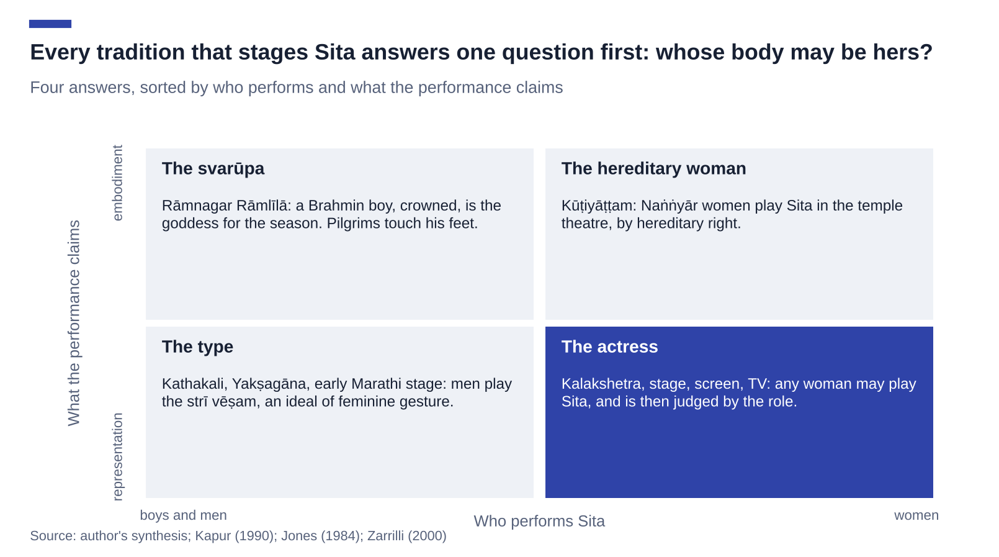

# Part VI. Stage, Sons and Shrine {.unnumbered}

# Chapter 21. The Staged Sita: Theatre, Dance and the Rāmlīlā

::: {custom-style="Epigraph"}
*bimbād ivoddhṛtau bimbau rāmadehāt tathāparau*

"Like images lifted from an image: two more bodies, taken from Rama's body."

— Vālmīki *Rāmāyaṇa* 1.4.10 (CE), describing the first two performers of the poem, Sita's sons
:::

## The argument of this chapter

Every Sita in this book so far has been made of words or of paint. This chapter turns to the Sita who is made of a body: the Sita of the stage, the dance and the open-air *Rāmlīlā*, who must be played by someone, and whose embodiment raises a question that no novel and no painting has to answer. Who may be Sita?

The question is older than the modern stage. The Rāmāyaṇa describes its own first performance. In the critical edition's first book, Vālmīki, having composed the poem, wonders who will perform it, and two young men in the dress of hermits touch his feet: Kuśa and Lava, "sons of the king", "rich in voice". He teaches them the poem, which the text names in a phrase this book might have taken as its title: "the whole Rāmāyaṇa, the great life of Sita, the slaying of Paulastya".^[CE 1.4.3–6.] They sing it, with every *rasa*, before the sages, and the listeners see in them "images lifted from an image, other bodies taken from Rama's body".^[CE 1.4.7–10.] In the seventh book the scene recurs, and the boys sing before Rama himself at his horse-sacrifice; the assembly cannot tell the singers from the subject of their song.^[CE 7.85.7–8.] The first performers of the Rāmāyaṇa were Sita's sons. They sang her life to the man who had banished her, and the song brought her back to court.

This chapter makes five claims.

1. Performance is the medium in which the Rāmāyaṇa has been most widely received. For most Indians in most centuries, Sita was not read; she was seen and heard, in a temple theatre, a village field, a dance hall or, from 1987, a television set.^[For the range of performance traditions, see Paula Richman and Rustom Bharucha, eds., *Performing the Ramayana Tradition: Enactments, Interpretations, and Arguments* (New York: Oxford University Press, 2021) [W174] (pinpoints to be verified).]

2. In most traditional forms, Sita has been played by men or boys: the Brahmin boys of the Rāmnagar *Rāmlīlā*, the male actors of Kathakali and Yakṣagāna. The tradition that a boy, while in costume, *is* the goddess (the *svarūpa*) makes the question of who plays Sita a theological question as well as a social one.

3. Where women have danced Sita, in the Kūṭiyāṭṭam of the Naṅṅyār women, in Rukmini Devi Arundale's dance-dramas at Kalakshetra and in the solo performances of modern dancers, the choice of episodes and the treatment of the ordeal have differed in ways that bear directly on the argument of this book.

4. The stage has been a site of Sita's refusal as well as her obedience: the Marathi theatre began, in 1843, with a play about her wedding, and the modern stage has staged her rejection of the second ordeal more often than the novel has.

5. Embodiment changes the meaning of silence. A Sita who stands silent on a stage is not absent from it; the audience sees her face. The performed Sita can refuse without speaking, and has.

## The Sanskrit stage

### Bhāsa's bark garment

Sanskrit drama took up the Rāmāyaṇa early and often. Two plays attributed to Bhāsa, among the group of thirteen discovered in Kerala manuscripts by T. Gaṇapati Śāstrī and published from 1912, dramatise it: the *Pratimānāṭaka*, "the play of the statues", and the *Abhiṣekanāṭaka*, "the play of the consecration".^[On the Trivandrum plays and the Bhāsa problem, see A. D. Pusalker, *Bhāsa: A Study* (Lahore: Mehar Chand Lachhman Das, 1940)† (pinpoints to be verified).] The *Pratimānāṭaka* contains a scene that every reader of this book will recognise as a small act of foreshadowing. Before the exile is announced, Sita, curious, tries on a bark garment of the kind ascetics wear; a maid protests that it is inauspicious; and a moment later the news arrives that Rama is to go to the forest.^[Bhāsa, *Pratimānāṭaka*, act 1† (pinpoint to be verified).] The playwright gives Sita the gesture of choosing the forest before anyone asks her to. In Vālmīki, as Chapter 1 showed, she argues her way into exile against her husband's refusal. In Bhāsa she has already dressed for it.

The *Abhiṣekanāṭaka*, which runs from the death of Vālin to Rama's consecration, includes the fire ordeal, and resolves it, as the Sanskrit stage almost always resolved it, with the appearance of Agni and the vindication of Sita.^[Bhāsa, *Abhiṣekanāṭaka*, act 6† (pinpoint to be verified).] The theoretical tradition of Sanskrit drama discouraged the representation of death and certain kinds of violence on stage, and preferred endings in which order is restored; the ordeal, staged, therefore tended to become a scene of divine confirmation rather than of trial.^[On the conventions of the Sanskrit stage, see the *Nāṭyaśāstra* and its commentators; for a modern account, see the essays in Rachel Van M. Baumer and James R. Brandon, eds., *Sanskrit Drama in Performance* (Honolulu: University of Hawai'i Press, 1981)† (pinpoints to be verified).]

### The later dramatists and the jasmine garland

Chapter 4 discussed Bhavabhūti's *Uttararāmacarita*, the eighth-century play that brings Sita back from the earth and reunites her with Rama in a play-within-a-play, and that every later playwright on the subject had to reckon with. It was not the only attempt to rewrite the ending. The *Kundamālā*, "the jasmine garland", attributed to a poet called Diṅnāga or Dhīranāga, sets its action in the period of the banishment: Sita, in Vālmīki's hermitage, floats a garland of jasmine down the river, and Rama, downstream, recognises her handiwork.^[*Kundamālā* of Diṅnāga (Dhīranāga)† (edition and pinpoints to be verified).] The garland is a message that is not a message. Sita does not write to Rama; she makes something beautiful and lets it go, and he is the one who must recognise it. The play ends in reunion.

The later Sanskrit dramatists multiplied the Rāmāyaṇa plays: Murāri's *Anargharāghava*, Rājaśekhara's enormous *Bālarāmāyaṇa*, in which Ravana is a suitor at Sita's bride-choice, Jayadeva's *Prasannarāghava*, and the composite *Hanumannāṭaka*, which circulated in many recensions.^[On these plays, see A. B. Keith, *The Sanskrit Drama in Its Origin, Development, Theory and Practice* (Oxford: Clarendon Press, 1924)† (pinpoints to be verified).] What unites them, for the purposes of this book, is a drift towards the happy ending. The Sanskrit stage could not bear to leave Sita in the earth. It brought her back, again and again, because the theory and the audience of the court theatre required that a play end in *śānti*, in peace. The modern novelists who refuse the reunion are refusing, among other things, the ending the classical theatre insisted on.

## Kerala: the temple theatre and the dance-drama

### Kūṭiyāṭṭam: the women in the temple theatre

Kūṭiyāṭṭam, the Sanskrit temple theatre of Kerala, is the oldest continuously performed form of Sanskrit drama in the world, and UNESCO proclaimed it a masterpiece of the oral and intangible heritage of humanity in 2001. It is performed by the Cākyār community, with drummers of the Nampyār community, in temple theatres called *kūttampalam*; and its female roles have traditionally been played by women of the Nampyār families, the Naṅṅyārs.^[On Kūṭiyāṭṭam, see Clifford Reis Jones, ed., *The Wondrous Crest-Jewel in Performance: Text and Translation of the Āścaryacūḍāmaṇi of Śaktibhadra with the Production Manual from the Tradition of Kūṭiyāṭṭam Sanskrit Drama* (Delhi: Motilal Banarsidass, 1984)†; and Farley P. Richmond, "Kūṭiyāṭṭam," in *Indian Theatre: Traditions of Performance*, ed. Farley P. Richmond, Darius L. Swann and Phillip B. Zarrilli (Honolulu: University of Hawai'i Press, 1990)† (pinpoints to be verified).]

This is a striking fact in a subcontinent where most traditional forms excluded women from the stage. In Kūṭiyāṭṭam, Sita has for centuries been played by a woman. The tradition's great Rāmāyaṇa play is Śaktibhadra's *Āścaryacūḍāmaṇi*, "the wondrous crest-jewel", whose acts are performed separately and at great length: the *Śūrpaṇakhāṅkam*, the act of Śūrpaṇakhā, and the *Aṅgulīyāṅkam*, the act of the ring, in which Hanumān brings Rama's ring to Sita in the Aśoka grove, are among the most celebrated pieces of the repertoire, and the *Aṅgulīyāṅkam* can extend over many nights of elaborated performance.^[Jones, *The Wondrous Crest-Jewel in Performance*† (pinpoints to be verified).]

The art of Kūṭiyāṭṭam is the art of elaboration: an actor may spend an hour on a single verse, unfolding its images through gesture and expression. A tradition that can spend nights on the scene in which a messenger brings a captive a token from her husband is a tradition that has decided where the centre of the story is. The Aśoka grove, Sita's captivity and her conversation with Hanumān, which Chapter 1 identified as the scene of her strongest political argument, the refusal of rescue, is the scene that Kerala's oldest theatre chose to expand without limit.

### Kathakali: the men who play women

Kathakali, the dance-drama that emerged in Kerala in the seventeenth century, traces part of its descent to the *Rāmanāṭṭam*, a cycle of eight plays on the Rāmāyaṇa composed by the ruler of Kottarakkara.^[On the origins of Kathakali, see Phillip B. Zarrilli, *Kathakali Dance-Drama: Where Gods and Demons Come to Play* (London: Routledge, 2000)† (pinpoints to be verified).] Its repertoire includes many Rāmāyaṇa plays: the wedding, the killing of Vālin, Hanumān's mission and the burning of Laṅkā, and the *Lavaṇāsuravadham*, in which Sita's young sons, in Vālmīki's hermitage, capture Hanumān, who has come with Rama's sacrificial horse, and bring him bound to their mother.

The scene in the *Lavaṇāsuravadham* in which Sita sees Hanumān tied up by her sons is one of the gentlest in the repertoire: the old servant of her husband, the messenger who found her in Laṅkā, is now a captive of the children Rama does not know he has. Sita recognises him; he recognises her; and the boys learn who he is. The scene is a family reunion that excludes the father. It anticipates, in the idiom of Kathakali, the argument Chapter 22 will make about the hermitage as a household Sita built without Rama.

In Kathakali, as in most of the classical dance-drama of the subcontinent until the twentieth century, Sita's role (*strī vēṣam*, the female type) was played by men. The convention is ancient and not peculiar to India; Shakespeare's heroines were boys. But it has a specific effect on the representation of a woman whose story is a story about the scrutiny of her body. A Sita played by a man is a Sita whose body cannot be the object of the scrutiny the story describes. The convention abstracts her. It turns her into a type, an ideal of feminine gesture, and the audience watches the ideal rather than the woman.

From the second half of the twentieth century, women have performed Kathakali, and women's troupes have performed its Rāmāyaṇa plays.^[On women in Kathakali, see Zarrilli, *Kathakali Dance-Drama*† (pinpoints to be verified).] Whether a Sita danced by a woman in Kathakali is a different Sita from one danced by a man is a question for the critic of dance. It is enough here to note that the change happened, and that it happened in the same decades in which women novelists began to write Sita in the first person.

### The shadow puppets and the goddess who watches

In the temples of the Bhagavati, the goddess, in central Kerala, a form of shadow-puppet theatre called *tōlpāvakkūttu* performs the Tamil Rāmāyaṇa of Kamban over many nights. Stuart Blackburn's study, *Inside the Drama-House*, recovered the form's own explanation of why it exists: the goddess, busy slaying the demon Dārika at the time of the war in Laṅkā, could not see Rama's victory over Ravana, and the puppet play is performed so that she may see it.^[Stuart Blackburn, *Inside the Drama-House: Rāma Stories and Shadow Puppets in South India* (Berkeley: University of California Press, 1996)† (pinpoints to be verified).]

The frame is remarkable. The audience for whom the Rāmāyaṇa is performed is a goddess, a fierce female deity, and the performers, who chant and comment on Kamban's verses through the night, often to empty grounds in the small hours, are performing for her. The Rāmāyaṇa in this tradition is a story told to a woman who missed it: not to Sita, but to a goddess more powerful than Sita, who sits in the shrine opposite the stage and watches. The puppeteers' commentaries on Kamban, Blackburn shows, are full of argument, explanation and moral reflection. The goddess hears all of it.

## The north: the Rāmlīlā

### Rāmnagar: the boy who is the goddess

The *Rāmlīlā*, the open-air dramatisation of the Rāmāyaṇa performed across north India in the autumn, usually culminating in the burning of Ravana's effigy on Dasahrā, is the most widely seen performance of the story in the world. UNESCO recognised it as part of the intangible heritage of humanity in 2005 and inscribed it on its Representative List in 2008. Its most famous form is the *Rāmlīlā* of Rāmnagar, across the Ganga from Varanasi, performed for a month under the patronage of the Maharaja of Banaras since the nineteenth century, across a whole town whose quarters become Ayodhya, Janakpur, Chitrakūṭ and Laṅkā, so that the audience walks with the actors from one place of the story to the next.^[Richard Schechner and Linda Hess, "The Ramlila of Ramnagar," *The Drama Review* 21, no. 3 (1977): 51–82†; Anuradha Kapur, *Actors, Pilgrims, Kings, and Gods: The Ramlila at Ramnagar* (Calcutta: Seagull Books, 1990)† (pinpoints to be verified).]

At Rāmnagar the principal roles of Rama, his brothers and Sita are played by Brahmin boys, chosen before puberty. While in costume and crowned, the boys are regarded as *svarūpas*: forms, or embodiments, of the deities they play. Pilgrims touch their feet. They are carried, so that their feet do not touch the ground. The text they perform is Tulsīdās's *Rāmcaritmānas*, chanted by a group of reciters, the *Rāmāyaṇīs*, while the actors speak dialogues in Hindi.^[Kapur, *Actors, Pilgrims, Kings, and Gods*† (pinpoints to be verified).]

The theological claim of the *svarūpa* has a consequence for Sita that deserves to be stated plainly. At Rāmnagar, the goddess is a boy. The body through which the devotee receives Sita's *darśan* is a male child's body, sanctified for the season of the performance. The tradition does not experience this as a paradox; it experiences it as grace, the deity's choice to descend into a pure vessel. But it means that in the most sacred performance of the Rāmāyaṇa in north India, no woman's body is permitted to be Sita. Sita's purity, the theme that the ordeal dramatises, is embodied by a body that the tradition regards as beyond the suspicion that falls on women's bodies.

I do not offer this as a criticism of Rāmnagar, whose tradition has its own coherence and whose audience has its own understanding of what it sees. I offer it as evidence for the argument this book has made about the Sita of the *Mānas*. Tulsī's Sita, as Chapter 2 described her, is protected from the ordeal by the shadow device: the woman who walks into the fire is a shadow, and the real Sita has been in the fire's keeping all along. The Rāmnagar *svarūpa* is, in a sense, the shadow device made flesh. The Sita who appears in the performance is not a woman. The woman is elsewhere.

### The audience's Rāmlīlā

Linda Hess, who watched the Rāmnagar *Rāmlīlā* across several seasons, described the experience of its audience: the *nemīs*, regular devotees who attend every night; the crowds of the great scenes; the pilgrims who come for *darśan* of the *svarūpas*.^[Linda Hess, "Ram Lila: The Audience Experience," in *Bhakti in Current Research, 1979–1982*, ed. Monika Thiel-Horstmann (Berlin: Dietrich Reimer, 1983)† (pinpoints to be verified).] What the audience sees is not a representation of the story but its re-presentation, its happening again, in a town that has become the story's map.

And the neighbourhood *Rāmlīlās* that are staged in thousands of towns and cities across north India every autumn, from the great grounds of Delhi to the village fields of Awadh and Bihar, are a vast, decentralised theatre in which the story is performed by amateurs for their neighbours. Their texts are often the *Mānas* or Radheshyam Kathavachak's popular Hindi *Rāmāyaṇ*, written for the stage in the early twentieth century.^[On Radheshyam Kathavachak and the *Rāmlīlā* stage, see Philip Lutgendorf, *The Life of a Text: Performing the Rāmcaritmānas of Tulsidas* (Berkeley: University of California Press, 1991)† (pinpoints to be verified).] Their Sitas have, for most of their history, been played by young men; in recent decades, many neighbourhood *Rāmlīlās* have cast women, and the change has been reported, in the press, as news.^[Press reports of women cast as Sita in neighbourhood *Rāmlīlās* (citations to be verified).] That it is news is the point. The casting of a woman as Sita, in the most widely watched performance of the story, is still experienced as a departure.

### The *Rāmlīlā* as civic ritual

The *Rāmlīlā* is also, and has always been, a civic ritual. At Rāmnagar, the Maharaja attends on his elephant, and the performance is in part a ritual of royal patronage; in the cities, the great *Rāmlīlā* committees are institutions of local power, and politicians attend the burning of Ravana. Since the 1980s, as Chapter 15 and Chapter 17 described, the Ram of the *Rāmlīlā* has been drawn into the politics of the Ayodhya movement, and the performance's civic meaning has changed accordingly.^[See Chapters 15 and 17.]

In the civic *Rāmlīlā*, the climax is the burning of Ravana: the triumph of the hero over the abductor. The ordeal and the banishment, the episodes on which this book has concentrated, are not the climax; in many *Rāmlīlās*, following the *Mānas*, the banishment is not performed at all. The *Rāmlīlā*'s Rāmāyaṇa ends in victory and coronation. It is the Rāmāyaṇa without the seventh book, performed every year to an audience of millions. Its Sita is rescued, not judged.

## The Marathi stage: a nation's theatre begins with a wedding

The modern Marathi theatre dates its beginning to a play about Sita. In 1843, under the patronage of the ruler of Sangli, Vishnudas Bhave staged *Sītā Svayaṃvar*, "Sita's bride-choice", and the date of its first performance is still commemorated as the birthday of the Marathi stage.^[On Vishnudas Bhave and the beginning of Marathi theatre, see Shanta Gokhale, *Playwright at the Centre: Marathi Drama from 1843 to the Present* (Calcutta: Seagull Books, 2000)† (pinpoints to be verified).] The choice of subject was not accidental. The bride-choice is the episode of Sita's story in which her father, not her husband, holds power, in which the drama is a contest among suitors, and in which the heroine's role is to be won. It is the beginning of the story, before the forest, the abduction and the fire. A theatre that wished to entertain a princely court without disturbing it could hardly have chosen better.

The commercial stages of the late nineteenth and early twentieth centuries, the Marathi *saṅgīt nāṭak*, the Parsi theatre and its Hindi and Urdu successors, staged the Rāmāyaṇa repeatedly, and from them, as Chapter 15 described, the early cinema took its mythological subjects and its first Sitas.^[See Chapter 15 and Chapter 3 on the stage and the screen.] On those stages too, for decades, Sita was played by men: the Marathi theatre's most celebrated female impersonators were male actors who made careers of heroines' roles.^[Gokhale, *Playwright at the Centre*† (pinpoints to be verified).] The arrival of women on the commercial stage and screen, in the early twentieth century, was itself a scandal; actresses were assumed to be of doubtful virtue. The first women who played Sita for money were, in the eyes of many of their audiences, the opposite of Sita. They stood on the stage and were judged by the standard of the character they played, exactly as the character was judged by the citizens of Ayodhya.

## Dance: the Sita of the body without words

### Kalakshetra: Vālmīki danced

In the 1950s and 1960s, Rukmini Devi Arundale, the founder of Kalakshetra in Madras and one of the principal architects of the twentieth-century revival of Bharatanatyam, choreographed a series of dance-dramas on the Rāmāyaṇa: beginning with *Sītā Svayaṃvaram* and continuing through the exile, Śabarī, the crest-jewel and the coronation.^[On Rukmini Devi Arundale's Rāmāyaṇa dance-dramas, see Leela Samson, *Rukmini Devi: A Life* (New Delhi: Penguin, 2010)† (pinpoints to be verified).] The series drew on Vālmīki, and it is remembered for its restraint: a classical aesthetic of clean lines, measured movement and austere design.

The Kalakshetra Rāmāyaṇa is significant for this book in two ways. The first is that Sita was danced by women. The revival of Bharatanatyam was, in part, a movement to take the dance out of the hands of the hereditary temple dancers, the *devadāsī* communities, whose art had been stigmatised by the colonial and reformist campaigns against their social position, and to make it respectable for women of the upper castes.^[On the revival and its costs, see Avanthi Meduri, "Bharatha Natyam: What Are You?" *Asian Theatre Journal* 5, no. 1 (1988): 1–22†; and Davesh Soneji, *Unfinished Gestures: Devadāsīs, Memory, and Modernity in South India* (Chicago: University of Chicago Press, 2012)† (pinpoints to be verified).] The women who danced Sita at Kalakshetra were, therefore, women whose right to dance had been secured by a movement that redefined the dancer's body as chaste. The Sita of the revival was danced by bodies that had been made respectable. The irony is close to the one this book has traced throughout: the purity of the danced Sita was produced by the exclusion of the women whose purity the reformers had questioned.

The second is the choice of where to end. The series ended with the coronation. Like the *Rāmlīlā*, it danced the Rāmāyaṇa without the banishment.

### The modern dancer: Sita's daughters

From the 1980s, solo dancers and choreographers working between the classical forms and contemporary theatre began to dance Sita against the grain. Mallika Sarabhai's *Sita's Daughters* (1990), a solo work, set Sita's story beside the lives of contemporary Indian women, and was among the first works of Indian dance to make the Rāmāyaṇa an explicit vehicle of feminist argument.^[Mallika Sarabhai (with John Martin), *Sita's Daughters* (dance-theatre, 1990) [W071] (performance documentation and pinpoints to be verified).] Its title, like the Marathi women's song quoted by Nabaneeta Dev Sen, made Sita a mother of the present: "Sita's exile / Let us share it among ourselves".^[Nabaneeta Dev Sen, "When Women Retell the Ramayan," *Manushi* 108 (1998): 26.]

The contemporary dancer has an instrument the novelist lacks: the body's capacity to refuse without words. A dancer can stand still while the music demands movement. She can turn her back on the audience. She can enact the descent into the earth as a choice rather than a fate, by the direction and pace of a single gesture. Several of the strongest modern stagings of Sita's last scene, in dance and in theatre, have rendered it in this way, without a line of dialogue: the woman walks forward, the light changes, and she is gone. The silence that the classical theatre's conventions imposed on Sita is, in these performances, transformed into the medium of her refusal.

## The modern theatre: the second ordeal refused

The modern Indian stage has returned to the Rāmāyaṇa repeatedly, and Chapter 6 discussed one of its most important productions: C. N. Sreekantan Nair's Malayalam play *Kāñcana Sīta* (1961) [W047], the second of his Rāmāyaṇa trilogy, whose questioning of Rama's kingship and whose Sita, identified with nature, made it controversial in its time and led to G. Aravindan's film of 1977.^[See Chapters 6 and 15.] The Kannada and Marathi experimental theatres, the theatre of the women's movement and the street theatre of the 1980s all staged versions of the ordeal, and many of them staged it as a public hearing in which the audience is asked to judge.^[On the women's movement and street theatre, see the scholarship on Indian feminist theatre (citations to be verified).]

That device deserves attention, because it is the stage's distinctive contribution to the argument of this book. The novelist can tell the reader that Sita refuses. The playwright can put the audience in the place of the citizens of Ayodhya, ask it to decide, and then show it the consequences of its decision. When a street play in a city square asks its audience whether Sita should walk into the fire, and someone in the crowd shouts yes, the play has reproduced the epic's seventh book in the present tense. The audience discovers that it is the washerman.

Chapter 15 discussed a fictional instance of the same device: the scene in Rajkumar Santoshi's *Lajja* (2001) in which an actress playing Sita in a village *Rāmlīlā* departs from the script to refuse the ordeal, and is attacked by the audience and the organisers.^[See Chapter 15.] The film imagined what would happen if a performer refused to perform the epic's judgement. Its answer was violence. The scene has the force it has because the audience of *Lajja* knows the *Rāmlīlā*, knows that its Sita does not refuse, and knows, too, that a woman who refuses in public is likely to be punished for it.

## What the body changes

### Silence on stage is not absence

Chapter 1 argued that the myth of the silent Sita is a myth: that Vālmīki's Sita speaks, argues and refuses at every turning point. The stage adds a further argument. Even where the performed Sita is silent, as at the moment of the descent in many performances, she is not absent. Her body is there; her face is seen. In the *Rāmlīlā*, the pilgrim who takes *darśan* of the *svarūpa* receives the deity's gaze; in Kūṭiyāṭṭam, the Naṅṅyār's eyes carry the meaning of a verse for an hour; in the last scene of a modern dance, the dancer's stillness is the statement.

The critical edition itself records what the audience at Rāmnagar would recognise as a scene of mutual looking. At the moment of Sita's descent, it says, "some looked at Rama, some at Sita".^[CE 7.88.19.] The poet divides the audience of the epic's own last performance into those who look at the king and those who look at the queen. The stage has always made the same division possible. The novel, which can only tell, cannot divide its readers' eyes.

### Who may be Sita?

The question with which this chapter began has had different answers in different traditions. At Rāmnagar, only a boy may be Sita, because only a boy's body can be the vessel of the goddess. In Kathakali until the twentieth century, a man, because the stage was not for women. In Kūṭiyāṭṭam, a woman of a specific hereditary community. At Kalakshetra, a woman of the revival, whose respectability was secured by the exclusion of the hereditary dancers. In the Marathi commercial theatre, first a man and then an actress whose own virtue was suspect. On television, from 1987, an actress whom the audience then worshipped, as Chapter 15 described, as though she were the goddess.^[See Chapter 15 on Deepika Chikhlia.]

Each answer is a theory of Sita's body: of who may represent purity, and at what cost to whom. The modern answer, that any woman may play Sita, is a democratic answer, and it is also an answer that exposes every woman who plays her to the standard of the role. The actress who played Sita on television was garlanded at railway stations. The fictional actress who refused the ordeal in *Lajja* was beaten. Between those two receptions lies the range of what an Indian audience has been prepared to accept from a woman who stands where Sita stood.

::: {custom-style="Box Title"}
Reading Against the Text
:::

::: {custom-style="Box"}
The first performers of the Rāmāyaṇa, in Vālmīki's own account, were Sita's sons, who sang "the great life of Sita" before the king who had banished her, and whose song brought her back to the assembly (1.4.6; 7.86.2). If the poem's first performance was an act of advocacy by her children, what does it mean that most later performances, from the Sanskrit court stage to the *Rāmlīlā*, ended before the banishment? Whose interest did the shorter performance serve?
:::

::: {custom-style="Box Title"}
The Debate: Embodiment
:::

::: {custom-style="Box"}
**Position A:** The convention by which boys and men played Sita protected the sanctity of the role and of women, who were thereby spared the gaze of the crowd.\
**Position B:** The convention excluded women from representing the most important woman in their tradition, and abstracted Sita into a type that no woman could be.\
**Where the evidence of this chapter leaves the argument.** Both positions describe something real. The *svarūpa* tradition is a coherent theology, and its audiences experience it as grace, not exclusion. But the history of who has been permitted to embody Sita is a history of who has been regarded as pure enough, and its exclusions, of women in general and of hereditary dancers in particular, track the exclusions this book has found in the literature. The stage, like the page, has asked who may speak for Sita; it has also asked, more bluntly, who may be her.
:::

## Conclusion

The Rāmāyaṇa describes its own first performance: Sita's sons, singing "the great life of Sita" before the king who banished her. The traditions that came after performed her in temple theatres, dance-dramas, shadow plays and open-air *Rāmlīlās*, usually through the bodies of boys and men, sometimes through women whose right to the stage was itself contested. Most performances ended before the banishment, and the *Rāmlīlā*, the most widely seen of them, ends in victory and coronation every year. But the stage has also been where Sita's refusal could be enacted without words, and where an audience could be made to discover, in a city square, that it was playing the washerman. The body changes the meaning of silence. A Sita on the stage is never simply absent; she is there to be looked at, and, as the poet noted at her last appearance, some look at Rama and some at her.
