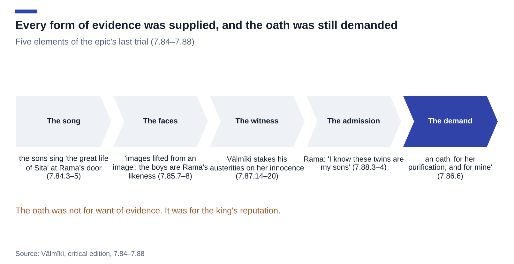

# Chapter 22. The Mother in the Hermitage: Lava, Kuśa and the Song That Summoned Her

::: {custom-style="Epigraph"}
"We are the grandsons of Raja Janak and the beloved sons of Sita … And we know not the name of our father."

— Avadhi women's song, quoted by Madhu Kishwar, *Manushi* 98 (1997), p. 24
:::

## The argument of this chapter

Between the banishment and the descent into the earth lie, in Vālmīki's chronology, some twelve years. They are the years of Sita's motherhood. She gives birth in a hermitage, raises two sons among ascetics and their families, and is summoned back to the court only when the boys, taught by the poet, sing her story before their father. Of all the periods of Sita's life, this is the one that the epic narrates most briefly and that the modern literature has found most fertile. It is also the one in which, for the first and only time in the story, Sita lives without a husband and without a captor: a household of her own, made of women ascetics, an old poet and two children.

This chapter reads that period, in Vālmīki, in Kālidāsa and Bhavabhūti, in the women's birth songs and in the modern retellings. It makes five claims.

1. The critical edition's account of Sita's motherhood is spare, but precise in ways that have rarely been noticed. The birth is attended by women; the boys are named by the poet; the community that receives Sita is a community of female ascetics, to whom the poet commends her "with the greatest affection".

2. The epic makes Sita's sons the instruments of her return. They are the poem's first performers, and the song they sing, "the great life of Sita", is the means by which Rama learns they are his. But their resemblance to him, which the assembly sees at once, is not enough to spare their mother the demand for an oath.

3. The women's songs of north and south India have made this period their own. They sing of Sita giving birth alone in the forest, of her pregnancy cravings, of her refusal of Rama's summons, and of children who do not know their father's name.

4. Modern retellings have made the hermitage the place where Sita becomes a single mother and a teacher, and the choice of her sons, whether to stay with her or to go to their father, a test of what her autonomy can secure.

5. The ending of the story is patrilineal. The mother returns to the earth; the sons inherit the kingdom. The hermitage, in which Sita built the only household that was ever hers, cannot hold the children it raised.

## The hermitage in Vālmīki

### The arrival

Chapter 1 followed Sita to the bank of the Ganga where Lakshmaṇa leaves her, and to the message she sends the king: "I do not grieve for my own body."^[CE 7.47.12.] What happens next is told in a short canto, and it deserves to be read closely, because it describes the community into which Sita is received.

The first to find her are children. The young sons of the hermits, hearing a woman weeping by the river, run to Vālmīki. "A woman never seen before," they tell him, "the wife of some great man, like Śrī herself, is weeping in a broken voice … like a goddess fallen from the sky; we do not think she is human."^[CE 7.48.1–4.] The poet goes to the river with water for her feet, and greets her by her relations: "daughter-in-law of Daśaratha, queen of Rama, daughter of King Janaka, welcome, faithful wife."^[CE 7.48.8.] And he tells her that he knows her innocence: "I know you are sinless, Sita, by the eye my austerities have given me."^[CE 7.48.10.]

Then he tells her where she will live:

> Not far from my hermitage there are female ascetics, established in austerity. They will care for you always, child, as one cares for a child.^[CE 7.48.11.]

Sita follows him to the women. They come out to greet the sage, and he presents her to them: "This is Sita, wife of the wise Rama, daughter-in-law of Daśaratha, daughter of Janaka, a virtuous woman, sinless, abandoned by her husband. I must protect her always. Look upon her, ladies, with the greatest affection; out of regard for my word, let her be especially honoured among you."^[CE 7.48.17–19.]

Three things in this short passage bear on the argument of this book. The first is that Vālmīki, the poet who will later testify to Sita's innocence before the assembly, pronounces her sinless at their first meeting, on the authority of his own spiritual sight, and without asking her a question. He does not test her. He knows. The contrast with the king, who knew and banished her anyway, is the epic's own.

The second is that the community Sita joins is a community of women. The *tāpasyaḥ*, the female ascetics, are not a decorative detail; they are the household into which she is placed and in which her children will be born. The epic, which has given Sita almost no female companions since she left Ayodhya, apart from the guards and friends of the Aśoka grove, gives her, at the moment of her abandonment, a community of women who are commanded to love her.

The third is the language of childhood. The poet calls Sita *vatsā*, "child", and asks the women to care for her "as one cares for a calf", *yathā vatsam*.^[CE 7.48.11.] The queen who has been abandoned is received as a daughter. In the hermitage, Sita is, for the first time since her marriage, someone's child again.

### The birth

The birth itself occupies a handful of verses, and they are framed by a coincidence the poet takes care to record. Śatrughna, Rama's youngest brother, on his way to fight the demon Lavaṇa, stops at Vālmīki's hermitage for a night. "On the very night that Śatrughna entered the leaf-hut, Sita gave birth to two boys."^[CE 7.58.1.] At midnight the hermits' sons bring the news to the poet, and ask him to perform a rite of protection for the infants. Vālmīki takes a fistful of *kuśa* grass and a cut tip, *lava*, and gives them names from the rite:

> The one born first is to be wiped with *kuśa* grass sanctified with mantras: let his name be Kuśa. The one born after is to be wiped with the cut tip, carefully, by the old women: let his name be Lava.^[CE 7.58.5–6.]

The detail of the old women, *vṛddhābhiḥ*, is easily passed over. It is the only indication in the critical edition of who attended Sita's labour: the elder women of the hermitage, who perform the rite on the younger child with the poet's grass. Sita gives birth among women, as women in India have given birth for most of history: away from the men of the family, attended by the older women of the community. Her husband is not there. His brother is asleep in a leaf-hut nearby, and is woken with the news at midnight, and says "Good fortune! Good fortune!"^[CE 7.58.10.] He does not, the epic implies, carry the news to Ayodhya. He goes on to his war.

### Twelve years

The epic then passes over the twelve years in which the boys grow up. We learn, later and indirectly, what they became: they were taught the Vedas, they were trained in music, they learned the poem by heart. When they come to Ayodhya, they are described as skilled in the theory of music, sweet-voiced, and "rich in voice".^[CE 1.4.4–9.] The years of Sita's motherhood are years of education, in a hermitage presided over by a poet. Her sons are raised to be singers of her life.

The silence of the epic about those years has been one of the great opportunities of the modern retellings. What did Sita do in the hermitage? Did she teach her sons? Did she tell them who their father was? Did she work, and at what? Did she grieve, or did she find a peace she had not known in the palace? The epic does not say. It gives the retellers twelve blank years and a community of women.

## The song that summoned her

### The commission

When Rama performs the horse-sacrifice, years later, Vālmīki comes to it with his disciples. And he gives the boys their instructions. They are to sing "the whole Rāmāyaṇa poem" everywhere: in the quarters of the sages, in the houses of Brahmins, in the streets and on the royal roads, in the houses of kings, "and especially at the door of Rama's palace, where the rite is in progress, before the priests".^[CE 7.84.3–5.] They are to sing twenty cantos a day. They are not to take money: "what is wealth to those who live in a hermitage, on fruit and roots?"^[CE 7.84.9–10.] If the king asks whose sons they are, they are to say only that they are Vālmīki's disciples.^[CE 7.84.11.] And they are not to show disrespect to the king, "for by dharma the king is the father of all beings".^[CE 7.84.13.]

The last instruction is the poet's irony, and it is unmistakable. The king is the father of all beings by dharma. He is the father of these two by birth, and does not know it. The boys are being sent to sing to their father, and told to respect him as every subject respects the king, while concealing the one fact that would make the respect personal.

### The performance

The performance is a sensation. Rama hears the song, "a new kind of recitation, adorned with music", and is curious; he summons the sages, the kings, the scholars and the old Brahmins and seats the two singers among them.^[CE 7.85.2–5.] And the assembly, looking from the boys to the king, sees what Rama does not yet see:

> They said to one another: both are like Rama, like images lifted from an image. If they did not wear matted hair and bark garments, we could see no difference between the singers and Rāghava.^[CE 7.85.7–8.]

The boys begin from the beginning of the poem and sing twenty cantos. Rama, delighted, orders Bharata to give them eighteen thousand pieces of gold. They refuse: "We live on the fruit and roots of the forest. What would we do with gold in the forest?"^[CE 7.85.13–15.] Rama asks who wrote the poem, and they tell him: Vālmīki, who is here at the sacrifice, and who composed it, in five hundred cantos, "from the beginning, up to the end of your life, good and ill".^[CE 7.85.19–20.]

For many days Rama listens. And then, the epic says simply, "when he had heard that song, he recognised Kuśa and Lava as Sita's sons".^[CE 7.86.2.]

### The resemblance is not enough

What follows is the scene Chapter 1 discussed as the second trial: Rama sends messengers to Vālmīki asking that Sita come to the assembly and take an oath of her purity. But the scene's preparation deserves to be read with the song in mind, because it exposes the logic of the demand with uncomfortable clarity.

Rama recognises the boys as his sons through the song. The assembly has already seen it on their faces. The boys are his image; they could be mistaken for him but for their hermit's clothes. Their existence and their resemblance are, by any standard a court of the period would have recognised, evidence of their mother's fidelity: they are the children of the husband from whom she was separated, born at the time the separation would require. If Sita's chastity had been the question, the boys would have answered it.

And yet Rama asks for an oath. His message is careful: "If she is of pure conduct, if she is free from sin, let her make her purification here, with the great sage's consent … Tomorrow at dawn let Maithilī, daughter of Janaka, take an oath in the midst of the assembly, for her purification, and for mine."^[CE 7.86.4–6.]

*For mine.* The phrase is *śodhanārthaṃ mameha ca*, "for the purpose of purification, and for me here". The oath is not for the boys' legitimacy, which the faces have settled. It is not for Rama's knowledge, which, he will tell the assembly a canto later, he already had: "I know these twins are my sons."^[CE 7.88.4.] It is for the purification of the king, whose reputation was stained by the rumour, and who requires that the woman he abandoned clear him of the charge of having kept her. The demand is a demand that Sita perform, once more, before the public whose opinion caused her banishment, so that the king may be cleansed of that opinion.

This is the precedent theory of kingship, examined in Chapter 18, at its most naked. The citizens' rumour stained the king; the king banished the queen to remove the stain; the queen's sons appear, carrying the evidence of her fidelity in their faces; and the king, rather than accepting the evidence, demands that the queen purify him before the citizens. The sons were the advocates. The song was the brief. The faces were the evidence. And the oath is still demanded.

### The poet as witness

Vālmīki's response to Rama's messengers is one of the most troubling verses in the seventh book. "So be it," he says. "Sita will do as pleases Rāghava; for the husband is a woman's deity."^[CE 7.86.10.] The poet who knew Sita's innocence at first sight, who received her as a daughter and commended her to the women of the hermitage, and who raised her sons to sing her life, agrees, on her behalf and without consulting her, that she will submit.

And then he testifies. When Sita comes to the assembly, walking behind him, her face lowered, her hands joined, her throat choked with tears, "with Rama in her mind", Vālmīki stands in the midst of the crowd and makes the longest speech of witness in the epic.^[CE 7.87.9, 7.87.13–20.] This Sita, he says, is faithful, devoted to dharma, sinless, abandoned near his hermitage by a husband afraid of public censure. These twins are her sons, and they are yours: "I speak the truth." He names his own lineage, the tenth son of Pracetas, and swears that he does not remember having spoken an untruth. He stakes the fruit of his austerities, thousands of years of them, on her innocence: "may I not enjoy their fruit if Maithilī is not sinless." He has examined her, he says, with the five elements and the mind as the sixth, and found her pure.

It is a magnificent testimony, and it is not enough. Rama accepts it, graciously; he says that the poet's words have given him confidence, that Sita had already given proof before the gods in Laṅkā, that he abandoned her out of fear of the world knowing her to be sinless, and asks the poet's forgiveness.^[CE 7.88.2–3.] But he does not withdraw the demand for the oath. Sita swears, and the earth opens.

Chapter 18 noted that the *dharmaśāstra* tradition regarded divine proof as a last resort, to be used only when human evidence fails. Here human evidence has not failed. There are the boys' faces; there is the testimony of the greatest sage in the assembly, staked on his austerities; there is the king's own admission that he knew. The oath is demanded in spite of the evidence, not for want of it. It is the clearest demonstration in the epic that the trial of Sita was never a search for truth.

## Kālidāsa and Bhavabhūti: the pregnant queen and the forest of memory

### "Tell the king, from me"

Kālidāsa, in the fourteenth canto of the *Raghuvaṃśa*, gives the banished Sita a message for Rama that Chapter 1 and Chapter 4 discussed.^[See Chapters 1 and 4; Kālidāsa, *Raghuvaṃśa* 14.61.] What should be added here is that the message is the message of a pregnant woman. Kālidāsa makes Sita's pregnancy the centre of her response to the banishment: she will not take her own life, she says, because she carries Rama's child; she will practise austerities after the birth, gazing at the sun, so that in another life too he may be her husband, and they may not be parted.^[Kālidāsa, *Raghuvaṃśa* [W005] 14.65–66† (pinpoints to be verified).]

The modern reader may find the wish for reunion in another life hard to bear. But the logic of the message deserves to be taken seriously. Sita does not forgive Rama; the opening of her message, asking whether his act befits his lineage, is a judgement. She declines to die, and her reason is her child. She declares that she will live, for the child's sake, and that her ascetic practice afterwards will be her own: directed at a future life, chosen by her. The pregnant Sita of the *Raghuvaṃśa* is a woman who decides to survive, and who gives her reasons.

### Bhavabhūti's forest

Bhavabhūti's *Uttararāmacarita*, discussed in Chapter 4, sets its central acts in the forest where Rama and Sita lived in exile, years after the banishment. The invisible Sita, made unseeable by the power of the river goddesses, watches Rama grieve for her in the places they shared. And the play's last act stages, before Rama, a play composed by Vālmīki and performed by celestial actors, in which the birth of the twins and Sita's descent are shown; Rama, watching, faints; and the play-within-the-play gives way to the reunion of the family.^[Bhavabhūti, *Uttararāmacarita*, act 7† (pinpoints to be verified); see Chapter 4.]

What Bhavabhūti adds to the story of Sita's motherhood is the figure of the sons as a bridge. In the play, the boys meet their father before they know who he is; Lava fights Rama's army in defence of his hermitage; Rama is moved by the boys without knowing why. The sons are the means by which the family is reconstituted, and the play ends, as the Sanskrit stage required, in reunion.^[See Chapter 21 on the drift of the Sanskrit stage towards the happy ending.] The modern novelists who refuse the reunion are refusing, among other things, the use of the children as the instrument of the mother's return.

## The women's songs: birth in the forest

### The songs of childbirth

Nabaneeta Dev Sen listed the sub-themes of the village women's songs of Sita, and the list is weighted towards the very period the epic passes over: the need to bear a son, the pregnancy cravings, the childbirth, the abandonment.^[Nabaneeta Dev Sen, "When Women Retell the Ramayan," *Manushi* 108 (1998): 20.] "They call it the Ramayan," she wrote, "but it is of Sita that they sing", and their favourite episodes come from the first and seventh books, "the two so-called spurious books".^[Dev Sen, "When Women Retell the Ramayan," 19.] The women's Rāmāyaṇa is, disproportionately, a Rāmāyaṇa of Sita's motherhood.

The songs of pregnancy are among the most intimate. Dev Sen notes a question at their heart, "what does Sita, the individual, desire for herself?", and quotes a Marathi song in which Sita tells the women, "Ram has no compassion, I am five months pregnant."^[Dev Sen, "When Women Retell the Ramayan," 23.] The pregnancy cravings of the queen are, in Vālmīki, the occasion of the banishment: Rama asks Sita what she desires, and she says she wishes to visit the hermitages by the Ganga, and he uses the wish as the pretext for sending her away.^[See Chapter 1 on the pretext of the visit to the hermitages.] The women's songs remember that the banished woman was pregnant, and that her husband used her desire against her. They sing the cravings as a woman's knowledge of her own body, set against a man's use of it.

### Giving birth alone

The songs of birth in the forest are the women's answer to the epic's few verses. In them, Sita gives birth alone, or with the help of forest women, and the details are those of an Indian village birth: the lamp, the cut cord, the need for someone to fetch water. Dev Sen quotes a Maithili song of birth in exile whose refrain is a sigh: "Alas! if only Ram would understand!"^[Dev Sen, "When Women Retell the Ramayan," 25.]

In the north Indian genre of the *sohar*, the songs sung at the birth of a son, Sita's birth in the forest is a recurring subject, and in several *sohar* songs recorded by scholars from eastern Uttar Pradesh and Bihar, the news of the birth is carried to Ayodhya, Rama sends for Sita, and Sita refuses to return.^[Smita Tewari Jassal, *Unearthing Gender: Folksongs of North India* (Durham, NC: Duke University Press, 2012), chap. 4, "Sita's Trials" [W142] (pinpoints to be verified).] The refusal is the women's: sung at the birth of a son, in the women's quarters, by women celebrating the continuation of a husband's lineage. In the middle of a celebration of patrilineal continuity, the women sing of a mother who will not take her son back to his father's house.

Kishwar quotes a song from Avadh, collected by Vidya Bindu Singh, in which the sons themselves speak, and which is the epigraph of this chapter: "We are the grandsons of Raja Janak and the beloved sons of Sita … And we know not the name of our father."^[Madhu Kishwar, "Yes to Sita, No to Ram! The Continuing Popularity of Sita in India," *Manushi* 98 (January–February 1997): 24.] The boys name their mother's father and their mother. They do not name their own. In a society in which a child's identity is his father's name, the song's boys are their mother's sons, and their maternal grandfather's grandsons, and they say so with pride. The patrilineal order of the epic, in which the boys are recognised as Rama's by their faces, is inverted in the women's song, in which they identify themselves by Sita and Janaka.

### The cravings and the grinding stone

Dev Sen describes, too, the songs sung at the grinding stone, in which women laugh at themselves even as they sing of Sita's suffering.^[Dev Sen, "When Women Retell the Ramayan," 27.] The setting matters. The grinding stone is a site of women's daily labour, and the songs sung there are work songs: they pace the work, and they make it bearable. Sita's motherhood, in these songs, is sung by women at work, and it is sung as the work of a woman: the labour of birth, the labour of raising children alone, the labour of feeding them in the forest. The epic gives Sita's sons a poet for a teacher. The songs give them a mother who works.

## The modern hermitage: the single mother

### The novel's twelve years

The modern retellings have filled the twelve blank years in many ways, and their choices tell us what each has needed Sita to be.

In Chitra Banerjee Divakaruni's *The Forest of Enchantments*, the hermitage years are years of growth: Sita raises her sons, works, learns the healing arts and comes to a new understanding of herself; the boys are her pupils as well as Vālmīki's.^[Chitra Banerjee Divakaruni, *The Forest of Enchantments* (Noida: HarperCollins India, 2019) [W169] (pinpoints to be verified).] The novel's Sita becomes, in the hermitage, the self-sufficient woman the contemporary reader wishes her to be: a single mother who is complete without her husband.

In Volga's *The Liberation of Sita*, the hermitage is the place from which Sita's encounters with the other wronged women of the epic proceed, and the cycle's hardest lesson concerns her sons. Reṇukā, the mother killed at her son's hand, teaches Sita that the boys she has raised will belong to their father, and that the patrilineal order will reclaim them; Sita's liberation includes the release of her attachment to them as Rama's heirs.^[Volga, *The Liberation of Sita*, trans. T. Vijay Kumar and C. L. L. Jayaprada (Noida: HarperPerennial, 2016) [W107]; see Chapter 8.] Volga's Sita does not build her freedom on her children. Her liberation, as Chapter 8 argued, consists in the recognition that she belongs to herself, and the recognition includes the acceptance that her sons belong to their father's world. It is one of the most painful lessons in the modern literature, and Volga does not soften it.

In other retellings, the sons stay with their mother; or the mother sends them to their father so that they may inherit; or the mother teaches them to judge their father. In the most uncompromising, the sons themselves refuse the father, as the women's songs suggested they might. The range of choices is the range of what the modern imagination thinks a mother's autonomy can secure for her children in a patrilineal world.

### The single mother as icon

In contemporary popular culture, Sita in the hermitage has become an icon of single motherhood. The image is everywhere in the language of women's magazines and social media: Sita as the mother who raised two sons alone, without support from their father, and raised them well. The image has real force. Single mothers in India face social stigma, legal difficulty and economic hardship, and a figure from the tradition who did what they do, and was revered for it, is a resource.

But the image also simplifies. Vālmīki's Sita did not raise her sons alone; she raised them in a community of women ascetics and under the protection of a poet who had the authority to send them to the king. Her single motherhood was supported by an institution, the hermitage, that the modern single mother does not have. And it ended, in the epic, with the children's return to their father and the mother's departure from the world. The icon of the single mother takes the twelve years and leaves out the ending.

### The screen: *Lava Kusa*

The popular cinema has told this part of the story more often, and more successfully, than any other medium. In Telugu, the story of Lava and Kuśa was filmed in 1934, and again in 1963, when *Lava Kusa*, directed by C. Pullaiah and C. S. Rao, with N. T. Rama Rao as Rama and Anjali Devi as Sita, became one of the most successful films in the history of Telugu cinema.^[*Lava Kusa* (dir. C. Pullaiah and C. S. Rao, 1963)† (production details to be verified).] Its songs remain famous. Its subject is precisely the period this chapter has examined: the banishment, the hermitage, the boys' song, the capture of the sacrificial horse, the battle of the sons against their father's army, and the reunion that is also a farewell.

On television, Ramanand Sagar's serial, which had ended with the coronation, was followed in 1988 by a sequel covering the seventh book, which included the story of the twins.^[On Sagar's serial and its sequel, see Chapter 15 and the scholarship cited there.] Kishwar's observation that Sagar "was forced to deviate from his text and show the agnipariksha to be a mock one" testifies to the pressure an audience could exert on the representation of Sita's trials.^[Kishwar, "Yes to Sita, No to Ram!" 29.] The story of the sons was the story through which the popular audience was willing to watch the banishment: because it ended with the children's triumph, it made the mother's suffering bearable.

## The patrilineal ending

### The mother goes; the sons stay

The last chapter of the epic's account of Sita's motherhood is the descent. Sita swears; the earth opens; she is taken. And the sons remain. Later in the seventh book, when Rama prepares to leave the world, he divides his kingdom: Kuśa is consecrated king of Kosala, Lava of the north, and cities are built for them.^[CE 7.97.17–18; 7.98.4.] The boys who were raised in a hermitage, who refused the king's gold because they had no use for it in the forest, become kings. Their mother's household is dissolved; their father's kingdom absorbs them.

The ending is patrilineal in the strict sense: the sons inherit from the father, and the mother's line, her household, her teaching and her community of women disappear from the story. The hermitage that raised the boys could not keep them. The women ascetics, commanded to love Sita, are never mentioned again.

### What the mother refused

Chapter 1 argued that Sita's descent into the earth is a refusal: of the second ordeal, of the court, of the king. It should be added here that it is also, inescapably, a departure from her children. Sita chooses the earth over the oath, and in choosing it she leaves her sons, who have just been recognised by their father, at the moment of their entry into his world.

The modern reader may ask whether the choice was a mother's choice. Several of the retellings ask the same question, and their answers differ. For some, the descent is a mother's sacrifice: Sita goes so that her sons may be accepted without the shadow of her trial. For others, it is a woman's refusal that a mother's love could not override: she would rather leave her children than submit once more. For Volga, the sons were always destined for their father's world, and the mother's freedom begins with accepting it.

The epic does not tell us what Sita thought of her sons at the moment of her oath. It tells us that she came to the assembly with Rama in her mind, and that she swore by her fidelity to him.^[CE 7.87.9; 7.88.10.] The poet's silence about her children, at the moment she leaves them, is one of the most eloquent silences in the poem. The women's songs fill it. The novels fill it. The reader who has followed Sita from the furrow to the hermitage may wish to leave it unfilled: a mother's last thought, which no one recorded, because no one asked.

::: {custom-style="Box Title"}
Reading Against the Text
:::

::: {custom-style="Box"}
The assembly sees at once that the boys are Rama's image (7.85.7–8); Vālmīki stakes his austerities on Sita's innocence (7.87.18); Rama admits that he knew she was sinless and that the twins are his (7.88.3–4). And still the oath is demanded, "for her purification, and for mine" (7.86.6). If every form of evidence has been supplied, what is the oath for? Whose purity is at stake in the final scene?
:::

::: {custom-style="Box Title"}
The Debate: Motherhood
:::

::: {custom-style="Box"}
**Position A:** Sita's motherhood is her vindication: she raises the king's heirs in adversity, and her sons restore her to honour.\
**Position B:** Sita's motherhood is the means of her final subjection: her sons' song summons her to the assembly where the oath is demanded, and her sons' inheritance is the price of her departure.\
**Where the evidence of this chapter leaves the argument.** The critical edition supports both and allows neither to stand alone. The sons are the instrument of Sita's return to court; their faces and the poet's testimony are evidence of her fidelity; and yet the oath is demanded, and the mother departs while the sons inherit. The women's songs, which make the sons name their mother and their mother's father, and the *sohar* songs in which Sita refuses Rama's summons, imagine a third position the epic does not contain: motherhood as the ground of a woman's refusal rather than of her return.
:::

## Conclusion

The twelve years of Sita's motherhood are the most lightly told years in Vālmīki and among the most fully imagined in the traditions that came after him. The critical edition gives her a community of women ascetics, a birth attended by elder women, a poet who knows her innocence without testing her, and two sons raised to sing her life. It makes the sons the instruments of her return, and their song the means by which Rama recognises them; and it shows, with a clarity that the modern retellings have rarely matched, that their faces, the poet's oath and the king's own knowledge were not enough to spare her the final demand. The women's songs remembered the pregnant queen, the birth in the forest and the sons who know their mother's name and not their father's. The modern novels made the hermitage the home of a single mother and a teacher. The epic's ending is patrilineal: the mother goes into the earth, the sons go into the kingdom. The household that was Sita's own could not keep the children it raised. What she thought, when she left them, no one asked.
