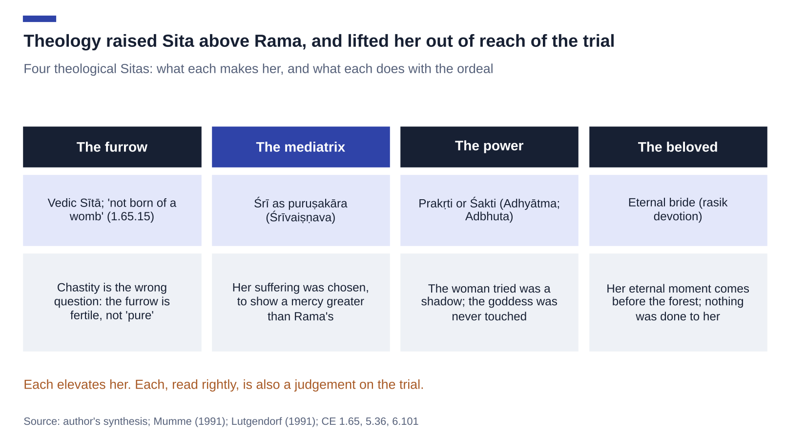

# Chapter 23. The Theologians' Sita: Furrow, Mediatrix, Śakti and Beloved

::: {custom-style="Epigraph"}
*ānṛśaṃsyaṃ paro dharmas tvatta eva mayā śrutaḥ*

"Non-cruelty is the highest dharma: I learned it from you yourself."

— Sītā to Rama, in the message she sends through Hanumān, Vālmīki *Rāmāyaṇa* 5.36.34 (CE)
:::

## The argument of this chapter

Most of this book has read Sita as a character: a woman in a story, who speaks, argues, refuses and is judged. But for most of the people who have known her story over the last thousand years, Sita has not been only a character. She has been a goddess: Śrī, the consort of Viṣṇu, descended into the world; the furrow-goddess of the Vedic ploughman; the primal power, Śakti, of which Rama is the vessel; the beloved of the devotee, in whose eternal palace garden the soul longs to serve. The theologians' Sita is the Sita of the temple, the liturgy and the commentary, and the modern literary imagination, which this book has studied, has been shaped by her even when it has rebelled against her.

This chapter examines four theological Sitas and asks what each does with the question this book has pressed throughout: the question of justice. It makes five claims.

1. Sita's divinity is older than the epic. Before she was a princess, Sītā was the furrow, worshipped by ploughmen in the Vedic hymns; Vālmīki's account of her birth from the earth preserves that origin, and her return to the earth completes it.

2. The Śrīvaiṣṇava tradition of south India made Sita the mediatrix (*puruṣakāra*) between the soul and God, and read her mercy towards her guards as a compassion greater than Rama's own. This is the most theologically powerful reading of Sita in the Hindu traditions, and it supplies, from within devotion, a standard by which Rama's judgements can be measured.

3. The *Adhyātma Rāmāyaṇa* and the Śākta traditions made Sita the primal power, Prakṛti or Śakti, of whom Rama's acts are the expression. In these readings, the woman who was tried was not the goddess; the goddess was elsewhere.

4. The *rasik* tradition of Ayodhya and Mithila made Sita the beloved and the gate: the devotee who would reach Rama must become a companion of Sita, and male ascetics adopted women's identities to do so. Its Sita is an eternal bride, untouched by the exile, the ordeal and the banishment.

5. Theology elevates Sita and, in elevating her, tends to exempt the story from the question of justice. If Sita is a goddess who chose her suffering, no one wronged her. The modern retellings that insist on the injustice are, among other things, a refusal of the theological exemption; and yet the theologians' own readings, rightly heard, contain some of the sharpest judgements on Rama in the tradition.

## The furrow

### The Vedic goddess

The word *sītā* means a furrow, the line cut by the plough. In the *Ṛgveda*, in a hymn to the lord of the field, the furrow is addressed as a goddess: "Come near, auspicious Sītā; we worship you, that you may be bountiful to us, that you may be fruitful to us."^[*Ṛgveda* 4.57.6–7† (locator to be verified against a standard edition).] In the domestic ritual manuals, a sacrifice to Sītā, the furrow, accompanies the ploughing, and she is named as a consort of Indra, the god of rain.^[On the *sītāyajña* in the *gṛhyasūtras*, see the standard handbooks of Vedic ritual† (pinpoints to be verified).] The goddess of the furrow is the earth's fertility, opened by the plough and fed by the rain.

Vālmīki's account of the heroine's birth preserves the goddess. King Janaka tells Viśvāmitra that, as he was ploughing a field, "she rose from the plough … found as I cleared the field, she is known by the name Sita"; and he calls her *ayonijā*, "not born of a womb".^[CE 1.65.14–15.] The heroine is named for the furrow because she is the furrow's daughter. Chapter 6 read this birth in the light of modern ecological thought, and examined the Malayalam play *Kāñcana Sīta* in which Sita is identified with nature itself.^[See Chapter 6.] What should be added here is the theological observation that frames the whole story: the woman whose body is examined for impurity by her husband and his subjects was, in her origin, the earth's own fertility, the sacred furrow that no human womb produced.

### The return to the furrow

The ending of the story completes the origin. When Sita swears that she has never thought of any man but Rama, and asks the goddess Mādhavī, the earth, to receive her, a throne rises from the ground on the heads of serpents, and the earth takes her in her arms and seats her there.^[CE 7.88.10–13.] The daughter of the furrow returns to the furrow. The modern feminist readings that see the descent as a refusal, and the ecological readings that see it as a homecoming, are in agreement with the oldest layer of the tradition: Sita belongs to the earth, and the earth takes her back.

What the Vedic origin adds to the argument of this book is a reminder that the question of Sita's "purity" is, from the standpoint of her origin, a category error. The furrow is not pure or impure; it is fertile. It is opened by the plough, and it bears. The ploughman does not ask whether the furrow is chaste. The transformation of the furrow-goddess into a queen whose chastity must be proved by fire is, among other things, a history of the moralisation of fertility: the conversion of the earth's bounty into a woman's sexual fidelity, and of the ploughman's gratitude into a husband's suspicion.

## Śrī the mediatrix

### The Śrīvaiṣṇava Rāmāyaṇa

In the Śrīvaiṣṇava tradition of Tamil south India, founded on the hymns of the Āḻvārs and the theology of Rāmānuja and his successors, the Rāmāyaṇa occupies a special place. The tradition calls it the *śaraṇāgati-śāstra*, the scripture of surrender, because it contains, in Rama's acceptance of Vibhīṣaṇa, the classic statement of God's promise to protect whoever takes refuge in him: "To one who comes to me even once, and begs, saying 'I am yours', I grant freedom from fear from all beings: this is my vow." Rama adds that he would accept Vibhīṣaṇa, "or Ravana himself", if he came for refuge.^[CE 6.12.20–21.]

In Śrīvaiṣṇava theology, the soul's surrender to God is mediated by Śrī, the goddess, Viṣṇu's inseparable consort, who intercedes on behalf of the soul and turns God's justice into mercy. Her role is called *puruṣakāra*, a term usually translated "mediatrix" or "intercessor": she is the one who recommends the soul to the Lord, and whose presence makes the Lord approachable. And since Sita is Śrī descended, the Rāmāyaṇa is read, in this tradition, as the story of Śrī's mediation.^[On the Śrīvaiṣṇava doctrine of Śrī as mediatrix, see Vasudha Narayanan, *The Way and the Goal: Expressions of Devotion in the Early Śrī Vaiṣṇava Tradition* (Washington, DC: Institute for Vaishnava Studies, 1987)† (pinpoints to be verified).]

### The mercy greater than Rama's

The most remarkable product of this reading is an argument, developed in the commentarial literature of the Teṅkalai school of Śrīvaiṣṇavism, that Sita's compassion is greater than Rama's. Patricia Mumme's study of Teṅkalai Rāmāyaṇa exegesis, published in Paula Richman's *Many Rāmāyaṇas*, shows how the tradition's teachers read the epic's episodes as illustrations of the relation between Śrī and the Lord, and how Sita's protection of the *rākṣasī* guards was set beside Rama's protection of those who took refuge in him.^[Patricia Y. Mumme, "Rāmāyaṇa Exegesis in Teṅkalai Śrīvaiṣṇavism," in *Many Rāmāyaṇas: The Diversity of a Narrative Tradition in South Asia*, ed. Paula Richman (Berkeley: University of California Press, 1991) [W074]† (pinpoints to be verified).]

The argument rests on two episodes, both of which this book has read in the critical edition. The first is the episode of the crow. In the *Sundarakāṇḍa*, Sita gives Hanumān a token to take to Rama: the memory of a crow, a son of Indra, that attacked her at Citrakūṭa, and against which Rama loosed a blade of grass charged with the power of the Brahma weapon. The crow fled through the three worlds; abandoned by his father, the gods and the sages, he came back to Rama for refuge; and Rama, "though he deserved death", protected him in compassion, taking only one of his eyes.^[CE 5.36.16–32.] Rama's mercy, in this episode, is mercy to one who surrendered.

The second is the episode Chapter 19 examined: Sita's refusal, after the war, to let Hanumān punish the guards who had threatened her. "Who would be angry with slave-women dependent on a king's protection, acting at another's command?" she asks; and she concludes that a noble person shows compassion even to those who deserve death, "for there is no one who does not err".^[CE 6.101.30, 6.101.36.] The guards did not surrender. They did not ask for mercy. Sita gave it unasked.

Set side by side, the two episodes yield the Teṅkalai argument: Rama protects those who take refuge in him; Sita protects those who have not even asked. Her compassion precedes the soul's surrender; his follows it. And so, in the tradition's own terms, the goddess is more merciful than the god.

### The standard within devotion

This reading has an importance for the argument of this book that has rarely been recognised. Chapter 18 measured Rama's judgements of Sita against the principles of natural justice and found them wanting; Chapter 19 showed that the epic places Sita's speech of mercy immediately before Rama's speech of condemnation, as two theories of judgement. A reader might object that both chapters apply external, modern standards to a sacred text. The Śrīvaiṣṇava tradition answers the objection from within devotion. A school of medieval Hindu theology, reading the Rāmāyaṇa as scripture, concluded that Sita's mercy exceeds Rama's, and that her compassion towards the undeserving is the higher form of the divine.

The critical edition supports the tradition more directly than the commentators knew. In the very message that contains the story of the crow, Sita reminds Rama of what he did for her then, and asks why he has not done as much now:

> For my sake, you loosed the Brahma weapon at a mere crow. Why do you forgive the one who carried me away from you, lord of the earth?^[CE 5.36.33.]

And she adds the line that is this chapter's epigraph: "Show great energy, and compassion towards me, bull among men: non-cruelty is the highest dharma, I learned it from you yourself."^[CE 5.36.34.] Sita, the captive, instructs her husband in his own dharma, quoting him back to himself. The goddess of the Śrīvaiṣṇava theologians is already, in the poem, the teacher of the god.

### The cost of the doctrine

The Śrīvaiṣṇava reading has a cost, and it is the cost of all theodicy. If Sita's captivity was a voluntary descent, undertaken so that she might show mercy to the *rākṣasīs* and rescue the world, then her suffering was not inflicted but chosen; and if it was chosen, the question of who wronged her dissolves. The commentarial tradition does not deny the ordeal or the banishment. But it reads them, as it reads everything in the story, as the *līlā*, the play, of the divine couple, whose separation is apparent and whose union is eternal. Within that frame, Rama's harshness at the fire is a play of harshness, and Sita's grief a play of grief.

This book has argued against such readings when they appear in modern apologetics, which use the doctrine of *līlā* to excuse the injustice of the story. But it should be said that the medieval theologians did not use it to excuse Rama. They used it to exalt Sita. In their reading, the goddess who suffered was the goddess who showed mercy, and her mercy was the measure of the divine. The modern apologist who reaches for *līlā* to protect Rama is borrowing the theologians' frame without their conclusion.

## Prakṛti and Śakti

### The *Adhyātma Rāmāyaṇa*: the real Sita and the shadow

The *Adhyātma Rāmāyaṇa*, a Sanskrit retelling composed probably in the fourteenth or fifteenth century and transmitted as part of the *Brahmāṇḍa Purāṇa*, reread the epic through Advaita Vedānta.^[*Adhyātma Rāmāyaṇa* [W010]; on its date and doctrine, see the introduction to the translation by Rai Bahadur Lala Baij Nath (Allahabad: Panini Office, 1913)† (pinpoints to be verified).] In its theology, Rama is the supreme Brahman, the absolute; Sita is Prakṛti, primal nature, or Māyā, the power through which the absolute appears as the world. Early in the text, Sita herself instructs Hanumān in the doctrine: Rama, she says, is the supreme Brahman, and she is the primal Prakṛti, by whose power all the acts attributed to Rama are performed.^[*Adhyātma Rāmāyaṇa*, *Bālakāṇḍa*, canto 1† (verses to be verified).]

The theology of the *Adhyātma* is the source of the shadow device that Chapter 2 traced into Tulsīdās. Before the abduction, Rama tells Sita to enter the fire and leave a shadow, a Māyā-Sītā, in her place; it is the shadow that Ravana carries off, and the shadow that enters the fire at Laṅkā, from which the real Sita emerges.^[See Chapter 2.] The device is theological before it is moral. If Sita is the power of Māyā, the creator of appearances, then the Sita who appears to be abducted is herself an appearance, and the real Sita, the power behind appearances, cannot be touched.

### The Śākta Sita

The Śākta traditions, which worship the goddess as the supreme reality, went further. In the *Adbhuta Rāmāyaṇa*, discussed in Chapter 2, it is Sita, not Rama, who kills the most powerful Ravana, the thousand-headed elder brother of the familiar one, after Rama has been struck down; she takes the terrible form of Kālī, and the gods must pacify her.^[*Adbhuta Ramayana* [W009]; see Chapter 2.] And in a late Upaniṣad that bears her name, the *Sītā Upaniṣad*, Sita is the primal power itself, the source of the three Vedas and of creation, worshipped in three forms: as will, as action and as manifest power.^[*Sītā Upaniṣad*† (text and verses to be verified).]

In the Śākta reading, the relation between Rama and Sita is inverted. He is the vessel; she is the power. His victories are hers. And the ordeal, in such a theology, is close to absurd: the power by which the fire burns cannot be tested by the fire.

### What the shadow costs

Chapter 2 argued that the shadow device protects Sita from the ordeal at the price of making the woman who suffered unreal. The theology of Prakṛti and Śakti explains why the device was theologically compelling and why it was ethically costly. Theologically, it preserved the goddess's transcendence: she could not be abducted, touched or tried, because she is the power behind all appearances. Ethically, it moved the injustice into the realm of appearance. The woman who was carried off, who argued with Ravana with a blade of grass between them, who was condemned before the armies and walked into the fire, was a shadow. What happened to her did not happen to Sita.

The consequence for the women who heard the story is the one Chapter 20 observed on the indenture plantations. A theology that removed the injustice from the goddess did not remove it from women's lives; it removed the goddess from the scene of the injustice. The women who were judged, as the shadow was judged, had no fire god to keep their real selves safe.

## The beloved

### The *rasik* tradition

In the sixteenth and seventeenth centuries, within the Rāmānandī order of north Indian ascetics, there developed a form of devotion to Sita and Rama modelled on the erotic devotion of the Kṛṣṇa traditions. Its practitioners called themselves *rasiks*, connoisseurs of the divine *rasa*, the aesthetic and emotional flavour of the divine couple's love. Philip Lutgendorf's essay "The Secret Life of Rāmcandra of Ayodhya", in Richman's *Many Rāmāyaṇas*, introduced the tradition to many readers; Peter van der Veer's ethnography of Ayodhya's ascetic orders, *Gods on Earth*, described its institutions.^[Philip Lutgendorf, "The Secret Life of Rāmcandra of Ayodhya," in *Many Rāmāyaṇas*, ed. Richman [W074]†; Peter van der Veer, *Gods on Earth: The Management of Religious Experience and Identity in a North Indian Pilgrimage Centre* (London: Athlone Press, 1988)† (pinpoints to be verified).]

The *rasik*'s devotion is directed to an eternal Rama and Sita, living in a heavenly Ayodhya or Mithila, in palaces and gardens, in perpetual union. Its theme is not the epic's war but the couple's love: their meeting in the garden at Janakpur before the bride-choice, their wedding, their play in the groves. The devotee seeks to enter this play, and the way in is through Sita. The *rasik* imagines himself as one of Sita's *sakhīs*, her female companions and attendants, who arrange the couple's meetings and serve them in their intimacy. Male ascetics of the tradition took female names, and some adopted women's dress and manners in their devotional practice. In some currents of the tradition, Sita is regarded as superior even to Rama, the source of his joy, and the devotee's access to him depends wholly on her favour.^[Lutgendorf, "The Secret Life of Rāmcandra of Ayodhya"† (pinpoints to be verified).]

### The bride without the forest

The *rasik* Sita is, in one sense, the most exalted Sita of the north Indian traditions. She is the gate to the divine, the mistress of the devotee, the one whose favour is everything. And she is, in another sense, the most completely removed from the story this book has read. The *rasik*'s eternal Ayodhya has no exile, no Laṅkā, no ordeal and no banishment. Its Sita is a perpetual bride, playing in the garden in which she first saw Rama. The *rasik* devotion has chosen, as its eternal moment, the moment in Sita's life before anything was done to her.

The choice has a logic that the tradition would defend: the eternal *līlā* is the reality, the epic's events are its temporal reflection, and the soul seeks the eternal. But its effect is to construct a Sita of perfect joy, enshrined in temples such as the Kanak Bhavan in Ayodhya, which tradition holds to be Sita's own palace, a gift from Kaikeyī at her wedding.^[On the Kanak Bhavan and the *rasik* temples of Ayodhya, see van der Veer, *Gods on Earth*† (pinpoints to be verified).] The Sita of the Kanak Bhavan has never been to the forest.

### Sītārām and Jai Shri Ram

The *rasik* tradition's emphasis on Sita survives in the everyday language of north Indian devotion. The common greeting "Sītārām", or "Jai Siyārām", names Sita first; the devotional cry "Siyāvar Rāmcandra kī jay", "victory to Rāmcandra, husband of Siyā", identifies Rama by his wife. Tulsīdās opens the *Mānas* with a salutation to Sita as the cause of the creation, maintenance and dissolution of the world, the remover of affliction and the giver of all good, and declares that he bows with joined hands to the whole world, knowing it to be pervaded by Sita and Rama.^[Tulsīdās, *Rāmcaritmānas* [W016], *Bālakāṇḍa*, invocatory verse 5 and 1.8† (locators to be verified).]

Observers of the Ayodhya movement of the 1980s and 1990s noted that its slogan, "Jai Shri Ram", "victory to Lord Rama", displaced in political usage the older greetings that named Sita first.^[On the slogans of the Ayodhya movement, see the scholarship cited in Chapters 15 and 17 (pinpoints to be verified).] Chapter 17 examined the posters of the movement, in which Rama stands alone; Kishwar's observation that "He stands alone only in the BJP's propaganda and posters" applies to the slogan as to the image.^[Madhu Kishwar, "Yes to Sita, No to Ram! The Continuing Popularity of Sita in India," *Manushi* 98 (January–February 1997): 24–25.] The theological tradition that made Sita the gate to Rama, and the greeting that named her first, were displaced in the language of the movement by a cry in which she does not appear. The history of Sita's afterlife includes the history of her disappearance from a greeting.

## Shrines without Rama

The theologians' Sita has her own temples. In Mithila, where she is regarded as the daughter of every household, Sitamarhi in Bihar is held to be the place of her birth from the furrow, and the great Jānakī temple at Janakpur, across the border in Nepal, built in the early twentieth century, is among the most important shrines of the region.^[On Janakpur and Sitamarhi, see Chapter 20.] In Sri Lanka, a temple at the place called Sita Eliya, in the hill country, is visited by pilgrims as the site of her captivity.^[On Sita Eliya, see the travel and pilgrimage literature on the "Ramayana trail" (citations to be verified).] Across India, sites associated with her exile, her kitchen (*Sītā kī rasoī*), her bath (*Sītā kuṇḍ*) and her footprints mark the map of her life.

Most of these sites are shared with Rama. But some are not. Kishwar described a temple at Raveri, in Yavatmal district of Maharashtra, dedicated to Sita without Rama: a shrine, according to local tradition, at the place where the banished Sita lived, in which she is worshipped alone.^[Kishwar, "Yes to Sita, No to Ram!" 25.] The temple without Rama is the theological counterpart of the women's songs that call Rama "stone-hearted": an act of devotion that chooses Sita and declines her husband. It is also, in the vocabulary of the *rasik* tradition, a kind of inversion. The *rasik* reaches Rama through Sita. The devotee at Raveri reaches Sita, and stops.

## Theology and justice

### The exemption

The four theological Sitas this chapter has examined share a feature. Each elevates Sita above the human plane on which the epic's injustice occurs. The furrow-goddess is beyond chastity; the mediatrix chose her suffering to show mercy; Prakṛti cannot be touched because the abducted Sita was a shadow; the beloved lives in a garden where nothing was done to her. Each, in elevating her, offers an exemption from the question of justice: if the goddess chose, or was not there, or is eternal, then no one wronged her.

The modern literature that this book has studied is, in large part, a refusal of this exemption. The novelists who write Sita in the first person, who make her grieve, argue and refuse as a woman, are insisting that what happened to her happened to someone. Ranganayakamma's footnotes, Volga's encounters, Sarah Joseph's monologues and the women's songs all assume that Sita suffered, and that her suffering was inflicted. In this sense, the modern literary imagination has been, among other things, a secularisation of Sita: a return of the goddess to the human plane, where justice can be asked of those who judged her.

### The judgement within

And yet the theologians' readings contain, as this chapter has tried to show, some of the sharpest judgements on Rama in the tradition. The Teṅkalai commentators concluded that Sita's mercy exceeds his. The *rasiks* made her the gate, without whom he cannot be approached. The Śākta texts made her the power, of whom he is the vessel. The *Mānas* salutes her before him, and the greeting of the north names her first. Within devotion, again and again, Sita is placed above Rama: more merciful, more powerful, more necessary.

The theologians did not use this elevation to condemn Rama. But the modern reader may draw the conclusion they declined to draw. If Sita's mercy is the highest form of the divine, then the judgement that condemned her without mercy is not divine. If she is the power, the judgement of the vessel on the power is a usurpation. The theologians' Sita, rightly heard, is the strongest witness in the tradition against the trial that the epic records. She told Rama, from captivity, that non-cruelty is the highest dharma, and that she had learned it from him. The theologians believed her.

::: {custom-style="Box Title"}
Reading Against the Text
:::

::: {custom-style="Box"}
The Teṅkalai commentators read Sita's protection of the guards as a mercy greater than Rama's protection of the crow, because she gave it unasked. If a medieval devotional tradition could conclude, from within scripture, that the goddess is more merciful than the god, why is it that the modern defence of the Rāmāyaṇa so often treats any comparison of Sita's judgement with Rama's as an attack on the faith?
:::

::: {custom-style="Box Title"}
The Debate: Divinity
:::

::: {custom-style="Box"}
**Position A:** Sita's divinity is the answer to the feminist critique: a goddess cannot be wronged, and her trials are a play enacted for the world's instruction.\
**Position B:** Sita's divinity is the evasion of the feminist critique: by making her suffering voluntary or unreal, theology removes the injustice from the human plane where it must be judged.\
**Where the evidence of this chapter leaves the argument.** Position B describes a real effect of the shadow device and of the doctrine of *līlā*. But Position A, as the medieval theologians actually developed it, did not exempt Rama; it exalted Sita above him. The Śrīvaiṣṇava doctrine that her mercy exceeds his, the *rasik* doctrine that she is the gate, and the Śākta doctrine that she is the power are all, rightly read, judgements on the trial. Divinity, in the tradition's own hands, was not only an evasion. It was also a verdict.
:::

## Conclusion

Before she was a princess, Sītā was the furrow, and the epic that tells of her birth from the plough and her return to the earth preserves the goddess at both ends of the story. The theologians who came after made her the mediatrix whose mercy exceeds the Lord's, the primal power of whom Rama is the vessel, and the beloved through whom the devotee enters the divine play. Each theology elevated Sita, and each, in its own way, offered an exemption from the question of justice: the goddess chose, or was not there, or was never touched. The modern literary imagination has largely refused that exemption, returning Sita to the human plane where she can be wronged and her judges can be judged. But the theologians' own Sita, rightly heard, is a witness for the prosecution. She taught her husband, from captivity, that non-cruelty is the highest dharma. The commentators who believed her concluded that she was more merciful than God.
