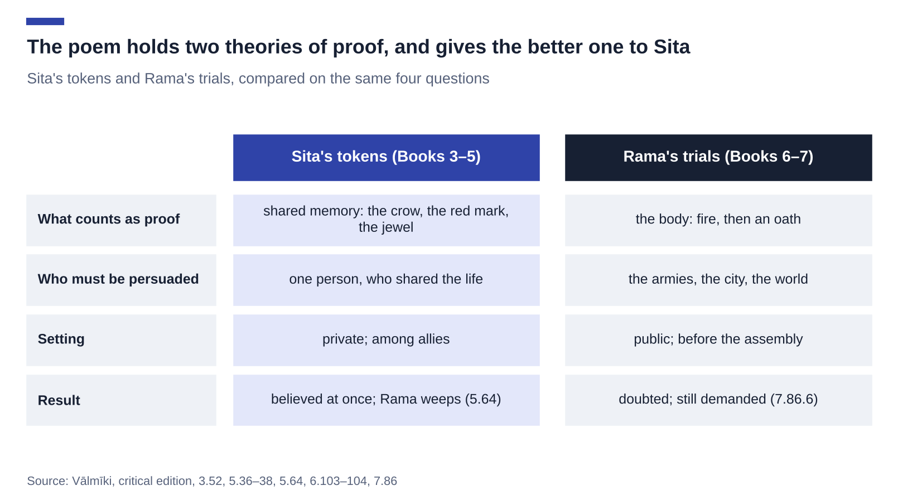

# Part VII. Back to the Poem: Tokens, Witnesses, Grief and the Grammar of Retelling {.unnumbered}

# Chapter 24. Ring, Jewel and Crow: Sita's Tokens and the Epic's Other Theory of Proof

::: {custom-style="Epigraph"}
*idaṃ śreṣṭham abhijñānaṃ brūyās tvaṃ tu mama priyam*

"Tell my beloved this, the best of all tokens."

— Sītā to Hanumān, Vālmīki *Rāmāyaṇa* 5.36.12 (CE)
:::

## The argument of this chapter

The final part of this book returns to Vālmīki. Twenty-three chapters have followed Sita out of the poem, into the songs, the novels, the stage, the paintings, the courts and the shrines. This part goes back into it, to six aspects of the critical edition that the modern retellings have used without always noticing them: the tokens by which Sita and Rama prove themselves to each other; the men who knew Sita was innocent and did nothing; the grief of the king who condemned her; the women who taught Sita the ideal of the faithful wife, and the story of her own life that she told one of them; Sita's argument against the sword, made in the forest and fulfilled in the seventh book; and the grammar by which every retelling, ancient and modern, transforms the poem it inherits.

This chapter begins with the tokens. The Sanskrit word is *abhijñāna*, a sign of recognition: an object or a memory that proves identity across separation. The Rāmāyaṇa is full of them. Sita drops her ornaments from the sky as Ravana carries her off, so that they may be found. Rama gives Hanumān a ring with his name on it to show Sita. Sita gives Hanumān a jewel from her hair to take back, and with it two memories that only she and Rama share. Rama recognises flowers on the ground as the ones he gave her. And, at the end, Rama performs his sacrifices with a golden image of Sita in her place.

The chapter makes five claims.

1. The tokens constitute the epic's other theory of proof: proof by intimacy, by private knowledge shared between two people, as against the proof by public spectacle that the ordeal represents.

2. Sita is the master of this theory. She chooses the tokens, devises them and controls what they prove; she proves herself to Rama by memory, while he tests her by fire.

3. The tokens work. Rama believes them instantly, and weeps. The epic thus demonstrates that Rama knew Sita by the evidence of intimacy, and that the public trials he later demanded were not a search for knowledge he lacked.

4. The tokens can also be forged: Ravana's illusionists counterfeit them, and Sita is deceived. The epic understands that evidence is vulnerable, and it places the remedy in the testimony of a friend.

5. The last token is the golden Sita: the image with which Rama replaces his wife at his sacrifices. It is the epic's most exact commentary on the ideal, and the modern retellings that took its name understood it.

## The ornaments from the sky

### What she dropped

The first tokens are dropped in flight. As Ravana carries Sita through the sky, her anklet falls, "adorned with jewels, like a circle of lightning, with a sweet sound", and her ornaments scatter to the earth "like stars falling from the sky".^[CE 3.50.27, 3.50.30.] And then, over a mountain, she sees five monkeys sitting on its summit, and acts:

> In their midst, the wide-eyed, lovely woman let fall her upper garment of gold-coloured silk and her beautiful ornaments, in the hope that they might tell Rama.^[CE 3.52.2.]

The act is deliberate, and it is the first act of Sita's resistance after the abduction. She cannot fight Ravana; she cannot escape. She can leave a trail. In the middle of the most violent episode of her life, carried through the air by a man who has seized her, Sita calculates: these creatures might meet Rama; if they do, the garment and the jewels will tell him which way I went. It is the act of a woman who expects to be searched for, and who makes herself findable.

### What he did with them

Months later, the five monkeys have become Rama's allies, and Sugrīva brings out the bundle. "I saw her," he tells Rama, "being carried off by the cruel *rākṣasa*, crying 'Rama! Rama!' and 'Lakshmaṇa!' in a broken voice, writhing in Ravana's lap like the wife of a serpent king. She saw me on the mountain, with four others, and let fall her upper garment and her ornaments. We took them and kept them. I will bring them; you should recognise them."^[CE 4.6.7–10.]

Rama's response is the first of the epic's great scenes of grief over a token. He takes the garment and the ornaments, and his eyes fill with tears "like the moon veiled by mist"; he cries "Ah, beloved!", loses his composure and falls to the ground; he presses the ornaments to his heart again and again, and breathes heavily "like an angry snake in its hole".^[CE 4.6.14–16.] Then he asks Sugrīva where the demon is who carried off "my beloved, equal to my life", and swears to destroy him.^[CE 4.6.20–23.]

The token did what Sita meant it to do. It told Rama which way she had gone, and it told him that she had been taken by force, crying his name. It is the first evidence in the epic of Sita's resistance, and it reached her husband exactly as she had planned.

### The anklets that are not there

Every reader who grew up with the Rāmāyaṇa in the vulgate, or in its popular retellings, will expect a famous verse at this point. Shown the ornaments, Lakshmaṇa says that he does not recognise the bracelets or the earrings, but he knows the anklets, because he bowed at Sita's feet every day. The verse has been quoted for centuries as the epitome of the younger brother's reverence: Lakshmaṇa never looked at his brother's wife above her feet.

The verse is not in the critical edition. In the constituted text of the *Kiṣkindhākāṇḍa*, Rama recognises the ornaments and laments over them, and Lakshmaṇa says nothing about anklets.^[CE 4.6.13–23.] The verse belongs to the later recensions and to the popular tradition that grew around them.

The philological point has a bearing on the argument of this book. The tradition invented a token for Lakshmaṇa: not one that proves Sita's identity, but one that proves his virtue. The anklet verse is a token of the brother-in-law's chastity of gaze, and its popularity tells us what the tradition needed from the scene. It needed to reassure its audience that the men who lived alone with Sita in the forest had never looked at her. The reassurance is a symptom of the anxiety that would condemn her: the anxiety about a woman's body in the presence of men who are not her husband. The verse protects Lakshmaṇa from a suspicion the critical edition does not raise, and in doing so it records the suspicion.

## The ring and the jewel

### The ring with his name

When the monkeys set out to search for Sita, Rama gives Hanumān a ring, "adorned with the mark of his own name", as a token for the princess.^[CE 4.43.11.] In the Aśoka grove, when Hanumān has finally found Sita and has had to work hard to persuade her that he is not another of Ravana's illusions, he shows it to her: "I am a monkey, noble lady, the messenger of the wise Rama. See this ring, marked with Rama's name. Take comfort."^[CE 5.34.2.]

The ring is a token in the simplest sense: an object that belonged to Rama and bears his name, which only someone sent by Rama could possess. It establishes the messenger's credentials. The poem dwells on Sita's joy at seeing it. But the ring proves little about Rama except that he sent it. It is a seal, not a memory.

### What Sita sends back

Sita's tokens are of another kind. When Hanumān offers to carry her back to Rama on his back, and she refuses, as Chapter 1 described, he asks her for a token "that Rāghava will know".^[CE 5.36.10.] And Sita does not reach for an object first. She reaches for a memory.

"Tell my beloved this, the best of all tokens," she says: and she tells the story of the crow at Citrakūṭa, the episode Chapter 23 examined for its theology.^[CE 5.36.12–32; see Chapter 23.] It is a story that only she and Rama know, about a day when they were alone in the forest near Citrakūṭa. Wet from bathing, she sat in his lap; then he slept in hers. A crow attacked her; she fought it off with a clod of earth, her girdle slipping, and Rama woke and laughed at her, and she was angry and ashamed. When the crow came back and drew blood, Rama, seeing the wound, loosed a blade of grass charged with the power of the Brahma weapon against it.^[CE 5.36.13–27.] The memory she chooses is not solemn. It is a memory of a quarrel, a laugh, a moment of embarrassment, and then of a husband's fury on her behalf. She adds a second memory, smaller and more intimate. When the mark on her forehead had been rubbed away, Rama drew a new one on her cheek with red arsenic: "you should remember that".^[CE 5.38.5.]

Only then does she give Hanumān an object: the crest-jewel from her hair, which she unties from her garment and hands to him "to be given to Rāghava". Hanumān, the poem notes with a touch of comedy, can fit the jewel only on his finger.^[CE 5.36.52–53.] Of the jewel itself, Sita says: "I have guarded this divine crest-jewel carefully. Seeing it, in my misfortune, I rejoice, as if I were seeing you."^[CE 5.38.7.]

### The structure of Sita's proof

Consider what Sita has done. Asked for proof that the messenger has met her, she supplies three tokens, in a deliberate order. The first is a story of danger and protection: a moment when Rama's love for her expressed itself as violence against the creature that harmed her. The second is a story of intimacy: a mark drawn by his hand on her face. The third is an object from her natal home, a jewel that, as Rama will remember, her father gave her at their wedding.

The order is an argument. The first token reminds Rama that he once loosed the Brahma weapon against a crow for her sake; and Sita adds, as Chapter 23 showed, the reproach that follows from the memory: "For my sake, you loosed the Brahma weapon at a mere crow. Why do you forgive the one who carried me away from you?"^[CE 5.36.33.] The token is evidence of identity and an instrument of persuasion at once: it proves that Hanumān met Sita, and it presses Rama to act. The second token reminds him of the private life they shared. The third returns him to the wedding, and to her father. Sita's tokens are a speech in three objects, and their subject is the bond between them, its tenderness, its obligations and its origin.

This is the theory of proof the epic attributes to Sita. Identity is proved by intimacy: by what two people know of each other that no one else could know. It is private, mutual and grounded in memory. It requires no fire.

## Rama receives the jewel

### "As a cow's milk flows"

When Hanumān returns and gives Rama the jewel, with Sita's words, the poem gives Rama one of its most tender speeches. He presses the jewel to his heart and weeps, with Lakshmaṇa. And he says:

> As a loving cow's milk flows for her calf, so my heart flows at the sight of this jewel.^[CE 5.64.3.]

He remembers where it came from: "This jewel was given to Vaidehī by my father-in-law at the time of the wedding; tied on her head, it shone the more."^[CE 5.64.4.] Seeing it, he says, he feels he has seen his father and Janaka; it shone on his beloved's head, and seeing it now, "I think of her as if she had come".^[CE 5.64.6–7.] And then the grief: "What could be more painful than this, to see this jewel, born of the waters, without Vaidehī?" Sita will live long, he says, if she holds out for a month; "I could not live a moment without her, the black-eyed one."^[CE 5.64.9–10.]

### What the tokens prove about Rama

The scene is decisive for the argument of this chapter. The tokens worked. Rama recognised them at once, believed them without hesitation, and wept. He did not ask Hanumān for further evidence. He did not wonder whether the story of the crow might have been extracted from Sita by torture, or the jewel taken from her by force. The intimacy of the tokens was, for him, sufficient proof that Hanumān had met Sita, that Sita was alive, and that she was still the woman who had shared his life.

Set this beside the scene before the fire, two books later. There, Rama has Sita before him in person. He does not need tokens; she is there. And he tells her, before the assembled armies, that her character has come under suspicion, that he cannot take back a woman who has lived in another man's house, and that she may go where she pleases.^[CE 6.103.15–24.] The man who believed a jewel without question does not believe the woman herself.

The difference is not in the evidence. It is in the audience. The tokens were received in private, among allies, by a husband grieving for his wife. The trial was conducted in public, before the armies, by a king concerned with his name. Rama knew Sita by the evidence of intimacy. He demanded the evidence of spectacle because the public, which had shared no intimacy with her, could not be persuaded by any other kind.

## The forged token

### The false head

The epic knows that tokens can be forged. In the *Yuddhakāṇḍa*, Ravana tries a final cruelty: he has a sorcerer fashion a likeness of Rama's head, and shows it to Sita as proof that Rama is dead. And Sita recognises it, by the very marks by which a token proves identity: "the eyes, the colour of the face, the face like her husband's, the hair, the line of the hair, and that beautiful crest-jewel". Recognising it "by all these signs", she cries out like an osprey and curses Kaikeyī.^[CE 6.23.2–3.]

The forgery is a perfect inversion of the tokens Sita sent. She proved herself to Rama by intimate signs; Ravana tries to prove Rama's death to her by counterfeit signs of the same kind. And the forgery works, for a time. Sita is deceived; she falls "like a plantain tree cut down", laments over the head as a widow, and begs her husband to take her with him.^[CE 6.23.6–8, 6.23.21.]

### The friend who tells the truth

What undoes the forgery is not more evidence. It is testimony. Chapter 19 described the scene: Saramā, the *rākṣasī* who has befriended Sita, comes to her, having spied on Ravana at the risk of her life, and tells her the truth: the head is a sorcerer's work, Rama is alive, the armies are gathering.^[CE 6.24.1–19; see Chapter 19.] Sita believes her friend over the counterfeit token.

The epic's theory of evidence, then, is not naïve. It knows that objects and signs can be fabricated, and that the more intimate the sign, the more cruel the forgery. And it places the remedy in the word of a trusted person, a witness who has seen and who speaks at a risk to herself. The same theory, applied to Sita's own case, would have given weight to the testimony of the witnesses who knew her innocence: Hanumān, who found her faithful in the grove; the *rākṣasīs* who guarded her; Saramā herself; and, in the seventh book, Vālmīki. Chapter 25 examines what those witnesses did with what they knew.

## The flowers on the ground

There is one more token in the poem, and it is the smallest. When Rama and Lakshmaṇa search the forest after the abduction, following the trail of Ravana's flight, they find flowers scattered on the ground. Rama stops. "I recognise these flowers, Lakshmaṇa," he says. "They are the ones I gave Vaidehī in the forest, and she wore them."^[CE 3.60.17.]

The flowers are not a token Sita chose. They fell from her hair as she was carried off. But Rama reads them as she read her own ornaments: as signs that she passed this way, and that she was taken against her will. The flowers he gave her come back to him as evidence. The intimacy of the gift becomes the proof of the crime.

The poem, in other words, is full of moments in which Rama knows Sita by what they have shared: the flowers he gave her, the jewel her father gave her, the crow he shot for her, the mark he drew on her cheek. Each is a proof of identity; each is also a proof of love. The epic that records Rama's trials of Sita records, in greater number and with greater tenderness, the evidence of his knowledge of her.

## The golden Sita

### The image at the sacrifice

The last token in the poem is the strangest. After the banishment, Rama decides to perform the horse-sacrifice, and he gives the order for its procession: "Let Bharata go ahead, placing before him my golden wife, fit for consecration in the sacrificial rite."^[CE 7.82.19.] A sacrifice requires the sacrificer's wife. Sita is in the hermitage. Rama has an image of her made in gold, and the image takes her place.

After Sita's descent into the earth, the poem returns to the image. Rama, at the end of the sacrifice, "not seeing Vaidehī, thought the world empty"; he returned to Ayodhya "holding Sita in his heart". And then:

> He chose no other wife than Sita. At every sacrifice, in the place of the wife, there was a golden Jānakī.^[CE 7.89.1–4.]

The verse is usually read as a testimony to Rama's fidelity, and it is one. He did not remarry; he did not take another queen; he kept Sita's place empty, or rather, filled it with her likeness. The tradition has rightly honoured him for it.

### What the image says

But the image says something else as well, and the modern retellings heard it. The golden Sita is the ideal wife in its purest form. It is perfectly faithful, because it is incapable of anything else. It has no history, no captivity, no rumour, no body that men might suspect. It can stand beside the king at every sacrifice without any citizen asking where it has been. It is everything the public required of Sita, and it is not Sita.

Rama, in other words, could live with the image of his wife and not with his wife. The real Sita, who had been carried off, who had argued and refused, who had lived in another man's city and borne children in a hermitage, could not stand beside him without provoking the talk that drove her out. Her golden likeness could. The verse that records Rama's fidelity also records the logic of the banishment: the king could have a queen only if the queen were made of gold.

### *Kāñcana Sīta*

C. N. Sreekantan Nair took the title of his Malayalam play from this image. *Kāñcana Sīta*, "the golden Sita", examined in Chapter 6, questioned the kingship of Rama, and G. Aravindan's film of 1977, discussed in Chapter 15, carried the question further: Aravindan's Sita does not appear in human form at all; she is present in the natural world, in the forest, the river and the wind.^[See Chapters 6 and 15; C. N. Sreekantan Nair, *Kāñcana Sīta* (1961) [W047]; G. Aravindan, *Kanchana Sita* (1977) [W054].] The play and the film read the golden image as the epic's own confession: the king's Sita is an artefact; the real Sita is elsewhere, in the earth from which she came.

The golden Sita is, in this sense, the ancestor of every idealised Sita that this book has examined: the reformer's model wife, the nationalist's inner domain, the calendar goddess, the poster's absent queen. Each is an image that stands in for a woman, and each is more convenient to the order that made it than the woman would have been. The first such image was made by Rama, for his sacrifices, in gold.

## The theatre of tokens

The tokens of the Rāmāyaṇa have had a long life on the stage. Chapter 21 noted that the Kūṭiyāṭṭam tradition of Kerala names its great Rāmāyaṇa acts after them: the *Aṅgulīyāṅkam*, "the act of the ring", in which Hanumān brings Rama's ring to Sita, is performed over many nights, and the play from which it comes, Śaktibhadra's *Āścaryacūḍāmaṇi*, is named for "the wondrous crest-jewel".^[See Chapter 21.] The Sanskrit drama's genre of recognition, of which Kālidāsa's *Abhijñānaśākuntala*, "the recognition of Śakuntalā", is the masterpiece, turns on a token, a ring lost and found, by which a king who has forgotten and rejected his wife is brought to remember her. The parallel with Sita has often been noted: a king rejects a wife who has done nothing wrong, and a token restores the memory he had lost or suppressed.^[On the *Abhijñānaśākuntala* and the Rāmāyaṇa, see the standard studies of Kālidāsa (citations to be verified).]

In the *Abhijñānaśākuntala*, the token brings recognition, and recognition brings reunion. In the Rāmāyaṇa's seventh book, as Chapter 22 showed, the sons themselves are tokens, living images of their father, and their song is a token in the form of a poem; Rama recognises them, and still demands the oath.^[See Chapter 22.] The Rāmāyaṇa is the darker recognition play. Its king recognises everything, and it is not enough.

::: {custom-style="Box Title"}
Reading Against the Text
:::

::: {custom-style="Box"}
Rama believed the crest-jewel, the crow story and the red mark on Sita's cheek without question, and wept (5.64.1–10). Before the armies, with Sita in front of him, he demanded the fire. Was the difference in the evidence, or in the audience? And what does the popular anklet verse, which is not in the critical edition, tell us about the anxieties of the audience the tradition imagined?
:::

::: {custom-style="Box Title"}
The Debate: Proof
:::

::: {custom-style="Box"}
**Position A:** The fire ordeal was the only proof available to a king in Rama's position: private knowledge cannot persuade the public, and the public's confidence was a condition of rule.\
**Position B:** The epic itself supplies a theory of proof by intimacy and testimony, which Rama accepted in private and refused in public; the ordeal was a choice, not a necessity.\
**Where the evidence of this chapter leaves the argument.** Position A states a real problem of rule, the problem Chapter 18 called the precedent theory of kingship. But the epic shows that the theory of proof it relies on was not the only one available. Rama knew Sita by tokens he believed at once; Sita knew a forged token for what it was by trusting a friend's testimony. The poem contains the alternative to the ordeal, and gives it to the woman.
:::

## Conclusion

The Rāmāyaṇa is a poem of tokens: ornaments dropped from the sky, a ring with Rama's name, a crest-jewel from Janaka's court, the story of a crow, a red mark on a cheek, flowers on the forest floor, and at the end a golden image standing in a queen's place. Sita devised the most eloquent of them, and through them the epic sets out a theory of proof by intimacy, memory and testimony, against which the ordeal by fire appears as what it was: a proof by spectacle, demanded for an audience that had shared nothing with her. Rama believed the tokens and wept. He did not believe the woman. And when she was gone, he replaced her with an image of gold, which stood beside him at every sacrifice and provoked no talk. The modern writers who called her *Kāñcana Sīta* understood the image better than its maker.
