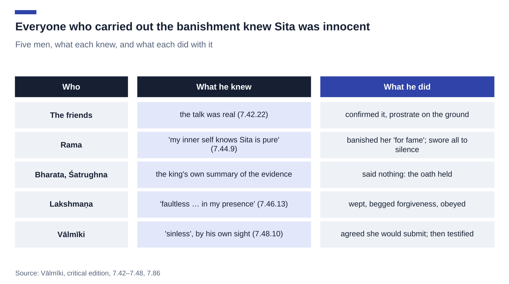

# Chapter 25. The Men Who Knew: Lakshmaṇa, the Brothers, the Friends and the Oath That Forbade Argument

::: {custom-style="Epigraph"}
*sā tvaṃ tyaktā nṛpatinā nirdoṣā mama saṃnidhau*

"You have been abandoned by the king, faultless as you are, in my presence."

— Lakshmaṇa to Sītā on the bank of the Ganga, Vālmīki *Rāmāyaṇa* 7.46.13 (CE)
:::

## The argument of this chapter

Sita was not condemned in ignorance. Every man who took part in her banishment knew that she was innocent. The king said so himself, to his brothers, on the evening he decided to send her away. The brother who drove her to the river said so to her face. The poet who received her in the forest knew it by his spiritual sight. The friends who confirmed the rumour to the king bowed their heads to the ground as they did so. And none of them refused.

This chapter reads the *Uttarakāṇḍa*'s account of the banishment from the side of the men who carried it out. It makes five claims.

1. The critical edition makes the knowledge of Sita's innocence explicit and shared. Rama tells his brothers that the gods declared her sinless before Lakshmaṇa's eyes and that his own inner self knows her to be pure; and he then forbids them, on oath, to argue with him.

2. The oath that forbade argument is the institutional heart of the banishment. It converts the brothers' knowledge into silence, and it is the epic's clearest image of how good men are made complicit in an injustice they recognise.

3. Lakshmaṇa, who carries out the banishment, is the epic's most fully drawn portrait of the subordinate who acts against his conscience under orders. His grief is real and his obedience complete. Sita's response to him, which commands him to tell the truth and then sends a message to the king, is the response of a judge to an agent.

4. The court companions who confirm the rumour, and the poet who agrees that "the husband is a woman's god", complete a picture of a society in which knowledge of injustice is widespread and refusal absent.

5. The modern retellings have repeatedly asked what Lakshmaṇa, Bharata and Hanumān should have done. The question is a modern one, and it is also the epic's own: the poem gives Lakshmaṇa the words to say that death would have been better, and does not let him say no.

## The court that heard the rumour

### The king among the storytellers

The scene in which the rumour reaches Rama opens in a mood of ease. The king sits among his companions, "clever men, tellers of many kinds of stories, jesters", who entertain him with tales and jokes.^[CE 7.42.1–3.] The critical edition names them, and among them is Bhadra. In a pause in the stories, Rama asks Bhadra what the people are saying in the city and the country: about him, about Sita, about his brothers and his mother Kaikeyī; "for kings, in a new reign, become the subject of talk".^[CE 7.42.4–6.]

Bhadra hesitates, and offers the good news: the people talk of the victory over Ravana. Rama presses him: "Tell me everything, exactly as it is, the good and the bad … so that I may do what is good, and not do what is bad. Tell me without fear, without anxiety."^[CE 7.42.9–11.] And Bhadra tells him. The people praise the bridge, the conquest of Ravana and the alliance with the monkeys and bears. And they ask what pleasure Rama can take in Sita, whom Ravana once took on his lap by force, who was carried to Laṅkā and kept in the Aśoka grove in the power of the *rākṣasas*; how can Rama not be disgusted? "We too shall have to put up with this in our wives; for as the king does, so the subjects follow."^[CE 7.42.14–19.]

The washerman of the later tellings, whose quarrel with his wife Chapter 13 discussed, is absent from the critical edition. The rumour reaches the king through a court entertainer, invited by the king himself to speak without fear. The scene is not one of the king overhearing a low-born man's insult. It is one of a king soliciting public opinion, receiving it through an intermediary, and treating it as decisive.

### "It is so, no doubt"

Rama's next act is to consult the rest of the company. "How is this to be told?" he asks them all; and "all of them, bowing their heads to the ground and prostrating themselves, replied to the wretched Rāghava: it is so, no doubt".^[CE 7.42.21–22.]

The verse is short and it is devastating. The king's friends confirm the rumour. They do not say that it is false; they do not say that it is unworthy of attention; they do not remind the king of the fire. They confirm that the talk exists, and they do so lying on the ground. Their prostration is the posture of men who know that what they are saying will cause pain, and who say it anyway, because the king has asked and the talk is real. They are not lying. They are reporting. And in reporting, without comment, they give the rumour the weight of the court's assent.

## The brothers

### "My breaths, walking outside me"

Having dismissed his friends, Rama sends for his three brothers. The poem dwells on their arrival: Lakshmaṇa rushing to the palace in his chariot, Bharata leaping up and running on foot, Śatrughna bowing to the ground at the summons.^[CE 7.43.3–10.] Rama, waiting, sits with his head lowered, and tells the doorkeeper to let them in quickly: "In them is my life; they are my breaths, walking outside me."^[CE 7.43.12.] When they enter, they see his face "like the moon in eclipse, like the sun at twilight, without light", his eyes full of tears; and Rama weeps, embraces them and seats them.^[CE 7.43.14–17.] "You are everything to me," he tells them. "You are my life … You are learned and wise; consider together what must be done for me."^[CE 7.43.18–19.]

The scene is constructed to make the reader feel the intimacy of the four brothers and the depth of Rama's distress. It is also constructed, unmistakably, as a council. Rama has asked his brothers to deliberate. He has called them wise. What follows shows what the deliberation was worth.

### What Rama told them

Rama tells his brothers of the rumour. And then he tells them what he knows:

> You know, gentle one, how in the empty Daṇḍaka forest Sita was carried off by Ravana, and how I destroyed him. Before your own eyes, Saumitri, the fire, bearer of offerings to the gods, declared Maithilī sinless, and so did the wind that moves in the sky. The moon and the sun proclaimed Janaka's daughter sinless, in the presence of the gods and of all the sages. Thus, of pure conduct, she was placed in my hands by great Indra on the island of Laṅkā, in the presence of gods and gandharvas. And my inner self knows Sita to be pure and glorious.^[CE 7.44.5–9.]

The speech is a summary of the evidence, delivered by the judge to his council, and it is conclusive. The fire, the wind, the moon, the sun, Indra, the gods and the sages have declared Sita innocent; Lakshmaṇa saw it; Rama's own inner self knows it. There is no doubt in the speech. There is not even a pretence of doubt.

And then Rama states the principle on which he will act. Ill fame, he says, condemns a person to the lower worlds for as long as it is spoken of; the gods condemn ill fame and honour good fame; "all the undertakings of great men are for the sake of fame". He would give up his own life, or his brothers, out of fear of public censure: "how much more, then, Janaka's daughter?"^[CE 7.44.11–13.]

### The oath

Rama gives his order: Lakshmaṇa is to take Sita in the morning, in a chariot driven by Sumantra, across the Ganga to the region of Vālmīki's hermitage, and leave her there.^[CE 7.44.15–17.] And then he closes the council:

> I am not to be answered about Sita in any way. If you object, it will be the greatest displeasure to me. You are sworn, by my arms and by my life, all of you who would speak to dissuade me in any way. If you honour me, if you abide by my command, take Sita from here today.^[CE 7.44.18–20.]

The oath is the institutional heart of the banishment. Rama has convened a council of his brothers, called them wise, laid before them the evidence of Sita's innocence, and then forbidden them, on pain of the most solemn oath a king can impose, to say anything against his decision. The council is not asked for its advice. It is informed of a decision, shown the evidence that the decision is unjust, and sworn to silence.

Rama even supplies the pretext. "She told me earlier that she wished to see the great hermitages on the bank of the Ganga. Let her wish be fulfilled."^[CE 7.44.21.] The pregnant queen's wish, Chapter 22 observed, becomes the means of her banishment. The king who has just declared her innocent instructs his brother to deceive her.

Then Rama, "his eyes covered with tears", goes into his apartments.^[CE 7.44.22.]

### The silence of the three

The brothers say nothing. The critical edition does not record a word from Bharata or Śatrughna in response to the order. Lakshmaṇa's only response, in the next canto, is to obey.

It would be unjust to the poem to say that the brothers did not care. The poem has shown their love for Rama, and it will show Lakshmaṇa's grief at length. But it is precise about what their love produced. It produced obedience. The brothers knew, from the king's own mouth, that the queen was innocent; they were sworn not to argue; and they did not argue. The oath worked as it was designed to work.

Bharata's silence is especially striking, because Bharata is the epic's model of the brother who refuses an unjust order. When Kaikeyī secured the throne for him by exiling Rama, Bharata refused it, went to the forest to bring Rama back, and, when Rama would not return, ruled as regent from a village with Rama's sandals on the throne. Bharata knew how to say no to an injustice done in his favour. He did not say it to an injustice done to Sita. The difference is the difference between an injustice to a brother and an injustice to a brother's wife, and the poem records it without comment.

## Lakshmaṇa at the river

### The journey

The next morning, Lakshmaṇa, "with a withered heart and a dry mouth", orders Sumantra to yoke the chariot and goes to Sita: "I am to take you quickly, by the king's command, to the hermitages of the sages on the bank of the Ganga."^[CE 7.45.1–7.] Sita is overjoyed. She gathers costly garments and jewels to give as gifts to the wives of the sages, and climbs into the chariot.^[CE 7.45.8–10.]

On the way, she sees bad omens: her eye throbs, her body trembles, her heart is uneasy, the earth seems empty. And her response to the omens is to pray, with joined hands, for the welfare of others: of Rama and his brothers, of her mothers-in-law, of the city and the countryside, of all living beings.^[CE 7.45.11–15.] Lakshmaṇa, hearing her, bows his head and says "may it be well", "with a heart drying up".^[CE 7.45.16.]

At the Ganga, Lakshmaṇa breaks down and weeps aloud. Sita, puzzled, rebukes him gently. "Why are you weeping? You have brought me to the bank of the Jāhnavī, which I have long wished to see; why do you grieve me at a time of joy? You are always at Rama's feet; are you grieving because you have been parted from him for two nights? Rama is dear to me too, as dear as life, but I do not grieve like this. Don't be childish."^[CE 7.45.22–25.] She asks him to take her across, to show her the ascetics; she will give them gifts, and they will spend a night and return to the city.^[CE 7.45.26–27.]

The poet has constructed the scene with great care. Sita is the one who comforts; Lakshmaṇa is the one who weeps. She is the adult and he is the child. She thinks the journey is a pilgrimage; he knows it is a banishment. The irony is unbearable, and it is meant to be.

### The confession

On the far bank, Lakshmaṇa speaks, his hands joined, his voice choked with tears:

> There is a great dart lodged in my heart, Vaidehī, because my wise elder brother has made me, in this matter, an object of the world's reproach. Death would be better for me today, or whatever is worse than death, than to be appointed to such a deed, condemned by the world. Be gracious. Do not be angry with me.^[CE 7.46.4–6.]

And he falls to the ground with his hands joined.

Sita, alarmed, does not yet understand. And her response is a command:

> What is this? I do not understand. Tell me the truth, Lakshmaṇa. I see that you are not well. Is the king well? If the king has sworn you to something that is causing you this anguish, tell it to me in my presence. I command you.^[CE 7.46.8–9.]

The verse deserves to be read slowly. Sita has guessed that Lakshmaṇa is under an oath, *śāpita*, the same word the poem used for the brothers' oath; and she overrides it. "I command you," *aham ājñāpayāmi te*. The queen, who does not yet know she has been banished, uses the authority of a queen to release a subject from a king's oath of silence. She is the only person in the *Uttarakāṇḍa* who demands that the truth be told to her face.

### The truth, and its terms

Lakshmaṇa tells her. Having heard in the assembly a terrible rumour about her, in the city and the country, the king "has abandoned you, faultless as you are, in my presence, out of fear of the citizens' censure; do not take it otherwise, my lady".^[CE 7.46.11–13.] He is to leave her at the hermitages, "by the king's command, as if to fulfil your wish".^[CE 7.46.14.] He commends her to Vālmīki, a close friend of their father; and he advises her: "keep to the vow of a faithful wife, hold Rama always in your heart, and your highest good will come".^[CE 7.46.15–18.]

The word *nirdoṣā*, "faultless", is Lakshmaṇa's own. He does not merely report the king's verdict; he adds his own judgement of its object. Sita is faultless, and she has been abandoned in his presence, by his agency. The man who carries out the sentence declares the condemned innocent as he carries it out.

### Sita's reply

Chapter 1 discussed Sita's reply: her grief, her refusal to drown herself because the royal line would be mocked, and the message she sends the king, which ends with the instruction to treat the citizens as his brothers.^[CE 7.47.3–12; see Chapter 1.] What should be added here is her relation to Lakshmaṇa. She does not curse him. She does not rebuke him. She gives him a message to carry, and she sends him back. She treats him, in other words, as what he is: an agent, a carrier of orders and messages, whose grief is real and whose responsibility is limited.

This is the same judgement Sita will make, in the critical edition's sixth book, about her guards, as Chapter 19 described: those who act under a king's command are not the proper objects of anger.^[CE 6.101.30; see Chapter 19.] She extends to Lakshmaṇa the mercy she extended to the *rākṣasīs*. The proper object of judgement is the one who commanded. And to him, Sita sends a message.

### Śatrughna

There is one more man who knew, and his knowledge was of a different kind. Śatrughna, the youngest brother, on his way to fight the demon Lavaṇa, spent a night at Vālmīki's hermitage, and on that very night, the poem records, Sita gave birth to twin sons. At midnight he heard the news and said "Good fortune! Good fortune!"; in the morning he went on to his war.^[CE 7.58.1, 7.58.10–12; see Chapter 22.]

Śatrughna knew, therefore, that the banished queen had borne the king two sons. The critical edition does not record that he told Rama, then or later; the next time the poem brings Rama and his sons together, it is the boys' song, years afterwards, that reveals them.^[CE 7.86.2.] The poem's silence may be only a silence of narration. But it leaves the reader with a brother who was present at the birth of the king's heirs and, so far as the poem tells us, said nothing to the king. He had been sworn, with the others, not to speak to Rama about Sita.^[CE 7.44.18–19.] It seems that he kept the oath even here.

## Lakshmaṇa at the fire

Lakshmaṇa's role in the banishment has a precedent in his role at the ordeal. When Sita, condemned before the armies in Laṅkā, asks him to build a pyre, "the only remedy for this calamity", the poem records his reaction with a precision that has rarely been noticed:

> Thus addressed by Vaidehī, Lakshmaṇa, slayer of enemy heroes, came under the sway of anger, and looked at Rāghava's face. Understanding from the expression what was in Rama's mind, the mighty Saumitri built the pyre, with Rama's consent.^[CE 6.104.20–21.]

Lakshmaṇa is angry. The word is *amarṣa*, indignation, resentment at an injury. He looks at his brother's face, hoping, we may suppose, to find there a sign that the pyre is not wanted. He finds the opposite. And he builds it.

The two scenes, at the pyre and at the river, form a pair. In both, Lakshmaṇa knows that Sita is innocent; in both, he is angry or grieved; in both, he looks to his brother and obeys. In the sixth book his obedience is silent; in the seventh he speaks, says that death would be better, and asks Sita's forgiveness. But in neither does he refuse. He is the epic's portrait of the good subordinate: loyal, feeling, articulate in his anguish, and obedient to the end.

## The other witnesses

### Hanumān

Hanumān is the only witness to Sita's captivity who saw her in the Aśoka grove, heard her refuse Ravana and the offer of rescue, and carried her tokens back to Rama. Chapter 24 showed how completely Rama believed the evidence Hanumān brought. In the sixth book, after the war, Hanumān goes to Sita with the news of victory, offers to punish her guards and hears her speech of mercy.^[CE 6.101; see Chapter 19.] He then brings her to Rama, and witnesses the trial.

The critical edition records no protest from Hanumān at the trial. The devotional tradition has made Hanumān the supreme devotee of Rama and Sita together, and the popular imagination has often given him, in later tellings and in the theatre, a role in Sita's defence. But in Vālmīki, the witness who knew most about Sita's conduct in captivity says nothing when she is accused of misconduct in captivity. He too looks to Rama, and is silent.

### Vālmīki

Chapter 22 examined the poet's double role in the final scene: his agreement, when Rama's messengers ask that Sita take an oath, that "she will do as pleases Rāghava, for the husband is a woman's god", and then his magnificent testimony, staking his austerities on her innocence.^[CE 7.86.10, 7.87.14–20; see Chapter 22.] The poet is the only man in the epic who speaks for Sita before the assembly. He does so after agreeing that she must submit to its demand.

### The men of the assembly

And there is the assembly itself. At the final scene, the poem records, the sages, kings, *rākṣasas*, monkeys and men of all four classes came in thousands "to see Sita's oath"; when she appeared, some cried "well done, Sita", some "well done, Rama", and some both.^[CE 7.87.7–12.] The crowd that had produced the rumour came to watch its resolution. It applauded both parties. It did not object.

## What the modern retellings ask

### Lakshmaṇa's guilt

The modern retellings have returned again and again to Lakshmaṇa at the river. In many of them, he is consumed by guilt; in some, he confronts Rama; in a few, he refuses. Chapter 6 discussed the modern literature of Ūrmilā, Lakshmaṇa's wife, whose long abandonment is the cost of his devotion to his brother; the retellings that give Ūrmilā a voice often give her a judgement on her husband's obedience as well.^[See Chapter 6.] The question they ask is the question the critical edition invites: what is the duty of a good man who is ordered to do an injustice he recognises?

### "Superior orders"

Chapter 19 observed that Sita's speech of mercy towards her guards anticipates the debate modern international law has conducted under the heading of "superior orders": the question of how far a subordinate who acts on command is responsible for what he does.^[See Chapter 19.] The banishment poses the same question from the other side. Lakshmaṇa acted on command. He knew the command was unjust; he said so; he asked forgiveness; he obeyed. Sita forgave him, or at least did not condemn him, on the principle she had applied to the guards. Modern law, after the experience of the twentieth century, has been less forgiving: it holds that an order to commit a manifest injustice does not relieve the person who carries it out of responsibility, though it may mitigate it.

The epic does not settle the question, and this book will not pretend to. But it should be noted that the epic poses it with great clarity, and that its answer is not simply the answer of obedience. The poem gives Lakshmaṇa the words "death would be better". It shows him weeping, falling, begging forgiveness. It records his anger at the pyre. It does not present his obedience as unproblematic. It presents it as tragic: the obedience of a good man who knows what he is doing and cannot find the strength to refuse.

### The oath as institution

The modern reader may draw a further conclusion. The oath that forbade argument was not a personal failing of Rama's; it was an institution, a use of the king's power to close the council's deliberation before it began. Chapter 18 measured the banishment against the principles of natural justice and found that Sita was not heard. This chapter adds that the king's own council was not heard either. The brothers who might have spoken for Sita were sworn not to. The injustice of the banishment was not only that the accused had no hearing. It was that the king, having laid the evidence before his council, made sure that no one could use it.

In this, the *Uttarakāṇḍa* describes something that every institution knows: the moment when the people who know the truth are told that they may not say it, and comply. The washerman of the later tellings has carried the blame for the rumour. The critical edition places the responsibility elsewhere: with a king who solicited the talk, a court that confirmed it on its knees, and a council of good men sworn to silence.

::: {custom-style="Box Title"}
Reading Against the Text
:::

::: {custom-style="Box"}
Rama tells his brothers that the gods declared Sita sinless before Lakshmaṇa's eyes and that his own heart knows her pure (7.44.6–9); then he forbids them, on oath, to argue (7.44.18–19). Bharata, who refused the throne Kaikeyī won for him by injustice, says nothing. What does the difference between Bharata's refusal in the second book and his silence in the seventh tell us about the limits of a brother's dharma?
:::

::: {custom-style="Box Title"}
The Debate: Obedience
:::

::: {custom-style="Box"}
**Position A:** Lakshmaṇa's obedience is the highest form of his dharma: loyalty to the elder brother and the king, maintained even at the cost of his own anguish.\
**Position B:** Lakshmaṇa's obedience is complicity: he knew Sita was innocent, said so, and carried out the sentence.\
**Where the evidence of this chapter leaves the argument.** The critical edition supports neither position in its simple form. It shows Lakshmaṇa's obedience as tragic, not exemplary: he declares Sita *nirdoṣā*, faultless (7.46.13), says that death would be better than his task (7.46.5), and begs her forgiveness (7.46.6). And it gives Sita the judgement that resolves the debate in her own terms: the one who acted under command is not the proper object of anger; the one who commanded is (6.101.30; 7.47.12).
:::

## Conclusion

The banishment of Sita was carried out by men who knew she was innocent. The king said so to his brothers, invoking the fire, the wind, the sun, the moon and his own inner self, and then forbade them on oath to argue. The court companions confirmed the rumour lying on the ground. Bharata, who once refused an unjust throne, was silent. Lakshmaṇa wept at the river, called Sita faultless, said that death would be better, and did as he was told; at the pyre in Laṅkā, angry, he had read his brother's face and built it. Sita commanded Lakshmaṇa to tell her the truth, judged him as she had judged her guards, and sent her message to the man who had given the order. The washerman has carried the blame for centuries. The critical edition distributes it more justly: among a king who sought out the talk, a court that bowed to it, and good men who were sworn to silence and kept their oath.
