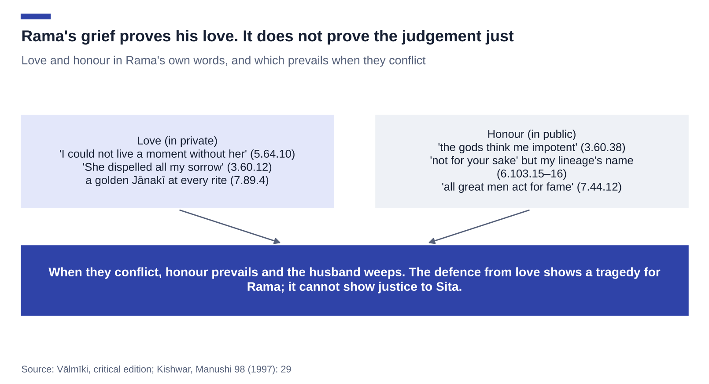

# Chapter 26. The King's Grief: Rama's Love and the Limits of the Defence

::: {custom-style="Epigraph"}
*na dharmas trāyate sītāṃ hriyamāṇāṃ mahāvane*

"Dharma did not protect Sita as she was carried off in the great forest."

— Rama to Lakshmaṇa, after the abduction, Vālmīki *Rāmāyaṇa* 3.60.35 (CE)
:::

## The argument of this chapter

Every critique of Rama in this book has met, at some point, the same reply. Rama loved Sita. He wept for her, searched for her, raised an army and crossed the sea for her; when he banished her, he wept; when she was gone, he never took another wife, and stood at his sacrifices beside her golden image. The reply is not an evasion. It is grounded in the poem, which gives Rama some of the most extravagant expressions of grief in Sanskrit literature. Any reading of Sita's story that ignores Rama's love is a weaker reading, and any critique that cannot account for it is a weaker critique.

This chapter takes the reply seriously. It reads Rama's grief in the critical edition, from the empty hut at Pañcavaṭī to the empty world after the descent, and asks what the grief proves. It makes five claims.

1. The critical edition insists on Rama's love for Sita, and its expressions of his grief are among the most intense passages in the poem. A reading that treats Rama as a cold husband is not a reading of Vālmīki.

2. Rama's grief, at its height, turns into rage against the world, and the rage reveals what was wounded: not only his love but his honour. "The gods surely think me impotent," he says, "because I am gentle and compassionate." The abduction wounded his manhood, and the war, as he will tell Sita, was fought to restore it.

3. The same structure governs the trial and the banishment. Rama's love is real, and it is subordinate to his honour. The epic does not hide this; it states it, in his own words, before the fire and before his brothers.

4. The defence from love therefore proves less than it claims. It proves that the banishment was a tragedy for Rama. It does not prove that it was just to Sita. A sacrifice is not made just by the suffering of the one who makes it, least of all when what is sacrificed belongs to someone else.

5. The modern retellings have divided along this line. Some give Rama's grief its full weight and make the story a tragedy of two people; others, following the women's songs, refuse to let his tears count in his favour. The critical edition supports the first view of Rama and the second view of the judgement.

## The empty hut

### "Like a madman"

Rama returns from killing the golden deer to find the hut at Pañcavaṭī empty. The poem's description of the scene is a set piece of desolation. The hut is "like a lotus pool in winter, robbed of its beauty"; the trees seem to weep; the flowers have wilted; the deer and birds are dejected; the deerskins and the *kuśa* grass are scattered, the mats thrown about.^[CE 3.58.5–7.] Rama cannot accept what he sees. Perhaps she has been carried off, or has died, or is lost, or has been eaten; perhaps she is hiding, timid as she is, or has gone into the forest to gather flowers or fruit, or to the lotus pool, or to the river for water.^[CE 3.58.8–9.]

He searches, and does not find her; his eyes red with grief, "he seemed like a madman".^[CE 3.58.10.] And then the poem gives him the speech that every later Rāmāyaṇa would imitate. He runs from tree to tree, from mountain to mountain, from river to river, and he asks them:

> Have you seen her, kadamba, my beloved who loved the kadamba? If you know, tell me of Sita of the lovely face … Bilva, tell me if you have seen her, in her yellow silk … Arjuna, tell me of my beloved who loved the arjuna, whether Janaka's timid daughter lives or not … Aśoka, dispeller of sorrow, make me true to your name by showing me my beloved … Deer, do you know Maithilī, the doe-eyed?^[CE 3.58.12–20.]

Tulsīdās would make a version of this lament one of the most beloved passages of the *Mānas*, in which Rama asks the birds, the deer and the bees whether they have seen the doe-eyed Sita.^[Tulsīdās, *Rāmcaritmānas* [W016], *Araṇyakāṇḍa*† (locator to be verified).] And Kālidāsa, in his *Meghadūta*, would give the same madness to an exiled demigod sending a cloud to his wife.^[On the *Meghadūta*'s debt to the Rāmāyaṇa, see the standard studies of Kālidāsa (citations to be verified).] The figure of the lover maddened by separation, asking nature for news of the beloved, enters Indian literature through Rama's grief for Sita.

### The silent river

The lament reaches its most poignant moment at the Godāvarī. Rama sends Lakshmaṇa to see whether Sita has gone to the river for lotuses; Lakshmaṇa searches the bathing places and returns empty-handed; and Rama goes himself and asks the river directly: "Where is Sita?"^[CE 3.60.1–6.] And the poem says:

> The creatures urged the river, "Tell him of his beloved." But though asked by the grieving Rama, the river did not speak of Sita. Thinking of Ravana's form and of the deeds of that evil one, the river, out of fear, did not tell him of Vaidehī.^[CE 3.60.7–9.]

The river knew. It had seen the abduction. And it said nothing, out of fear of the powerful man who had done it.

The verse has a resonance for the argument of this book that its poet could not have intended, and that the reader of the seventh book cannot miss. The Godāvarī knew the truth about Sita and was silent out of fear of a king. Chapter 25 showed that the court of Ayodhya knew the truth about Sita and was silent, sworn by its own king. The river's silence, in the third book, protects Ravana; the court's silence, in the seventh, serves Rama. In both, the witness that knows is afraid of the power that acts.

### "What shall I tell Janaka?"

Rama's despair, at the river, turns to the people to whom he is accountable. "What shall I say, Lakshmaṇa, when I meet Janaka, or Vaidehī's mother, without her?" he asks.^[CE 3.60.11.] And he remembers what Sita was to him in the forest: "she who dispelled all my sorrow, when I was without a kingdom, living on forest food: where has Vaidehī gone?"^[CE 3.60.12.] The nights will be long, he says, for a man without kin who cannot see the princess.^[CE 3.60.13.]

These are among the tenderest verses in the poem, and they deserve to be quoted in any honest account of Rama. The prince in exile, deprived of his kingdom, found in his wife the one who removed his sorrow. He knows what he has lost. And he knows, too, that he must answer for her to her father: the question "what shall I tell Janaka?" is the question of a husband who accepts responsibility to her family for her safety.

## The rage against the world

### The flowers and the blood

Then Rama and Lakshmaṇa find the signs of the abduction: the flowers Rama had given Sita, scattered on the ground; the gold beads from her ornaments; drops of blood; the wreckage of Jaṭāyu's battle, a broken bow, a golden coat of mail, a shattered chariot.^[CE 3.60.15–33; see Chapter 24.] Rama reads them as evidence that Sita has been torn apart and eaten by *rākṣasas*.^[CE 3.60.26.] And his grief becomes rage.

He threatens the mountain: show me Sita, or I will destroy your peaks; my arrows will burn you to ash; you will be bare of grass and trees forever. He threatens the river: I will dry you up today if you do not tell me of Sita.^[CE 3.60.19–21.] And then he turns on the cosmos itself:

> Whether Sita has been carried off, or has died, or been devoured, ascetic that she is, dharma did not protect her as she was taken in the great forest … All beings will despise me in their ignorance, though I am the maker of the worlds, brave and compassionate. Surely the lords of the thirty gods think me impotent, because I am gentle, devoted to the world's welfare, restrained and compassionate. See, Lakshmaṇa: in me, virtue has become a fault.^[CE 3.60.35–39.]

He resolves to destroy all beings: neither *yakṣas* nor *gandharvas*, *piśācas* nor *rākṣasas*, *kiṃnaras* nor men will know happiness.^[CE 3.60.40.]

### What was wounded

The passage is the key to Rama's character in the critical edition, and it is worth reading closely, because it shows how Rama's grief is constituted.

It begins in love and loss: Sita is gone, perhaps dead, and dharma did not protect her. The verse that is this chapter's epigraph is an astonishing admission for the hero of dharma to make: the order of the world, which Rama embodies, failed the woman he loved. In the next breath, the grief becomes something else. Rama worries about what all beings will think of him. He fears that the gods regard him as *nirvīrya*, without virility, impotent, because his gentleness and compassion have been mistaken for weakness. His virtue, he says, has become a fault: his restraint has made him look like a man who cannot protect his own.

What was wounded by the abduction, in other words, was not only Rama's love. It was his manhood, his standing in the eyes of the world and the gods, his reputation as a man who can protect what is his. The rage that follows is a rage to restore that standing: to show the gods, by destroying the worlds if necessary, that he is not impotent.

This is not a modern psychological reading imposed on the poem. It is what Rama says. And it is exactly what he will say again, two books later, before the fire, when he tells Sita that the war was not fought for her sake: "it was to protect my conduct, to wipe away the stain on my famous lineage, that I did this".^[CE 6.103.15–16.] The abduction wounded his honour; the war restored it; and the woman who was the occasion of both is, at the moment of his victory, an embarrassment to the honour the war has won back.

## Love and honour

### The jewel and the fire

Chapter 24 set Rama's reception of Sita's crest-jewel, in the fifth book, beside his reception of Sita herself, in the sixth. Holding the jewel, he wept like a cow whose milk flows for her calf, and said he could not live a moment without her.^[CE 5.64.3, 5.64.10.] Facing Sita, before the armies, he said that she was to him "like a lamp to a man with diseased eyes", and that she could go wherever she pleased.^[CE 6.103.17–18.]

The two speeches seem to come from two different men. They come from the same man, in two different settings. In the fifth book, Rama is a husband, among allies, grieving in private for a wife he cannot reach. In the sixth, he is a victorious king, before his armies and his allies' armies, in public, receiving back a wife who has lived in another man's house. The first Rama speaks from love. The second speaks from honour. The poem shows that both are Rama, and it shows which prevails when they conflict.

### The tears at the banishment

The same structure governs the banishment. Chapter 25 described Rama weeping before his brothers, his face "like the moon in eclipse", embracing them, calling them his life; and then announcing that he would give up his own life, or theirs, out of fear of public censure, "how much more Janaka's daughter".^[CE 7.43.14–17, 7.44.13; see Chapter 25.] He went into his apartments with his eyes covered in tears.^[CE 7.44.22.]

The tears are real. The poem does not present them as hypocrisy, and a reader who calls them hypocritical is not reading the poem. But the poem is precise about what the tears accompany. They accompany a decision taken in the knowledge of Sita's innocence, for the sake of fame (*kīrti*), the principle that "all the undertakings of great men are for the sake of fame".^[CE 7.44.12.] The king weeps, and banishes. The tears are the cost of the decision to him. They do not alter the decision.

### The empty world

And after the descent, the poem gives Rama a final grief. At the end of the sacrifice, "not seeing Vaidehī, he thought the world empty"; he could find no peace; he dismissed the kings and the crowds, and returned to Ayodhya "holding Sita in his heart". He took no other wife; at every sacrifice, a golden Jānakī took her place. He reigned, the poem says, for ten thousand years, performing sacrifices, and in his reign there was no untimely death, no disease, no adharma.^[CE 7.89.1–10.]

The coda is meant as consolation, and it consoles. Rama's fidelity to Sita's memory is complete; the kingdom flourishes; the order of the world is restored. But the reader who has followed the argument of this book will notice what the flourishing kingdom required. There was no adharma in Rama's reign, says the poem; and the reign began with the banishment of an innocent queen and the beheading of a Śūdra ascetic, and the earth swallowed the queen in the presence of all the kings and sages of the world.^[See Chapters 1 and 10.] The poem's claim that there was no adharma in Rāmrājya is the claim of a political order that has defined its own injustices out of existence.

## The defence from love

### What it proves

The defence from love, then, is grounded in the poem, and it proves something real. It proves that the banishment was a tragedy for Rama: that he lost what he loved, by his own decision, and suffered for the rest of his life. It proves that Rama was not a cold or indifferent husband, and that the feminist readings which present him as one are, as readings of Vālmīki, mistaken. It proves that the poem regards the story as a tragedy of two people, not as a simple story of a villain and a victim.

Bhavabhūti understood this better than any later writer. His *Uttararāmacarita*, discussed in Chapter 4, is a play about Rama's grief: the king who banished his wife wanders the forest where they once lived, fainting at the memory of her, while the invisible Sita watches him and pities him. "There is only one *rasa*," says a character in the play, "and it is pathos."^[Bhavabhūti, *Uttararāmacarita* [W007], 3.47† (locator to be verified).] Bhavabhūti's Rama suffers more than any other Rama in the tradition, and the play's resolution, the reunion, is offered as the reward for his suffering.

### What it does not prove

What the defence from love does not prove is that the banishment was just to Sita. And here the argument must be stated with care, because it is the argument on which the whole of this book's reading of the seventh book depends.

A sacrifice is not made just by the suffering of the one who makes it. When Rama banished Sita, he sacrificed his happiness for the sake of his fame and his kingdom's norm. That was a real sacrifice, and he paid it. But he also sacrificed Sita: her home, her place, her honour, her children's birthright, and in the end her life in the world. That was not his to sacrifice. He paid for his own loss with his tears. Sita paid for hers with everything else.

The women's songs that Chapter 2 and Chapter 9 examined saw this with complete clarity. They do not deny that Rama grieved. They simply decline to count his grief in his favour. "Ram honge bade admi par Sita ne kya sukh paya?", in Kishwar's translation of the proverb, "Ram may be a great man, but what happiness did Sita get?"^[Madhu Kishwar, "Yes to Sita, No to Ram! The Continuing Popularity of Sita in India," *Manushi* 98 (January–February 1997): 29.] The question does not dispute Rama's greatness. It asks a different question. And Kishwar records the popular judgement that follows: people will call a man "a Ram-like son, a Ram-like brother, or a Ram-like king", but they "will never say … He is a Ram-like husband".^[Kishwar, "Yes to Sita, No to Ram!" 29.]

### The husband and the king

The popular judgement recorded by Kishwar contains, in a sentence, the resolution this chapter has been working towards. Rama was a great son, a great brother and, by the standards of the poem's political theory, a great king. He was not a good husband. And the poem shows why: when the claims of the king and the claims of the husband conflicted, the king prevailed every time, and the husband wept.

The defence from love confuses the two roles. It points to the husband's grief to excuse the king's judgement. But the grief belongs to the husband and the judgement to the king; and the king, as Rama himself said at the fire and before his brothers, acted for his name and his lineage, not for his love. The love was real, and it lost. That is the tragedy. It is not a defence.

## The modern Ramas

The modern retellings have divided along the line this chapter has traced. Some, following Bhavabhūti, give Rama's grief its full weight. Kuvempu's *Śrī Rāmāyaṇa Darśanam*, discussed in Chapter 4, sends Rama into the fire with Sita, so that the ordeal becomes a trial both must undergo.^[See Chapter 4.] Several of the first-person novels discussed in Chapter 11 allow Sita to understand and even forgive Rama's grief, while refusing his judgement: they make the story, as Vālmīki did, a tragedy of two people.^[See Chapter 11.]

Others decline to let Rama's tears count. Nina Paley's *Sita Sings the Blues*, discussed in Chapter 13, gives its Rama almost no interiority, and its comedy depends on the contrast between Sita's devotion and his indifference.^[See Chapter 13.] Ranganayakamma's footnotes, examined in Chapter 5, treat Rama's grief as a performance.^[See Chapter 5.] The women's songs, as we have seen, simply ask what happiness Sita got.

The critical edition, read closely, supports the first group's Rama and the second group's verdict. It gives Rama a love more intense, and a grief more extravagant, than most modern retellings allow him. And it shows, in his own words, that the love was subordinate to his honour, and that when they conflicted, Sita paid. A reader who holds both these things at once, the reality of Rama's love and the injustice of his judgement, is reading Vālmīki. A reader who lets go of either is reading a later Rāmāyaṇa.

::: {custom-style="Box Title"}
Reading Against the Text
:::

::: {custom-style="Box"}
After the abduction, Rama says that dharma did not protect Sita (3.60.35), and that the gods must think him impotent because he is gentle (3.60.38). Before the fire, he says the war was fought to wipe the stain from his lineage (6.103.16). What is the relation between the grief of the third book and the judgement of the sixth? Is it possible that the same wound produced both?
:::

::: {custom-style="Box Title"}
The Debate: Love
:::

::: {custom-style="Box"}
**Position A:** Rama's love for Sita, attested by his grief, his search, his war and his lifelong fidelity, shows that the banishment was a tragic sacrifice, not an injustice.\
**Position B:** Rama's love is irrelevant to the justice of the banishment; a man may love the woman he wrongs.\
**Where the evidence of this chapter leaves the argument.** Position A is right about Rama and wrong about the banishment. The critical edition attests his love at length (3.58; 4.6; 5.64; 7.89) and shows, in his own words, that it was subordinate to his honour (3.60.38–39; 6.103.15–16; 7.44.12–13). The banishment was a tragedy for Rama and an injustice to Sita. The poem's achievement is that it makes us see both.
:::

## Conclusion

The critical edition's Rama loves Sita. He asks the trees and the deer whether they have seen her, threatens the mountains and the rivers, weeps over her jewel like a cow for her calf, banishes her with his eyes full of tears and, when she is gone, finds the world empty and keeps her golden image at his side. Any honest reading must begin there. But the poem also records, in Rama's own words, what was wounded when Sita was taken: his standing before the gods, who might think him impotent; his lineage, which bore a stain the war was fought to remove; his fame, for which, he told his brothers, all the undertakings of great men are made. Rama's love was real, and it was subordinate. The defence from love proves that the banishment was a tragedy for him. It does not prove that it was just to her. The village women who asked what happiness Sita got were not denying Rama's tears. They were declining to let the king's grief settle the husband's account.
