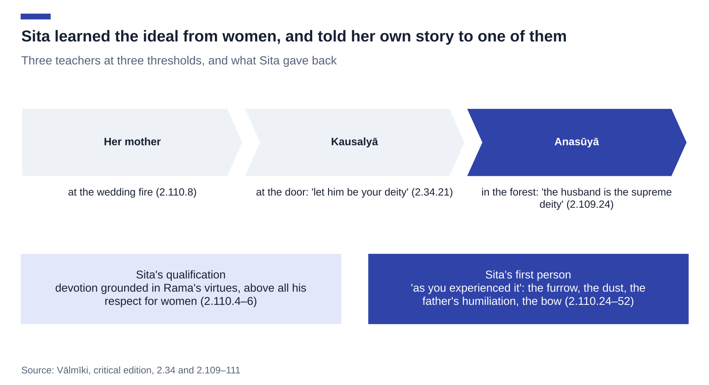

# Chapter 27. The Women Who Taught Sita: Kausalyā, Anasūyā and the First Person in the Forest

::: {custom-style="Epigraph"}
*tasya lāṅgalahastasya karṣataḥ kṣetramaṇḍalam / ahaṃ kilotthitā bhittvā jagatīṃ nṛpateḥ sutā*

"As he ploughed the field, plough in hand, I rose up, they say, breaking through the earth: the king's daughter."

— Sītā, telling her own story to Anasūyā, Vālmīki *Rāmāyaṇa* 2.110.27 (CE)
:::

## The argument of this chapter

The ideal of the faithful wife, the *pativratā*, is usually discussed as something men imposed on women: a norm written by Brahmin lawgivers, enforced by husbands and fathers, and dramatised in the Rāmāyaṇa by a husband who put his wife into the fire. The critical edition tells a more complicated story. In Vālmīki, the ideal is taught to Sita by women. Her mother instructs her at her wedding; her mother-in-law instructs her as she leaves for the forest; an old ascetic woman instructs her in the forest. Sita answers each of them, and her answers are among the least read of her speeches.

And one of those women does something more. Anasūyā, the aged wife of the sage Atri, having taught Sita the ideal, asks her to tell her own story, "in detail, as you experienced it". And Sita does. In the second book of the critical edition, in a hermitage in the forest, to a woman who has asked to hear it, Sita tells the story of her birth from the furrow, her father's anxiety, the bow contest and her marriage, in the first person. It is the first time in the epic that Sita narrates her own life.

This chapter makes five claims.

1. In the critical edition, the ideal of the *pativratā* is transmitted to Sita from woman to woman: by her mother, by Kausalyā and by Anasūyā. The epic presents the ideal as women's knowledge, passed down by women.

2. Sita accepts the ideal, and qualifies it. She rebukes Kausalyā for implying that she might need the warning, and she grounds her devotion, in her reply to Anasūyā, in Rama's specific virtues, above all his respect for women. The standard she articulates is one that Rama will later fail.

3. Sita's account of her birth and marriage, told to Anasūyā, is the epic's own first-person Sita. It is told to a woman, at a woman's request, and its emphases (the dust-covered foundling, the father humiliated by the need to marry a daughter, the difficulty of marrying a girl "not born of a womb") are the emphases of the women's songs.

4. The transmission of the ideal from woman to woman is what the sociologist Deniz Kandiyoti called the patriarchal bargain: women's investment in the norms that constrain them, in exchange for the protections and powers those norms afford. The epic records the bargain with precision, and records, in Sita's replies, its terms.

5. The modern first-person Sita novel, which this book has examined at length, has a precedent in Vālmīki that it has rarely acknowledged. The first person was given to Sita in the epic's second book, by an old woman who wanted to hear her story.

## The mother-in-law

### Kausalyā's warning

As Sita prepares to follow Rama into exile, she adorns herself with the ornaments her father-in-law has provided, and Kausalyā, Rama's mother, embraces her, smells her head in blessing, and gives her a warning:

> In all this world, unchaste women, though always honoured by those they love, do not esteem a husband who has fallen into misfortune. You must not despise my son, now that he has been exiled. Poor or rich, let him be your deity.^[CE 2.34.19–21.]

The warning is sincere, and it is the speech of a mother anxious for her son. Kausalyā is sending Rama into fourteen years of poverty in the forest, and she knows, or believes she knows, how wives treat husbands who lose their fortune. She warns Sita against becoming such a wife.

### Sita's reply

Sita's reply is respectful, formal and, read carefully, pointed:

> I will do everything the noble lady instructs. I know how I must behave towards my husband; I have heard it taught. The noble lady should not class me with the wicked. I can no more swerve from dharma than light can swerve from the moon.^[CE 2.34.23–24.]

The second sentence is the rebuke. *Na mām asajjanenāryā samānayitum arhati*: "the noble lady ought not to put me in the same company as the wicked". Kausalyā's warning implied that Sita might be one of the unchaste women who despise a ruined husband. Sita declines the implication. She has already, as Chapter 1 showed, argued her way into the exile against Rama's own refusal; she hardly needs to be warned against deserting him.

Then Sita states the doctrine in its most famous form:

> A lute without strings does not sound; a chariot without wheels does not move; a woman without a husband does not prosper, though she have a hundred sons. A father gives in measure, a mother gives in measure, a son gives in measure; who would not honour the husband, the giver without measure? … For women, the husband is a deity.^[CE 2.34.25–27.]

Kausalyā weeps, "from grief and joy together".^[CE 2.34.28.]

### What the exchange shows

The exchange is a transmission. The mother-in-law teaches the doctrine; the daughter-in-law recites it back, perfectly; the mother-in-law weeps with relief. The *pativratā* ideal passes from one generation of women to the next, at the threshold of the household, as the younger woman leaves it.

But Sita has done two things in her reply that a mere recitation would not do. She has refused the suspicion implicit in the warning; and she has stated the doctrine in an economic idiom that deserves attention. The father, the mother and the son give "in measure", *mitam*; the husband gives "without measure", *amitam*. The husband is to be honoured because he is the unlimited giver. The doctrine is stated as a theory of dependence: a woman's prosperity depends on her husband, as the lute's sound depends on its strings. It is a description of a social fact, the economic dependence of a wife on her husband in a patrilineal household, presented as a norm.

The modern reader will hear in it the logic of the patriarchal bargain, to which this chapter will return. Sita knows where her prosperity lies. She knows that a woman with a hundred sons and no husband is, in the society she lives in, without standing. Her devotion is, among other things, an accurate reading of her position.

## The old woman in the forest

### Anasūyā

In the forest, at the hermitage of the sage Atri, Rama asks Sita to go to the sage's wife, Anasūyā, an ascetic woman renowned for her austerities: "for ten thousand years" she practised them, and once, by her power, made the Gaṅgā flow when the land was parched.^[CE 2.109.8–16.] The poem describes her as Sita sees her: "loose-skinned, wrinkled, old, her hair white with age, her limbs always trembling like a plantain tree in the wind".^[CE 2.109.18.] Sita bows to her, says her own name and asks after her health.^[CE 2.109.19–20.]

Anasūyā's response is a sermon on the doctrine Kausalyā had taught, and it is more absolute:

> It is good fortune that you have regard for dharma, Sita: that, leaving your kin, your pride and your wealth, you follow Rama, confined to the forest. Women to whom the husband is dear, whether he lives in the city or the forest, whether he is wicked or ill-fated, attain great worlds. Ill-conducted, lustful or poor, for women of noble nature the husband is the supreme deity.^[CE 2.109.21–24.]

She contrasts such women with the unchaste, "whose hearts are ruled by desire", who lose their reputation and their dharma; and she promises that women like Sita "will move in heaven, like those who have done good deeds".^[CE 2.109.26–28.]

### Sita's reply: the qualification

Sita's reply to Anasūyā is longer than her reply to Kausalyā, and its structure is the key to the chapter.

She begins by accepting the doctrine: "This is no wonder, that the noble lady should speak to me so. I too know that the husband is a woman's guru." She accepts even its hardest form: "Even if my husband were without good conduct, noble lady, I would have to serve him without duplicity."^[CE 2.110.2–3.]

And then she turns:

> How much more, then, one who is praised for his virtues, compassionate, master of his senses, steadfast in love, righteous, devoted to his mother, dear to his father? The way the mighty Rama behaves towards Kausalyā, he behaves towards the other wives of the king. Righteous and loving to the king, he treats as a mother any woman the king has looked upon even once, setting aside his pride.^[CE 2.110.4–6.]

The doctrine is accepted in its absolute form, and then immediately displaced. Sita does not, in fact, rest her devotion on the abstract principle that a husband is to be served whatever he is. She rests it on what Rama is: virtuous, compassionate, self-controlled, constant in love. And of all his virtues, the one she dwells on is his conduct towards women: his respect for his father's wives, his treatment of every woman the king has so much as looked at as a mother.

### The standard she set

The reader who knows the rest of the poem will recognise the irony at once. Sita, in the forest, praises Rama for the respect he shows women. The same Rama will, before the armies in Laṅkā, tell her that she may go to Lakshmaṇa or Bharata or Sugrīva or Vibhīṣaṇa; and Sita will answer, as Chapter 1 showed, that he speaks "like a common man to a common woman", and that he "puts my womanhood alone in front, like a petty man".^[CE 6.103.22–23, 6.104.5, 6.104.14; see Chapter 1.] The virtue on which she grounded her devotion is the virtue he will abandon.

Sita's reply to Anasūyā, in other words, sets the standard by which her later rebuke is made. She does not, before the fire, abandon the doctrine of the *pativratā*. She holds Rama to the description she gave of him in the forest. The husband she praised to Anasūyā was a man who treated every woman with respect. The husband who stood before her in Laṅkā was not that man. Her rebuke is not a rejection of devotion. It is a demand that the husband be what her devotion assumed.

### The renewal of instruction

Sita ends her reply by naming her teachers. What her mother-in-law instructed her as she came to the forest is in her heart; and "what my mother taught me long ago, beside the fire, at the time my hand was given", that too she holds. And Anasūyā's words, she says, have "renewed" both: "for a woman, no austerity is ordained other than service to her husband." She cites the examples of Sāvitrī and of Rohiṇī, the moon's wife, who is never seen without him.^[CE 2.110.7–11.]

The lineage is explicit. Sita's mother taught her at the wedding fire; her mother-in-law taught her at the door of the house; the old ascetic woman teaches her in the forest. Three women, at three thresholds of her life, have taught her the same doctrine, and Sita acknowledges all three. The *pativratā* ideal in Vālmīki is women's knowledge, transmitted in a female line.

## The gift

### Ornaments from an ascetic

Anasūyā is delighted. She kisses Sita's head and offers her a gift by the power of her austerities: "this divine, excellent garland, this garment and these ornaments, and this costly unguent". They will adorn Sita's limbs, will suit her and will never fade. "Anointed with this divine unguent, daughter of Janaka, you will adorn your husband, as Śrī adorns the imperishable Viṣṇu."^[CE 2.110.14–19.] Sita accepts the gift and sits, with joined hands, beside the old woman.^[CE 2.110.20–21.]

The gift is surprising. An ascetic woman, who has spent ten thousand years in austerities and whose own body is wrinkled and trembling, gives the young wife cosmetics and jewels: a garland that will not wither, an unguent that will not wear off. The doctrine of the faithful wife, it turns out, includes adornment. The wife is to be beautiful for her husband, as the goddess is beautiful for the god, and the old woman's gift is the means.

The poem does not say whether the ornaments Sita let fall over the mountain, as Ravana carried her off, were among the ones Anasūyā gave her.^[On the ornaments dropped in flight, see Chapter 24.] A reader may wonder. The old woman's gift of beauty, meant to adorn Sita for her husband, may have become the trail by which her husband found her.

## The first person

### "As you experienced it"

Then Anasūyā asks for something in return. "I have heard," she says, "that you were won by this glorious Rāghava at a bride-choice. I wish to hear that story in detail, Maithilī. Tell it to me fully, as you experienced it."^[CE 2.110.23–24.]

The phrase *yathānubhūtam*, "as you experienced it", deserves to be underlined. Anasūyā does not ask for the facts of the bride-choice, which she says she has already heard. She asks for Sita's experience of it. She asks for the story in the first person.

And Sita tells it. "Listen," she says, and begins.^[CE 2.110.25.]

### The story Sita tells

Sita's account of her own life, as the critical edition gives it, runs to some twenty-five verses, and it is remarkable both for what it includes and for how it frames it.

It begins with her birth:

> Janaka, lord of Mithila, a hero who knows dharma, devoted to the warrior's duty, rules the earth justly. As he ploughed the field, plough in hand, I rose up, they say, breaking through the earth: the king's daughter. Seeing me, the king, who was scattering handfuls of seed, was astonished: I was covered all over in dust. Childless, he took me on his lap himself out of love, and saying "this is my daughter", poured his affection on me.^[CE 2.110.26–29.]

A voice from the sky confirmed it: "So it is, king: she is your daughter by dharma." Janaka gave her to his eldest queen, who loved her "with a mother's affection".^[CE 2.110.30–32.]

Then the anxiety:

> When my father saw that I had reached the age for marriage, he fell into worry, like a poor man who has lost his wealth. In this world, a maiden's father suffers humiliation from those equal to him and those beneath him, even if he is equal to Indra. Seeing that humiliation not far off, the king was sunk in an ocean of worry, and found no shore, like a man without a boat. Knowing me to be not born of a womb, he could not, for all his thought, find a husband fit and suitable for me.^[CE 2.110.33–36.]

The solution was the bride-choice, with a bow given by Varuṇa that no man could bend. Kings came, and failed. Rama came, with Viśvāmitra and Lakshmaṇa, and bent the bow "in the blink of an eye", and it broke with a sound like a thunderbolt.^[CE 2.110.37–47.] And then a detail that the reader of this book will not miss:

> Then my father, true to his word, raised the vessel of water to give me to Rama. But Rāghava did not accept me then, not knowing the wish of his father, the lord of Ayodhya. Only after my father had consulted my father-in-law, the aged King Daśaratha, was I given to Rama.^[CE 2.110.48–50.]

Ūrmilā, her younger sister, "lovely to see", was given to Lakshmaṇa. "Thus I was given to Rama at that bride-choice; and I am devoted, by dharma, to my husband, the best of heroes."^[CE 2.110.51–52.]

### What the first-person Sita emphasises

Set beside the third-person account of the same events in the first book, where Janaka tells Viśvāmitra of finding Sita in the furrow and of the bow, Sita's account has its own emphases.^[CE 1.65.14–27; see Chapter 23.] Three of them stand out.

The first is the dust. Janaka's account says that she rose from the plough. Sita's account adds that she was "covered all over in dust", *pāṃsuguṇṭhitasarvāṅgī*, and that her father was astonished. The foundling is a dirty child found in a field, whom a childless man takes on his lap. Sita remembers, or rather has been told (*kila*, "they say"), the moment of her adoption as a moment of her father's love for a child who was not his.

The second is the father's humiliation. The longest passage in Sita's account is not about the bow or Rama; it is about her father's worry. She describes it in images of ruin and drowning: a poor man who has lost his wealth, a man in an ocean without a boat. And she gives the reason in a general maxim: "in this world, a maiden's father suffers humiliation" from all sides, however great he is. Sita knows that daughters are a burden on their fathers' honour, and she tells Anasūyā so.

The third is her origin as an obstacle. Janaka could not find a husband for her because she was *ayonijā*, "not born of a womb". The miraculous birth that makes Sita sacred also makes her unmarriageable: no family knows her lineage; no match can be calculated. The bride-choice with the impossible bow is Janaka's solution to the problem of a daughter without a genealogy.

These are precisely the emphases of the women's songs. Nabaneeta Dev Sen listed the songs' sub-themes, and the first three are the foundling, the worry over marriage and child marriage.^[Nabaneeta Dev Sen, "When Women Retell the Ramayan," *Manushi* 108 (1998): 20.] She quoted a Marathi song in which Sita says, "I was found at the tip of a plough / How can I have parents?", and a Maithili song in which Sita asks her father how much longer he plans to keep her unmarried.^[Dev Sen, "When Women Retell the Ramayan," 20–21.] The village women who sang Sita's birth and marriage were singing the story Sita told Anasūyā. Whether or not any of them knew the passage, they chose the same moments, and gave them the same weight.

### The narrator and her listener

Anasūyā's response completes the scene. She embraces Sita, kisses her head and praises her narration: "You have spoken in clear syllables and words, vividly and sweetly; I have heard everything about the bride-choice as it happened. I delight in your story, sweet-voiced one." Night is falling; the birds are settling; the sages are returning from their evening bath. "Go, I give you leave; be Rama's companion. You have pleased me with your sweet telling." And she asks Sita to put on the divine ornaments in her presence, so that she may see her adorned. Sita does, bows to her, and goes to Rama.^[CE 2.111.1–12.]

The scene is a scene of women's storytelling, and it is framed with care. An old woman asks a young one to tell her own story; the young woman tells it; the old woman praises the telling for its clarity and sweetness; and the evening comes on. It is the scene of a thousand Indian courtyards, in which women tell each other their lives. Vālmīki placed it at the heart of his second book, and gave the narrator's voice to Sita.

## The patriarchal bargain

### Kandiyoti's term

Chapter 9 introduced the sociologist Deniz Kandiyoti's concept of the patriarchal bargain: the strategies by which women, within systems that constrain them, invest in the norms of those systems in exchange for the protections and powers they afford, and in particular the power that older women gain over younger ones in the patrilineal household.^[Deniz Kandiyoti, "Bargaining with Patriarchy," *Gender & Society* 2, no. 3 (1988): 274–90; see Chapter 9.] Chapter 9 used the concept to read Mantharā, the servant whose loyalty to Kaikeyī was a bargain from below.^[See Chapter 9.]

The critical edition's account of Sita's teachers is the bargain from above and within. Kausalyā, the senior queen whose own position has been destroyed by Kaikeyī's intrigue, teaches her daughter-in-law the doctrine that will keep the younger woman bound to her son. Anasūyā, the ascetic woman whose authority derives from her own lifetime of service to her husband, teaches the young wife the doctrine that made her great. Sita's mother taught her at the wedding fire the norms by which she would be judged in her husband's house. Each woman transmits the ideal because each has invested in it, and each has gained something by it: a son's security, a sage's reverence, a daughter's good marriage.

### What the bargain secures

Kishwar's essay, which this book has drawn on throughout, records the modern form of the bargain with unusual candour. "By shaping themselves in the Sita mould," she observed, "women often manage to acquire enormous clout and power over their husbands and family."^[Madhu Kishwar, "Yes to Sita, No to Ram! The Continuing Popularity of Sita in India," *Manushi* 98 (January–February 1997): 31.] And she insisted that "Indian women are not endorsing female slavery when they mention Sita as their ideal": they see Sita as "a person whose sense of dharma is superior to and more awe inspiring than that of Ram".^[Kishwar, "Yes to Sita, No to Ram!" 22.]

Sita's reply to Anasūyā shows how such a sense of dharma works. She accepts the ideal completely, and then defines its object. The husband she serves is a man of particular virtues; her service is a response to those virtues; and when he betrays them, she will hold him to them. The bargain secures her a standard by which to judge him. It is a constrained power, and it is real.

### What it costs

The bargain's cost is also recorded. The doctrine Anasūyā teaches is absolute: the husband is the supreme deity even if he is "ill-conducted, lustful or poor". Sita accepts this in principle, before qualifying it in practice. And the society in which the doctrine is taught is the society that, in the seventh book, will banish her on the strength of rumour. The women who taught Sita the ideal could not protect her from the men who enforced it. Kausalyā, who warned her not to despise a ruined husband, did not warn her that a triumphant husband might despise her. Anasūyā, who promised her heaven, could not promise her a hearing.

## The modern first person

### A precedent unacknowledged

Chapter 11 measured the rise of the first-person Sita novel and called it the "Sitayan moment": the appearance, after 2010, of a genre in which Sita tells her own story.^[See Chapter 11.] The novels present the first person as a modern gift, the restoration of a voice the tradition had denied. Chapter 1 argued that the tradition never denied Sita a voice; this chapter adds that it gave her the first person specifically, in a scene of women's storytelling, and that the scene has been almost entirely forgotten.

The Anasūyā scene is not obscure. It is in the second book of the critical edition, in the most widely read part of the epic. But it has rarely been noticed as what it is: an autobiographical narrative by Sita, requested by a woman, told to a woman, and praised by that woman for its clarity and sweetness. Its absence from the modern discussion of Sita's voice is itself evidence for the argument of this book. The modern retellers, and many of their critics, have assumed the silence they set out to break.

### What the precedent teaches

The precedent also teaches something about the first person that the modern novels have sometimes forgotten. Sita's first-person narrative in Vālmīki is not a confession, a protest or a self-assertion. It is a story told on request, to a sympathetic listener, about the circumstances of her birth and marriage, and its emphases are those of a woman who knows how daughters are valued: the dust, the father's humiliation, the problem of an unknown lineage. It ends with an affirmation of her devotion, which the reader cannot take as merely conventional, because it has just been grounded in a description of Rama's virtues that Rama will later fail.

The first-person Sita of the epic, in other words, is neither the silent wife of the reformers nor the liberated heroine of the bestseller. She is a narrator who knows her situation precisely, tells it without complaint, and states the terms on which her devotion rests. When those terms are broken, she will say so. The first person, in Vālmīki, is where the terms are set.

::: {custom-style="Box Title"}
Reading Against the Text
:::

::: {custom-style="Box"}
Anasūyā asks Sita to tell her story "as you experienced it" (2.110.24), and Sita's longest passage is about her father's humiliation at having a daughter to marry (2.110.33–36). Why does the epic's first first-person Sita dwell on her father's anxiety rather than her own feelings? And why has the scene been so little noticed by the modern writers who claim to have given Sita her first voice?
:::

::: {custom-style="Box Title"}
The Debate: Transmission
:::

::: {custom-style="Box"}
**Position A:** The *pativratā* ideal is an instrument of patriarchy, imposed on women by male authority and dramatised by the epic to discipline them.\
**Position B:** The *pativratā* ideal is women's own knowledge, transmitted by mothers and elders, and a source of moral authority for the women who hold it.\
**Where the evidence of this chapter leaves the argument.** The critical edition supports Position B as a description and Position A as an analysis. The ideal is taught to Sita by women (2.34.19–21; 2.109.21–28; 2.110.7–8), and Sita draws authority from it, grounding her devotion in Rama's virtues (2.110.4–6) and later holding him to them (6.104.5, 6.104.14). But the women who teach it cannot protect her from the men who enforce it. The bargain is real on both sides: it gives Sita a standard, and it gives her judges a weapon.
:::

## Conclusion

In Vālmīki, Sita learns the ideal of the faithful wife from women: from her mother at the wedding fire, from Kausalyā at the door of the house and from Anasūyā in the forest. She accepts it and qualifies it. She rebukes her mother-in-law for implying she might need the warning; she tells the old ascetic that she would serve even a bad husband, and then grounds her devotion in Rama's respect for women, the virtue he will abandon before the fire. And when Anasūyā asks her to tell her story "as you experienced it", Sita gives the epic its first first-person account of her life: the dust-covered foundling, the father humiliated by the need to marry her, the girl without a lineage, the bow, the husband who would not accept her without his father's consent. The modern first-person Sita has a precedent she has rarely acknowledged. It was given to her by an old woman in the forest, who praised her for speaking clearly, and then asked to see her in her jewels.
