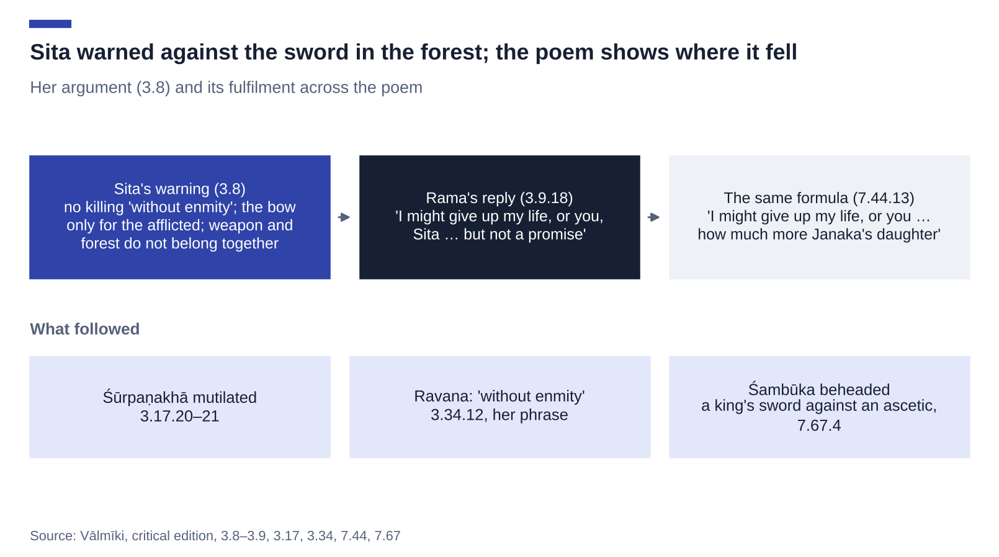

# Chapter 28. Sita Against the Sword: Violence, Promise and the Forest

::: {custom-style="Epigraph"}
*kva ca śastraṃ kva ca vanaṃ kva ca kṣātraṃ tapaḥ kva ca*

"Where is the weapon, and where the forest? Where the warrior's power, and where austerity?"

— Sītā to Rama, on the way into the Daṇḍaka forest, Vālmīki *Rāmāyaṇa* 3.8.23 (CE)
:::

## The argument of this chapter

Early in the *Araṇyakāṇḍa*, as Rama, Sita and Lakshmaṇa leave the hermitage of the sage Sutīkṣṇa and set out into the Daṇḍaka forest, Sita stops her husband and makes a speech. It is a speech about violence. Rama, she says, has promised the sages of the forest to kill the *rākṣasas* who harass them; he carries his bow everywhere; and she fears what the bow will do to him. She tells him a story about an ascetic who was given a sword to keep, and who, carrying it everywhere, became violent and went to hell. She asks him not to kill without enmity. And she ends by apologising for the presumption of a woman instructing her husband in dharma.

The speech is one of the most remarkable in the epic, and it is one of the least discussed. Chapter 1 did not examine it; nor, so far as the corpus records, has any modern Sita novel made it central. This chapter reads it, and Rama's reply, and follows its consequences through the poem. It makes five claims.

1. Sita's speech in the forest is a complete ethical argument against violence without cause, grounded in a theory of how weapons corrupt those who carry them. It is the epic's most sustained statement of an ethic of non-violence, and it is given to Sita.

2. Rama's reply rests on a promise: he has given his word to the sages, and he would give up his life, or Sita, or Lakshmaṇa, sooner than break it. The formula he uses recurs, almost word for word, in the seventh book, when he banishes Sita for fear of censure. The poem marks the two moments as one.

3. The violence Sita feared arrives. Rama's first act against a *rākṣasī* in the forest is the mutilation of Śūrpaṇakhā; Ravana's justification for abducting Sita uses Sita's own phrase, "without enmity". Her warning becomes, in the enemy's mouth, a charge.

4. The epic's treatment of violence against women begins earlier, with Tāṭakā, the first woman Rama is told to kill. His reluctance, and the sage's argument that overrides it, set the pattern for the forest.

5. Sita's parable of the ascetic and the sword is fulfilled in the seventh book, when the king takes his sword into the forest and kills an ascetic. The killing of Śambūka is the exact opposite of what Sita asked: a weapon used against austerity, without enmity, by a king.

## The speech in the forest

### The three vices

Sita begins with a principle. Dharma, she says, is great and subtle, and it can be attained only by one who refrains from the vices born of desire. There are three such vices: falsehood, which is grave; and two that are graver still, "going to another man's wife, and violence without enmity".^[CE 3.8.2–3.]

She then examines her husband against the list. Falsehood "has never been in you, Rāghava, and never will be". Desire for other men's wives, "the destroyer of dharma", how could that be in you? You are master of your senses; I know it. "But the third, this terrible thing, the taking of others' lives without enmity, done out of delusion: that is now before you."^[CE 3.8.4–6.]

The argument is precise. Sita does not accuse Rama of violence. She tells him that he is free of the first two vices, and that the third is the one he is now in danger of. The danger is structural, not moral: it arises from the situation he has put himself in.

### The promise and the bow

The situation is this. Rama has promised the sages of the Daṇḍaka forest that he will kill the *rākṣasas* who threaten them; he has set out with his brother, bow and arrows in hand, for that purpose. "Seeing you set out, my mind is troubled with anxiety." She does not like the journey to the Daṇḍaka, and she gives her reason: "You have gone into the forest with your brother, bow and arrows in hand. Seeing all the creatures that live in the forest, might you not spend your arrows on them?"^[CE 3.8.7–11.]

And then the theory: "For warriors, the bow, like fuel near a fire, greatly increases their fiery power when it is close at hand."^[CE 3.8.12.] The weapon is not neutral. Its presence changes the one who carries it, as fuel changes a fire.

### The ascetic and the sword

To illustrate the theory, Sita tells a story. Once there was an ascetic, truthful and pure, in a forest full of birds and deer. Indra, wishing to disrupt his austerities, came to the hermitage in the form of a warrior, sword in hand, and left the sword with the ascetic as a deposit in trust. The ascetic, anxious to guard the deposit, carried the sword everywhere; he would not go even to gather roots and fruit without it. "Always carrying the weapon, little by little the ascetic abandoned his resolve for austerity, and made his own mind violent. Then, delighting in violence, heedless, dragged down by adharma, from living with that weapon the sage went to hell."^[CE 3.8.13–19.]

The parable is a small masterpiece. Its ascetic is not a bad man; he is a scrupulous one, who carries the sword because he has promised to guard it. His virtue, his fidelity to a trust, is the means of his corruption. And the corruption is gradual, *krameṇa*, "little by little": the sword does not make him violent at once; it makes him violent by being always at hand.

The application to Rama is exact, and Sita does not need to spell it out. Rama, too, has taken up a weapon because of a promise. Rama, too, is in a forest among ascetics. Rama, too, will carry the weapon everywhere. The danger is not that he is violent. It is that his fidelity to his promise will make him so.

### What Sita asks

Then Sita states her request:

> Out of love and respect I remind you; I do not instruct you. Never, holding your bow, should you form the intention of killing the *rākṣasas* who live in the Daṇḍaka without enmity. I do not wish you to kill living beings without offence, hero. For warriors who live in the forest with restraint, the bow has only this purpose: the protection of the afflicted.^[CE 3.8.20–22.]

And she adds the line that is this chapter's epigraph: "Where is the weapon, and where the forest? Where the warrior's power, and where austerity? These are contradictory. Let us honour the dharma of the place." The use of weapons pollutes the mind; when he returns to Ayodhya, he may practise the warrior's dharma again. Her parents-in-law would rejoice without end, she says, if he renounced the kingdom and became a sage.^[CE 3.8.23–25.]

The argument has three parts. The first is a limit on violence: the bow is for protecting the afflicted, not for killing the unoffending. The second is a theory of place: the forest has its own dharma, the dharma of austerity, and the warrior's weapon does not belong in it. The third is a wish: that Rama might be, in the forest, what the forest asks of its inhabitants, an ascetic rather than a warrior.

### The apology

Sita ends with a disclaimer. "I have said this out of a woman's fickleness. Who is able to tell you dharma? Reflect with your brother, using your judgement, and do what pleases you, without delay."^[CE 3.8.29.]

The phrase *strīcāpalāt*, "from a woman's fickleness", is the conventional self-deprecation of a woman who has presumed to instruct a man, and it should not be read as Sita's real estimate of her speech. She has just delivered a carefully argued ethical discourse, with a principle, an application, a parable and a conclusion. The apology is the formula that makes the discourse sayable. Mandodarī, Chapter 19 observed, used a similar formula when she set a woman's compassion against the warrior's ethic: "because of a woman's nature, my mind turns to compassion".^[CE 6.99.23; see Chapter 19.] In both cases, the woman's voice claims the lesser authority of her nature in order to say what the men's ethic cannot.

## Rama's reply

### The promise

Rama's reply is courteous and firm. "You have spoken for my good, my lady, with affection, and in a way worthy of your family." But, he says, "you have answered yourself": she has said that warriors bear the bow so that there may be no cry of the afflicted, and the sages of the Daṇḍaka are afflicted. They came to him for refuge; they told him that the *rākṣasas* attack them at their sacrifices and devour them; that they could kill the *rākṣasas* by the power of their austerities, but will not spend the austerities they have accumulated so long; and so they asked him to protect them.^[CE 3.9.1–15.] He promised. And a promise, once made, cannot be broken:

> Having promised, I cannot, while I live, make my promise to the sages false; for truth is always dear to me. I might give up my life, or you, Sita, with Lakshmaṇa, but not a promise once made, especially to Brahmins.^[CE 3.9.17–18.]

He is pleased with her, he says; "one does not instruct someone who is not dear". And he goes on, bow in hand, into the hermitages.^[CE 3.9.20–21.]

### The answer and what it leaves out

Rama's answer is strong on its own terms. Sita had conceded that the bow is for protecting the afflicted; the sages are afflicted; therefore the bow is justified. The answer turns her own principle against her request.

But it does not answer her argument. Sita did not say that Rama should not protect the sages. She said that he should not kill "without enmity", and she warned that a weapon always at hand would lead him to do so. Rama's reply addresses the first point and ignores the second. It justifies the purpose; it does not address the danger. And it grounds the justification not in the merits of the case but in the inviolability of a promise: having given his word, he will keep it whatever the cost.

### The formula

The cost Rama names is the most striking element of the reply. "I might give up my life, or you, Sita, with Lakshmaṇa": *apy ahaṃ jīvitaṃ jahyāṃ tvāṃ vā sīte salakṣmaṇām*.^[CE 3.9.18.] He says it to Sita's face, as a measure of how seriously he takes his word, and the poem presents it as an expression of his commitment to truth.

The reader of the seventh book has heard the formula before, or rather will hear it again. When Rama tells his brothers that he will banish Sita, he says: "I might give up my life, or you, bulls among men, out of fear of censure: how much more, then, Janaka's daughter?" *Apy ahaṃ jīvitaṃ jahyāṃ yuṣmān vā puruṣarṣabhāḥ / apavādabhayād bhītaḥ kiṃ punar janakātmajām*.^[CE 7.44.13.]

The two verses share their opening words and their structure: I might give up my life, or you; how much more (or, but not) the thing in question. In the third book, the thing that cannot be given up is a promise to the sages, and Sita is among the things that could be. In the seventh, the thing that cannot be endured is public censure, and Sita is the thing that will be given up. The formula that declared Sita expendable for the sake of a promise is used, years later, to declare her expendable for the sake of a reputation.

I do not suggest that the poet planned the echo as a commentary; formulas recur in oral and early literary epic for many reasons. But the echo is there in the critical edition, and it has a meaning that the attentive reader cannot miss. In both places, Rama ranks his commitments, and in both places Sita is below the top. She was ranked below a promise in the forest, and below fame in Ayodhya. The forest speech was the first time she heard where she stood.

## The violence she feared

### Śūrpaṇakhā

The violence Sita feared arrives within a few cantos. Śūrpaṇakhā, Ravana's sister, comes to Pañcavaṭī and offers herself to Rama, and then to Lakshmaṇa; mocked by both, she rushes at Sita; and Rama orders Lakshmaṇa to disfigure her. The critical edition records his words: "You should disfigure this ugly, unchaste, wildly drunken, pot-bellied woman." Lakshmaṇa cuts off her ears and nose.^[CE 3.17.20–21.]

Chapter 10 examined the Śūrpaṇakhā episode at length, and the modern retellings that have rehabilitated her.^[See Chapter 10.] What this chapter adds is its relation to Sita's speech. Śūrpaṇakhā was a *rākṣasī* of the Daṇḍaka forest. She had threatened Sita, and Rama's defence of his wife was not "without enmity". But the response was mutilation, not protection: not the minimum force needed to protect the afflicted, which was the purpose Sita assigned to the bow, but the deliberate disfigurement of a woman whose offence was desire and whose assault had been checked.

### Ravana's charge

And when Ravana justifies his abduction of Sita, he uses Sita's own phrase. Speaking to Mārīca, whom he wants as an accomplice, Ravana describes Rama as a disgrace to the warrior class, and names his crime: "by whom, without enmity (*vairaṃ vinā*), in the forest, relying on mere strength, my sister was disfigured by the cutting off of her ears and nose".^[CE 3.34.10–12.] Therefore, he says, he will carry off Rama's wife.

*Vairaṃ vinā*: "without enmity". It is the phrase Sita used in her warning to Rama: "never form the intention of killing the *rākṣasas* without enmity".^[CE 3.8.21.] The poem gives the enemy Sita's words. What she feared her husband might do, the enemy says he has done; and the enemy's revenge falls on her.

The reader should not take Ravana's account as the poem's verdict; Ravana is lying to an accomplice, omitting his sister's attack on Sita and his own designs. But the echo is exact, and its irony is the tragic irony of the whole *Araṇyakāṇḍa*. Sita warned that violence without cause would bring disaster. The disaster came, through the enemy's claim that violence had been done without cause, and it came to her.

## The first woman Rama was told to kill

### Tāṭakā

The epic's concern with violence against women begins long before the forest, in the first book, with the first woman Rama is asked to kill. Viśvāmitra, who has taken the boy Rama to protect his sacrifices, brings him to a forest haunted by Tāṭakā, a *yakṣī* cursed into the form of a man-eater. He tells Rama to kill her, and anticipates his objection:

> You must not feel disgust at killing a woman, best of men. A king's son must do it for the welfare of the four classes … For those charged with the burden of kingship, this is the eternal dharma. Kill her, Kākutstha, who is without dharma. For it is told that long ago Indra killed Mantharā, Virocana's daughter, who wished to destroy the earth; and Viṣṇu killed the wife of Bhṛgu, mother of Kāvya … By these and many other great princes, women devoted to adharma have been killed.^[CE 1.24.15–19.]

Rama agrees, out of respect for his father's instruction to obey the sage.^[CE 1.25.2–5.] But when Tāṭakā appears, he hesitates. "I cannot bring myself to kill her, protected as she is by her woman's nature," he tells Lakshmaṇa; "I will destroy her power and her movement." He proposes instead to make her turn back "with her ears and the tip of her nose cut off".^[CE 1.25.11–12.] Tāṭakā charges; Rama shoots her in the breast; she falls and dies; and the gods applaud.^[CE 1.25.13–15.]

### The pattern

The Tāṭakā episode establishes a pattern that the forest will repeat. A woman of the wild, outside the order of the household, is judged dangerous. The young prince is reluctant to kill a woman, and the reluctance is presented as a virtue: she is "protected by her woman's nature". The alternative to killing is mutilation: ears and nose. An authority, here the sage, supplies the argument that overrides the reluctance, citing precedent and the welfare of the social order. And the gods applaud.

In the forest, the pattern recurs with Śūrpaṇakhā, and the mutilation that Rama proposed as a merciful alternative for Tāṭakā is carried out. The sequence from the first book to the third shows the "protection" of a woman's nature narrowing. For Tāṭakā, it protected her from death until she charged. For Śūrpaṇakhā, it protected her from death and not from disfigurement. For Sita, in the end, it protected her from neither the fire nor the forest.

Sita's speech in the Daṇḍaka should be read against this background. She is the only person in the epic who argues, at length and from principle, against violence without cause, and she makes the argument in the forest where her husband will mutilate a woman and from which she will be carried off in revenge.

## The sword in the seventh book

### Śambūka

Sita's parable was about an ascetic and a sword. A man of austerity, given a weapon to keep, carried it until it made him violent, and so lost both his austerity and his place in heaven. The parable's lesson was that weapon and forest, warrior's power and austerity, do not belong together.

In the seventh book, the parable is fulfilled in reverse. A Brahmin's son dies, and the Brahmin blames the king: some adharma in the kingdom has caused the untimely death. Rama searches, and finds, in the forest, an ascetic performing austerities, hanging upside down. He asks who he is. The ascetic replies: "I was born of a Śūdra womb." "While the Śūdra was still speaking," the poem says, Rama drew his sword and cut off his head, and the Brahmin's son came back to life.^[CE 7.66.13, 7.67.2–5; see Chapters 1 and 10.]

Chapter 1 called Śambūka "the other victim", and Chapter 10 examined the anti-caste tradition that has made his killing the centre of its critique of Rāmrājya.^[See Chapters 1 and 10.] What should be added here is the relation to Sita's speech. Everything Sita warned against is present in the killing. A king takes a weapon into the forest. He uses it against an ascetic, a man practising austerity, who has offered him no offence and bears him no enmity. He uses it at once, without hearing, "while the Śūdra was still speaking". The weapon and the forest, the warrior's power and austerity, meet, and the austerity is destroyed.

### The connection the poem does not make

The critical edition does not connect Sita's speech to the killing of Śambūka. They are separated by four books and many years; Sita is in Vālmīki's hermitage when Śambūka dies; no one recalls her parable. The connection is the reader's.

But it is a connection that the argument of this book compels. Sita's speech in the forest set out a limit on royal violence: the bow is for protecting the afflicted; it must not be used without enmity against those who have done no offence; the forest has its own dharma, which the weapon violates. The seventh book shows a king who had banished the woman who set that limit, using his sword, in the forest, against an ascetic who had done no offence. The two victims of the *Uttarakāṇḍa*, Sita and Śambūka, are joined by more than the coincidence of their suffering. The first had warned against what was done to the second.

## Sita and non-violence in the modern imagination

### Gandhi's Sita

Chapter 3 described Gandhi's Sita: the model of the satyagrahi, who resisted Ravana's overwhelming force by purity and refusal, without violence, and who could therefore stand for a subject people's resistance to empire.^[See Chapter 3.] Gandhi's reading drew on Sita's conduct in captivity, the blade of grass and the refusal of Ravana. It did not, so far as this book has found, draw on her speech in the Daṇḍaka, which would have given him a more direct warrant: a Sita who argues, from principle, against the use of weapons without cause, and who tells a parable about how weapons corrupt the virtuous.

The omission is instructive. Gandhi's Sita resisted the enemy. The Sita of the forest speech restrains her husband. A nationalist reading that needed Sita as a figure of resistance to the coloniser had less use for a Sita who questioned the violence of her own side. Here, as Chapter 3 argued of Gandhi's Sita more generally, the reading took what it needed: "he had no use for a Sita who refused her husband".^[See Chapter 3.]

### The ecological Sita

The modern ecological readings of Sita, which Chapter 6 examined in connection with *Kāñcana Sīta* and the debate between Vandana Shiva and Bina Agarwal, have also tended to overlook the forest speech, though it is the epic's most explicit statement of an ethic of the forest.^[See Chapter 6.] Sita's argument that the forest has its own dharma (*deśadharma*), that the warrior's weapon does not belong in it, and that a prince in the forest should live as its ascetics live, is a theory of place-based ethics stated two thousand years before the term. The ecological retellers who identified Sita with nature had, in the critical edition, a Sita who had already spoken for the forest's dharma against her husband's bow.

### A missing retelling

The forest speech is, in short, one of the great unused resources of the Sita tradition. The feminist retellings have concentrated on the fire, the banishment and the descent; the anti-caste retellings on Śambūka; the ecological readings on the furrow and the earth. The speech in which Sita argues against violence without cause, connects the weapon to the corruption of the virtuous, and claims the forest for austerity, has been left almost untouched. It awaits its novelist.

::: {custom-style="Box Title"}
Reading Against the Text
:::

::: {custom-style="Box"}
In the forest, Rama tells Sita he would give up his life, or her, sooner than break a promise to the sages (3.9.18). In Ayodhya, he tells his brothers he would give up his life, or them, for fear of censure, "how much more Janaka's daughter" (7.44.13). The poem uses the same formula twice. What does it tell us about where Sita stood among Rama's commitments, and when she first learned it?
:::

::: {custom-style="Box Title"}
The Debate: Violence
:::

::: {custom-style="Box"}
**Position A:** Rama's violence in the forest is the protection of the afflicted that Sita herself conceded to be the purpose of the bow; the sages asked for it, and he had promised.\
**Position B:** Sita's warning was vindicated: the violence that followed (the mutilation of Śūrpaṇakhā, the war, and in the end the killing of Śambūka) exceeded the protection of the afflicted and fell, as she feared, on the unoffending.\
**Where the evidence of this chapter leaves the argument.** The critical edition supports Position A as a justification of Rama's purpose and Position B as an account of what happened. Sita's speech (3.8.2–29) set a limit that Rama's reply (3.9.1–21) did not address. Ravana's charge used her very words, "without enmity" (3.34.12); and in the seventh book a king took his sword into the forest against an ascetic who had done no offence (7.67.2–5).
:::

## Conclusion

On the way into the Daṇḍaka forest, Sita made the epic's most sustained argument against violence without cause. She named it as one of the three vices born of desire; she warned that a weapon always at hand changes the one who carries it, as fuel feeds a fire; she told the parable of the ascetic corrupted by a sword held in trust; and she claimed the forest for austerity, apologising for the presumption of a woman's speech. Rama answered with a promise, and with a formula that ranked Sita below it, a formula he would use again when he banished her. The violence she feared came: the mutilation of Śūrpaṇakhā, the enemy's charge in her own words, the abduction, the war. And in the seventh book, with Sita gone, a king took his sword into the forest and killed an ascetic while he was still speaking. The woman who had warned against it was not there to remind him.
