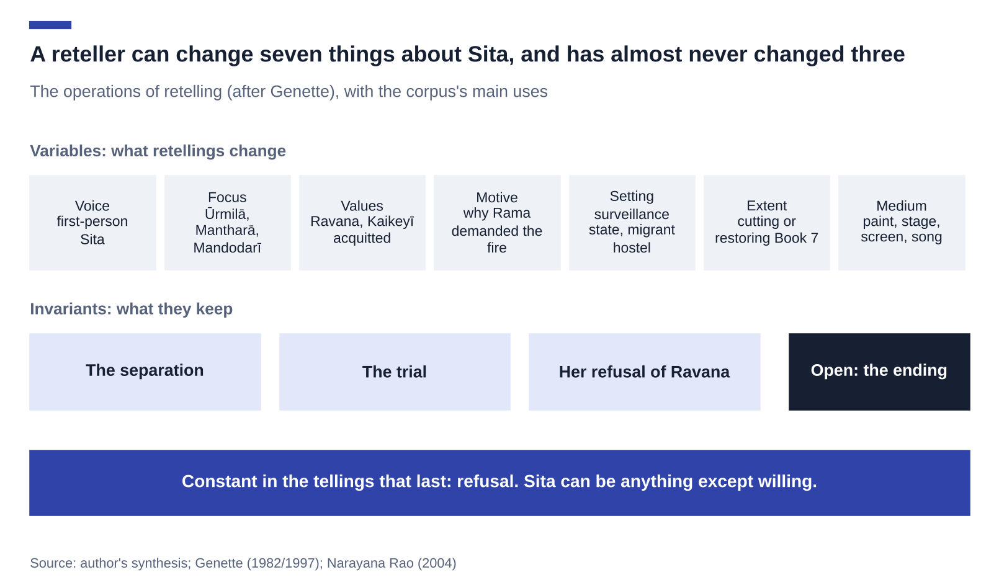

# Chapter 29. The Grammar of Retelling: What a Reteller Can Change, and What Sita Will Not Let Go

::: {custom-style="Epigraph"}
"Re-vision—the act of looking back, of seeing with fresh eyes, of entering an old text from a new critical direction—is for women more than a chapter in cultural history: it is an act of survival."

— Adrienne Rich, "When We Dead Awaken: Writing as Re-Vision" (1972)
:::

## The argument of this chapter

This book has examined more than a hundred retellings of Sita's story across two millennia, a dozen languages and every medium from palm leaf to streaming platform. It has read them one by one, in their contexts, and asked of each the same question: whose need does this Sita serve? This last chapter before the Conclusion steps back from the individual texts and asks a different question, a formal one. What, precisely, can a reteller do to the story? What operations are available to someone who wishes to make a new Sita out of an old one? And are there limits: changes that, once made, produce a figure the audience no longer recognises as Sita?

The chapter makes five claims.

1. The transformations performed on Sita's story across the corpus can be described by a small number of operations, which literary theory, from Gérard Genette's *Palimpsests* to Linda Hutcheon's theory of adaptation, has named: changes of voice, of focus, of value, of motive, of setting, of extent and of medium.

2. Each operation has a characteristic politics. Changing the voice gives Sita speech; changing the value rehabilitates the villains; changing the setting makes the epic speak to the present; changing the extent decides which parts of the story count. The history of Sita's afterlife is, in large part, a history of which operations were used, by whom and when.

3. Some elements of the story have proved remarkably stable across the corpus: the separation, the trial, and Sita's refusal of Ravana. The ending, by contrast, is the most variable element of all.

4. The limits of the grammar are marked by the retellings that provoked the strongest reactions: those that made Sita desire Ravana, or another man, or that represented her sexuality in ways her audiences found intolerable. Velcheru Narayana Rao's question, "When does Sita cease to be Sita?", is answered in practice by the controversies.

5. The one element that the strongest retellings never surrender is the one this book has argued is constant: refusal. Sita may be given any voice, any setting, any motive. She is not, in the tellings that have lasted, given a voice that consents to her own condemnation.

## The theory of the second degree

### Genette's palimpsests

Gérard Genette's *Palimpsests*, published in French in 1982, offered a systematic account of what he called "literature in the second degree": texts that derive from other texts. A text that derives from an earlier one by transformation he called a *hypertext*, and the earlier text its *hypotext*.^[Gérard Genette, *Palimpsests: Literature in the Second Degree*, trans. Channa Newman and Claude Doubinsky (Lincoln: University of Nebraska Press, 1997)† (pinpoints to be verified).] Virgil's *Aeneid* is a hypertext of Homer; Joyce's *Ulysses* is another. And Genette's great contribution was to classify the operations by which hypertexts transform their hypotexts: not merely to say that a later text "retells" an earlier one, but to specify what it changes.

His categories were designed for the European tradition, and they fit the Rāmāyaṇa imperfectly, for a reason Chapter 2 made central: there is no single hypotext. Ramanujan's "pool of signifiers" is not one text but a tradition, and every telling draws on several earlier tellings at once.^[See Chapter 2 and A. K. Ramanujan, "Three Hundred Rāmāyaṇas: Five Examples and Three Thoughts on Translation," in *Many Rāmāyaṇas: The Diversity of a Narrative Tradition in South Asia*, ed. Paula Richman (Berkeley: University of California Press, 1991), 22–49† [W062].] A modern Sita novel may transform Vālmīki, Tulsī, the television serial and a grandmother's songs simultaneously. But Genette's categories remain useful as a grammar of operations, provided we remember that the hypotext is plural.

### Repetition without replication

Linda Hutcheon's *A Theory of Adaptation* (2006) adds a second insight. Adaptation, she argues, is "repetition without replication": its pleasure for the audience lies in the combination of the familiar and the new, in recognising the story and noticing the difference.^[Linda Hutcheon, *A Theory of Adaptation* (New York: Routledge, 2006)† (pinpoints to be verified).] An audience that does not know the earlier story cannot experience a retelling as a retelling; it experiences only a story. The force of a retelling therefore depends on the audience's knowledge of what it changes.

This is the condition of every Sita retelling in India, where, as Ramanujan said, no one reads the Rāmāyaṇa for the first time. A Sita who refuses the second ordeal is meaningful because the audience knows she might have consented. A Sita who speaks in the first person is meaningful because the audience knows she was spoken about. The retelling's argument is carried by its difference from what the audience already knows. And this is why the operations matter: each operation is a choice about where to place the difference.

### Re-vision

Adrienne Rich, writing in 1972, gave the feminist version of the same insight in the sentence that is this chapter's epigraph.^[Adrienne Rich, "When We Dead Awaken: Writing as Re-Vision," *College English* 34, no. 1 (1972): 18–30, at 18.] For women, she argued, looking back at the old texts "from a new critical direction" is not an academic exercise but "an act of survival", because those texts have shaped women's understanding of themselves. Alicia Ostriker, a decade later, described the "revisionist mythmaking" of women poets who entered the old myths to steal their language.^[Alicia Ostriker, "The Thieves of Language: Women Poets and Revisionist Mythmaking," *Signs* 8, no. 1 (1982): 68–90.] The Introduction to this book drew on both. What this chapter adds is the specification: re-vision is not one act but several, and the feminist retellings of Sita have used some operations far more than others.

## The operations

### 1. Changing the voice

Genette called it *transvocalisation*: the conversion of a third-person narrative into a first-person one, or the change of the narrating voice.^[Genette, *Palimpsests*† (pinpoint to be verified).] It is the single most important operation in the modern Sita corpus. Chapter 11 measured its rise: the first-person Sita novel, rare before the twenty-first century, became after 2010 the dominant form of the English-language retelling.^[See Chapter 11.]

The operation's politics are obvious and powerful: it gives Sita a voice in a story told about her. But this book has argued that its effects are more ambiguous than they appear. A first-person Sita may say exactly what the third-person tradition said about her, now in her own words; the voice may be borrowed, as Nabaneeta Dev Sen showed of the women who "find a suitable mask in the myth of Sita".^[Nabaneeta Dev Sen, "When Women Retell the Ramayan," *Manushi* 108 (1998): 19.] And the voice may be a man's: Chapter 11 examined the male first-person Sitas, in which a male author speaks as Sita, and asked whether ventriloquism is voice.^[See Chapter 11.] The operation changes who speaks. It does not by itself change what is said.

The women's songs used the operation centuries before the novel. Sita speaks in the first person in many of them, to trees, to her mother, to Lakshmaṇa, to Rama. Mallika Sengupta's *Sitayan* in Bengali poetry, Anamika's *Sita's Veil* in Hindi prose, and Sarah Joseph's monologues in Malayalam all use it, with very different results.^[See Chapters 7, 9 and 14.] The first person is the oldest tool in the feminist kit, and the most easily co-opted.

### 2. Changing the focus

A related operation changes not the narrator but the point of view, the consciousness through which the story is seen: Genette's *transfocalisation*. The story may be told by Vālmīki's narrator but seen through Sita's eyes, or through Ūrmilā's, Mantharā's, Mandodarī's or Śūrpaṇakhā's.

The modern corpus has used this operation to move the story's centre away from Sita altogether. Chapter 6 examined the literature of Ūrmilā, the woman who slept through the epic; Chapter 9, the three Mantharās of the southern writers; Chapter 10, the Śūrpaṇakhā retellings; Chapter 19, the Mandodarī novels; Chapter 12, the Kaikeyī novels.^[See Chapters 6, 9, 10, 12 and 19.] Each moves the camera to a woman at the edge of the frame. The result is a Rāmāyaṇa of many women, in which Sita is one among them.

The operation's politics depend on whose eyes are chosen. Chapter 10 argued that the feminist canon has chosen, disproportionately, the eyes of upper-caste women, and that the forest woman Śabarī and the Śūdra ascetic Śambūka have been seen through far less often.^[See Chapter 10.] The camera moves; it does not move everywhere.

### 3. Changing the values

Genette's *transvalorisation* is the reassignment of moral value: the hero becomes a villain, the villain a hero, the secondary character the centre of moral attention. Its most dramatic use in the Sita corpus is the anti-epic of Chapter 5, in which Periyar, Ranganayakamma and the Telugu rationalists reversed the epic's values, making Ravana the Dravidian hero and Rama the Aryan aggressor.^[See Chapter 5.] Michael Madhusudan Dutt, in 1861, had already shifted the epic's sympathy to Laṅkā.^[See Chapters 3 and 19.]

The feminist retellings have used transvaluation more selectively: on Śūrpaṇakhā, Kaikeyī, Mantharā and Ahalyā, the women the tradition condemned. Chapter 12 called the result "the market's acquittals": the popular novel's tendency to rehabilitate every villainess, until no woman in the epic is guilty of anything.^[See Chapter 12.] The operation is powerful because it unsettles the audience's settled judgements. It is weak when it becomes automatic: when every condemned figure is acquitted, the acquittals lose their force.

Transvaluation has rarely been applied to Sita herself, for an obvious reason: she is already the heroine. The interesting cases are those that revalue her not downwards but sideways: Chalam's Sita, who chooses Ravana; Kandasamy's, who climbs onto a stranger's lap.^[See Chapters 5 and 10.] These are the limit cases to which this chapter will return.

### 4. Changing the motives

*Transmotivation* changes why characters act. It is the operation most used on Rama. Why did he demand the ordeal? Because public opinion required it (the precedent theory); because he doubted her (the jealous husband); because he wished to prove her purity to the world (the devotional reading); because the shadow had to be exchanged for the real Sita (the *Adhyātma* and Tulsī); because, as Kuvempu imagined, he too had to be purified.^[See Chapters 2, 4, 18 and 23.] Each motive produces a different Rama, and a different relation between Rama and Sita.

The modern realist novel has been especially drawn to transmotivation. Chapter 11 examined S. L. Bhyrappa's *Uttarakāṇḍa*, which strips the story of the supernatural and asks what human motives would produce the events.^[See Chapter 11.] Amish's *Sita: Warrior of Mithila*, discussed in Chapter 12, gives Sita political motives for her marriage.^[See Chapter 12.] The operation's power lies in its plausibility: it makes the old story make sense to a modern reader. Its danger is that plausibility becomes excuse. A motive that explains an act can also be made to justify it.

### 5. Changing the setting

Genette called it *transdiégétisation*, the transfer of a story to a different world, and named a special case *proximisation*: bringing the story closer, in time and place, to the audience.^[Genette, *Palimpsests*† (pinpoint to be verified).] The modern corpus offers striking examples. Samhita Arni's *The Missing Queen* moves the seventh book into a modern surveillance state; Rashi Rohatgi's *Sita in Exile* moves the exile into the lives of migrant mothers in pandemic Europe; Nina Paley's *Sita Sings the Blues* sets Sita's story beside the animator's own divorce in New York.^[See Chapters 13 and 20.]

Proximisation is the operation that makes the epic speak to the present most directly, and it is the one most likely to provoke controversy, because it asserts that the story's injustice is not past. A Sita in a surveillance state accuses the state. A Sita in a migrant hostel accuses the border. The women's songs proximised the story as a matter of course: their Sita lives in a village, grinds grain, fears her mother-in-law and gives birth with the help of the midwife. The village song is the oldest proximisation of all.

### 6. Changing the extent

The most consequential operation, and the least noticed, is the choice of which parts of the story to tell. Genette distinguished reduction (by excision, concision or condensation) from augmentation (by extension or expansion).^[Genette, *Palimpsests*† (pinpoint to be verified).] Every telling of the Rāmāyaṇa performs both.

The excision that matters most is the excision of the seventh book. Tulsīdās's *Mānas* omits the banishment; the *Rāmlīlā*, following the *Mānas*, ends with the coronation; Ramanand Sagar's serial ended there and had to be extended; the Kalakshetra dance-dramas ended there; most children's versions end there.^[See Chapters 2, 15 and 21.] The excision produces a Rāmāyaṇa in which Sita is rescued but never banished, tried but never finally condemned. It is the Rāmāyaṇa most Indians know.

The augmentation that matters most is the expansion of the periods the epic passes over: Sita's childhood in Mithila, her years in the hermitage, her captivity in the grove. The women's songs expanded the first and the last; the modern novels expanded all three; Chapter 22 showed how the twelve years of the hermitage became the modern literature's richest field.^[See Chapter 22.] Augmentation is where invention is most free, because the epic offers so little to contradict it.

The politics of extent are therefore the politics of the canon. The tradition that cut the seventh book protected Rama from the judgement this book has pressed. The retellings that restored it, and expanded the hermitage years, made that judgement possible again.

### 7. Changing the medium

Finally, the story may be moved from one medium to another: from verse to prose, from narrative to drama, from text to image, from stage to screen. Genette called this *transmodalisation*; Hutcheon makes it the centre of her theory of adaptation.^[Genette, *Palimpsests*†; Hutcheon, *A Theory of Adaptation*† (pinpoints to be verified).] Chapters 15, 16, 17 and 21 examined Sita in cinema, painting, print and performance, and each found that the medium imposes its own grammar. The painter must choose a moment; the stage must choose a body; the film must choose a face; the poster must choose whether to include her at all.^[See Chapters 15, 16, 17 and 21.]

The medium also decides who can retell. The Mithila painters, the Paṭuā scroll singers and the Pardhan Gond artists of *Sita's Ramayana* retold Sita's story in visual languages that the literary canon did not recognise as retelling. The women who sang at the grinding stone retold it in a medium that left no texts until scholars wrote the songs down. A history of Sita's afterlife that confined itself to novels would miss most of the retellers.

## The invariants

### What does not change

If the operations describe what a reteller can change, the corpus also shows what retellers have almost never changed. Three elements are nearly invariant across the tellings this book has examined.

The first is **the separation**. In every telling, Sita and Rama are parted: by abduction, by banishment, by the earth or by renunciation. Even the *rasik* devotion, which imagines an eternal union, defines itself against the separation it declines to remember.^[See Chapter 23.] No telling in the corpus imagines a Rāmāyaṇa in which Sita and Rama are never separated. The separation is the story.

The second is **the trial**. In nearly every telling, Sita's fidelity is questioned and must be answered: by fire, by oath, by the earth, by the narrator's insistence or by the heroine's refusal. The tellings that soften the trial, by the shadow device or the mock ordeal, still stage it; the tellings that abolish it, as some Southeast Asian tellings transform it, still require Sita to prove something.^[See Chapters 2 and 20.] The suspicion is part of the story's structure.

The third is **Sita's refusal of Ravana**. In the overwhelming majority of tellings, ancient and modern, Sita refuses Ravana absolutely. She places a blade of grass between them; she rejects his offers; she remains faithful in captivity. The modern retellings have rehabilitated Ravana as a hero, a scholar, a wronged brother, a Dravidian king. They have, with very few exceptions, not made Sita love him.

### The ending is the variable

The element that varies most is the ending. Vālmīki's Sita enters the earth; Bhavabhūti's is reunited with Rama; the Jain Sita becomes a nun; the *Mānas* omits the question; Kuvempu's Rama enters the fire with her; Volga's Sita renounces; Arni's disappears; some Southeast Asian Sitas are reunited, some depart.^[See Chapters 1, 2, 4, 8, 13 and 20.] Chapter 1 called the descent into the earth the constant of the strongest tellings; this chapter adds that it is the constant of the tellings that do not flinch, not of the tradition as a whole. The tradition as a whole has been unable to agree on how the story should end.

The variability of the ending is itself significant. The tellers agree that Sita is separated, tried and faithful. They disagree about what follows from that: whether she should return, depart, renounce or disappear. The ending is where each telling states its verdict, and the verdicts have never converged.

## The limits

### When Sita ceases to be Sita

Velcheru Narayana Rao asked "When does Sita cease to be Sita?", and argued that the tradition is plural within a cultural grammar, not without one.^[Velcheru Narayana Rao, "When Does Sita Cease to Be Sita? Notes toward a Cultural Grammar of Indian Narratives," in *The Rāmāyaṇa Revisited*, ed. Mandakranta Bose (New York: Oxford University Press, 2004), 219–41 [W110].] There are limits to how far a telling can transform the figure before audiences cease to recognise her.

The corpus allows us to locate those limits empirically, by asking which retellings provoked the strongest reactions. The answer is consistent. The retellings that met the strongest hostility were those that touched Sita's sexuality: Chalam's 1924 play, in which Sita walks into Ravana's pyre because Ravana respected her; Meena Kandasamy's poem, in which "My Sita climbs onto a stranger's lap"; *Sita Sings the Blues*, whose Sita sings the torch songs of the 1920s and whose sensuality offended some of its viewers; the novels and essays that imagined Sita's desire.^[See Chapters 5, 10 and 13.] The retellings that reversed Rama's value, made Ravana a hero or condemned the banishment were controversial; those that touched Sita's desire were intolerable to many.

The limit, in other words, falls where the invariant falls. Sita may be given any voice, any setting, any motive. She may judge Rama, refuse him, leave him. What her audiences have most consistently refused is a Sita who desires another man. The third invariant, her refusal of Ravana, is the boundary of the grammar.

### What the limit protects

It is tempting to read this limit simply as patriarchy's last line of defence: the one change the tradition cannot tolerate is a woman's sexual autonomy. There is truth in this, and Chapter 10 developed it. But the limit also protects something else, which this book has argued is Sita's own.

Sita's refusal of Ravana, in Vālmīki, is her first great act of refusal: the blade of grass, the fearless reply, the rejection of a king's offer of wealth and power.^[CE 3.54.1, 5.19.3; see Chapter 1.] It is continuous with her refusal of rescue by Hanumān, her refusal to accept Rama's verdict before the fire, and her refusal of the second oath. The refusal of Ravana is the first link in a chain of refusals that ends in the earth. A Sita who desires Ravana is not only a Sita who transgresses the tradition's sexual norms. She is a Sita whose first refusal has been taken away.

This is why the most radical feminist retellings have generally not made Sita love Ravana. Volga's Sita does not; Anamika's does not; Sarah Joseph's does not; even Chalam's chose Ravana not from desire but from a judgement on the two men. Kandasamy's Sita, who climbs onto a stranger's lap, is the exception that proves the rule: her poem's force lies precisely in its violation of the boundary, and it presents itself as a desecration.

## The constant

### Refusal

The Introduction to this book argued that the history of Sita's afterlife is a history of political need presenting itself as a history of speech, and that beneath the changing uses of her voice one thing has been constant in the strongest tellings: refusal.^[See the Introduction.] This chapter's formal analysis supports the argument. The operations of retelling can change everything about Sita's voice: who speaks, through whose eyes, with what values, from what motive, in what setting, for how long and in what medium. They cannot, in the tellings that last, take away her refusal. Her refusal of Ravana is an invariant; her refusal of the second ordeal is the ending the strongest tellings choose; her refusal of the court is the meaning of the descent.

The retellings that have endured are those that found new forms for the refusal. Candrābatī's narrator lashes her whip; the village women sing that Rama has lost his mind; Kumaran Asan's Sita thinks, alone, and judges; Volga's Sita renounces; Arni's disappears; Anamika's will not lecture; the Kerala dancer stands still. The retellings that have faded are, for the most part, those that took the refusal away: that made Sita consent to her condemnation, or celebrate it, or forget it.

### A grammar of freedom

Narayana Rao spoke of a cultural grammar. This chapter suggests that the grammar of Sita has a specific shape. Its variables are voice, focus, value, motive, setting, extent and medium; its invariants are separation, trial and the refusal of Ravana; its open question is the ending; and its constant, in the tellings that last, is refusal. The grammar is generous: it permits more transformations than any single tradition has used. It has one rule that the strongest retellers have understood without stating it. Sita can be anything except willing.

::: {custom-style="Box Title"}
Reading Against the Text
:::

::: {custom-style="Box"}
Take any retelling discussed in this book and list the operations it performs: voice, focus, values, motives, setting, extent, medium. Which does it use most? Which does it avoid? And where does it place its ending? A retelling's choice of operations is its argument, whether or not it states one.
:::

::: {custom-style="Box Title"}
The Debate: Limits
:::

::: {custom-style="Box"}
**Position A:** The limits on retelling Sita (above all, the refusal to let her desire another man) are patriarchal constraints that a free literature should break.\
**Position B:** The limits protect the integrity of a sacred figure, and retellings that violate them are not retellings but desecrations.\
**Where the evidence of this chapter leaves the argument.** Position A is right that the limit polices women's sexuality, and Chapter 10 showed how. Position B is right that the limit marks the boundary of recognition. But both miss what the limit protects in the poem itself: Sita's first refusal, the blade of grass between her and Ravana, which begins the chain of refusals that ends in the earth. The strongest feminist retellings have kept that refusal not because they were constrained, but because it was hers.
:::

## Conclusion

Every Sita in this book was made by a small number of operations: changing who speaks, through whose eyes, with what values and motives, in what setting, over what extent and in what medium. The operations have their politics: the first person gives voice and can be borrowed; transvaluation unsettles judgement and can become automatic; proximisation makes the injustice present; excision decides what counts; the medium decides who may retell. Across the corpus, three elements have been nearly invariant (the separation, the trial and Sita's refusal of Ravana) and one has never been settled: the ending. The limits of the grammar fall where the invariant falls, at Sita's sexuality, and the limit protects, among other things, her first refusal. The retellings that last have found new forms for that refusal. The grammar permits almost everything. It does not permit a willing Sita.
