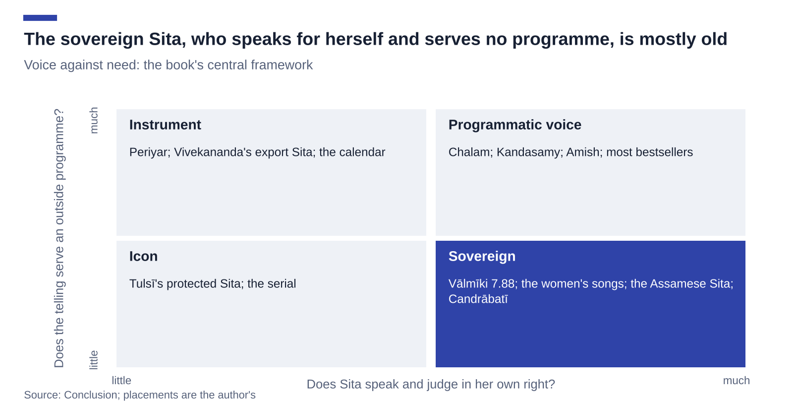
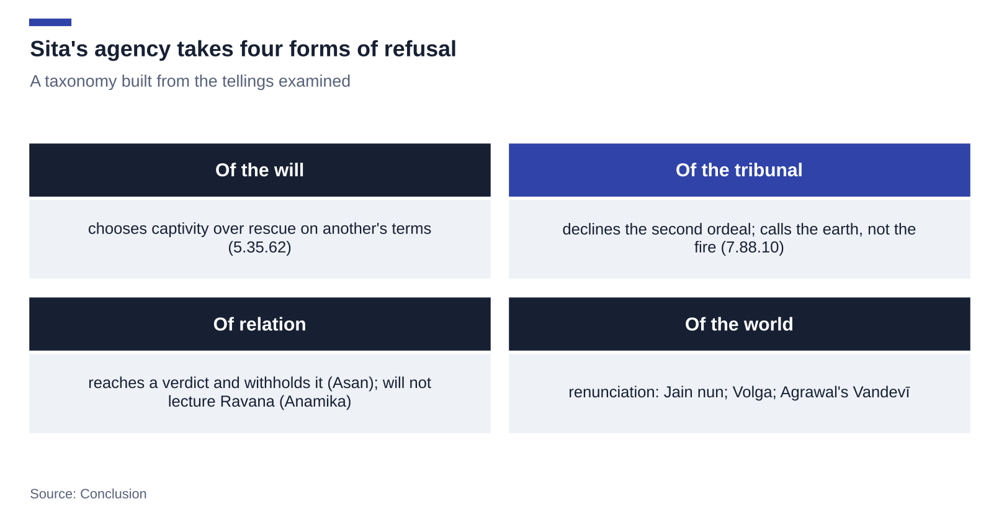
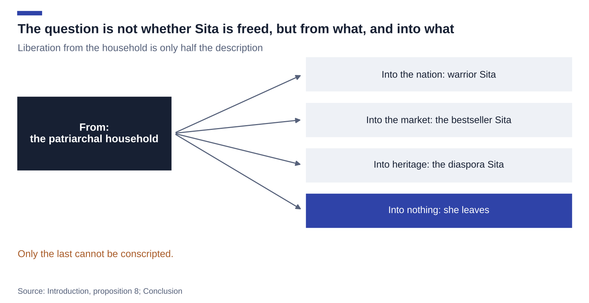

# Conclusion. The Earth Opens: Refusal, Return and the Sovereignty of Sita {.unnumbered}

::: {custom-style="Epigraph"}
*tasmiṃs tu dharaṇī devī bāhubhyāṃ gṛhya maithilīm*\
*svāgatenābhinandyainām āsane copaveṣayat*

"And there the goddess Earth took Maithilī in her arms, greeted her with a welcome, and seated her on the throne."

— Vālmīki *Rāmāyaṇa* 7.88.13 (CE)
:::

## The question, again

This book began with a question set at the very start of the research from which it grew: is Sita's literary afterlife fundamentally a history of women's changing possibilities of speech, or is it also a history of the changing political needs of the societies that keep rewriting her?^[Research plan, §8.] It is time to say what the evidence has shown.

The answer, in a sentence, is that the second history has repeatedly passed itself off as the first. Again and again, across a century and a half and a dozen languages, a Sita has been given a new voice, and the voice has turned out to speak the sentences that its moment needed spoken: the reformer's sentiment, the nationalist's purity, the rationalist's indictment, the Marxist's analysis, the liberal feminist's self-assertion, the market's empowerment, the diaspora's heritage, the nation's martial pride. The history of Sita's speech is real. But it has been, for most of its course, a history of ventriloquism, and the ventriloquists have changed more than the voice.

And yet there is a constant, and it is not voice. It is refusal. From Vālmīki's seventh book, where Sita in ochre declines the second ordeal and the earth takes her side, through the Assamese Sita who names Rama death, the Avadh song in which she will never see his face again, Kumaran Asan's riverbank verdict, Pudumaippittan's Ahalya who returns to stone, Volga's education in withdrawal, Arni's missing queen and Kandasamy's vanishing act, to Agrawal's renunciant and Anamika's Sita who will not even lecture her captor, the most powerful Sitas are those who refuse. Their agency is exercised, most often, as withdrawal: from a tribunal, a marriage, a city, a world that will not stop judging them. And the refusal belongs to no single politics. Devout women and Dalit poets, conservative novelists and Marxist critics, nationalist film audiences and diaspora novelists have all found it in the story, because it was always there.

## The eight propositions reconsidered

The Introduction set out eight propositions. Let me take them in turn and say how each has fared.

**1. Voice is not new.** This proposition has survived intact. Chapter 1 showed, verse by verse from the critical edition, that Vālmīki's Sita argues, taunts, accuses, defies, counsels, refuses, rebukes, appeals and withdraws. She calls Rama "a woman in a man's form" (2.27.3); she tells him he speaks "like a common man to a common woman" (6.104.5); she declares that "my heart, which is in my control, abides in you" while her limbs were in another's power (6.104.9); she tells the king who banished her to treat his citizens as brothers (7.47.11). No modern retelling gives Sita a voice she lacked. What modern retellings do is choose among the voices she had.

**2. Silence has a history.** This proposition has survived, with a qualification. The silent Sita owes much to the devotional reorientation of the *Adhyātma Rāmāyaṇa* and Tulsīdās, whose shadow Sita protected her body by erasing her experience and whose *Mānas* omitted the banishment (Chapter 2). But the decisive consolidation was colonial: the reformer's pedagogy of sentiment, the nationalist's inner domain, the oleograph, the stage and the screen (Chapter 3). The qualification is that the colonial century also produced the first modern counter-Sitas, in Odia, Malayalam, Telugu, Tamil and Kannada, contemporaneously with the ideal (Chapters 3–4). Silence and its critique were made together.

**3. The critique of Rama is indigenous.** This proposition has survived, and the evidence for it is the strongest in the book. Vālmīki's own fire god commands the king (6.106.9); Kālidāsa's Sita addresses him as "king", not husband; the Assamese *Uttarakāṇḍa* calls him death incarnate; Candrābatī calls him, in Dev Sen's paraphrase, a "deranged wimp"; Bengali women call him heartless and a sinner; Mithila will not marry its daughters westward; and the devout viewers of 1987 ordered him "to behave better". Madhu Kishwar's informants put it most simply: they will call a man "a Ram-like son, a Ram-like brother, or a Ram-like king", but never "a Ram-like husband".^[Madhu Kishwar, "Yes to Sita, No to Ram! The Continuing Popularity of Sita in India," *Manushi* 98 (January–February 1997): 29.]

**4. Refusal, not voice, is Sita's signature.** This proposition has survived, and it is the book's central claim. But the evidence has added a refinement. Refusal takes at least four forms in the corpus: the refusal of the will (Vālmīki's Sita choosing captivity over rescue on another's terms); the refusal of the tribunal (the second ordeal declined; the earth called instead of the fire); the refusal of relation (Asan's Sita who never delivers her verdict; Anamika's who will not lecture); and the refusal of the world (the renunciant's exit, from the Jain nun of the *Paumacariya* to Volga's education and Agrawal's Vandevī). A theory of Sita's agency must hold all four.

**5. Every modern Sita answers a political need.** This proposition has survived, and it has been strengthened by the cases in which the need was declared. The most honest retellings in the corpus are those that say whose Sita they are writing: Kandasamy's "my Sita", Anamika's Sita modelled on women in war, Arni's journalist who asks about Sita rather than speaking as her. The least honest are those that present the author's programme as Sita's recovered voice. The distinction between a declared and a concealed programme is, I think, the most useful critical tool this book offers.

**6. The feminist canon has its own exclusions.** This proposition has survived, and Chapter 10 gave it its sharpest form: the Rāmāyaṇa distributes three regimes of control over women's bodies, the tested (Sita), the mutilated (Śūrpaṇakhā) and the polluting (Śabarī), and the feminist canon has concentrated on the first, the regime of the upper-caste wife whose ordeal is the price of her privilege. The corpus itself, Sita-heavy and thin on Dalit and Adivasi women's voices, is evidence of the exclusion it describes.

**7. Vernacular women's narratives are intellectual history.** This proposition has survived and has been extended. The women's songs constitute not only a history of feeling but a history of reasoning: about marriage and its dangers (Mithila), about the distribution of reputation (the Telugu Urmila who will not recognise her husband), about the evidentiary status of a woman's word ("Do you accept my truth, my lord?"), about solidarity (Sita's exile "distributed amongst us all"). The Kannada song's demand that a woman's word be admitted as evidence is, I have argued, a jurisprudential claim that anticipates modern law.

**8. The question is not whether Sita is liberated, but from what, and into what.** This proposition has survived, and the chapters on the market and the screen gave it its clearest illustration. A Sita liberated from the patriarchal household into the nation's service (Amish), into a heritage brand (the diaspora), or into a box-office spectacle has changed masters. The Sitas who are liberated into nothing, who simply leave, are the ones whom no programme can conscript.

## What the decolonial reading has shown

I promised in the Introduction to say what the decolonial vocabulary of this book was for, and what it did not license. Let me now say what it has done.

It has shown that the figure at the centre of the liberation narrative, the silent and submissive "traditional Sita", is in large part a colonial-modern construction: assembled under a tribunal that made the status of women the index of civilisation, by reformers and nationalists who accepted the tribunal's jurisdiction while contesting its verdict. A feminism that sets out to liberate that Sita accepts the colonial description of the tradition. That is coloniality at work in the reading of a myth.

It has shown, equally, that the resources for criticising Rama's treatment of Sita are native: in Vālmīki's own text, in the regional and sectarian tellings, and above all in the women's songs. Anamika's word for a feminism built from such resources, *deśaj*, born of the soil, is the right word. The liberation of Sita does not require an import.

And it has shown the limit of the decolonial argument, which is the limit that Sharmila Rege's question imposes. The native resources are not evenly distributed. The *Uttarakāṇḍa* that gives Sita her greatest refusal gives Śambūka no chance to finish a sentence. A decolonial reading that defended the tradition against its feminist critics while ignoring its caste violence would not be decolonial; it would be a new nationalism. And a nationalist reading that measured Sita by her service to the nation, as the warrior Sita of the popular novel and the spectacle is measured, would not have escaped coloniality; it would have substituted one external programme for another. Decolonisation, in the reading of Sita, means letting her be measured by her own tradition's standards, and those standards include the right to refuse every jurisdiction that claims her, including the nation's.

## What the image, the law and the return to the poem have shown

Parts V to VII were added to the original design of the research, and they have done more than extend its range. They have tested its central claim from three new directions: through media other than the written word, through the language of law and through a return to the poem itself. Let me say what each has shown.

### The image and the stage

The painted and performed Sitas of Chapters 16, 17 and 21 confirmed the argument about need in a medium where it might have been expected to fail. A painting cannot argue; it can only choose a moment. And the moments chosen have been, overwhelmingly, the moments that served the patron: the wedding and the war for the Mewar court, the intimacy of exile for the Pahari patron who had himself painted beside the divine couple, the abduction for the oleograph press, the threshold for the moral pedagogy of the bazaar print, and, for the political poster, no Sita at all.^[See Chapters 16 and 17.] The choice of moment is the painter's argument. The stage, likewise, answers the question of Sita's body before it says a word: a Brahmin boy at Rāmnagar, a man in Kathakali, a hereditary woman in Kūṭiyāṭṭam, a respectable woman at Kalakshetra, an actress who is then judged by the role.^[See Chapter 21.] Each answer is a theory of who may represent purity.

But the image and the stage also found refusal where the argument predicted it. The Mughal painter of about 1600 showed Sita standing upright and composed within the flames, alone, with no Rama in the frame; the descent attributed to Raja Ravi Varma, staged as a court tragedy, shows the enthroned king half rising in dismay as the queen leaves his court in the Earth's arms; the modern dancer enacts the last scene as a choice, by the direction and pace of a single gesture.^[See Chapters 16, 17 and 21.] A Sita who cannot speak can still refuse, and the visual traditions have found ways to show it.

### The law

Chapter 18 read the epic's two great judgements as legal records and found that they fail the tests of law: the ordeal by the *dharmaśāstra*'s own rule that divine proof is a last resort, and the banishment by every principle of natural justice. Chapter 25 added that the king's council was silenced as well as the accused: Rama laid the evidence of Sita's innocence before his brothers and then forbade them, on oath, to argue. Chapter 22 showed that, at the final scene, every form of evidence had been supplied, her sons' faces, the poet's testimony staked on his austerities and the king's own admission, and that the oath was demanded anyway, "for her purification, and for mine".^[CE 7.86.6; see Chapters 18, 22 and 25.]

The legal reading confirmed the argument of Chapter 1 in the most exact terms available: the trial of Sita was never a search for truth. It was a procedure for managing reputation. And it showed, too, that modern Indian law, in its slow movement from the premise of the ordeal to the premise of the women's song, "Do you accept my truth, my lord?", has learned from Sita's case without ever hearing it.

### The world beyond

Chapters 19 and 20 crossed the sea. On the other side of the war, in Laṅkā, the critical edition gave voice to women whom the modern retellings have only recently discovered: Mandodarī, who judged her husband's desire as the cause of his death; Trijaṭā, who protected Sita with a dream; Saramā, who risked her life to tell her the truth.^[See Chapter 19.] And Sita herself, asked to judge the guards who had threatened her, refused to punish them, on the grounds that they had acted under command and that "there is no one who does not err".^[CE 6.101.30, 6.101.36.] Beyond India, in the courts of Southeast Asia and on the indenture plantations, every Sita answered a need, royal, Muslim, devotional or diasporic, as the Sitas at home had done.^[See Chapter 20.]

### The return to the poem

The most unexpected finding of the later chapters is how much of the critical edition the retellings, ancient and modern, have left unused. Sita's speech on the way into the Daṇḍaka forest, against violence without enmity, with its parable of the ascetic corrupted by a sword held in trust, has awaited its novelist for two thousand years; its prophecy is fulfilled in the seventh book when a king takes his sword into the forest and kills an ascetic while he is still speaking.^[See Chapter 28.] Sita's account of her own birth and marriage, told in the first person to the old ascetic Anasūyā "as you experienced it", is the epic's own first-person Sita, and its emphases, the dust-covered foundling, the father humiliated by the need to marry a daughter, are the emphases of the women's songs.^[See Chapter 27.] Her tokens, the crow, the red mark on her cheek, the jewel from her father's court, constitute a theory of proof by intimacy that Rama believed in private and refused in public.^[See Chapter 24.] And at the end of the poem stands the golden Sita, the image that took her place at every sacrifice: the ideal wife in its purest form, faithful because incapable of anything else, provoking no talk.^[See Chapter 24.]

These findings strengthen the first of the Introduction's propositions beyond what Chapter 1 alone could show. Voice is not new; nor is the first person; nor the argument against violence; nor the theory of proof that the ordeal violated; nor even the critique of the ideal as an image that replaces a woman. All of them are in Vālmīki. What the modern liberation narrative claims to have given Sita, the poem had already given her, and the tradition, by its excisions, its shadow devices and its happy endings, had taken away.

### Love, grief and the defence of Rama

Chapter 26 took the strongest defence of Rama seriously, and the book is better for it. The critical edition's Rama loves Sita: he asks the trees and the deer whether they have seen her, weeps over her jewel like a cow for her calf, banishes her with tears in his eyes and keeps her golden image at his side for the rest of his life. A reading that makes him a cold husband is not a reading of Vālmīki. But the poem also records, in Rama's own words, what the abduction wounded: his standing before the gods, who might think him impotent; his lineage, which bore a stain the war was fought to remove; his fame, for which, he told his brothers, all the undertakings of great men are made.^[CE 3.60.38–39, 6.103.15–16, 7.44.12; see Chapter 26.] The love was real, and it was subordinate. Rama ranked his commitments, and the poem shows where Sita stood: below a promise to the sages in the forest, below fame in Ayodhya, in a formula he used twice.^[CE 3.9.18, 7.44.13; see Chapter 28.] The defence from love proves a tragedy for Rama. It cannot prove justice to Sita.

### The grammar and its rule

Finally, Chapter 29 described the grammar of retelling: seven operations by which every Sita in the corpus was made, three elements that the corpus has almost never changed, and one, the ending, that it has never settled. Its conclusion is the conclusion of this book stated as a rule of form. Sita may be given any voice, any setting, any motive, any medium. The retellings that last do not give her a voice that consents to her own condemnation. The grammar permits almost everything. It does not permit a willing Sita.

## The earth

I return, at the end, to the earth.

The last image of Sita in Vālmīki is not of a woman swallowed by the ground. It is of a mother receiving a daughter. "The goddess Earth took Maithilī in her arms, greeted her with a welcome, and seated her on the throne."^[CE 7.88.13.] The throne rises from the earth on the heads of serpents; the Earth takes Sita in her arms; she welcomes her; she seats her. Then the two descend together, and flowers fall, and the gods cry "well done", and the world is bewildered.^[CE 7.88.11–20.]

Sita's last act in Vālmīki is therefore not a death but a homecoming, and the home is not her husband's. She was born of a furrow, found by a king who was ploughing, covered in dust, raised in his palace, given to Rama, carried to Laṅkā, tested by fire, banished to the forest, replaced at the sacrifice by an image of gold, summoned to be tested again. At the end she goes back to where she came from, and the mother who receives her seats her on a throne. The queen whom Ayodhya would not keep is enthroned by the Earth.

The women of Mithila understood this. They say, in Kishwar's report, that Sita is a daughter of every household in their country, because had Janaka not ploughed that field that day, someone of any other caste might have found her.^[Kishwar, "Yes to Sita," 28.] The farmers of Maharashtra, in Sharad Joshi's speeches, understood it too: they were told that they owed "a long overdue debt" to Sita *mātā*, and they paid it in land, in their wives' names.^[Kishwar, "Yes to Sita," 27.] Sita's sovereignty, in this reading, is the sovereignty of the earth itself: not given by any king, not revocable by any city, not dependent on any husband's verdict. She returns to it, and it receives her as its own.

That is the Sita this book has tried to read: neither the silent wife of the calendar nor the liberated heroine of the bestseller, but a woman whose voice was never in question, whose fidelity was her own, whose agency was exercised as refusal, and whose final act was to go home. Every age has rewritten her to serve its needs. She has outlasted every one of them, because at the end of every telling, the earth opens, and she leaves.

## Directions for further work

A book of this kind must end by naming what it has not done, and the research corpus on which it rests makes the list easy to compile.

The Braj women's songs I recorded in Dholpur remain to be transcribed and analysed; they may supply the original evidence for Hypothesis D that this book has drawn from others' fieldwork.^[Corpus workbook, W203.] The two English translations of Candrābatī, by the Boses and by Dev Sen, require a verse-by-verse comparison against the Bengali. The Dalit and Adivasi women's Sita, in Hindi and Marathi poetry and in Adivasi songs of Śabarī, remains thinly archived; Rekha Sethi's study of Hindi women poets and Du. Saraswathi's *Sannathimmi's Ramayana* are leads to follow.^[Corpus workbook, W202, W219.] Gujarati, Kashmiri, Punjabi and Sindhi women's retellings are absent from the corpus. Mallika Sengupta's Bengali *Sitayan* deserves an English translation. And the reception of the 2026 Ramayana film is a subject that will occupy scholarship for a decade.

Above all, the modern novels discussed in Part IV must be read against citable editions, and the pinpoint references marked for verification in this book must be supplied. The argument does not depend on them; its evidence for the central claims comes from Vālmīki's verses and from the women's songs as recorded by Dev Sen and Kishwar, all checked against the sources. But a book that asks every retelling whose sentences it speaks owes its reader the page on which each sentence can be found.

# Afterword. Reviewer #2: Objections and Replies {.unnumbered}

The research plan for this book included, as its last step, a "Reviewer #2 audit": a deliberate attempt to test the argument for theoretical weaknesses, historical inaccuracies, overgeneralisation, unsupported claims and gaps in scholarship.^[Research plan, §7.] I record here the strongest objections I have been able to formulate, and my replies. The reader may judge whether the replies succeed.

**Objection 1. The argument depends on a single text.** The claim that "voice is not new" rests on the Vālmīki *Rāmāyaṇa*. But Vālmīki is one telling among hundreds; most Indians have never read it; the Sita they knew was Tulsī's. To use Vālmīki against the liberation narrative is to privilege the Sanskrit original that Ramanujan taught us not to privilege.

*Reply.* The objection is half right. The argument does not privilege Vālmīki as an origin; Chapter 1 accepts Ramanujan's plurality and Chapter 2 treats the regional tellings as independent. It uses Vālmīki because the liberation narrative itself claims to be answering "the traditional Sita", and Vālmīki is the text most modern retellers believe they are answering. If Tulsī's Sita is the one most Indians knew, that strengthens rather than weakens the argument of Chapters 2 and 3: the silent Sita is a particular tradition's Sita, not the tradition's.

**Objection 2. "Refusal" is a romanticisation of death.** To call Sita's descent into the earth a "refusal" and an exercise of "sovereignty" is to aestheticise a woman's death under unbearable pressure. The real lesson of the story is that a wronged woman had no exit but death, and calling it agency is the move this book criticises in others.

*Reply.* This is the strongest objection, and I do not think it can be fully answered. Chapter 1 acknowledges that the final scene supports both readings. Two points nonetheless stand. First, the text does not present the act as death: it presents a throne rising, a mother's embrace, a welcome and a seating. Second, the women's songs and Kishwar's informants overwhelmingly read it as rejection rather than annihilation. My reading follows theirs. But the objection should be kept in view by every reader of this book: an agency exercised by leaving the world is an agency whose world has failed.

**Objection 3. The decolonial frame is ideologically loaded.** The vocabulary of "coloniality" and "Bharat" is associated in contemporary India with a particular political position, and its use risks enlisting the study of Sita in that politics.

*Reply.* The vocabulary has been used here in a limited and specified sense, and the book has argued repeatedly against the uses the objection fears: against the interpolation defence (Chapter 1), against the nationalist warrior Sita (Chapter 12), against any reading of the tradition that ignores Śambūka (Chapters 1, 5, 10). The decolonial reading, as defined here, criticises the nationalist Sita as severely as the liberal one.

**Objection 4. The modern novels are under-read.** Part IV discusses novels without quoting them, relying on summaries, reviews and the author's corpus notes. Its claims about those novels are therefore secondhand.

*Reply.* The objection is correct, and the book says so in its Note on Evidence and in every relevant footnote. The claims made about the novels concern structure, narrator, plot and ending, which summaries and reviews can establish, rather than texture, which they cannot. The arguments about the Sitayan moment (Chapter 11) and the warrior Sita (Chapter 12) are arguments about the genre, and would survive correction of particular readings. But a revised edition must read every novel in a citable edition.

**Objection 5. The corpus is the author's construction.** The book's claims about the shape of the field (which languages, periods and characters dominate) are drawn from a workbook the author built. Its skew, towards Sita, towards English, towards the post-1990 period, may reflect the author's search rather than the field.

*Reply.* Yes; and the book treats the skew as a finding about the archive through which the field is constituted (Chapter 10). The workbook's method, recorded in its Sources and Method tab, is transparent and reproducible, and its gaps are listed. The workbook makes no claim to represent all Sita retellings ever written. They represent what a deliberate, multilingual search of the available archive could find, and that is itself evidence.

**Objection 6. Choral agency is a convenient category.** The notion of "choral agency", by which the women's songs' critique of Rama is attributed to the community of singers rather than to Sita, allows the author to find agency wherever she wishes, and makes the thesis unfalsifiable.

*Reply.* The category is falsifiable: it would fail if the songs contained no critique of Rama in any voice, which Dev Sen's own evidence shows is not the case. What the category resists is the assumption that agency must be located in a single speaking subject. That assumption is itself a cultural one, and the songs give reason to question it.

**Objection 7. The book is too kind to Kishwar.** Madhu Kishwar's later political trajectory, and her essay's own sympathy for the Sita ideal, should make her a suspect witness.

*Reply.* The book uses Kishwar's 1997 essay as evidence of what her informants said and of what she observed, not as an authority on what Sita means. Her reports of the Lakshmi Mukti campaign and the viewers' letters to Sagar are reports of events, and they are the kind of evidence a historian must use. Where her conclusions go beyond her evidence, as in the comparison of Hinduism with "religions where god's commandments are to be unconditionally obeyed", the book records them without endorsing them.

**Objection 8. The book has the same exclusion it criticises.** A book that criticises the feminist canon for concentrating on Sita has itself concentrated on Sita.

*Reply.* Guilty. The book's subject was set as "Sita in the modern Indian literary imagination", and it has tried, within that subject, to keep Śūrpaṇakhā, Śabarī, Mantharā and Śambūka in view. But the proportions of the book reproduce the proportions of the corpus, and the corpus reproduces the archive. The next book should begin with Śabarī.

**Objection 9. The later chapters abandon the book's subject.** A book announced as a study of "the modern Indian literary imagination" devotes much of its last three parts to paintings, law, theology and, above all, to the Sanskrit text of Vālmīki. Its subject has drifted from the modern retellings to the ancient poem.

*Reply.* The drift is deliberate, and the Introduction now says so. The modern retellings make a claim about the poem: that it silenced Sita and that they restore her voice. A study of the retellings must therefore test that claim against the poem, and the more closely the poem was read, the more it was found to contain what the retellings claim to have added: a first-person Sita (2.110), an argument against violence (3.8), a theory of proof by intimacy (5.36–38), a critique of the ideal as an image that replaces a woman (7.89.4). The return to the poem is not a departure from the subject. It is the evidence on which any judgement of the modern retellings depends. What the objection rightly notices is that the book's judgement of the moderns has, as a result, become sterner than its original design anticipated.

**Objection 10. The critical edition is a modern construct.** The Baroda critical edition is a twentieth-century philological reconstruction that no premodern reader knew. To read Sita's "first person" in 2.110 or her speech against the sword in 3.8 as evidence of what "the tradition" contained is to read an artefact of modern scholarship back into history.

*Reply.* The objection is correct about the edition and mistaken about its use here. The passages on which the later chapters rest (Sita's account of her life to Anasūyā, her speech in the Daṇḍaka, the crow and the crest-jewel, the oath that forbade Rama's brothers to argue, the golden Sita) are not reconstructions of rare readings; they belong to the common stock of the manuscript tradition, which is why the critical edition retains them. Where the vulgate adds a famous verse that the critical edition omits, as with Lakshmaṇa's anklets, Chapter 24 says so and draws the consequence. The critical edition is used because it is the most widely cited scholarly text and because its numbering lets the reader check every claim. It is not used to claim that a particular premodern reader read exactly these words.

**Objection 11. Reading the epic as a legal record is anachronistic.** Natural justice, superior orders, evidentiary presumptions: the vocabulary of Chapters 18, 19 and 25 belongs to modern law, and its application to an ancient poem is a category error.

*Reply.* Chapter 18 applied two standards, not one: the *dharmaśāstra*'s own rules of proof, which are not modern, and the principles of natural justice, which are. The first test the epic fails by the standards of its own world. The second is applied openly, as a modern reader's question, and the chapter does not pretend that Vālmīki's audience asked it. But the later chapters found that the poem anticipates the modern questions more often than the objection allows: Sita's speech of mercy reasons about command and responsibility (6.101.30); Lakshmaṇa declares her faultless while executing the order (7.46.13); Manu tells Ikṣvāku not to use the rod without cause (7.70.8). The vocabulary is modern. The questions are the poem's.

**Objection 12. The defence of Rama is too easily dismissed.** Chapter 26 concedes Rama's love and then denies that it matters. A reading that grants the evidence and refuses its conclusion is not engaging with the defence.

*Reply.* The chapter does not deny that Rama's love matters; it denies that it settles the question of justice. Those are different claims, and the poem itself distinguishes them: it gives Rama's tears and Rama's reasons in the same speeches, and the reasons are about fame and lineage (6.103.15–16; 7.44.11–13). A defence of Rama that rested on his reasons would have to defend the precedent theory of kingship, and Chapter 18 examined that theory with respect. A defence that rests on his tears proves that he suffered. The book accepts that he suffered. It does not accept that his suffering is the measure of what was done to her.

**Objection 13. The painting chapters rely on attributions and reproductions.** Several of the paintings discussed are "attributed to" an artist or dated approximately, and all were seen in digital reproductions rather than in the original.

*Reply.* Correct, and the captions and the List of Illustrations say so. The arguments of Chapters 16 and 17 concern composition (which moment is chosen, who is placed where, who is omitted), and composition survives reproduction. They do not concern pigment, condition or attribution, on which the book defers to the museums and scholars cited. Where an attribution is uncertain, the argument does not depend on it.
